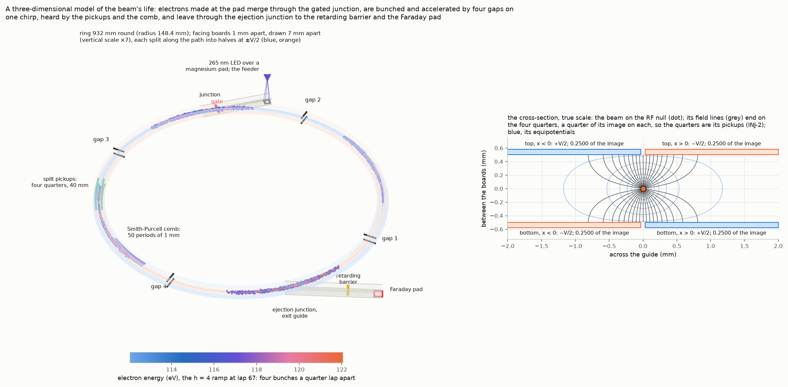
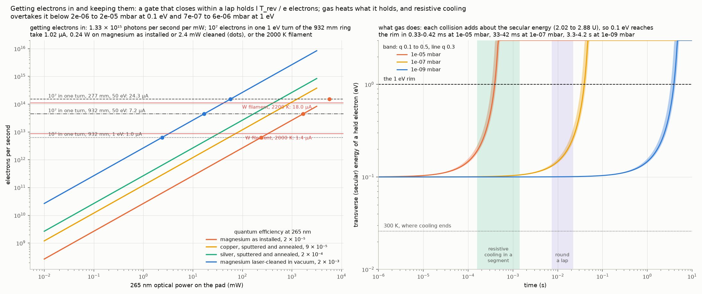
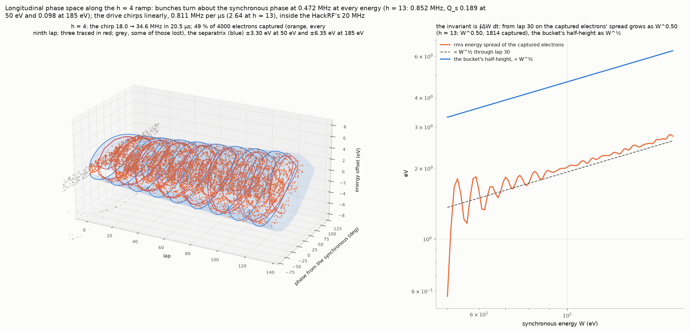
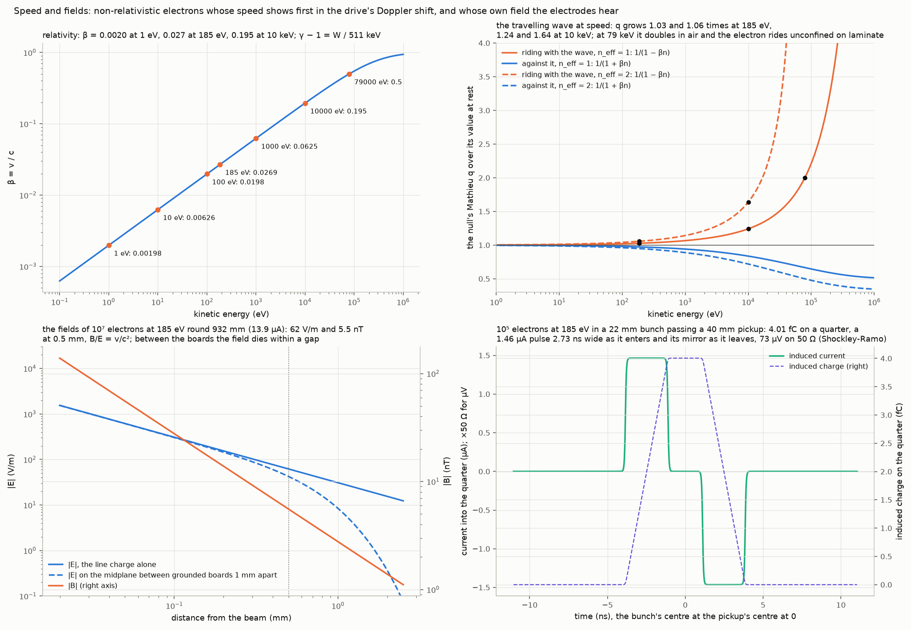
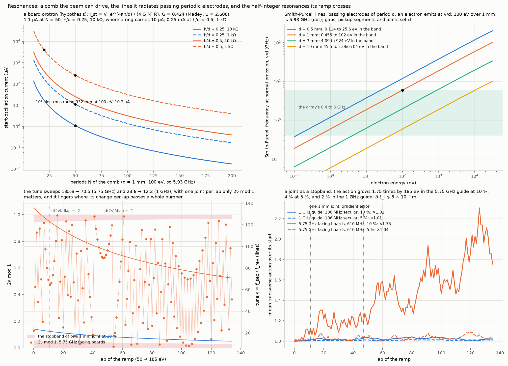
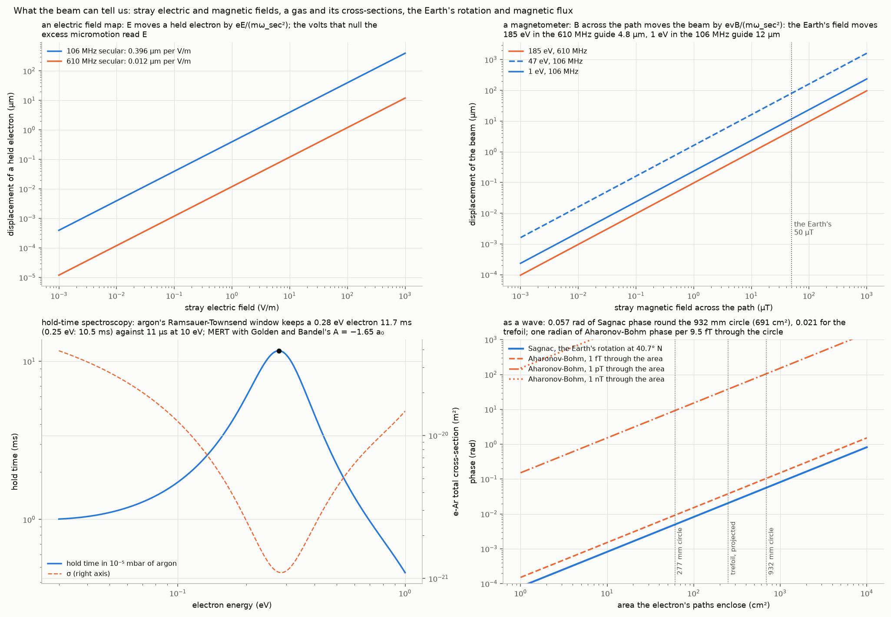

<!-- 2026-11-21. The owner's questions on the life of a beam in array16's guides, from a theory memo on getting
electrons in, accelerating them, the fields they make, their resonances, getting them out and what they measure, and
its adversarial verification. Confirmed and corrected claims stand as results, in corrected form; uncertain ones are
hypotheses or open questions; refuted statements are left out. Every number comes from a verified claim, from the
ledger (docs/LAWS.md), from experiments/accelerator_study.md or docs/VIRTUAL_ANTENNA.md, or from a check made for this
document, marked "checked". The figures are drawn by
experiments/beam_lifecycle_study.py into experiments/beam_lifecycle/, whose run.log and results.json hold their
numbers. -->

# The beam's life: in, round and out

## 1. The question

The owner, on 2026-11-21:

> how do we, in theory, deposit electrons into the accelerator? and what is the physics that happens as the
> electron(s) accelerate? and type of fields are they inducing? can you also state generating 3d diagrams/models to
> better visualize? and are they traveling at relativistic speeds? since they radiate, is there some resonance at some
> speed and size that it can produce wilder effects? and what does it mean to eject them and/or use an electron sensor
> in addition to the setup? what can we learn about the world?

The guides are board electrodes at 0.4 to 6 GHz, two facing boards split into halves (ELE-2) or one board's rails
(ELE-1, ELE-3), holding electrons of electron-volts to kilo-electron-volts at about 10⁻⁵ mbar. The acceleration model is
the four-gap ring of `experiments/accelerator_study.md`: a 932 mm loop, four 0.5 V gaps on one chirp, 50 to 185 eV in
135 laps. The guide runs as a travelling-wave ring (`docs/VIRTUAL_ANTENNA.md` section 7.2); knots across several boards
follow `docs/KNOTTED_GUIDE.md`, and `docs/CAVITY_KNOTS.md` moves the well into a cavity.

## 2. Short answers

- **Getting electrons in.** A closed guide that keeps phase-space volume captures only a set of zero volume from outside
  (Proposition); capture takes electrons made inside, a guide that changes while they arrive, or cooling. On the board a
  265 nm LED on a magnesium pad photoemits 4.3 nA per milliwatt, a feeder merges at a junction, and a gate closes within
  a lap: 10⁷ electrons in one 1 eV turn of the 932 mm ring take 1.0 µA, 0.24 W of UV or a 2000 K filament.
- **As they accelerate,** a bunch oscillates about the synchronous phase at 0.852 MHz at every energy, the drive chirps
  linearly (2.63 MHz per µs), the spread grows as W^½, bends ask a deeper guide (4.2 eV for 185 eV round 43.8 mm), gas
  heats held electrons, and joints between boards act as stopbands.
- **Their fields:** 62 V/m and 5.5 nT at 0.5 mm from 10⁷ electrons; image currents on the electrodes; a resonance shift
  N⟨U⟩/W, 89 kHz for 1.5 × 10⁷ electrons; 1.1 × 10⁻²⁴ W of radiation each; Smith-Purcell emission at v/d.
- **Relativistic?** No: β = 0.0020 at 1 eV, 0.027 at 185 eV, 0.195 at 10 keV. Speed shows first as the drive's Doppler
  shift, raising the Mathieu q of an electron riding the travelling wave by 3 to 6 % at 185 eV and 24 to 64 % at 10 keV.
- **Wilder effects:** a beam can drive a comb resonator, a board orotron starting at 1.1 µA where a ring carries 10 µA
  (Hypothesis); the bunched beam drives the ring's own 322 MHz mode at 60.5 and 168 eV; joints, plasma and ions add
  lines.
- **Ejecting and sensing:** the gate, the junction or the guide's volts send electrons to a Faraday pad (500 or more per
  dump), a retarding barrier (their energies) or an MCP (single electrons); left in place, the electrodes read number,
  energy, spread and secular frequency.
- **What we learn:** stray electric and magnetic fields, surface field noise at 0.1 to 1 GHz, vacuum and cross-sections,
  and as a wave the Earth's rotation (0.057 rad round 932 mm) and magnetic flux (1 rad per 9.5 fT).
- **3-D models: yes.** Figures 1 and 3 are three-dimensional, and `docs/CAVITY_KNOTS.md` adds a cavity's null curves;
  matplotlib draws them from the particle core, PyVista gives interactive views, and STL exports give printed models.

**Figure 1.** A three-dimensional model of the 932 mm ring (radius 148.4 mm) on two facing boards 1 mm apart, drawn 7 mm
apart (vertical scale ×7), each board split along the path into halves at ±V/2 (blue, orange). Electrons made at the
magnesium pad under the 265 nm LED run down the feeder and merge at the junction, whose gate (red) closes within a lap;
four gaps on one chirp (black) bunch and accelerate them. The four bunches of the h = 4 ramp are drawn at lap 67, 117 eV
synchronous, each electron coloured by its energy, a bunch filling its bucket over most of the 233 mm between buckets.
The split pickups (green, the four quarters of a 40 mm segment) and the Smith-Purcell comb (50 periods of 1 mm on the
top board) hear them, and the ejection junction sends them down the exit guide past the retarding barrier (yellow) to
the Faraday pad. Right, at true scale: the cross-section, where the beam's own field lines (grey) end on the four
quarter electrodes, 0.2500 of its image on each (INJ-2), with its equipotentials (blue).
`experiments/beam_lifecycle_study.py` draws this figure and the others here; its `run.log` and `results.json` in
`experiments/beam_lifecycle/` hold their numbers.

## 3. Getting electrons in

### 3.1 The rule

**Proposition (no capture in a closed conservative guide).** Let one drive period be an invertible map T keeping
phase-space volume μ (Liouville; incommensurate drives join as phases on a torus), K a region of finite volume and K∞
the states that stay in K for ever. Then T(K∞) ⊆ K∞ and μ(TK∞) = μ(K∞) < ∞, so K∞∖TK∞, the states that just entered
from outside, has volume zero, as does its union over steps: almost every electron entering a closed conservative guide
leaves again. Capture takes a source inside K (ionisation), a map that changes in time (a gate, a switched junction, a
guide ramped as electrons arrive) or one that contracts volume (cooling). The gate's deadline is one lap: 66 ns at 50 eV
on the 277 mm ring, 1.57 µs at 1 eV on the 932 mm ring.

### 3.2 Sources on the board

**Claim (photoemission).** A 265 nm LED (4.68 eV) gives 1.33 × 10¹⁵ photons per second per milliwatt. Magnesium as
installed has a quantum efficiency of 2 × 10⁻⁵, 4.3 nA per milliwatt, and 2 × 10⁻³ laser-cleaned in vacuum
(Srinivasan-Rao et al.); copper and silver, sputtered and annealed, 9 × 10⁻⁵ and 2 × 10⁻⁴ (Rasheed et al., with a 265 nm
LED); aluminium, its work function of 4.06 to 4.26 eV between magnesium's 3.66 eV and copper's 4.53 to 5.10 eV, lies
between them (Le Pimpec et al.). Cleaning in vacuum takes tools beside the array, so the board's figure is the
as-installed one. Electrons leave with up to 1.0 eV from magnesium and 0.4 eV from silver, matched to a 1 eV well.
Contamination lowers gold's effective threshold to 4.1 to 4.3 eV (Wass et al.), so ENIG pads under the lamp emit weakly
too.

**Claim (filament and field emission).** A tungsten filament 25 µm by 2 mm bonded across two pads gives, by the
Richardson-Dushman law (60 A/cm²K², work function 4.54 eV), 1.4 µA at 2000 K and 18 µA at 2200 K, radiating 43 and 63
mW at an emissivity of 0.3, with 0.17 to 0.19 eV of spread (checked). Field emission of 10² to 10⁸ A/m² takes 2.2 to 4.0
GV/m at a tip (Murphy and Good). That also limits the drive, whose
full V stands across the split between board halves: 3.5 MV/m for 354 V over 0.1 mm, 130 MV/m for a keV guide's 13.2 kV,
so at etched edges (enhancement 100 to 1000) field emission and flashover set the highest drive.

**Claim (made inside).** A 1 µA, 100 eV primary crossing 0.5 mm of guide at 10⁻⁵ mbar makes 1.9 × 10⁷ ion pairs per
second (N₂, 2.5 × 10⁻²⁰ m²; Song et al.). The LED ionises Cs, Rb and K (3.894, 4.177 and 4.341 eV; NIST) and no
residual gas; Rb's ground-state cross-section near 254 nm, 1 (+4.3/−1) × 10⁻²⁴ m² (Witkowski et al.), gives 0 to
4.5 × 10⁴ electrons per second per milliwatt through 0.5 mm of room-temperature vapour, 4 to 6 × 10³ by theory, from a
dispenser heated on the board. Matthiesen et al. loaded their trap from inside, ionising calcium. **Hypothesis (slow
secondaries).** N₂'s secondary spectrum is flat at low energy and falls faster than E⁻² above about 10 eV (Opal,
Peterson and Beaty). On the fit usually attributed to it, 1/(1 + (E/Ē)^2.1) with Ē = 13 eV for N₂ (the scale the
paper's tables fix), cut at (E_p − 15.6 eV)/2 for a 100 eV primary, a 1 eV well catches 6 % of impact secondaries and a
4 eV well 24 % (checked for that form; 5 % and 20 % without the cut).

### 3.3 Capture by switching

**Claim.** A ring filled through a gate that closes within one lap holds I·T_rev/e electrons (checked):

| Ring and energy | T_rev | 10⁷ electrons in a turn take | As 265 nm light on magnesium |
| --- | --- | --- | --- |
| 277 mm, 50 eV | 66 ns | 24 µA | 5.7 W as installed, 57 mW cleaned |
| 932 mm, 50 eV | 222 ns | 7.2 µA | 1.7 W as installed, 17 mW cleaned |
| 932 mm, 1 eV | 1.57 µs | 1.0 µA | 0.24 W as installed, 2.4 mW cleaned; the 2000 K filament gives 1.3 × 10⁷ |

The gate is a DC barrier a few volts above the injection energy, switched in nanoseconds by the controller, at
logic-level volts for injection at 1 to 5 eV. Chip junctions split guided electrons up to 3 eV (Hammer et al.) and
200 eV (Zimmermann et al., two-sided), turning a single well into a double well; run backward one merges a feeder into
the ring. By section 3.1 a static merger also lets the ring's electrons out, so the feeder's well is removed once the
bunch has passed. Stacking more turns into the same phase space takes cooling.

### 3.4 Cooling, and what gas does

**Proposition (the facing boards' pickup).** For facing boards 2h apart, split into halves, each quarter carries exactly
a quarter of a centred charge's image (the four weighting potentials are equal at the centre and sum to one), and the
right halves against the left have weighting field 1/(2h) at the null (`φ = ½ + (1/π)·Re gd(πz/2h)`): an effective
distance D = 2h, 1 mm at h = 0.5 mm.

**Claim (resistive cooling).** A pickup of resistance R at the secular frequency damps a held electron's secular energy
at γ = e²R/(mD²) (Wineland and Dehmelt). A board tank at 106 MHz (1 to 3 pF, Q 50 to 150) is 25 to 225 kΩ, so τ = 0.16
to 1.4 ms at D = 1 mm inside its 20 to 60 mm of guide, and round a lap τ = mD²ωC′L/(e²Q), 7.3 to 22 ms on the 932 mm
ring. It cools toward 300 K, heating at γkT (7.3 eV/s at 10 kΩ), which feedback through a board amplifier lowers
(D'Urso et al.); one pickup cools one transverse direction. A pickup uniform over a cloud couples only to its centre of
mass, which in a linear force obeys the one-particle equation exactly (the generalised Kohn theorem; Brey et al.), so
internal energy leaves only through anharmonicity or gas. Catching an electron that crosses a well takes a τ under its
passage, one secular period, 10⁴ times shorter than these; the switching of section 3.3 catches it.

**Proposition (collisions heat).** A speed-preserving isotropic collision with an infinitely heavy scatterer at a random
drive phase adds on average 2U to an electron's secular energy, U the pseudo-potential there (first order in q): with
v = v_sec + v_m, `⟨|v_new − v_m|²⟩ = |v|² + |v_m|²`, and the drive-phase average gives m⟨v_m²⟩ = 2U. Gas molecules
all outweigh an electron, so gas heats a held electron (Major and Dehmelt's heavy buffer gas).

**Claim (hold time against pressure).** In exact Mathieu motion (Floquet solutions, both transverse directions held, the
motion along the guide free) a collision that redirects the velocity isotropically adds on average 2.02, 2.25 and 2.88 U
at q = 0.1, 0.3 and 0.5 to an electron at rest along the guide, U being half the secular energy (checked). The
transverse energy then e-folds every 1.1 to 1.4 collision times, from 0.1 eV to a 1 eV rim in 0.33 to 0.42 ms at 10⁻⁵
mbar and 33 to 42 ms at 10⁻⁷ mbar; repeated collisions pass 15 to 18 % of the energy to the motion along the guide,
which stretches each e-fold to 1.2 to 1.7 collision times (checked). Resistive cooling overtakes the heating below 2 ×
10⁻⁶ to 2 × 10⁻⁵ mbar at 0.1 eV and 7 × 10⁻⁷ to 6 × 10⁻⁶ mbar at 1 eV. Matthiesen et al. held electrons for tens of
milliseconds in ultra-high vacuum, some for a second.

**Figure 2.** Getting electrons in and keeping them. Left: electrons per second against 265 nm power (1.33 × 10¹⁵
photons per second per milliwatt) for each pad's quantum efficiency, against the one-turn fills of section 3.3 (10⁷
electrons in one lap: 24.3 µA on the 277 mm ring at 50 eV, 7.2 µA on the 932 mm ring at 50 eV, 1.02 µA at 1 eV) and the
tungsten filament (1.4 µA at 2000 K, 18 µA at 2200 K). The dots mark what the fills take: 0.24 W of light on magnesium
as installed and 2.4 mW laser-cleaned for the 1 eV turn, 1.7 W and 17 mW at 50 eV. Right: a held electron's transverse
energy against time under collisions with residual gas (σ = 10⁻¹⁹ m²), each adding 2.02 to 2.88 times the
pseudo-potential on average (band: q from 0.1 to 0.5; line: q = 0.3): from 0.1 eV to the 1 eV rim in 0.33 to 0.42 ms at
10⁻⁵ mbar, 33 to 42 ms at 10⁻⁷ and 3.3 to 4.2 s at 10⁻⁹. Shaded, resistive cooling's time constants: 0.16 to 1.4 ms in a
segment of 25 to 225 kΩ, 7.3 to 22 ms round a lap. Cooling overtakes the heating below 2 × 10⁻⁶ to 2 × 10⁻⁵ mbar at 0.1
eV and 7 × 10⁻⁷ to 6 × 10⁻⁶ mbar at 1 eV.

## 4. Acceleration

The four-gap model: L = 932 mm, harmonic h = 13, four 0.5 V gaps, synchronous phase φs = 30°, 1 eV per lap,
58.5 → 112.5 MHz in 20.5 µs over 135 laps, 45 % captured at 1.6 eV rms.

**Proposition (phase stability).** For a non-relativistic beam crossing n_g gaps of peak volts V per lap the lap map is
Hamiltonian, `H = −(πh/2W)·ΔW² + n_g·eV·(cos φ + φ·sin φs)`, late electrons gaining more; below transition
(η = −1/γ² ≈ −1) φs between 0 and π/2 is stable (McMillan). The tune `Q_s = √(h·n_g·eV·cos φs/(4πW))` is 0.189 at 50 eV
and 0.098 at 185 eV, and in hertz `(1/L)·√(h·n_g·eV·cos φs/(2πm))` = 0.852 MHz at every energy. The bucket's half-height
is ±1.83 eV at 50 eV and ±3.52 eV at 185 eV, over −39° to 150°. Tracked, the captured electrons' first periods run 5.7
to 6.7 laps (quartiles) against 5.3, lengthened by amplitude and by the energy the ramp adds meanwhile (checked).

**Proposition (the chirp).** Constant gain ΔW per lap of length L gives dv/dt = ΔW/(mL), so the drive at harmonic h
chirps linearly at h·ΔW·e/(mL²) = 2.63 MHz per µs (model: 2.635), and (3/2)β² off linear relativistically. The ramp
moves f_rev from 4.50 to 8.65 MHz, so inside the HackRF's 20 MHz h ≤ 4: 18.0 → 34.6 MHz with the gaps in phase, which
captures 49 % and reaches 185 eV in 20.5 µs at 2.7 eV rms. Each gap's 0.5 V across 50 Ω is +4.0 dBm. The guide's carrier
and the gaps' chirp are two drives: one HackRF channel carries one, rev B's LMX2572 the other (12.5 MHz to 6.4 GHz, with
an automatic linear ramp).

**Claim (what is conserved).** Longitudinally the invariant is ∮ΔW dt, not ∮ΔW dφ, since (φ, ΔE/ω_rev) is the
canonical pair: a bunch keeps its phase extent and its length in metres while its spread grows as W^½ with the bucket
(tracked from lap 30 on, the 1,814 captured electrons' spread grows as W^0.50; from 58 to 175 eV, the first laps'
filamentation included, 1.65 times against √(175/58) = 1.74). Transversely the action ε⊥/ω_sec holds:
a guided beam keeps its size where a free one would shrink in angle. Phase-space density and charge, less losses, are
conserved; energy is not.

**Claim (deepening the guide).** Holding W round a bend R_b takes a depth of about 2W·r₀/R_b; tracking held 38 to 77 %
of the estimate. The 932 mm trefoil's tightest bend is 43.8 mm, so 185 eV at r₀ = 0.5 mm takes 4.2 eV:

| Electrodes, q = 0.3 | Volts | Frequency | Through 10 kΩ | Through 1 kΩ |
| --- | --- | --- | --- | --- |
| four rods | 113 V | 3.66 GHz | 0.63 W | 6.3 W |
| facing boards | 354 V | 5.75 GHz | 6.3 W | 63 W |

At fixed q the volts rise as W and the frequency as W^½. A circle of the same 932 mm holds 3.4 times the trefoil's
energy (CUR-3; `docs/KNOTTED_GUIDE.md` section 6.1), and wells this deep on bare copper meet that document's multipactor
hypothesis (section 5.5). The ramp's 126 m of path against a 40 m free path at 10⁻⁵ mbar and 293 K (σ = 10⁻¹⁹ m², the
repo's estimate) leaves 4.5 % unscattered, 73 % at 10⁻⁶ mbar and 97 % at 10⁻⁷ (checked); a beam above its well is lost
at the first deflection beyond √(D/W), 0.15 rad here.

**Figure 3.** Longitudinal phase space along the h = 4 ramp in three dimensions: lap, phase from the synchronous phase,
and energy offset. The separatrix (blue surface, a ring every 15 laps) widens from ±3.30 eV at 50 eV to ±6.35 eV at 185
eV, as W^½. Of 4,000 electrons of a continuous 50 eV beam 49 % are captured (orange, every ninth lap; three traced in
red turn about the synchronous phase at 0.472 MHz, the same at every energy), and the rest fall behind (grey). The chirp
runs from 18.0 to 34.6 MHz in 20.5 µs, linearly at 0.811 MHz per µs. Right: after the first 30 laps, in which the
captured beam filaments, its rms energy spread grows as W^0.50 (W^0.50 too at h = 13, for its 1,814 captured electrons),
and the bucket's half-height as W^½.

## 5. The fields they make

**Proposition (Coulomb and magnetic fields).** 10⁷ electrons at 185 eV round 932 mm are 13.9 µA, making 62 V/m and
5.5 nT at 0.5 mm, B/E = v/c². A guide D eV deep at its space-charge limit holds N′ = 4πε₀D/e² = 6.9 × 10⁸ electrons per
metre per eV and carries I = 4πε₀·D·v, 0.66 mA per eV of depth at 100 eV, with f_p = q·f/2 (RFG-4).

**Claim (image currents).** A charge q moving at v induces i = q·v·E_w on an electrode of weighting field E_w (Shockley;
Ramo), so the electrodes are the beam's antenna. 10⁵ electrons at 185 eV in a 22 mm bunch put 4 fC on a facing-board
quarter, a 1.5 µA pulse of 2.7 ns, 73 µV on 50 Ω; 10⁵ to 10⁷ circulating electrons give −98 to −58 dBm on a 50 Ω pickup.

**Proposition (the guide weighs its cloud).** To first order N electrons at pseudo-potentials Uᵢ in a resonator storing
W raise its resonance by δω/ω = N⟨U⟩/W (Slater's perturbation with the cold electrons' permittivity). 1.5 × 10⁷
electrons at ⟨U⟩ = 0.04 eV in the 277 mm ring at 13 V (1.17 nJ) shift it 8.2 × 10⁻⁵, 89 kHz at 1.08 GHz: 1.4° of
transmission phase at Q 150, about 4Q_L·δω/ω in reflection when overcoupled. The beam's own 2IR on a gap is 1.4 mV
across 50 Ω and 277 mV across a 10 kΩ resonant gap, which the beam then loads.

**Claim (radiation).** 185 eV on a 148 mm circle radiates 1.1 × 10⁻²⁴ W (Larmor), 7.9 × 10⁻¹³ eV per lap against 1 eV
gained. A train of 13 bunches is an azimuthal current of order 13 whose share of free radiation at kR = 0.35 is
2.8 × 10⁻³⁷, `(3/4)∫[J₁₃′(kR sin θ)² + (13 cos θ)²·J₁₃(kR sin θ)²/(kR sin θ)²] sin θ dθ` (checked); coherence at 5.9 GHz
takes bunches of 30 ps. The electrodes hear what the circulation barely radiates, a
held column 51 dB above its radiation (`docs/VIRTUAL_ANTENNA.md` section 7.4).

**Proposition (Smith-Purcell emission).** Passing electrodes of period d, an electron emits at
f = n·v/(d(1 − β·cos θ)), v/d at normal emission: 5.93 GHz for 100 eV over 1 mm (Smith and Purcell). The 0.4 to 6 GHz
band covers 0.46 to 102 eV at d = 1 mm, 4.1 to 924 eV at 3 mm and 45.5 eV to 10.6 keV at 10 mm, d being set by gaps,
pickup segments and joints. The field reaches electrodes h away as e^(−2πh/(γd)): 0.21 at h/d = 0.25, 0.043 at 0.5.

## 6. Relativity

| Energy | 1 eV | 10 eV | 100 eV | 185 eV | 1 keV | 10 keV | 79 keV |
| --- | --- | --- | --- | --- | --- | --- | --- |
| β | 0.00198 | 0.0063 | 0.0198 | 0.0269 | 0.0625 | 0.195 | 0.5 |

**Claim (what follows).** The beam's magnetic self-force cancels β² of its electric force, 7.2 × 10⁻⁴ at 185 eV and 3.8
% at 10 keV. The classical speed is high by about (3/4)W/mc², 2.7 × 10⁻⁴ at 185 eV, which phase stability absorbs since
the chirp fixes the speed. η stays negative on a guide, so there is no transition energy. Radiation grows as γ⁴v⁴/R², to
7 × 10⁻²³ W at 10 keV on a 1 m bend.

**Proposition (the travelling wave at speed).** An electron moving at βc with a well carried at phase speed c/n_eff sees
the transverse force and the drive frequency both scaled by (1 − βn_eff): the depth is unchanged, and the null's Mathieu
q becomes q/(1 − βn_eff), against the wave q/(1 + βn_eff). Riding with the wave, q grows 1.03 and 1.06 times at 185 eV
(air, and laminate with n_eff ≈ 2), 1.24 and 1.64 times at 10 keV; at 79 keV it doubles in air, and on laminate the
electron rides with the wave unconfined. From a few hundred eV a ring runs its wave against the beam, or standing.

**Claim (what keV takes).** By the bend rule on facing boards at q = 0.3, 1 mm from the null, 10 keV round a 1 m bend
takes 1.68 kV at 6.25 GHz, and 79 keV 1.32 kV at 5.56 GHz round 10 m or 13.2 kV at 17.6 GHz round 1 m. At 79 keV
γ − 1 = 0.155, so these non-relativistic estimates are 15 % off, and kilovolts across a 0.1 mm split meet section 3.2's
field-emission limit.

**Figure 4.** Speed and fields. Top left: β against kinetic energy, 0.0020 at 1 eV, 0.027 at 185 eV, 0.195 at 10 keV and
0.5 at 79 keV. Top right: the null's Mathieu q for an electron riding with the travelling wave, q/(1 − βn_eff), and
against it, q/(1 + βn_eff), for n_eff = 1 (air) and 2 (laminate): 1.03 and 1.06 times at 185 eV, 1.24 and 1.64 at 10
keV, and 2.0 in air at 79 keV, where on laminate the electron rides with the wave unconfined. Bottom left: the fields of
10⁷ electrons at 185 eV round 932 mm (13.9 µA), 62 V/m and 5.5 nT at 0.5 mm, B/E = v/c², with the electric field on the
midplane between grounded boards 1 mm apart, which dies within a gap. Bottom right: the current a bunch of 10⁵ electrons
at 185 eV, 22 mm long, induces on one quarter of a 40 mm pickup (Shockley-Ramo, with the weighting potential of the
boards): 4.01 fC, a 1.46 µA pulse 2.73 ns wide as it enters and its mirror as it leaves, 73 µV on 50 Ω.

## 7. Resonances and wilder effects

### 7.1 A board orotron

**Claim (the beam's gain).** By Madey's theorem (`⟨ΔW⟩ ∝ d/dψ[sinc²(ψ/2)]`) a cold beam of current I₀ and energy eV₀
crossing N periods of a synchronous wave has, at the best detuning ψ = 2.606, the conductance G_b = −0.424·N·I₀/V₀;
tracking at 100 eV converges to it as the field shrinks (0.952, 0.997 and 0.9999 of it at 200, 50 and 10 V/m).

**Hypothesis (a board orotron).** An interdigital comb on one board (period d, N periods, halves at ±V_m/2 across a
resonator of shunt resistance R, the beam h from it) oscillates at f ≈ v/d above `I_st = V₀·e^(4πh/d)/(1.70·N³·R)`. At
100 eV over 1 mm (5.93 GHz) that is 1.1 µA for h/d = 0.25, N = 50 and 10 kΩ; 11 µA at 1 kΩ; 0.25 mA at h/d = 0.5, N =
50, 1 kΩ; 3.9 mA at N = 20. Combs on both boards roughly halve these, and 10⁷ electrons round 932 mm at 100 eV carry 10
µA. It takes 50 or more periods within d/4 of the beam, R ≥ 1 kΩ and a spread under W/N. The 50 mm comb is a wavelength
long, so its bus bars carry a standing wave and its coupling takes a field solve; near a space-charge limit the beam's
plasma phase over its 8.4 ns transit, 8 to 22 rad, calls for a collective start current. Below threshold the comb
carries the beam's shot noise 5.7 dB above thermal (10 µA, N = 50, h/d = 0.5, 1 kΩ); above it a line at v/d tunes with
the beam's energy and saturates near 1/(2N) of its power, −20 dBm for 10 µA at 100 V, a current above threshold in the
first case only. Rusin and Bogomolov's orotron, a grating inside an open resonator, is the precedent.

### 7.2 Revolution harmonics and the ring's modes

**Proposition (selection rule).** A beam current of azimuthal order n (n bunches, or the n-th revolution harmonic)
drives mode m of a ring carrying N identical perturbations only if N divides n − m: `Σ_k e^(2πi(n−m)k/N)` is N then and
0 otherwise, the ring selection rule of `docs/VIRTUAL_ANTENNA.md` section 7.2 with the beam as source. A smooth ring
couples order n to mode n alone, which rings only for a beam as fast as the wave, v = c/n_eff; gaps, joints, stubs and
combs couple beam and mode where n·f_rev meets a mode m = n − pN.

**Claim (on the 932 mm ring).** Its m = ±1 modes sit at c/L = 321.6 MHz in air. The h = 13 beam's coherent lines lie at
multiples of 13, and two couple through the four gaps inside the ramp: n = 39 to m = −1 at 168 eV, and n = 65 to m = +1
at 60.5 eV. Schottky lines meet m = ±1 at 17 energies between 50.7 and 168 eV.

### 7.3 Joints as stopbands

**Claim.** During the ramp the transverse tune ν = f_sec/f_rev sweeps 23.6 → 12.3 in a 1 GHz guide (q = 0.3) and 135.6 →
70.5 in a 5.75 GHz facing-board guide, crossing 23 or 131 half-integer resonances. A joint ℓ_j long with gradient error
δ opens a stopband δν = δ·ℓ_j/(πβ), β = v/ω_sec (Courant and Snyder), where a parked electron e-folds in
L/(δ·ℓ_j·ω_sec), 14 µs at 106 MHz secular and 2.4 µs at 610 MHz. Crossing costs: with one joint per lap only 2ν mod 1
matters, and where its change per lap passes −2 and −1 (near laps 11 and 45 to 48) the 5.75 GHz guide lingers. One 1 mm
joint at 10 % grows the mean transverse action 1.75 times by 185 eV, having swung between 1.75 and 2.30 times over the
ramp's last 12 laps, and at 5 % by 4 %, so that ring asks δ·ℓ_j ≲ 5 × 10⁻⁵ m; the 1 GHz guide grows about 2 %. N
identical joints open systematic resonances only at 2ν = pN, the rule
`docs/KNOTTED_GUIDE.md` section 6.2 places a knot's joints by.

### 7.4 Plasma, ions and others

**Claim.** The plasma line f_p = q·f/2 and the Trivelpiece-Gould lines below it are resonances of the beam itself.
Electrons ionise residual gas from 12.07 eV (O₂; H₂O at 12.6 eV, N₂ at 15.6 eV), and from 9 to 11 eV where a board's
outgassed hydrocarbons and solvents are present. A 185 eV electron ionises N₂ every 20 to 27 µs at 10⁻⁵ mbar; the beam's
well holds the ions (0.04 V for 10⁷ electrons on 932 mm) and is partly neutralised within about 0.1 ms at 10⁻⁵ mbar and
10 ms at 10⁻⁷ mbar, when ion-electron oscillations appear on the pickups. Others to watch: nonlinear resonances n·ω_sec
= ω, and parametric heating by drive-amplitude noise at 2f_sec, which driven on purpose measures f_sec.

**Figure 5.** Resonances. Top left: the board orotron's start current (hypothesis RES-H1), V₀e^(4πh/d)/(4GN³R) with G =
0.424 from Madey's gain at ψ = 2.606, for h/d = 0.25 and 0.5 at 1 and 10 kΩ (100 eV over d = 1 mm, 5.93 GHz), against
the 10.2 µA of 10⁷ electrons round 932 mm at 100 eV; the dots are section 7.1's cases, 1.1 µA, 11 µA, 0.25 mA and 3.9
mA. Top right: the Smith-Purcell frequency v/d against energy for d = 0.5 to 10 mm, the array's band shaded: 0.46 to 102
eV at 1 mm, 4.1 to 924 eV at 3 mm, 45.5 eV to 10.6 keV at 10 mm. Bottom left: along the ramp the transverse tune falls
from 135.6 to 70.5 in the 5.75 GHz facing-board guide and from 23.6 to 12.3 in the 1 GHz guide (lines); with one joint
per lap only 2ν mod 1 matters (dots, 5.75 GHz), and where its change per lap passes −2 and −1 (dotted, laps 11 and 47)
it lingers; shaded, the stopband of one 1 mm joint at 10 %. Bottom right: the mean transverse action of 4,000 electrons
of random betatron phase over its start, a 1 mm joint kicking them once per lap for the ramp's 135 laps: 1.75 times by
185 eV in the 5.75 GHz guide at 10 %, after a peak of 2.30 near lap 126, 4 % more at 5 %, and 2 % more in the 1 GHz
guide.

## 8. Getting them out and sensing them

Ejecting opens the gate, switches the junction or drops the guide's volts; the electrons leave along an exit guide into
a detector, and the measurement ends the beam. **Claim (detectors).**

| Detector | Reads | Numbers |
| --- | --- | --- |
| Faraday pad, board charge amplifier | the absolute number | 10⁷ electrons are 1.6 pC; noise 10 to 125 electrons rms (5 to 20 pF, 1 to 10 µs shaping), so dumps of 500 or more |
| retarding barrier on the exit guide | the longitudinal energy distribution | the ramp's 1.6 eV rms at about 1 % (estimate) |
| time of flight | energy | 50 mm at 185 eV in 6.2 ns; a lap in 116 ns (0.87 %); 0.1 eV moves arrival 3.1 ns over 100 laps |
| MCP, beside the board | single electrons; with a phosphor, their image | rated for 1.3 × 10⁻⁴ Pa or better, 7.7 times lower than 10⁻⁵ mbar; a single-anode low-vacuum assembly runs to 1 Pa (Hamamatsu) |

**Claim (in place).** Left in place, the electrodes are the sensor, read by a second receiver on the board while the
HackRF drives: a mixer from the drive line into the controller's ADC. Rev B's AD8317 reads power only, about −54 to −4
dBm; the Schottky lines of 10⁵ to 10⁶ electrons (−98 to −78 dBm) and bunch phase take the mixer, or the roles swapped,
the board's synthesiser driving while the HackRF listens. They read bunch phase; f_rev and so energy; Schottky lines at
n·f_rev whose power counts N and, for a coasting beam, whose width n·f_rev·ΔW/(2W) gives the spread (486 kHz at harmonic
13 for 1.6 eV at 185 eV; a bunched beam shows synchrotron sidebands); the secular line; the resonator's shift N⟨U⟩/W;
the comb's line at v/d.

## 9. What we can learn about the world

**Proposition (field maps).** A stray field E displaces a held electron by eE/(mω_sec²), a field B across its path by
evB/(mω_sec²). Electric: 0.40 µm per V/m at 106 MHz secular, 0.012 µm at 610 MHz; the volts that null the excess
micromotion read E. Magnetic: the 610 MHz guide (5.75 GHz facing boards, q = 0.3) holds 185 eV round 43.8 mm with a
101 µm bend offset, and the Earth's 50 µT moves that beam 4.8 µm, a magnetometer of 10 µT per micrometre and a design
load of micrometres. In the 106 MHz guide, which holds up to 47 eV round the 148 mm circle, a 1 eV beam moves 12 µm. A
winding that cancels the field over a ring is much larger than the ring, or shaped.

**Claim (surface field noise).** The anomalous heating of ion traps, here at 0.1 to 1 GHz, a band ion traps do not
reach: per unit noise density an electron heats 72,846 times faster than ⁴⁰Ca⁺ in energy, the ratio of their masses, and
728 times in quanta at a secular frequency a hundred times the ion's. Scaling
room-temperature ion-trap noise (Brownnutt et al.) as d⁻⁴ and 1/f gives 7 × 10⁻⁸ to 7 × 10⁻⁶ eV/s at 0.5 mm and 7 × 10⁻⁴
to 0.07 eV/s at 50 µm, against copper's Johnson heating (0.077 eV/s at 50 µm for a 0.26 Ω strip) and gas at 10⁻⁹ mbar
(0.03 eV/s). Measuring it takes an electron within about 50 µm of the surface and a single-electron readout (−148 dBm
into a 100 kΩ pickup); circuits under 0.1 Ω and 10⁻¹⁰ mbar reach the range's upper part, its low end a few milliohms and
about 10⁻¹¹ mbar.

**Claim (vacuum and cross-sections).** The hold time at a chosen energy reads n·σ(W)·v, a gauge from 10⁻⁵ to 10⁻¹⁰ mbar
and an electron-scattering spectrometer. Argon's cross-section falls to about 1.1 × 10⁻²¹ m² at 0.285 eV (Golden and
Bandel's Ramsauer-Townsend minimum), so electrons near 0.28 eV in 10⁻⁵ mbar of argon live about 12 ms (10.5 ms at
0.25 eV) against 11 µs at 10 eV, where σ is about 2 × 10⁻¹⁹ m² (estimate): an electron wave's interference with an atom,
read as a beam's lifetime. Lines give energy too: the comb's
v = f·d, f_rev's v/L, and f_p the density.

**Claim (far horizons).** Guided-electron interferometry has its parts: chip beam splitters (Hammer et al.; Zimmermann
et al.) and a quantum electron microscope designed on them (Kruit et al.). The Earth's rotation at 40.7° N gives a
Sagnac phase 2mΩ·A/ħ of 0.057 rad round the 932 mm circle (691 cm²) and 0.021 rad for the trefoil's projected area, a
phase Hasselbach and Nicklaus measured for electrons on a turntable. The Aharonov-Bohm phase eΦ/ħ is one radian per 9.5
fT through 691 cm² (Tonomura et al. showed it with the field shielded from the paths), so the Sagnac phase takes
magnetic stability near 0.5 fT. Image charges in resistive surfaces decohere the paths (Sonnentag and Hasselbach). One
transverse mode, ħω_sec = 0.44 µeV (5.1 mK) at 106 MHz, carries fringes; a 0.1 eV beam fills 2.3 × 10⁵ quanta.
**Hypothesis (multimode fringes).** Both phases depend only on enclosed area and flux, the same in every transverse
mode, so a splitter and combiner that treat all modes alike keep fringes in a multimode beam; a simulated guided
Mach-Zehnder scoring visibility against transverse temperature settles it.

**Figure 6.** What the beam can tell us. Top left: a stray electric field moves a held electron by eE/(mω_sec²), 0.40 µm
per V/m at 106 MHz secular and 0.012 µm per V/m at 610 MHz. Top right: a magnetic field across the path moves a beam by
evB/(mω_sec²); the Earth's 50 µT moves 185 eV in the 610 MHz guide 4.8 µm and 1 eV in the 106 MHz guide 12 µm. Bottom
left: the hold time in 10⁻⁵ mbar of argon and the cross-section behind it (dashed, right axis), by modified
effective-range theory (O'Malley) with Golden and Bandel's scattering length, −1.65 a₀, and argon's polarisability,
11.08 a₀³ (Schwerdtfeger and Nagle), its two k³ terms fitted to Golden and Bandel's Ramsauer-Townsend minimum, 0.125
πa₀² at 0.285 eV, and drawn to 1 eV, where the theory holds: the window keeps a 0.28 eV electron 11.7 ms (10.5 ms at
0.25 eV), against 11 µs at 10 eV with section 9's 2 × 10⁻¹⁹ m². Bottom right: the Sagnac phase of the Earth's rotation
at 40.7° N against the area the paths enclose, 0.0568 rad round the 932 mm circle (691 cm²) and 0.0206 rad for the
trefoil's projected 251 cm², and the Aharonov-Bohm phase for 1 fT, 1 pT and 1 nT through the area: one radian per 9.52
fT through the circle.

## 10. Laws for the ledger

Proposed rows, ids following `docs/LAWS.md`: INJ getting in, ACC acceleration, BMF the beam's fields, RES resonances,
SNS sensing. A Proposition gets Lean declarations and a test against the float code; a Claim or a Hypothesis gets none.

| Id | Statement | Label | Falsifier | Lean |
| --- | --- | --- | --- | --- |
| INJ-1 | a volume-preserving guide captures only a null set from outside | Proposition | a tracked plateau in a static closed guide | `μ(K∞ \ T K∞) = 0` |
| INJ-2 | facing-board quarters take 1/4 of the image; D = 2h | Proposition | a field solve's share not tending to 1/4 | symmetry; derivative of gd |
| INJ-3 | a heavy-scatterer collision adds 2U on average | Proposition | Mathieu tracking off 2 as q → 0 | a symmetric direction average |
| INJ-4 | yields, one-turn fills, filament and field emission | Claim | a pad's QE outside 0.3 to 3 times the cited value | — |
| INJ-5 | resistive cooling in a segment and round a lap | Claim | an e-fold outside 0.5 to 2 times the formula | — |
| INJ-6 | hold time against pressure | Claim | a hold time not scaling as 1/p | — |
| INJ-H1 | a 1 eV well catches 6 % of secondaries, 4 eV 24 % | Hypothesis | a measured share outside half to twice | — |
| ACC-1 | phase stability; f_s independent of energy | Proposition | f_s drifting at constant volts | algebra over ℝ |
| ACC-2 | the chirp is linear, (3/2)β² off relativistically | Proposition | a tracked chirp off beyond (3/2)β² | derivative algebra |
| ACC-3 | riding with the wave, q → q/(1 − βn_eff) | Proposition | a relativistic track off the factor | algebra over ℝ |
| ACC-4 | ∮ΔW dt invariant; spread ∝ W^½ | Claim | a log-log slope other than ½ | — |
| ACC-5 | bend rule, deepening, losses, keV drives | Claim | escapes outside 0.38 to 0.77 of the estimate | — |
| BMF-1 | line-charge fields; I = 4πε₀Dv at the limit | Proposition | a many-particle self-field off the formula | algebra |
| BMF-2 | the resonance shifts by N⟨U⟩/W | Proposition | a phase slope off against counted electrons | algebra on Slater's formula |
| BMF-3 | Smith-Purcell frequency and reach | Proposition | an induced spectrum not peaking at v/d | algebra |
| BMF-4 | image signals and radiation scales | Claim | a radiation-reaction run differing above 10⁻¹⁰ eV per lap | — |
| RES-1 | order n drives mode m only if N divides n − m | Proposition | exchange where N does not divide n − m | NFD-5's lemma |
| RES-2 | Madey's conductance; the ring's couplings at 60.5 and 168 eV | Claim | tracking not converging as E → 0 | — |
| RES-3 | stopbands, crossing growth, δ·ℓ_j ≲ 5 × 10⁻⁵ m | Claim | a tracked ramp growing otherwise | — |
| RES-4 | ionisation thresholds and neutralisation | Claim | ion lines below the thresholds | — |
| RES-H1 | the board orotron's start current | Hypothesis | no growth at 3 I_st, or growth below I_st/3 | — |
| SNS-1 | displacements eE/(mω_sec²) and evB/(mω_sec²) | Proposition | a tracked offset 2 % off at q = 0.3 | algebra |
| SNS-2 | detectors and in-place readout | Claim | a simulated dump off its stated resolution | — |
| SNS-3 | surface-noise sensitivity and budget | Claim | heating unlike d⁻⁴ below gas and Johnson terms | — |
| SNS-4 | hold-time spectroscopy; Sagnac and Aharonov-Bohm scales | Claim | no argon maximum near 0.3 eV | — |
| SNS-H1 | multimode beams keep Sagnac fringes | Hypothesis | simulated visibility falling with temperature | — |

**To prove first in Lean:** INJ-1 to INJ-3, ACC-1 to ACC-3, BMF-1 to BMF-3, RES-1 and SNS-1: measure theory and algebra
over ℝ and ℂ, RES-1 sharing NFD-5's lemma.

## 11. Sources

1. J. Hammer, S. Thomas, P. Weber, P. Hommelhoff, "Microwave chip-based beam splitter for low-energy guided electrons,"
   Phys. Rev. Lett. 114, 254801 (2015), doi:10.1103/PhysRevLett.114.254801, arXiv:1408.2658.
2. R. Zimmermann, P. Weber, M. Seidling, P. Hommelhoff, "Beam splitting of low-energy guided electrons with a two-sided
   microwave chip," Appl. Phys. Lett. 115, 104103 (2019), doi:10.1063/1.5117355.
3. C. Matthiesen et al., "Trapping electrons in a room-temperature microwave Paul trap," Phys. Rev. X 11, 011019 (2021),
   doi:10.1103/PhysRevX.11.011019, arXiv:2005.06681.
4. A. Rasheed et al., "Calibrated in-vacuum quantum efficiency system for metallic and III-V thin-film photocathodes,"
   J. Vac. Sci. Technol. B 41, 064006 (2023), doi:10.1116/6.0002904.
5. T. Srinivasan-Rao et al., "Sputtered magnesium as a photocathode material for rf injectors," Rev. Sci. Instrum. 69,
   2292 (1998), doi:10.1063/1.1148934.
6. F. Le Pimpec et al., "Quantum efficiency of technical metal photocathodes under laser irradiation of various
   wavelengths," Appl. Phys. A 112, 647 (2013), doi:10.1007/s00339-013-7600-z, arXiv:1202.0152.
7. P. J. Wass et al., "Effective decrease of photoelectric emission threshold from gold plated surfaces," Rev. Sci.
   Instrum. 90, 064501 (2019), doi:10.1063/1.5088135, arXiv:1901.01057.
8. S. Dushman, "Electron emission from metals as a function of temperature," Phys. Rev. 21, 623 (1923),
   doi:10.1103/PhysRev.21.623. The Richardson-Dushman law of section 3.2.
9. E. L. Murphy, R. H. Good, "Thermionic emission, field emission, and the transition region," Phys. Rev. 102, 1464
   (1956), doi:10.1103/PhysRev.102.1464.
10. M.-Y. Song et al., "Cross sections for electron collisions with N₂, N₂*, and N₂⁺," J. Phys. Chem. Ref. Data 52,
    023104 (2023), doi:10.1063/5.0150618.
11. C. B. Opal, W. K. Peterson, E. C. Beaty, "Measurements of secondary-electron spectra produced by electron impact
    ionization of a number of simple gases," J. Chem. Phys. 55, 4100 (1971), doi:10.1063/1.1676707.
12. M. Witkowski et al., "Photoionization cross sections of the 5S1/2 and 5P3/2 states of Rb in simultaneous
    magneto-optical trapping of Rb and Hg," Phys. Rev. A 98, 053444 (2018), doi:10.1103/PhysRevA.98.053444,
    arXiv:1810.12211.
13. A. Kramida, Yu. Ralchenko, J. Reader, NIST ASD Team, NIST Atomic Spectra Database, doi:10.18434/T4W30F.
14. D. J. Wineland, H. G. Dehmelt, "Principles of the stored ion calorimeter," J. Appl. Phys. 46, 919 (1975),
    doi:10.1063/1.321602.
15. B. D'Urso, B. Odom, G. Gabrielse, "Feedback cooling of a one-electron oscillator," Phys. Rev. Lett. 90, 043001
    (2003), doi:10.1103/PhysRevLett.90.043001.
16. F. G. Major, H. G. Dehmelt, "Exchange-collision technique for the rf spectroscopy of stored ions," Phys. Rev. 170,
    91 (1968), doi:10.1103/PhysRev.170.91.
17. L. Brey, N. F. Johnson, B. I. Halperin, "Optical and magneto-optical absorption in parabolic quantum wells," Phys.
    Rev. B 40, 10647 (1989), doi:10.1103/PhysRevB.40.10647.
18. E. M. McMillan, "The synchrotron, a proposed high energy particle accelerator," Phys. Rev. 68, 143 (1945),
    doi:10.1103/PhysRev.68.143.
19. E. D. Courant, H. S. Snyder, "Theory of the alternating-gradient synchrotron," Ann. Phys. 3, 1 (1958),
    doi:10.1016/0003-4916(58)90012-5.
20. W. Shockley, "Currents to conductors induced by a moving point charge," J. Appl. Phys. 9, 635 (1938),
    doi:10.1063/1.1710367.
21. S. Ramo, "Currents induced by electron motion," Proc. IRE 27, 584 (1939), doi:10.1109/JRPROC.1939.228757.
22. L. C. Maier, J. C. Slater, "Field strength measurements in resonant cavities," J. Appl. Phys. 23, 68 (1952),
    doi:10.1063/1.1701980.
23. S. J. Smith, E. M. Purcell, "Visible light from localized surface charges moving across a grating," Phys. Rev. 92,
    1069 (1953), doi:10.1103/PhysRev.92.1069.
24. F. S. Rusin, G. D. Bogomolov, "Orotron, an electronic oscillator with an open resonator and reflecting grating,"
    Proc. IEEE 57, 720 (1969), doi:10.1109/PROC.1969.7049.
25. J. M. J. Madey, "Relationship between mean radiated energy, mean squared radiated energy and spontaneous power
    spectrum in a power series expansion of the equations of motion in a free-electron laser," Nuovo Cimento B 50, 64
    (1979), doi:10.1007/BF02737622.
26. M. Brownnutt, M. Kumph, P. Rabl, R. Blatt, "Ion-trap measurements of electric-field noise near surfaces," Rev. Mod.
    Phys. 87, 1419 (2015), doi:10.1103/RevModPhys.87.1419, arXiv:1409.6572.
27. D. E. Golden, H. W. Bandel, "Low-energy e⁻-Ar total scattering cross sections: the Ramsauer-Townsend effect," Phys.
    Rev. 149, 58 (1966), doi:10.1103/PhysRev.149.58.
28. F. Hasselbach, M. Nicklaus, "Sagnac experiment with electrons: observation of the rotational phase shift of electron
    waves in vacuum," Phys. Rev. A 48, 143 (1993), doi:10.1103/PhysRevA.48.143.
29. Y. Aharonov, D. Bohm, "Significance of electromagnetic potentials in the quantum theory," Phys. Rev. 115, 485
    (1959), doi:10.1103/PhysRev.115.485.
30. A. Tonomura et al., "Evidence for Aharonov-Bohm effect with magnetic field completely shielded from electron wave,"
    Phys. Rev. Lett. 56, 792 (1986), doi:10.1103/PhysRevLett.56.792.
31. P. Sonnentag, F. Hasselbach, "Measurement of decoherence of electron waves and visualization of the
    quantum-classical transition," Phys. Rev. Lett. 98, 200402 (2007), doi:10.1103/PhysRevLett.98.200402.
32. P. Kruit et al., "Designs for a quantum electron microscope," Ultramicroscopy 164, 31 (2016),
    doi:10.1016/j.ultramic.2016.03.004, arXiv:1510.05946.
33. Makers' data sheets, without DOI: Texas Instruments LMX2572 (SNAS740), its ramping function; Analog Devices AD8317
    (rev. D), its input range; Hamamatsu Photonics, MCP and MCP assembly catalogue (TMCP1046E), its operating vacuum.
34. T. F. O'Malley, "Extrapolation of electron-rare gas atom cross sections to zero energy," Phys. Rev. 130, 1020
    (1963), doi:10.1103/PhysRev.130.1020. The effective-range form of Figure 6's argon cross-section.
35. P. Schwerdtfeger, J. K. Nagle, "2018 Table of static dipole polarizabilities of the neutral elements in the
    periodic table," Mol. Phys. 117, 1200 (2019), doi:10.1080/00268976.2018.1535143. Argon's 11.08 a₀³.
