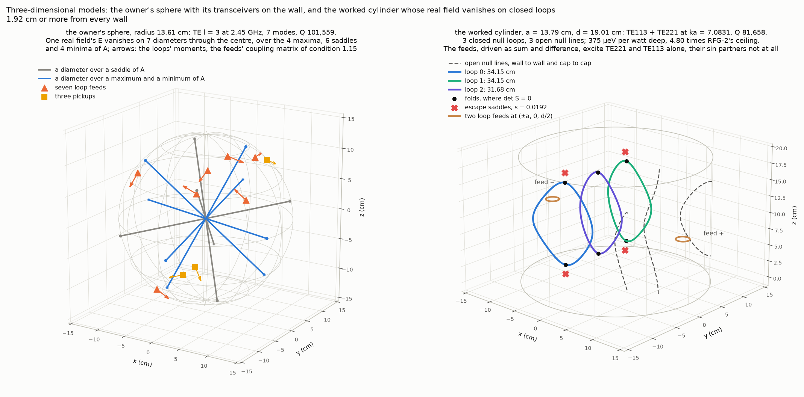
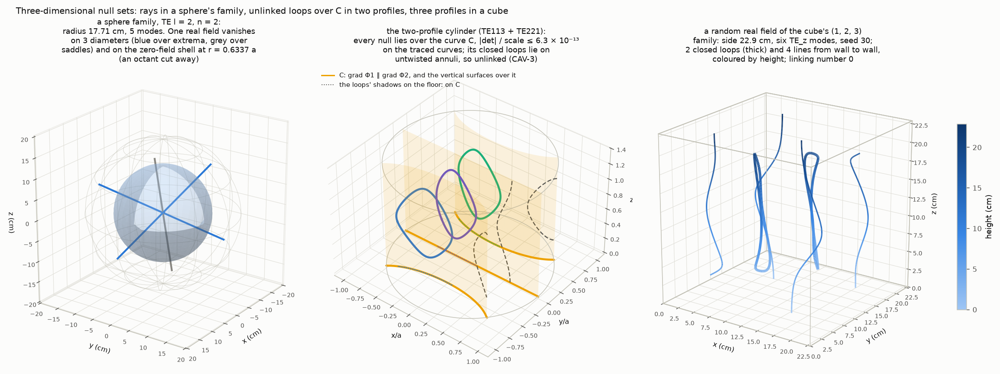
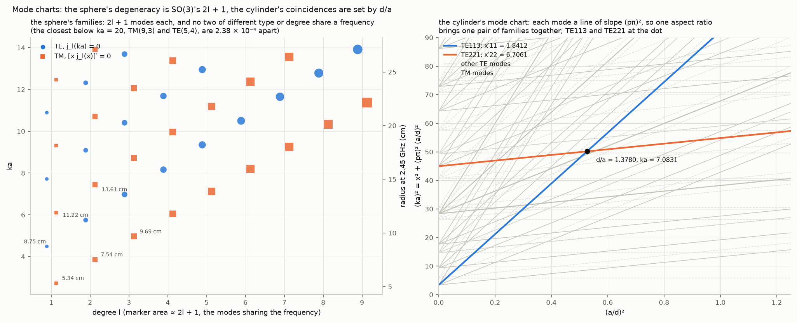
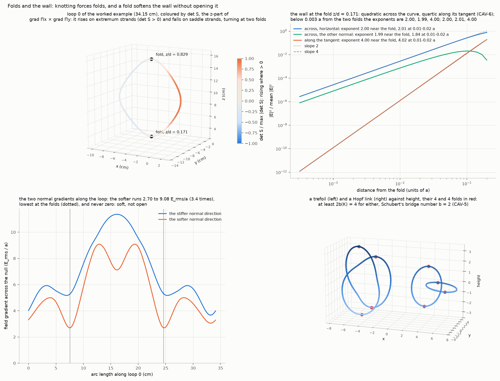
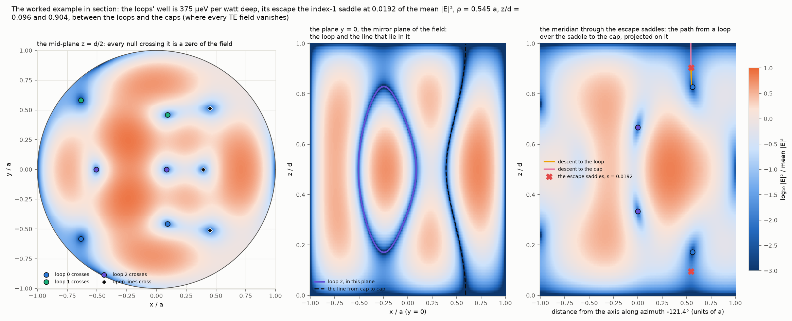
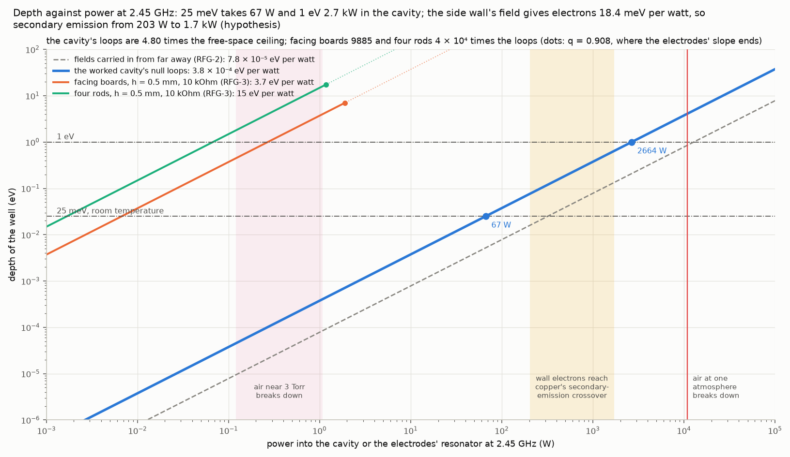
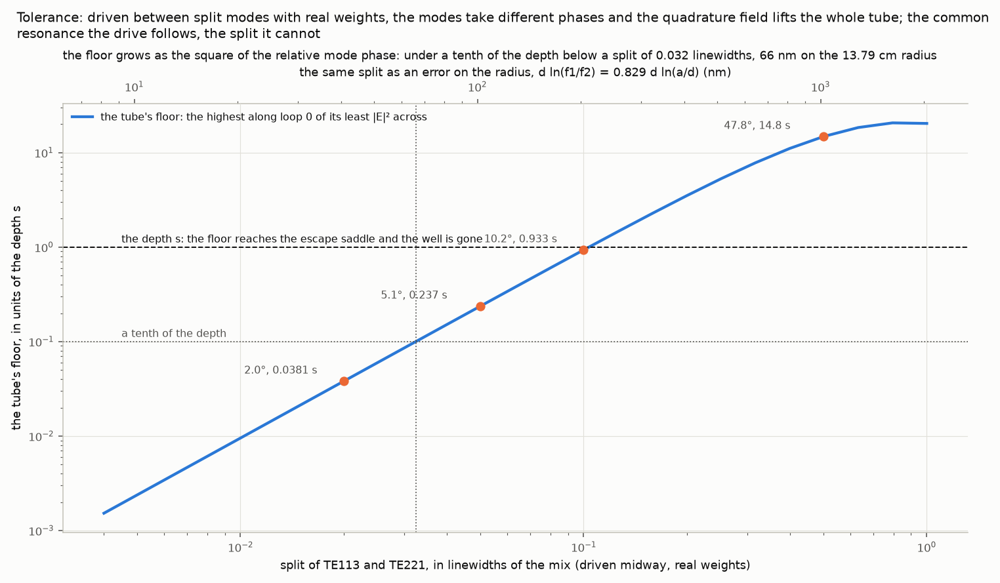

<!-- 2026-11-21. The owner's question of a spherical containment cavity with knotted fields, from a theory memo on
cavity modes and the null curves of their fields and its adversarial verification. Confirmed and corrected claims stand
as results, in corrected form; uncertain ones are hypotheses or open questions; refuted statements are left out. Every
number comes from a verified claim, from the ledger (docs/LAWS.md), or from a check made for this document, marked
"checked". The figures are drawn by experiments/cavity_knots_study.py into
experiments/cavity_knots/, whose run.log and results.json hold their numbers. -->

# The cavity and its knots

## 1. The question

The owner, on 2026-11-21:

> Let's say we research and build a spherical like set up for containment and at points along the sphere are where the
> transceivers, electrodes, and sensors lie, are bessel functions relevant here? or what type of mathematics describes
> the system and what's possible when using spherical confinement for knotted fields within it? almost feels like a
> crude model of the sun, where fields become tangled, and i would think a closed geometric field would be a stable
> field, what happens when we push it to its limits? are we just creating a fancy microwave? or what does this theory
> push towards?

An outside model (Gemini) claimed that Berry and Dennis (2001) built knotted nodal lines from superposed Bessel beams;
that Chandrasekhar-Kendall states knot the field lines of force-free fields; that in a cylinder a real standing sum of
degenerate TE modes, `E = (∂Π/∂y, −∂Π/∂x, 0)·cos ωt`, vanishes on the curves where `∇⊥Π = 0`, the ponderomotive
potential rising quadratically round them where the transverse Hessian is invertible; and that where a curve folds back
along z the Hessian degenerates and the wall softens. It asked how many degenerate modes a trefoil or a Hopf link needs,
whether knotting forces a minimum number of weak points, and what the oscillating B field does at the null.

"Knotted field" names three objects: field lines of E or B, which tangle in the Sun's corona; phase singularities, the
lines where a complex scalar wave vanishes (Berry and Dennis; Dennis et al.); and null curves of the whole vector E of a
real standing field, round which a ponderomotive well forms. The third holds a charge and is the subject here: the
closed guide of `docs/VIRTUAL_ANTENNA.md`, a null line with a well round it, moved from board electrodes into a resonant
cavity at 2.45 GHz. `docs/BEAM_LIFECYCLE.md` follows electrons into, round and out of a guide.

## 2. Short answers

- **Bessel functions: yes.** A cylinder's modes are `J_m(x′ρ/a)·cos mφ·sin(pπz/d)`, a sphere's `j_l(kr)` times vector
  spherical harmonics. Symmetry and number theory decide which modes share a frequency, transcendence why a perfect
  sphere's families never meet, Morse theory where a real field vanishes, knot theory how its zeros are tied.
- **A perfect sphere gives rays, not knots.** Within one family a real TE field's nulls are diameters and zero-field
  shells. Loops take two families with different radial profiles at one frequency, which a perfect sphere never has and
  a deformed, loaded or coaxial sphere, a polyhedron of boards or a tuned cylinder supplies. Two profiles give unlinked
  loops; a link or a knot takes at least three.
- **A worked case:** a copper cylinder 13.8 cm in radius and 19.0 cm tall, driven in TE113 and TE221 with real weights,
  holds three closed null loops 32 to 34 cm long, at least 1.9 cm from every wall, in a well 375 µeV per watt deep: 4.8
  times RFG-2's free-space ceiling, 25 meV for 67 W, 1 eV for 2.66 kW.
- **Weak points.** A knot or link of bridge number b forces at least 2b folds against height, 4 for a trefoil or a Hopf
  link, where the in-slice Hessian is singular. Folds soften the wall without opening it; the leaks are the lowest
  saddle of |E|² and near-reconnections.
- **Hopf links and trefoils** turned up in none of about 4,300 random cavity fields and none of 96 compiled targets.
  Whether a real TE cavity field can hold one is open; a threading rule says it asks for about half a turn of the
  field's principal axes along each loop.
- **Stability.** A regular closed null curve keeps its knot type under small changes of weights, frequency and geometry
  until a reconnection. Vacuum fields superpose linearly: nothing tangles or relaxes by itself.
- **The Sun.** Tangling and relaxation to a Chandrasekhar-Kendall state take a conducting plasma carrying current; the
  cavity shares their curl-eigenvalue mathematics, and with gas at a few Torr holds a collisional discharge.
- **Limits:** wall electrons reach copper's secondary-emission crossover from 0.2 to 1.7 kW, a 1 eV well stands at 2.66
  kW (1.49 MV/m peak), and air breaks down near 11 kW.
- **More than an oven.** An oven puts a kilowatt into an overmoded, loaded box whose field nobody chooses. This cavity,
  at a Q of 82,000 with K coherent feeds, chooses one field from a degenerate family, and with it where its null curves
  lie and when they reconnect: a field compiler with a cavity's stored-field gain.

| The outside model's claim | Here |
| --- | --- |
| Berry and Dennis's knots from Bessel beams | Holds; those are zero lines of a complex scalar wave, a different object from whole-vector nulls of a real field (section 5) |
| Chandrasekhar-Kendall states knot field lines | Holds for field lines of force-free fields; the cavity shares their curl-eigenfield mathematics (section 9) |
| E vanishes on curves where `∇⊥Π = 0` | Holds (CAV-1) |
| quadratic rise where the transverse Hessian is invertible | Holds |
| the Hessian degenerates where the curve folds in z | Holds, exactly there (CAV-5) |
| the wall softens there | Corrected: quartic only along the curve's tangent, quadratic in its normal plane (CAV-6) |
| modes for a trefoil or a Hopf link | At least three axial (radial) profiles at one frequency (CAV-3); the cube's smallest such family has six TE modes in a twelve-dimensional space; whether three suffice is open |
| a minimum number of weak points | At least 2b(K) folds, softer and not open |
| B at the null | Nonzero and in quadrature, c·\|B\| up to 2.9 E_rms; 5.5 × 10⁻⁴ of the well for a trapped electron (CAV-18) |

**Figure 1.** Three-dimensional models. Left: the owner's sphere, radius 13.61 cm, its TE l = 3 family at 2.45 GHz
(seven modes, copper Q 101,559). One real field of the family (a seeded draw) vanishes on seven diameters through the
centre, over the 4 maxima, 6 saddles and 4 minima of its angular part A (4 − 6 + 4 = 2): blue diameters run from a
maximum to a minimum (A(−x) = −A(x) at odd l), grey ones join two saddles. Seven loop feeds on the wall (triangles,
arrows along their moments) couple to the modes through the wall's tangential H, which runs along the surface gradient
of A; placed and turned by a seeded search, their coupling matrix has condition number 1.15, and three pickups (squares)
sit where they most raise its smallest singular value. Right: the worked cylinder, a = 13.79 cm and d = 19.01 cm, TE113
and TE221 at ka = 7.0831 (Q 81,658): its three closed null loops (34.15, 34.15 and 31.68 cm, at least 1.92 cm from every
wall), its three open null lines (dashed: two from side wall to side wall, 15.64 cm, one from cap to cap, 19.96 cm), the
two folds of each loop (dots), and its four escape saddles at 0.01919 of the mean |E|² (crosses, ρ = 0.545 a, z/d =
0.096 and 0.904). The two loop feeds at (±a, 0, d/2) read H_z: driven as sum and difference they excite TE221 and TE113
alone, and the sin φ and sin 2φ partners not at all. `experiments/cavity_knots_study.py` draws this figure and the
others here; its `run.log` and `results.json` in `experiments/cavity_knots/` hold their numbers.

## 3. The mode bases

**Cylinder.** In a circular cylinder of radius a and height d the TE modes derive from

    Π = J_m(x′_mn ρ/a)·(cos mφ or sin mφ)·sin(pπz/d),   E = ∇Π × ẑ = (∂Π/∂y, −∂Π/∂x, 0),

with `x′_mn` the n-th zero of `J′_m` and `k² = (x′_mn/a)² + (pπ/d)²`; TM modes carry E_z. The cos/sin doublets and the
pairs TE_0np, TM_1np (`J′₀ = −J₁`) are degenerate at every aspect ratio. **Claim.** Every other coincidence is set by
d/a, so one aspect ratio tunes one pair of families together (a fact of Bourget's type about zeros of `J′_m`, numerical
and unproved for derivatives).

**Sphere.** In a sphere of radius a the TE fields are `E = ∇ × (rψ) = ∇ψ × r`, `ψ = j_l(kr)·A(θ, φ)` with A a real
spherical harmonic of degree l and `j_l(ka) = 0`; TM families satisfy `[x·j_l(x)]′ = 0` at x = ka. Each (l, n) family is
2l + 1 fold degenerate at any radius. At 2.45 GHz (k = 51.348 m⁻¹):

| Family | ka | Radius | Modes | Copper Q |
| --- | --- | --- | --- | --- |
| TE, l = 1 / 2 / 3 | 4.4934 / 5.7635 / 6.9879 | 8.75 / 11.22 / 13.61 cm | 3 / 5 / 7 | 65,300 / 83,800 / 101,600 |
| TM, l = 1 / 2 / 3 | 2.7437 / 3.8702 / 4.9734 | 5.34 / 7.54 / 9.69 cm | 3 / 5 / 7 | 29,300 / 33,700 / 37,200 |

**Claim.** Q is `a/δ` for TE and `(a/δ)·(1 − l(l + 1)/(ka)²)` for TM, with copper's skin depth δ = 1.34 µm, agreeing
with quadrature of the wall loss to five digits (σ = 5.8 × 10⁷ S/m exactly gives 0.4 % more). A radius error of
a/Q = δ moves a TE family by one linewidth, and the drive follows it. TM l = 1 at ka = 2.744 is the ball resonance met
in `docs/VIRTUAL_ANTENNA.md` section 3.3.

**Proposition (no accidental degeneracy in a sphere).** Families of different type or degree never share a frequency.
Each root condition reads `A(x)·sin x + B(x)·cos x = 0` with A and B polynomials in 1/x over ℚ. A common nonzero root of
two conditions makes a nonzero polynomial determinant vanish, so it is algebraic; then
`e^(2ix) = (1 + i·tan x)/(1 − i·tan x)` is algebraic, which the Hermite-Lindemann theorem forbids (a case of
Lindemann-Weierstrass, Baker's Theorem 1.4). Below ka = 20 the closest pair, (l, n) = (9, 3) TM and (5, 4) TE, is
2.38 × 10⁻⁴ apart, 52 to 68 linewidths for copper at their radius of 38.3 cm at 2.45 GHz (checked to 50 digits).

So the cylinder's degeneracies come from the circle and one tunable coincidence, the cube's from its symmetry and from
sums of three squares, `m² + n² + p²`, and the sphere's from SO(3) alone: 2l + 1 modes sharing one radial profile.

**Figure 2.** Three-dimensional null sets. Left: the sphere family TE l = 2, n = 2 (radius 17.71 cm at 2.45 GHz, five
modes): one real field vanishes on three diameters, over the axes of its quadratic A (blue over its extrema, grey over
its saddles), and on the zero-field shell at r = 0.6337 a where j₂ first vanishes inside, drawn with an octant cut away.
Middle: the two-profile cylinder of section 7 over the curve C where ∇Φ₁ ∥ ∇Φ₂ (orange, with the vertical surfaces over
it): every traced null lies over C, |det(∇Φ₁, ∇Φ₂)| / (|∇Φ₁| |∇Φ₂|) staying under 6.3 × 10⁻¹³ on them, the loops'
shadows (dotted) fall on C, and the closed loops lie on untwisted annuli, so they are unlinked (CAV-3). Right: a random
real field of the cube's (1, 2, 3) family, side 22.9 cm, its six TE_z modes with normal random weights: two closed loops
(thick) and four lines from wall to wall, coloured by height, the loops' linking number 0. The draw shown (seed 30) is
one that holds closed loops; the draws of seeds 0 to 11 hold only lines from wall to wall.

**Figure 3.** Mode charts. Left: ka of the sphere's TE families (j_l(ka) = 0, circles) and TM families ([x j_l(x)]′ = 0,
squares) against l, each marker's area proportional to the 2l + 1 modes it holds; the right axis gives the radius at
2.45 GHz, and the six families of section 3's table are labelled (8.75, 11.22 and 13.61 cm for TE l = 1 to 3; 5.34, 7.54
and 9.69 cm for TM). No two families of different type or degree share a frequency: of the 87 below ka = 20 the closest,
TM(9,3) and TE(5,4), are 2.381 × 10⁻⁴ apart, 52 to 68 linewidths of copper at their radius of 38.3 cm. Right: the
cylinder's mode chart, (ka)² = x² + (pπ)²(a/d)², each mode a line of slope (pπ)² (TE solid, TM dashed); TE113 (x′₁₁ =
1.8412) and TE221 (x′₂₂ = 6.7061) cross at (a/d)² = 0.52665, d/a = 1.3780 and ka = 7.0831.

## 4. Where a real TE field vanishes

**Proposition (nulls are critical points).** For a real standing TE field `|E|² = r²·|∇_tan ψ|²` in a sphere and
`|∇⊥Π|²` in a cylinder: the radial (axial) component vanishes identically, and E vanishes exactly where ψ is critical on
its sphere r = const (Π on its slice z = const). Proof: `∇ × (rψ) = ∇ψ × r` since `∇ × r = 0`, and Lagrange's identity.
Two real conditions in three dimensions give curves. A general real field needs three and vanishes at points, a complex
one six; the TE structure removes one component everywhere, as the long electrodes of facing boards do for their null
line (ELE-2).

**Proposition (one family gives rays).** Within one family `ψ = R(r)·A(θ, φ)` and `∇_tan ψ = R(r)·∇_S A/r` is a product,
so the nulls are the zero-field spheres R = 0 and the cone over the critical points of A: for a generic A diameters
through the centre, paired by `A(−x) = (−1)^l·A(x)`; for a zonal A whole cones; always the centre. In the cylinder they
are the planes s = 0 and vertical lines over the critical points of Φ. No closed null curve stands alone in one family.
Morse theory counts the critical points, maxima minus saddles plus minima equal to 2: one diameter for l = 1, three for
a generic l = 2. Families with n ≥ 2 add interior zero-field shells.

**Claim (rotating fields and TM content).** A rotating superposition's time-averaged well `|E_R|² + |E_I|²` needs four
conditions for a TE null: generically none, only symmetry-forced ones such as a rotating |m| ≥ 2 mode's axis. An
in-phase TM admixture moves the curve and leaves a tube of floor `|E_TM,z|²`, null only where that component crosses
zero. Null curves take real weights on TE modes.

## 5. Loops, links and knots

**Proposition (two profiles give an unlink).** With `Π = Φ₁(x, y)·s₁(z) + Φ₂(x, y)·s₂(z)` a null has `s₁∇Φ₁ + s₂∇Φ₂ = 0`
with `(s₁, s₂) ≠ 0`, so `det(∇Φ₁, ∇Φ₂) = 0`: every null lies over the plane curve C where `∇Φ₁ ∥ ∇Φ₂`. For a regular
null set (2 × 3 Jacobian of rank 2) those vertical surfaces are untwisted annuli and strips, and the closed null curves
on them form an unlink; wall-to-wall lines on nested components of C can still thread them. A link or a knot therefore
takes at least three distinct axial (radial) profiles at one frequency. At symmetric settings, such as the m = 2 pattern
turned 45°, forced crossings make a tracer report spurious links; 0.03 rad either side every linking number is 0, as in
35 settings of the worked pair, 139 cylinder pairs and 400 cube fields (checked).

Where the profiles come from:

- **a cylinder** brings two families together with d/a (section 7) and needs a second parameter for a third;
- **a cube** has three exactly, the modes with (m, n, p) a permutation of (1, 2, 3), side `√14·λ/2` = 22.9 cm at 2.45
  GHz, in a twelve-dimensional degenerate space (six TE_z, six TM_z) where E_z = 0 means holding the TM_z amplitudes at
  zero; a cuboid with two tuned aspect ratios does it at lower order;
- **a sphere** needs its symmetry broken: a spheroid, a load, a concentric inner sphere whose radius ratio tunes
  profiles mixed from `j_l` and `y_l`, or a polyhedron of boards.

The nulls are the zeros of `w = Π_x + iΠ_y = 2∂Π/∂z̄`: a phase field like Berry and Dennis's, constrained because
`∂w/∂z = Δ⊥Π/2` is real. **Claim (threading rule).** Orient a closed null loop B by `∇Π_x × ∇Π_y`. For a direction v
nowhere tangent to B, the winding of `∂_v w` along B is `Wr_v(B) + Lk(B, Z∖B)`, with `Wr_v(B) = Lk(B, B + εv)` the
directional writhe and Z the null set: the form Winfree and Strogatz gave for phase singularity lines. It held on 1,041
(loop, direction) pairs of the worked example and 304 of a cube field, four with Wr_v ≠ 0; a threaded loop is its next
test. For horizontal v, `∂_v w` stays in a half-plane on extremum strands, which add less than half a turn, so a Hopf
link of otherwise unthreaded loops asks each saddle strand to turn its principal axes about half a turn between folds.

**Claim (what was searched).** No link or knot appeared in 3,600 random fields of twelve exactly degenerate cube
families (6 to 13 modes), 300 more counting wall-to-wall threading, or 400 in the (1, 2, 3) family. Linked circles
compiled as a generalised eigenproblem (|E|² on the target against a tube round it) in the 40-mode family N = 314 came
out as reconnecting arcs of alternating orientation. With 80 to 160 free Helmholtz waves single rings of radius 0.35 λ
compiled 18 of 18, of 0.6 λ 2 of 18, and linked pairs 0 of 96.

**Hypothesis (knotted nulls, open).** Whether a real TE superposition at one frequency, in any cavity, has closed null
curves of linking number 1 or knot determinant 3 is open. In free space the twist is no topological obstacle:
Cauchy-Kovalevskaya data on an annulus round each component can carry it, and Runge approximation by entire Helmholtz
fields, with the stability of transverse zeros, should place a Hopf link inside a free-space null set, the method by
which Enciso and Peralta-Salas realised every link in Beltrami fields and, with Hartley, in oscillator eigenfunctions.
Any obstruction is then quantitative, band limit and mode count. Random search at low order is weak evidence: Taylor and
Dennis found about 50,000 knots among 10⁹ nodal curves of random eigenfunctions, more on longer loops.

## 6. Weak points

**Proposition (folds).** The tangent of a null curve is `∇Π_x × ∇Π_y`, whose z-component is `Π_xx·Π_yy − Π_xy² = det S`,
S the in-slice Hessian: the curve folds in z exactly where S is singular, rising on extremum strands (S definite) and
falling on saddle strands. Schubert's bridge number b(K) is the least number of maxima of a height over the type K, so a
closed null curve of type K has at least 2b(K) folds: 2 for an unknot, 4 for a Hopf link or a trefoil, 2·min(p, q) for a
torus knot T(p, q). Concentric spheres are a standard height on S³, so the count holds against r in a sphere.

**Proposition (folds are not leaks).** Near a fold `Π = λv²/2 + αu³/3 + γζu` (u along the kernel of S, v across it, ζ
the height), so `|E|² = (αu² + γζ)² + λ²v²`. The tangent there is u; in the normal plane (v, ζ), `|E|² = λ²v² + γ²ζ²`,
quadratic, the vertical direction supplying the restoring gradient. The wall is quadratic in the normal plane wherever
the 2 × 3 Jacobian has rank 2, which holds on every regular null curve, and goes quartic only at a reconnection.

At the two folds of the worked example's loop 0, within 0.003 a of each, |E|² grows with exponents 2.00 and 1.99 (2.00
and 2.01 at the other fold) across the curve and 4.00 along its tangent (checked); the softer normal gradient runs from
2.70 to 9.08 E_rms/a along the loop, lowest at the folds.
Knotting forces at least 2b(K) soft points and no open ones. The leaks are the lowest saddle of |E|² on the way out
(section 7), near-reconnections where the rank falls, and any quadrature field from detuning, which lifts the whole
tube's floor (section 8.3).

**Claim (stability).** A regular closed null curve moves smoothly with weights, frequency and geometry and keeps its
knot type (the implicit function theorem on `∇⊥Π = 0`); it changes type only at a reconnection, where two lines touch
and exchange partners. In weight space reconnections are walls of codimension one, those of hypothesis SYN-H4
(`docs/VIRTUAL_ANTENNA.md` section 4.7), inside a cavity's degenerate family.

**Figure 4.** Folds and the wall. Top left: loop 0 of the worked example (34.15 cm) coloured by det S, the z-part of
∇Π_x × ∇Π_y: it rises on extremum strands (det S > 0) and falls on saddle strands, turning at its two folds, z/d = 0.171
and 0.829. Top right: |E|² from the fold at z/d = 0.171 along the two directions of the normal plane and along the
tangent; below 0.003 a the exponents are 2.00, 1.99 and 4.00 (2.00, 2.01 and 4.00 at the other fold): quadratic across
the curve and quartic along it (CAV-6). Between 0.01 and 0.02 a, where the next terms of the normal form enter, they
read 2.01, 1.84 and 4.02 (1.98, 2.13 and 3.97). Bottom left: the two normal gradients along the loop, the singular
values of the 2 × 3 Jacobian of (Π_x, Π_y) in E_rms/a: the softer runs from 2.70 to 9.08, 3.4 times, lowest at the folds
(dotted), and never reaches zero. Bottom right: a trefoil, the (2, 3) torus knot turned to its two-bridge position, and
a Hopf link of two round circles (linking number 1) against height: four folds each (red), the 2b(K) = 4 that Schubert's
bridge number b = 2 forces (CAV-5).

## 7. A worked example

TE113 and TE221 meet in a circular cylinder when `(πa/d)² = (x′₂₂² − x′₁₁²)/(3² − 1²)`.

| Quantity | Value |
| --- | --- |
| Cavity | copper cylinder, a = 13.79 cm, d = 19.01 cm (d/a = 1.3780), 11.36 litres |
| Field | `Π = J₁(x′₁₁ρ/a)·cos φ·sin(3πz/d) + J₂(x′₂₂ρ/a)·cos 2φ·sin(πz/d)`, equal coefficients; ka = 7.0831 |
| Q | 55,967 (TE113), 89,953 (TE221), 81,658 for the mix (83 % of its energy in TE221); linewidth 30 kHz |
| Closed null loops | three, 34.15, 34.15 and 31.68 cm long, z from 0.171 to 0.829 d, at least 1.92 cm from any wall; unknots with 2 folds each; every pairwise linking number 0 |
| Open null lines | two from side wall to side wall, one from cap to cap; the end caps are zero-field planes for every TE mode |
| Field at 1 W | E_rms 10.3 kV/m (the amplitude's rms over the volume), peak 28.8 kV/m, peak \|E\|² 7.87 times the mean |
| Escape | an index-1 saddle of \|E\|² at s = 0.0192 of the mean, at ρ = 0.545 a and z/d = 0.096 and 0.904, between loops and caps |
| Depth | 375 µeV per watt, 4.80 times RFG-2's ceiling |
| At a loop | the medians along loop 0 of its two normal gradients give Mathieu q 6.5 × 10⁻⁴ and 5.3 × 10⁻⁴, secular 0.56 and 0.46 MHz at 1 W, both growing as √P (q 0.021 and 0.017, 17.8 and 14.6 MHz at 1 kW); stiffness varies 3.4 times along a loop |

**Proposition (depth per watt).** A cavity of volume V and quality Q fed with power P stores
`QP/ω = (ε₀/2)∫|E|² dV`, so a well whose escape saddle is s times the mean of |E|² is `(e/m)·Q·s·P/(2ε₀ω³V)`
electron-volts deep, `(3π/2)·Q·s/(k³V)` times RFG-2's ceiling (Bassett's bound): 4.8 here, k³V being 1,538. At the
antinodes |E|² per watt is 2.0 × 10³ times the ceiling's (checked), the stored-field gain RFG-2 names; a well round a
null keeps only its saddle's share.

**Claim (the numbers above).** Two independent tracers found the loops; floods on three grids (0.0193, 0.0195, 0.0192)
and Newton's method (0.01919) found the saddle, at which walls, open lines and the other loops all open.

**Figure 5.** The worked example in section, log₁₀ of |E|² over its mean. Left: the mid-plane z = d/2, crossed twice by
each loop (coloured dots) and once by each open line (diamonds), every crossing a zero of the field. Middle: the plane
y = 0, the field's mirror plane, which holds loop 2 and the line from cap to cap; the caps are zero-field planes for
every TE mode. Right: the meridian at azimuth −121.4° through the two escape saddles (crosses: 0.01919 of the mean at ρ
= 0.545 a, z/d = 0.096 and 0.904; their mirror images in y = 0 lie at +121.4°). Steepest descent of |E|² from the upper
saddle reaches loop 0 one way and the cap the other, nowhere above the saddle (0.01888 of the mean at most): the escape
path, projected on the meridian, with the points where loops 0 and 2 cross it.

## 8. Numbers for a build

### 8.1 Against the ceiling and against board electrodes

| Route at 2.45 GHz | Depth per watt | 25 meV takes | 1 eV takes |
| --- | --- | --- | --- |
| fields carried in from far away (RFG-2) | 78.2 µeV | 320 W | 12.8 kW |
| the worked cavity's null loops | 375 µeV | 67 W | 2.66 kW |
| facing boards, h = 0.5 mm, 10 kΩ (RFG-3 scaled as 1/f²) | 3.7 eV | 6.7 mW | 0.27 W |
| four rods, the same | 14.8 eV | 1.7 mW | 67 mW |

Board electrodes are 10⁴ to 4 × 10⁴ times deeper per watt at the same frequency (checked), 5.9 × 10⁴ to 2.4 × 10⁵ at
RFG-3's own operating point (1 GHz, up to 1.2 and 2.9 eV), and a printed microwave Paul trap holds electrons (Matthiesen
et al.). The cavity buys room: a well 34 cm long, at least 1.9 cm from every surface, away from the surface noise and
image charges of `docs/BEAM_LIFECYCLE.md` section 9, whose capture rule (section 3) says how electrons enter it.

### 8.2 Feeds, pickups and electrodes: the cavity's compiler

**Claim (the operator).** At K feeds the mode amplitudes are `a = D(ω)·C·w`, C the feed-to-mode coupling and
`D_n = 1/(1 + 2iQ_nδ_n)` with δ_n the relative detuning, so the compiler's operator is `G = Φ·D(ω)·C`
(`docs/VIRTUAL_ANTENNA.md` section 3.4, with modes for element fields). Selecting M degenerate modes takes K ≥ M feeds
with C of rank M, and K covers every mode the feeds couple to within a linewidth, since a feed coupling to a degenerate
partner drives it on resonance. Null curves need real mode amplitudes, which on exact resonance real feed weights give:
sign and magnitude from one HackRF channel through a 180° hybrid and attenuators. In the worked example two feeds in the
plane y = 0, driven as sum and difference, decouple the sin φ and sin 2φ partners of its four-dimensional space; the
cube's N = 14 family takes up to 12 feeds; a sphere's l family at least 2l + 1.

These are the owner's transceivers, electrodes and sensors on the sphere: feeds (probes or loops through the wall)
drive; pickups at other points read mode amplitudes, so the compiler measures C and D in place; electrodes, wall patches
at DC or low frequency, gate, inject and eject electrons and hear their image currents.

### 8.3 Tolerance

**Claim (what detuning takes).** Only the aspect ratio splits the two families, `d ln(f₁/f₂) = 0.829·d ln(a/d)`; a
uniform expansion cancels. Driven midway between split modes with real weights, the modes take different phases, and
the quadrature field lifts the floor of the whole tube:

| Split | Relative mode phase | Tube floor | On the radius |
| --- | --- | --- | --- |
| 0.5 linewidth | 47.8° | 14.8 s | 1.02 µm |
| 0.1 linewidth | 10.2° | 0.93 s | 204 nm |
| 0.05 linewidth | 5.1° | 0.24 s | 102 nm |
| 0.02 linewidth | 2.0° | 0.038 s | 41 nm |

A floor under a tenth of the depth takes a split under 0.032 linewidths, 66 nm on the radius; the common
resonance moves 41.6 kHz per kelvin, which the drive follows. Three routes hold the split: a tuning element on the board
(by Slater's perturbation about 0.02 cm³ of metal at one mode's E maximum moves it 10⁻⁵); a phase shifter per feed, at a
power cost of about `1 + (2Qδ)²`; or the drive frequency where `Q₁δ₁ = Q₂δ₂`, at which both modes share one phase and
real weights work, for 4.3 times the power at a half-linewidth split.

### 8.4 B at the null

**Claim.** `B = ∇ × E/(iω)` is nonzero on the E null and in quadrature with E: c·|B|/E_rms runs from 0.09 to 2.66 on two
loops and from 0.20 to 2.90 on the third. Its force is β times the electric scale: at 1 kW (E_rms/c = 1.08 mT) the
velocity quiver is ω_c/ω = 0.0124 per unit of c·|B|/E_rms, and the mean energy of that quiver over the depth is at
most β²·(c·|B|/E_rms)²/s, 369·β² on the loops (checked), 5.5 × 10⁻⁴ for an electron trapped at 0.38 eV and equal to the
depth near 690 eV. Trapped electrons are far from relativistic (β = 0.002 at 1 eV), so the electric pseudo-potential
holds.

### 8.5 Breakdown, multipactor and gas

**Hypothesis (limits).** Impact energies are set by the field at the wall: the caps carry no E, and the side wall's
ponderomotive energy peaks at 0.942 of the mean, 18.4 meV per watt. A wall electron returns with at most 3.17 U_p or
crosses with at most 8 U_p, so copper's first secondary-emission crossover, 30 to 100 eV (Vaughan), comes at 0.5 to
1.7 kW for returning electrons and 0.2 to 0.68 kW for crossing ones; two-surface resonance is far off
(f × 2a = 676 GHz·mm). Air at one atmosphere breaks down near 3 MV/m peak, about 11 kW here. Near 2.9 Torr, where the
collision frequency equals ω, air breaks down at order 10 to 30 kV/m (MacDonald, Gaskell and Gitterman; Herlin and Brown
for the diffusion theory): 0.1 to 1 W here, at the antinodes. Above 7.4 × 10¹⁶ per cubic metre, the critical density at
2.45 GHz, the discharge reflects the wave.

### 8.6 Built from boards

The walls are boards (rule 1). Six copper-clad boards make a cube of the N = 14 family or a cuboid tuned in two aspect
ratios; a flex board rolled into a cylinder with board end caps makes the worked example; a polyhedron of boards, or
flex gores on a printed frame, makes the owner's sphere, its faces splitting the families by its symmetry, which is
itself the tuning loops need. Feeds, pickups, tuning elements and electrodes sit on the same boards. Seams, foil
roughness and solder joints lower Q below the seamless figures, which an eigenmode run of the board model and a
reflection sweep give (`docs/KNOTTED_GUIDE.md` section 8); section 8.3's tolerance lies far below board fabrication's,
so the boards carry tuning and a feed network that sets phase. At 1 to 10 W the worked well is 0.38 to 3.8 meV (4.4 to
44 K, checked), thermal energy takes 67 W, and 1 eV a coherent 2.45 GHz amplifier of kilowatt class.

**Figure 6.** Depth against power at 2.45 GHz. The worked cavity's loops give 375 µeV per watt (blue), 4.80 times
RFG-2's ceiling of 78.2 µeV per watt for fields carried in from far away (dashed): 25 meV at 67 W and 1 eV at 2.66 kW
(dots). Through a 10 kΩ resonator, electrodes 0.5 mm from the null give 3.7 eV per watt on facing boards and 15 eV per
watt on four rods, 9.9 × 10³ and 4.0 × 10⁴ times the loops, until the null's Mathieu q reaches 0.908 at 7.0 and 17.4 eV
(dots; faint beyond). Shaded: air near 3 Torr breaks down at 10 to 30 kV/m at the antinodes, 0.12 to 1.1 W; wall
electrons reach copper's 30 to 100 eV secondary-emission crossover from 203 W (crossing, 8 U_p) to 1.7 kW (returning,
3.17 U_p), the side wall's |E|² peaking at 0.942 of the mean, 18.4 meV per watt (hypothesis CAV-H2). Air at one
atmosphere breaks down near 3 MV/m peak, at 10.8 kW (red).

**Figure 7.** The tube's floor against the split of TE113 and TE221, driven midway with real weights so that the modes
take amplitudes 1/(1 + 2iQ_nδ_n): at each point of loop 0 the least |E|² across the loop, and the highest of these along
it, in units of the depth s. The table's splits are the dots: 0.5, 0.1, 0.05 and 0.02 linewidths give relative mode
phases of 47.8°, 10.2°, 5.1° and 2.0° and floors of 14.8, 0.933, 0.237 and 0.0381 s, growing about as the phase squared.
The floor stays under a tenth of the depth below 0.032 linewidths; the top axis gives the split as an error on the
radius through d ln(f₁/f₂) = 0.829 d ln(a/d): 66 nm at 0.032 linewidths, 1019 nm at half a linewidth.

## 9. The Sun, and the limits

- In the corona the plasma conducts so well that field lines are frozen into it: moving plasma twists and tangles them,
  and they relax by reconnection. Taylor's relaxation at fixed helicity ends in a linear force-free field, `∇ × B = λB`,
  a Chandrasekhar-Kendall state.
- **Claim (the same mathematics).** A monochromatic field's Riemann-Silberstein vector `F = E + icB` obeys `∇ × F = kF`,
  a curl eigenfield whose modes in a cylinder or sphere are section 3's Bessel functions, as Chandrasekhar-Kendall
  functions are. Knotted and linked field lines exist in vacuum Maxwell fields (Irvine and Bouwmeester; Kedia et al.).
- **The vacuum cavity has no dynamics of its own.** Maxwell's equations in vacuum are linear: at fixed geometry and
  weights the null set is fixed, and null lines reconnect only when weights, frequency or shape change.
- **The solar regime takes** a plasma carrying its own current and conducting well enough for the field to be frozen in,
  a large Lundquist number. A discharge at a few Torr is weakly ionised and collisional, carrying RF currents.

Pushed to its limits, the worked cavity passes these thresholds:

| Power | What happens |
| --- | --- |
| 10 mW | a 3.75 µeV (43.6 mK) well round the loops |
| 67 W | 25 meV, thermal energy at room temperature |
| 0.2 to 1.7 kW | wall electrons reach copper's first secondary-emission crossover (hypothesis) |
| 2.66 kW | a 1 eV well, 1.49 MV/m peak, q = 0.034 at a loop |
| about 11 kW | filled with air at one atmosphere, the cavity breaks down |

## 10. What the theory pushes toward

- **A cavity field compiler:** the process of `docs/VIRTUAL_ANTENNA.md` with `G = Φ·D(ω)·C`, measuring C and D through
  pickups, solving for real weights inside a degenerate family, verifying by mapping. It places, moves and reconnects
  null curves, and its reconnection walls are the price list for topology.
- **Null topology as a design variable,** with the laws below: profiles per link, folds per knot, soft walls,
  reconnections.
- **The open question:** a Hopf link or a trefoil of whole-vector E nulls in a real TE cavity field, with the sphere,
  split by a concentric inner sphere or polyhedral faces, as a three-profile candidate.
- **A measurement at milliwatts:** a small dielectric bead shifts the resonance in proportion to |E|² where it sits
  (Maier and Slater), so a bead drawn through the cavity maps the null loops, the HackRF reading the shift.
- **Room against power:** electrons 2 cm from every surface at tens of watts, against electrodes reaching the same depth
  with milliwatts a millimetre from copper.

## 11. Laws for the ledger

Proposed rows, ids following `docs/LAWS.md`: CAV, cavity modes and their null curves. A Proposition gets Lean
declarations and a test against the float code; a Claim or a Hypothesis gets none.

| Id | Statement | Label | Falsifier | Lean |
| --- | --- | --- | --- | --- |
| CAV-1 | real TE nulls: `\|E\|² = r²\|∇_tan ψ\|²` or `\|∇⊥Π\|²`, critical points on slices | Proposition | a null off the critical set | curl identity; Lagrange's identity |
| CAV-2 | one family: zero-field spheres and cones over crit(A) | Proposition | a closed loop in one sphere family | zero of a product |
| CAV-3 | two profiles: nulls over `det(∇Φ₁, ∇Φ₂) = 0`; regular closed nulls unlinked | Proposition | a regular two-family link | the determinant condition |
| CAV-4 | no two sphere families of different (type, l) share a frequency | Proposition | a common root at higher precision | algebraic reduction; Hermite-Lindemann a premise |
| CAV-5 | `t_z = det S`; at least 2b(K) folds | Proposition | fewer z-extrema than 2b(K) | cross-product algebra; b(K) a premise |
| CAV-6 | fold normal form, quadratic in the normal plane at rank 2 | Proposition | super-quadratic growth there | polynomial identity |
| CAV-7 | depth `(e/m)QsP/(2ε₀ω³V)`, `(3π/2)Qs/(k³V)` times RFG-2's ceiling | Proposition | an algebra error | beside `Confine.lean` |
| CAV-8 | `d ln(f₁/f₂) = (p₁² − p₂²)(π/d)²/k²·d ln(a/d)` | Proposition | a split under uniform scaling | derivative algebra |
| CAV-9 | regular null curves keep their type until a reconnection | Claim | a type change at full rank | — |
| CAV-10 | sphere roots, radii and Q's | Claim | 10⁻⁴ off in ka, or 1 % in Q | — |
| CAV-11 | cylinder degeneracies at every aspect ratio: doublets and TE_0np/TM_1np only | Claim | another pair at two aspect ratios | — |
| CAV-12 | rotating TE fields: no generic nulls; TM floor `\|E_TM,z\|²` | Claim | a stable null of a generic complex TE field | — |
| CAV-13 | threading rule | Claim | a traced loop breaking it | — |
| CAV-14 | the worked example: three unknotted loops, s = 0.0192, 375 µeV per watt | Claim | a field solve with other loops or barrier | — |
| CAV-15 | q and f_sec at a loop, growing as √P | Claim | a tracked secular frequency 10 % off | — |
| CAV-16 | tube floor against split; 0.03 linewidths for s/10 | Claim | a two-feed simulation with another floor | — |
| CAV-17 | `G = ΦD(ω)C`; K covers every coupled mode; when real weights suffice | Claim | a quadrature field at the null on resonance | — |
| CAV-18 | B at the null; magnetic term at most 369β² of the depth | Claim | a Lorentz track off the pseudo-potential beyond order β | — |
| CAV-19 | `E + icB` a curl eigenfield; vacuum nulls fixed at fixed weights | Claim | nulls moving at fixed weights below breakdown | — |
| CAV-H1 | a real TE cavity field can hold a Hopf link or trefoil of nulls | Hypothesis | a traced Lk = 1, or a proved minimum degeneracy | — |
| CAV-H2 | secondary emission from 0.2 to 1.7 kW; air near 11 kW; few-Torr discharge at 0.1 to 1 W | Hypothesis | a simulated or measured onset elsewhere | — |

**To prove first in Lean:** CAV-1, CAV-3's determinant condition, CAV-5, CAV-6, CAV-7 and CAV-8, algebra over ℝ beside
`formal/Array16/Confine.lean`; then CAV-2 and CAV-4's reduction.

## 12. Sources

1. M. V. Berry, M. R. Dennis, "Knotted and linked phase singularities in monochromatic waves," Proc. R. Soc. Lond. A
   457, 2251-2263 (2001), doi:10.1098/rspa.2001.0826.
2. M. R. Dennis, R. P. King, B. Jack, K. O'Holleran, M. J. Padgett, "Isolated optical vortex knots," Nature Physics 6,
   118-121 (2010), doi:10.1038/nphys1504.
3. A. J. Taylor, M. R. Dennis, "Vortex knots in tangled quantum eigenfunctions," Nature Communications 7, 12346 (2016),
   doi:10.1038/ncomms12346, arXiv:1608.00909.
4. A. Enciso, D. Peralta-Salas, "Knots and links in steady solutions of the Euler equation," Annals of Mathematics 175,
   345-367 (2012), doi:10.4007/annals.2012.175.1.9.
5. A. Enciso, D. Hartley, D. Peralta-Salas, "A problem of Berry and knotted zeros in the eigenfunctions of the harmonic
   oscillator," J. Eur. Math. Soc. 20, 301-314 (2018), doi:10.4171/JEMS/767.
6. S. Chandrasekhar, P. C. Kendall, "On force-free magnetic fields," Astrophysical Journal 126, 457 (1957),
   doi:10.1086/146413.
7. J. B. Taylor, "Relaxation of toroidal plasma and generation of reverse magnetic fields," Phys. Rev. Lett. 33,
   1139-1141 (1974), doi:10.1103/PhysRevLett.33.1139.
8. J. B. Taylor, "Relaxation and magnetic reconnection in plasmas," Rev. Mod. Phys. 58, 741-763 (1986),
   doi:10.1103/RevModPhys.58.741.
9. W. T. M. Irvine, D. Bouwmeester, "Linked and knotted beams of light," Nature Physics 4, 716-720 (2008),
   doi:10.1038/nphys1056.
10. H. Kedia, I. Bialynicki-Birula, D. Peralta-Salas, W. T. M. Irvine, "Tying knots in light fields," Phys. Rev. Lett.
    111, 150404 (2013), doi:10.1103/PhysRevLett.111.150404, arXiv:1302.0342.
11. H. Schubert, "Über eine numerische Knoteninvariante," Math. Z. 61, 245-288 (1954), doi:10.1007/BF01181346.
12. A. T. Winfree, S. H. Strogatz, "Organizing centres for three-dimensional chemical waves," Nature 311, 611-615
    (1984), doi:10.1038/311611a0.
13. A. Baker, Transcendental Number Theory (Cambridge University Press, 1975), doi:10.1017/CBO9780511565977.
14. I. M. Bassett, "Limit to concentration by focusing," Optica Acta 33, 279-286 (1986), doi:10.1080/713821943.
15. L. C. Maier, J. C. Slater, "Field strength measurements in resonant cavities," J. Appl. Phys. 23, 68-77 (1952),
    doi:10.1063/1.1701980.
16. C. Matthiesen, Q. Yu, J. Guo, A. M. Alonso, H. Häffner, "Trapping electrons in a room-temperature microwave Paul
    trap," Phys. Rev. X 11, 011019 (2021), doi:10.1103/PhysRevX.11.011019, arXiv:2005.06681.
17. M. A. Herlin, S. C. Brown, "Breakdown of a gas at microwave frequencies," Phys. Rev. 74, 291-296 (1948),
    doi:10.1103/PhysRev.74.291.
18. A. D. MacDonald, D. U. Gaskell, H. N. Gitterman, "Microwave breakdown in air, oxygen, and nitrogen," Phys. Rev. 130,
    1841-1850 (1963), doi:10.1103/PhysRev.130.1841.
19. J. R. M. Vaughan, "Multipactor," IEEE Trans. Electron Devices 35, 1172-1180 (1988), doi:10.1109/16.3387.
