<!-- 2026-11-21. Theory and design study of a knotted RF guide built from several boards, from five lens memos
(topology, fields, drive, particles, buildability) and their adversarial verification, revised the same day after a
review of the whole: its errors re-derived, the lead designs given resonance designs, and the segmented and one-piece
variants, the particles' own fields, loading, costs and an order of work added. Confirmed and corrected claims stand as
results, in corrected form; uncertain ones are hypotheses or open questions; refuted statements are left out. Every
number comes from a verified claim, from the ledger (docs/LAWS.md), or from a check made for this document with
array16.particles and numpy, marked "checked". Figures 1 to 7 and 9 to 11 are drawn by
experiments/knotted_guide_study.py into experiments/knotted_guide/, whose run.log and results.json hold the numbers
their captions quote; Figures 8 and 12, and the compile of section 7, are drawn here as diagrams. -->

# The knotted guide

## 1. The question

The owner, on 2026-11-21:

> not everything has to be on a single board, since ensuring on a single board would limit us to just a ring and not
> any other knots

> maybe the knotted guide goes first since understanding different component topologies could influence how a desired
> field gets compiled?

> for simulations, are you also on planning to eventually modeling the hardware design to simulate of it's possible to
> build?

Behind them stands the question the particle work has carried since the first run (`AGENTS.md`): can the field generated
by the array produce a closed geometric shape that holds charged particles and accelerates them along the path, and what
do different geometries and configurations yield when it comes to the fields produced by the particles themselves? Its
aim is the virtual antenna, a generic process that compiles arbitrary fields (`docs/VIRTUAL_ANTENNA.md`), of which a
closed guide is one target: a null line with a well round it, driven as a travelling wave. Both lines stay open
(`AGENTS.md` rule 1), a ring with everything on one board and knots across several boards; this study takes the knot
first. Sections 2 and 3 answer the first remark, section 7 the second, and section 8 the third: every design is modelled
as hardware, from the fab's rules to the vacuum, on a simulated bench before anything is ordered.

## 2. Short answers

- **One rigid two-layer board makes a planar ring; a knot needs crossings, and crossings need levels.** On parallel
  levels joined by ramps a knot of bridge number b needs at least 2b ramps, four for the trefoil, and two slotted
  double-sided boards give two levels; rounded sticks, lattice boards, facing flex strips and one flexible ribbon
  carrying rails are the other routes. A slot along any closed path frees an island, c + 2 pieces for a diagram of c
  crossings and two for the ring, a fabrication cost the ring pays too; a four-layer board holds crossings in its own
  thickness only with its pieces held by a carrier (Hypothesis KNT-H4).
- **Energy sets the size:** a knot turns through more than 4π, so its length exceeds 4π times its tightest bend radius
  (Proposition). By the bend rule that is at least 12.6 mm of path per unit of held energy over well depth at h =
  0.5 mm, and by what tracking held, 16 to 33 mm: the first run's W/D = 16.6 takes 270 to 550 mm.
- **The knot goes first because topology fixes the compiler's terms:** what is frozen in copper, what stays live, which
  operators one copper carries at once (DC, a megahertz chirp, 915 MHz), and the symmetry of what is built, which picks
  the ring modes that travel, the stopbands, the perturbations that cancel and the beam harmonics each pickup hears.
- **Fields are exact where symmetry holds:** a piece keeping one mirror antisymmetry has an exact null without axial
  field.
- **The drive is the first compile problem.** The knot is a ring resonator of shunt resistance Z₀Q/(2πm). On the lead
  design at 2 % rms spacer error, two re-solved feeds leave a backward wave of 0.013 of the forward in the median (0.020
  at the 90th percentile) and keep 0.94 of a perfect ring's depth per watt, where a fixed hybrid leaves 0.13 and 0.74
  (checked, 60 draws); one feed makes a standing wave. A 1 eV well at 915 MHz takes 0.89 W on bare copper and 1.1 to
  4.2 W on the fab's gold over nickel (ENIG): an amplifier of +30.0 to +37.0 dBm.
- **Particles:** facing boards hold 0.605·D·R/h bent in their plane by the static balance, which E2-9 tracks, where four
  rods held 0.61 to 0.95 of their static limit; joints heat unless smooth over 3v/(f(1 − β)) and, for the null-step
  family, three secular wavelengths, 29 mm at 8 eV; cut into six DC-isolated segments the strips' joints double as gaps,
  one chirp of 5.6 to 15.8 MHz taking electrons from 1 to 8 eV in 117 laps.
- **The particles' own fields carry the knot's shape:** a bunch on the trefoil is an axial electric dipole at 3f_rev and
  an in-plane one at f_rev and 2f_rev, where on a ring it is an in-plane dipole at f_rev alone; a steady beam's magnetic
  moment is 0.37 of a ring's of the same length; image charges in the boards shift the tune by 0.003 at 3.4 × 10⁴
  electrons, and the beam detunes the ring by under 10⁻⁶ of a linewidth (section 6.6).
- **The hardware is modelled before it is built,** from one geometry source, through a review of fifteen checks on a
  twin bench (section 8). Its first findings change the designs: at 915 MHz the 25 µm polyimide holds 7 % of the flex
  strips' field, n_eff = 1.031, so their m = 1 ring takes 318 mm (307 mm would resonate at 947 MHz, outside the band);
  the stacked boards' slot guide holds 85 % of its field in the laminate, Q 43 on FR-4 and 117 on RO4003C; the twist
  that closes the strips makes them non-developable, and their two plates differ in length by 23 mm; copper multipacts
  above wells of 2 to 3 eV (Hypothesis), and the fab's flex surface is gold over nickel as received.
- **Lead designs:** T915-S, flex strips on an r/R = 0.45 trefoil at 915 MHz, m = 1, and T915-S6, the same cut into six
  segments to accelerate; S2-C3, two slotted RO4003C boards with a six-ramp trefoil at m = 2; L26, a lattice trefoil;
  R1, the one-board ring with the flat control; T915-R, one flex ribbon carrying rails; and the sharp six-stick trefoil,
  the case that must fail.

## 3. Topologies: how boards make a knot

D₀ and G₀ are the depth and gradient of gapless facing boards at the same volts and spacing (ELE-2), h the distance from
the null to the copper, W the energy held, D the depth. The band is 915 MHz unless stated.

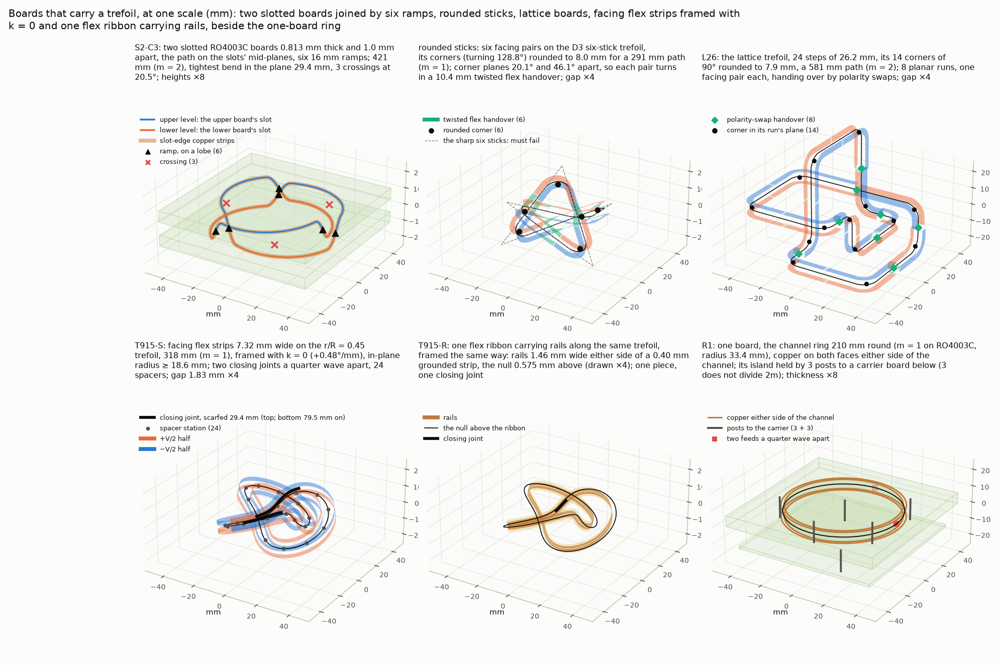

**Figure 1.** The arrangements of section 3.2 carrying a trefoil, at one scale (mm), from `ClosedCurve` and the frames
of section 3.5. Top left, S2-C3: two slotted RO4003C boards 0.813 mm thick and 1.0 mm apart (heights drawn ×8), the path
on their slots' mid-planes, the upper level blue and the lower orange over the slot-edge copper, six 16 mm quintic ramps
on the lobes (triangles) and three crossings at 20.5° (crosses); 421 mm round, its tightest bend 29.4 mm in the plane
and 19.2 mm where a ramp's climb adds to a lobe's bend. Top middle: the D3 six-stick trefoil (dashed, sharp: the case
that must fail) rounded to 8.0 mm; its corners turn 128.8° in planes 20.1° and 46.1° apart, so each facing pair turns
through a 10.4 mm twisted flex handover (green). Drawn with m = 1's 291 mm of path, it takes a hexagon 384 mm round
whose straights keep 24.5 mm or more, room to round the corners to 13.8 mm; section 3.4's 8.0 mm is what a hexagon 291
mm round allows, its rounded path then 198 mm. Top right: L26, the 24-step lattice trefoil at 26.2 mm, its 14 corners
rounded to 7.9 mm for a 581 mm path, one facing pair to each of its 8 planar runs, handing over by polarity swaps
(diamonds). Bottom left: T915-S, facing flex strips 7.32 mm wide on the r/R = 0.45 trefoil at 318 mm, framed with k = 0
(+0.48°/mm) so that the in-plane radius stays at 18.6 mm or more, the halves at +V/2 orange and −V/2 blue, the gap drawn
×4; the two closing joints, scarfed over 29.4 mm and 79.4 mm apart (black), and the 24 spacer stations. Bottom middle:
T915-R, one flex ribbon carrying the rails along the same trefoil and framing, the null 0.575 mm above it (drawn ×4).
Bottom right: R1, the channel ring 210 mm round on one RO4003C board (thickness ×8), copper on both faces either side of
the channel, its island held by three posts to a carrier board below (three does not divide 2m) and the frame by three
more, the two feeds a quarter wave apart.

### 3.1 What knot theory fixes

**Claim (ramp count).** On parallel levels joined by ramps a knot of bridge number b needs at least 2b ramps: each level
arc entered from below at both ends holds a maximum, and a knot has at least b maxima (Schubert, cited). That two levels
reach 2b is this document's argument: a bridge presentation's b over-arcs go on the upper level and the rest on the
lower, two ramps to each over-arc; a test builds that layout for each knot of the table and identifies its type with
SnapPy. **Proposition (symmetric layouts).** T(p, q) as the closure of the braid (σ₁⋯σ_(q−1))^p has p-fold symmetry, p(q
− 1) crossings and 2p ramps; `ClosedCurve.torus_knot` with (2, 3) flattens to six ramps with C3, with (3, 2) to four
with C2. 4₁ here is the knot, not `ClosedCurve.figure_eight`, which is an unknot.

| Knot | Bridge | Crossings | Least ramps | Symmetric layouts: ramps, symmetry, crossings | Sticks | Lattice steps; sticks | Ropelength, diameters | Flat at r/R |
| --- | --- | --- | --- | --- | --- | --- | --- | --- |
| 3₁ | 2 | 3 | 4 | 6, C3, 3; 4, C2, 4 | 6 | 24; 12 | 16.37 | 4/13 |
| 4₁ | 2 | 4 | 4 | 4, C2 at most | 7 | 30; 14 | 21.04 | |
| 5₁ = T(2,5) | 2 | 5 | 4 | 10, C5, 5; 4, C2, 8 | 8 | 34; ≥ 15 | 23.60 | 4/29 |
| 8₁₉ = T(3,4) | 3 | 8 | 6 | 8, C4, 8; 6, C3, 9 | 8 | ≤ 42 found; ≥ 15 | 30.49, probable | 9/25 |

**Proposition (length).** A closed curve of curvature at most 1/R_min whose total curvature exceeds 4π (CUR-3, a
premise) has L > 4π·R_min. **Claim (size).** With the bend rule W ≈ D·R/(2h) that is L > 8πh·W/D, 12.6 mm per unit of
W/D at h = 0.5 mm and 209 mm for the first run's W/D = 16.6, a lower bound: tracking met the rule at 38 to 77 %, and
with that fraction the length is 16 to 33 mm per unit of W/D, 270 to 550 mm for 16.6, against the first run's 276.5 mm
(total curvature 4.44π), which held 8 eV at q = 0.6 where the rule gives 20.9 eV. Facing boards' static limit in their
plane, 0.605·D·R/h, gives L > 4πh·W/(0.605·D), 19.0 mm per unit of W/D at the lead design's h = 0.915 mm (checked).
**Claim (ropelength).** That bound binds over the tight-knot floor (Ashton et al.; Denne, Diao and Sullivan) once W/D
exceeds 1.3 times the tube diameter in millimetres. **Proposition (sudden turn).** An axis turned by θ in less than a
secular period leaves a particle of energy W with W·sin²θ of transverse energy below 90° and all of W beyond, and n
sticks turn more than 720°/n somewhere (Milnor's total curvature, a premise). **Claim (sharp joints).** A sharp joint
keeps a particle only if W·sin²θ < D below 90° and W < D beyond, so matching the trefoil's 16.6 D takes 51 sticks or
more. The sudden limit holds only roughly, the field changing over about 2h against a secular wavelength of 2 to 3.7 mm,
and a real joint hands over 0.4 to 0.75 of W·sin²α (the kink, section 6.2); the must-fail case of section 10 rests on
the conservative side, W below D. **Proposition (flat points; checked).** On its inner equator the torus knot ((R + r
cos qt)e^(ipt), r sin qt) has radial acceleration r·q² − (R − r)·p², so its curvature vanishes there exactly when r/R =
p²/(p² + q²): the first run's r/R = 0.30 sits beside the trefoil's 4/13, while r/R = 0.45 (total curvature 5.37π) keeps
the curvature radius under 24.5 mm at 229 mm.

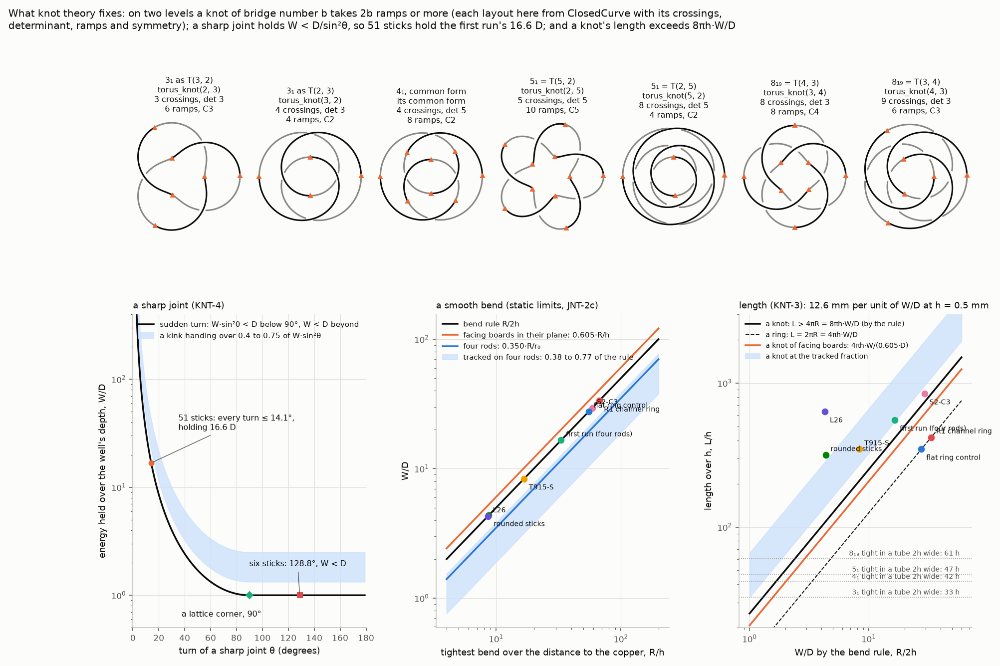

**Figure 2.** What knot theory fixes (section 3.1). Top: layouts on two levels from `ClosedCurve`, seen from above, the
upper level dark and the lower grey (broken where it passes under), ramps as triangles, each with the crossings,
determinant, ramps and rotational symmetry computed from its curve: the trefoil as T(3, 2) (3 crossings, 6 ramps, C3)
and as T(2, 3) (4, 4, C2), 4₁ in its common form (4 crossings, 8 ramps, C2), 5₁ as T(5, 2) (5, 10, C5) and T(2, 5) (8,
4, C2), and 8₁₉ as T(4, 3) (8, 8, C4) and T(3, 4) (9, 6, C3). The determinants, 3, 5, 5 and 3, tell the knots apart, and
every torus layout takes the least ramps its diagram allows. 4₁'s common form is alternating, so its diagram takes 8
ramps; its 4-ramp layout comes from a two-bridge presentation, which the test of KNT-1 builds. Bottom left: the energy a
sharp joint holds against its turn, W·sin²θ < D below 90° and W < D beyond, shaded where a kink hands over 0.4 to 0.75
of W·sin²θ: the six sticks' 128.8° corners hold under D, and 51 sticks, every turn 14.1° or less, hold the first run's
16.6 D. Bottom middle: the static limits against the tightest bend over the distance to the copper (the bend rule R/2h,
facing boards 0.605·R/h in their plane, four rods 0.350·R/r₀), the band four rods tracked (0.38 to 0.77 of the rule),
and the designs. Bottom right: length over h against W/D by the rule: a knot's bound L > 4πR = 8πh·W/D (12.6 mm per unit
of W/D at h = 0.5 mm), a ring's 4πh·W/D, a knot of facing boards' 4πh·W/(0.605·D), the tracked band, the tight-knot
floors for a tube 2h wide (ropelengths 16.37, 21.04, 23.60 and 30.49 diameters) and the designs, each L/4πR above its
bound: the first run 1.33, T915-S 1.65, S2-C3 1.14, the rounded sticks 2.89, L26 5.86.

### 3.2 The arrangements compared

Costs are entry prices plus an allowance, rough estimates.

| | Two slotted boards (S2-C3) | Rounded sticks | Rounded lattice (L26) | Facing flex strips (T915-S) | One flex ribbon (T915-R) | One board (R1) |
| --- | --- | --- | --- | --- | --- | --- |
| Boards, copper | 2 double-sided RO4003C 0.813 mm, spacer frame; 4 layers by one slot | 6 facing pairs, 2 designs; twisted flex straights | 8 facing pairs | 2 strips, 1 layer each | 1 strip, 1 layer | rails, or both faces by a channel |
| Joints | 6 compiled ramps; 3 crossings at 20.5° | 6 corners of 128.8°; 6 twisted handovers | 14 corners of 90° | 2 closing joints | 1 closing joint | none, or a carrier's posts |
| Tightest bend | 30.0 mm | 8.0 mm | 7.9 mm | 15.3 mm | 15.3 mm | the ring's radius |
| Total curvature | 4π in the plane, plus the climbs | 4.29π | 7π | 5.37π | 5.37π | 2π |
| Length, m | 420 mm, m = 2 | 291 mm, m = 1 | 582 mm, m = 2 | 318 mm, m = 1 | about 318 mm, m = 1 | 210 mm (channel), about 200 mm (rails), m = 1 |
| Well and power | 0.21 to 0.30 eV at 40 V, 1.29 W | 1 eV at 54.9 V, 0.51 W | 1 eV at 54.9 V, 1.03 W | 1 eV at 50.3 V, 0.89 W (ENIG 1.1 to 4.2 W) | 0.093 eV at 50 V | 0.093 eV at 50 V (rails); 0.21 to 0.30 eV at 40 V, 0.64 W (channel) |
| Route, rough cost | rigid, routed slots: $100 to $250 on RO4003C, $40 to $80 on FR-4 | rigid, printed brackets, flex straights: $60 to $100 | rigid, printed frame: $40 to $70 | flex on a former: $60 to $120 | flex: $30 to $60 | one rigid board |
| Field | levels 0.26 to 0.34 D₀ flush, 0.10 to 0.14 D₀ set back; ramps ≥ 0.23 G₀ flush | facing wells; twisted handovers | facing wells; polarity-swap handovers | full facing well | rails, 0.0091 of four rods | rails 0.0091 of four rods; channel as S2-C3's levels |
| Drive | 2 feeds; ramp rails up to 2V | 6 segments | 8 runs; all modes couple | 2 feeds; 6 segments in T915-S6 | 2 feeds | 2 feeds |
| Compiling | frozen sign patterns; C3 | one cell, two handovers; D3 | one cell; no symmetry | framing and closure free; C3 if closed symmetrically | framing free; C3 | ring modes alone |

**Other routes, with what each takes.**

- *A flex rolled into a tube with four strips* is a printed four-rod quadrupole, share near 1 instead of ¼: 1 eV at q =
  0.5 and 915 MHz takes 16 V with r₀ = 0.58 mm, and a tube of 1 mm radius holds 2.9 eV at 47 V. Bent to 15.3 mm its wall
  strains by r₀/R, 3.8 to 6.5 %, past what flex copper takes, so the tube takes slits or pleats every few millimetres,
  or bends of R ≥ 100·r₀ (checked).
- *Rigid-flex* orders feeds, baluns and connectors on rigid islands and the knot on flex as one piece, at a few times
  the flex price (rough).
- *The odd-k single band:* closed with k = −3 the strips keep C3 and become one band of 2L for both plates, with one
  closing joint, an in-plane radius of 29 mm or more and a twist strain 29 times the wrinkling scale (section 3.5).
- *The figure-eight knot 4₁* is amphichiral and two-fold at most, so its layouts couple ±m for every m (section 5.2): it
  travels when its perturbations are weak (2Q|c₂ₘ| ≤ 1) or on feeds compiled at its joints. In the common
  parametrisation ((2 + cos 2t)·cos 3t, (2 + cos 2t)·sin 3t, sin 4t) at 318 mm its tightest bend is 6.1 mm, its strands
  pass 8.4 mm apart and its total curvature is 6.61π (checked); by ropelength it takes 1.29 times the trefoil's length
  for the same tube. Its curve joins the core beside `torus_knot`.
- *Links:* two planar rings interlocked through slots in each other's board, a Hopf link, are two one-board guides on
  one drive through a divider, each an R1; their beams' magnetic fields link (section 6.6).
- *Out of the plane without a knot:* the (1, 3) torus curve is unknotted and not planar; at r/R = 0.2 and 318 mm its
  tightest bend is 25.1 mm, its total curvature 3.64π and its holonomy −146° (checked). Beside the flat ring and the
  trefoil it separates what leaving the plane costs from what knotting costs (E2-22).

### 3.3 Stacked boards: the slot guide and the compiled ramp

**Claim (slot guide).** One double-sided board with a routed slot, its four slot-edge strips driven as a quadrupole,
holds a null in the slot: 0.26 to 0.34 D₀ and 0.50 to 0.59 G₀ for a 0.8 mm board, a 1.0 mm slot and flush copper (vacuum
to FR-4). The copper's set-back from the routed wall moves it most: at the usual 0.2 mm, 0.14 D₀ and 0.37 G₀ with planes
1.5 mm off, and 0.10 to 0.11 D₀ and 0.33 to 0.34 G₀ on the axis with the other board's copper 1.0 mm off, and 0.12 to
0.15 D₀ with it 3 mm off (checked). A plated slot would short top to bottom; single-board electron traps exist (Luo et
al.). **Claim (the slot guide as a line; checked).** The quadrupole puts opposite volts on the top and bottom copper of
each side, so the laminate between them holds 81 to 89 % of the field energy. With 0.5 mm strips set back 0.2 mm, FR-4
0.8 mm gives n_eff 1.71, Z₀ 60 Ω, Q 43 (its loss tangent sets it) and λg 189 to 192 mm at 915 MHz; RO4003C 0.813 mm
gives n_eff 1.56, Z₀ 67 Ω, Q 117 and λg 208 to 210 mm; wider strips add capacitance and lower R. These come from a
finite-volume section solve made for this revision, the copper's loss by Wheeler's incremental-inductance rule on 35 µm
copper, calibrated on stripline's closed form to 1 %. **Design (resonance; checked).** The drawn layout is 2.0 guided
waves on RO4003C: S2-C3 runs at m = 2 at about 420 mm (R₀ = 33.2 mm, set from a coupon's index), R = Z₀Q/(2πm) =
0.62 kΩ, so 40 V, a 0.21 to 0.30 eV level at q = 0.44, takes 1.29 W; m = 1 at 210 mm takes 0.64 W with a 14 mm bend. On
FR-4 the same 40 V takes 1.9 W at m = 1 (192 mm) and 3.9 W at m = 2 (384 mm): the cheaper board is the dearer drive.
**Claim (the ramp that must fail).** A straight cut-out of a gapless stack's middle board makes the null jump half the
rise at each end and sit between at (h/(2h + t/2))²·G₀. **Claim (compiled ramp).** Bounded least squares over 1 mm
segments on two slotted boards' four layers carries the null up a quintic climb as a sign pattern shifting up one layer
at a time, mostly −1, 0 and +1: rail assignment and tapered strip ends. At rail volts the gradient has a floor where the
null crosses an inner copper plane, 0.23 G₀ for 0.8 mm boards 1.0 mm apart and 0.45 G₀ for 0.4 mm boards 0.6 mm apart
(with levels of 0.12 D₀); twice the rail doubles it. These floors come from flush copper planes; E2-4 compiles the ramp
with the 0.2 mm set-back the levels use. **Layout (checked):** ρ = R₀ + a·cos(3φ/2) over two turns with R₀ = 33.2 mm and
a = 4 mm is a six-ramp trefoil 420 mm long whose tightest bend, 30.0 mm, lies on its three outer lobes, 42 mm on the
three inner ones and about 33 mm at the crossings, which meet at 20.5°; the six ramps centre on the lobes.
**Hypotheses.** *Ramp energy:* a ramp holds about (G/G₀)²·(clearance/h)·R/(2h)·D₀, R its bend radius. At 40 V (D₀ =
2.13 eV), with the flush floor 0.23 G₀ and the lens's clearance of about 0.87h, that is 2.9 eV on the three ramps on the
30 mm outer lobes and 4.1 eV on the 42 mm inner ones, against 7 to 10 eV on the levels by the bend rule, so the ramps
limit S2-C3 unless their rails run at up to twice the rail (11.7 and 16.5 eV); loose by π²/4 (E2-5). *Modes by layout:*
identical ramps from p over-arcs split modes with p | m, unequal ones p | 2m, so six ramps keep m = 1 and 2 (E2-24).
*Crossings:* crossings at 90° do not couple differentially; S2-C3's at 20.5° do, by an amount the boundary-element solve
sets (E2-19), and reshaping them to 90° costs about 2π more total curvature, 120 to 190 mm of path at its bends. At a
crossing the upper guide's floor is the lower board's slot, not copper, which moves the on-axis escape saddle that sets
the level's depth (E2-3). *A four-layer board* holds three levels, but its closed slot frees c + 2 pieces (E2-27).
Printed ion tracks already climb between levels (`docs/PRIOR_ART.md`).

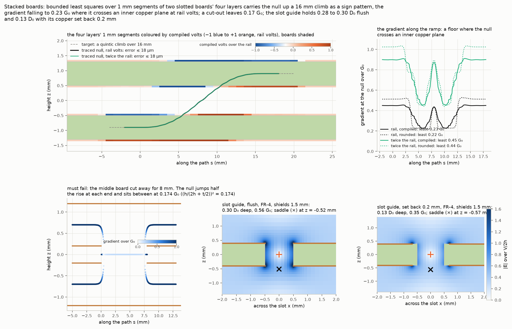

**Figure 3.** Stacked boards (section 3.3), from finite-difference Laplace solves in vacuum, the copper flush with the
slot's wall unless set back. Top left: a 16 mm quintic climb from the lower board's slot to the upper's on two 0.8 mm
boards 1.0 mm apart with 1.0 mm slots, the four layers' 1 mm segments coloured by the volts bounded least squares
compiles at rail volts (|w| ≤ 1; boards shaded): a sign pattern shifting up one layer at a time, the traced null within
18 µm of the target, and likewise at twice the rail. Top right: the gradient at the null along the ramp, compiled
(solid) and rounded to −1, 0, +1 (dotted): 0.23 G₀ where the null crosses an inner copper plane at rail volts (0.22
rounded) and 0.45 G₀ at twice the rail. Bottom left, the ramp that must fail: a gapless stack of three boards (h = 0.5
mm, a 0.4 mm middle board, its four faces driven alternately) with the middle board cut away for 8 mm; the null of each
channel jumps half the rise at each end, and in the cut-out it sits at 0.174 G₀, (h/(2h + t/2))². Bottom middle and
right: the slot guide's section in a 0.8 mm FR-4 board with a 1.0 mm slot, |E| over V/2h with the null (+) and the
escape saddle (×) a minimax flood finds: flush, 0.30 D₀ deep at 0.56 G₀ (0.28 D₀ and 0.50 G₀ in vacuum); the copper set
back 0.2 mm, 0.13 D₀ at 0.35 G₀, and 0.11 D₀ at 0.34 G₀ with the other board's copper 1.0 mm off.

### 3.4 Sticks and lattice knots

**Claim (sticks).** Stick numbers are 6, 7, 8 and 8 (Randell; Eddy and Shonkwiler). The D3 six-stick trefoil's corners
turn 128.8°, so sharp it holds W < D, and its consecutive corner planes meet at 46.1° and 20.1° (checked): along each
stick the facing pair must turn about the axis by that angle. **Proposition (orthogonal handover).** Near the null E_x −
iE_y = c·z, and turning the electrodes by α multiplies c by e^(−2iα): a 90° turn is a polarity swap, ELE-2's ln cosh u
keeping its u² and u⁶ terms and reversing u⁴, so null and gradient carry over and only the octupole part changes. No
polarity swap gives e^(−2iα) for 46.1° or 20.1°, so the sticks hand over through a twisted flex section, which keeps the
null exact (section 4.4) at a cost (τh)² of 5 × 10⁻³ and 1 × 10⁻³ for those angles over 10.4 mm, or through a
general-angle butt joint whose field the boundary-element solve gives; even the 90° butt joint takes a 3-D solve
(E2-20). **Design (sticks).** On section A (slotted RO4003C, section 5.1) m = 1 is 291 mm; the handover straights take
three secular wavelengths (section 6.2), 10.4 mm for 1 eV and 29.4 mm for 8 eV at q = 0.5, so the corners round to
8.0 mm for 1 eV (checked). **Claim (lattice).** The minimal lattice trefoil takes 24 steps (Scharein et al.) and 12
sticks or more (Huh and Oh); the one found here has 14 sticks in 8 planar runs and 7π of curvature, and corners of
radius R with straights s need a pitch of 2R + s (checked). **Design (L26; checked).** On section A at 915 MHz (h =
0.92 mm) m = 2 takes 582 mm: 24 steps of 26.2 mm with 10.4 mm straights and corners of 7.9 mm. A 1 eV well at q = 0.5
(54.9 V) takes 1.03 W through 1.47 kΩ and holds about 5 eV per eV of depth by the static rule at its corners; m = 3
takes 873 mm, a 40 mm pitch and 14.8 mm corners, and 1.5 W. With no symmetry every perturbation couples ±m, so L26
travels on compiled feeds alone.

### 3.5 Flex strips and their framing

**Proposition (straight strips).** A straight strip lies on the curve's rectifying developable, every bend toward a
board, and folds 1/|(τ/κ)′| from the curve: 10⁻⁴ mm on the first run's trefoil, 0.47 mm on the r/R = 0.45 trefoil at
318 mm, 1.5 to 3.3 mm on flatter trefoils and T(2,5). **Proposition (twist-free strips).** A strip whose normal is
carried by the twist-free axes is developable: its rulings u = T × n turn only along T (u′ = −κ_g·T), so its tangent
plane is constant along each ruling. It is limited by its in-plane radius 1/|κ_g| and comes back turned by the holonomy
α (CUR-1). **Proposition (closure).** A twist (kπ − α)/L closes it, one band of 2L for odd k and two of L for even k;
with a twist rate ω ≠ 0 the strip is no longer developable, its rulings turning by ω about its normal (|det(T, u, u′)| =
|ω|). **Claim (closure and symmetry; checked).** On the r/R = 0.45 trefoil at 318 mm α = −153° and the torsion sums to
−5.15π, so a strip keeps the three-fold symmetry only if it turns a multiple of 3π against the Frenet frame a lap. The k
= −1 closure (−0.085°/mm) turns 5π and breaks it; k = 0 (+0.48°/mm) turns 6π and keeps it. Because the frame winds 6π
against the Frenet frame, the curvature toward the boards κ_n passes through zero six times a lap (eight for k = −1)
while the strip twists at 0.0084 rad/mm; started so that the six curvature maxima turn 0.80 of their curvature toward
the boards, the k = 0 strip keeps an in-plane radius of 18.6 mm or more (15.6 mm for k = −1). **Claim (strain;
checked).** Twisted at ω across a half-width b with free edges, a strip strains its edges by +(ωb)²/3 and its centre by
−(ωb)²/6: +3.2 × 10⁻⁴ and −1.6 × 10⁻⁴ for k = 0 at b = 3.66 mm, beside the 0.36 % bending strain of 0.11 mm flex, and
the compression is 4.6 times the wrinkling scale (t/W)² = 3.5 × 10⁻⁵ of 43 µm flex 7.32 mm wide. **Hypothesis (flat
lay-up).** Cut as the planform of its centre line's geodesic curvature, the closed k = 0 strip seats between its spacers
flat to the 37 µm rms the gap budget allows; the shell model of section 8.1 and a coupon settle it (E2-23). **Claim (the
two plates; checked).** The plates' centre lines at ±h along the board normal differ in length by 2h·∮κ_n ds to first
order, and the curvature toward the boards keeps one sign over most of the lap (∮κ_n ds = −12.8 rad), so the outer plate
is 329.5 mm and the inner 306.1 mm: two different pieces, their planforms about 21 × 315 and 21 × 292 mm in their
smallest boxes, both fitting a 234 × 490 mm panel. **Claim (odd k; checked).** k = −3 (−1.22°/mm) turns 3π against the
Frenet frame and keeps C3, keeps an in-plane radius of 29.0 mm or more with its six curvature maxima 0.89 toward the
boards, has plates of equal length (∮κ_n ds near zero), and makes both plates one band of 2L, 639 mm, with one closing
joint. Its twist strains the edges by 2.0 × 10⁻³, 29 times the wrinkling scale, and its band develops into about 44 ×
570 mm, longer than the 490 mm panel, so at that fab it is two pieces and two joints. k = −1's band of 2L overlaps
itself when laid flat.

±0.1 mm on h = 0.5 mm moves the depth by −31 % to +56 %, and on the lead design's h = 0.915 mm by −19 % to +26 %, q with
it. **Mounting.** A former holds the strips by their edges (2 mm of PLA behind a flex ring halves its Q), and in vacuum
printed parts serve as jigs and outside mounts (Povilus et al.); inside the gap the 1.83 mm is held by sapphire or ruby
balls of that diameter (±2.5 µm, negligible outgassing) seated in laser-cut holes in the polyimide beside the copper at
the 24 stations, and the band is clipped at its edges by PEEK or RO4003C clips (RO4003C: 0.06 % mass loss, 0.00 %
condensables). Each plate is an open strip threaded along a printed jig of the knot and closed at its joint, the inner
plate first, then the spacers and the outer plate, the jig holding the joint's two ends in register to DR-11's alignment
while they are soldered or bonded (DR-14). JLCPCB makes the flex with ±0.1 mm outlines, in ENIG only; a bare-copper
finish takes another fab (section 5.4).

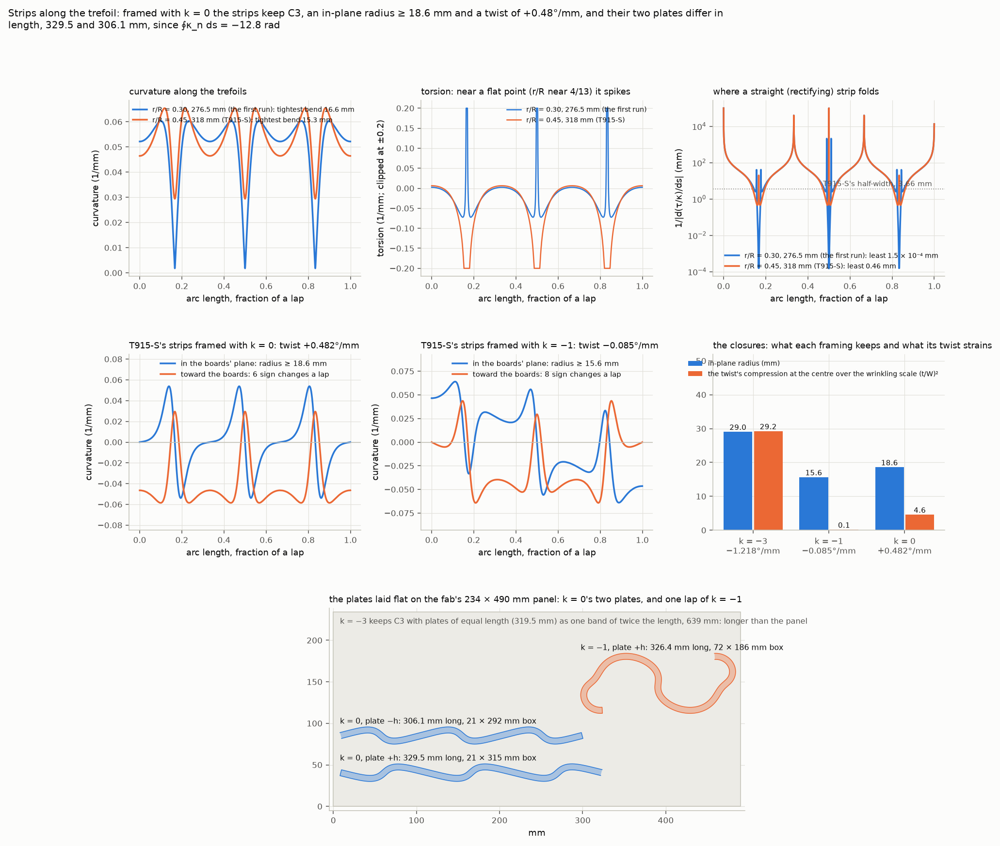

**Figure 4.** Strips along the trefoil (section 3.5), from `ClosedCurve.torus_knot`. Top: curvature, torsion (clipped at
±0.2 per mm) and 1/|d(τ/κ)/ds|, the distance at which a straight (rectifying) strip folds, along the first run's r/R =
0.30 trefoil at 276.5 mm, near the flat point 4/13, where the torsion spikes and the strip folds 1.5 × 10⁻⁴ mm from the
curve, and along T915-S's r/R = 0.45 trefoil at 318 mm, where it folds 0.46 mm out, inside its half-width of 3.66 mm.
Middle: T915-S's strips framed with k = 0 (+0.482°/mm) and k = −1 (−0.085°/mm), their curvature in the boards' plane and
toward the boards: k = 0 keeps C3 and an in-plane radius of 18.6 mm or more, κ_n changing sign six times a lap; k = −1
keeps 15.6 mm, and eight; right, the closures' in-plane radii (k = −3: 29.0 mm) and the compression their twist puts at
a strip's centre over the wrinkling scale (t/W)² of 43 µm flex 7.32 mm wide, 4.6 for k = 0 and 29 for k = −3. Bottom:
the plates laid flat on the fab's 234 × 490 mm panel: k = 0's two, 329.5 and 306.1 mm long in boxes 21 × 315 and 21 ×
292 mm (∮κ_n ds = −12.8 rad), and one lap of k = −1 in a box 72 × 186 mm.

### 3.6 One board

**R1, the single-board line (checked).** *Rails:* two rails keep 0.0091 of a four-rod well (ELE-3). At 915 MHz, q = 0.5
at 50 V puts the null 0.575 mm up, over rails 1.46 mm wide either side of a 0.40 mm grounded strip, in a 0.093 eV well;
a 1 eV well at q = 0.5 takes 543 V with the null 1.89 mm up, and at 1 eV with the null 0.5 mm up q is 1.89, past 0.908.
A rail ring one guided wave round, about 200 mm on 1.6 mm FR-4 (n_eff ≈ √((1 + ε_r)/2), an estimate) and 32 mm in
radius, holds about 2.6 eV by the bend rule and 1.5 to 2.2 eV by what rings tracked (section 6.1): the twin's first
calibration rung, with no island to hold. *Channel:* the board's own copper round a routed channel is the slot guide of
section 3.3; a channel ring m = 1 round on RO4003C is 210 mm (radius 33.4 mm), its 0.21 to 0.30 eV level at 40 V taking
0.64 W. A tab across the channel would cross the null at mid-thickness, so the island is held by a carrier board a few
millimetres below, joined to island and frame by posts where the guide's even disturbance has faded (exp(−πs/2h)); each
post is a joint whose count must not divide 2m. The same board carries resonator, feeds and pickups. *Control:* a flat
facing-board ring of T915-S's 318 mm (radius 50.6 mm) holds 33.4 eV per eV of depth by the static rule, 2.7 to 3.3 times
T915-S, the price of the knot at equal length (E2-22). *One flexible piece:* the rails on one flex ribbon make a
surface-electrode guide that follows any knot as one fabricated piece with no gap to hold and no plates to align
(T915-R), at the rails' share; it closes as the strips do (section 3.5).

## 4. Fields of segmented and multi-board guides

Facing boards at y = ±h split down x = 0 (ELE-2), the path along s, lengths in h, fields quasi-static.

### 4.1 Where the null is exact

**Proposition (one antisymmetry).** Electrodes and volts odd under reflection in a plane M make φ vanish on M, and the
zeros of the normal field form a curve that persists under any change keeping the antisymmetry; on it the whole field
vanishes, without axial field or ripple. Flat pieces keep the midplane whatever their in-plane bends, gaps and jogs;
ramps, steps and out-of-plane bends keep x = 0; a helix keeps a null by screw symmetry. **Proposition (axial field).**
Elsewhere E_s = −dφ/ds on the transverse-null curve, so ripple, e²(dφ/ds)²/(4mω²), comes where curvature or torsion
changes and where two symmetries break together.

### 4.2 How far a joint reaches

**Proposition (decay by parity).** Disturbances odd across the midplane fade as exp(−πs/h) or faster, even ones (common
mode, steps, ramps) as exp(−πs/2h): e-folding in 0.16 and 0.32 mm at h = 0.5 mm. **Claim (width floor).** On boards W
wide the even ones stop near 0.1·exp(−πW/4h) of the drive, 5 × 10⁻⁴ at 6h, unless a grounded surround closes the edges.

### 4.3 Joints, gaps, angles and ramps

| Feature | Null | Axial field on the null | Gradient |
| --- | --- | --- | --- |
| bare gap d across both boards | on the axis | none | down 0.47·(d/h)^1.8: 2.7 % at 0.2h |
| grounded strip 0.5h long | on the axis | none | 0.60 of full |
| offset sideways or vertically alone | jogs | below 10⁻¹¹ V/h on a mirrored mesh | |
| offset dx sideways and dy vertically | jogs both ways | 0.32·V·dx·dy/h³ | |
| ramp kink α | 0.275h per radian inward | none | −2 % at 15°, −9 % at 45° |
| corner in the board plane | 0.20h to 0.25h per radian inward | none | 0.985 at 30°, 0.840 at 90° |
| ramp kink that yaws (30°, 20°) | | 0.003 to 0.03 V/h (Hypothesis) | |

**Hypothesis (the kick).** Crossing an oscillating axial field an electron changes energy by up to e·V·K(ωh/v), K the
field's Fourier amplitude at ω/v, and this sets the tolerances (E2-14). **Proposition (adiabaticity).** ωh/v =
(4.44/q)·√(D/W) on facing boards. In a 1 eV well at q = 0.5 (50 V) it is 6.28 at 2 eV and 3.14 at 8 eV, so a 0.2h offset
both ways kicks a 2 eV electron about 69 meV and an 8 eV one about 0.55 eV, half the well, at each pass (K ≈ 0.0014 and
0.011, the verifier's table), and a 1 % common-mode imbalance 1.9 and 43 meV, in any band; 0.2h is 0.18 mm at 915 MHz
(checked). The alignment budget therefore follows the registered energy: the 7 % of the well that 0.2h costs at 2 eV
takes 0.071h, 65 µm, at 8 eV, and DR-11 holds the registered energy's figure. **Hypothesis (separation).** Pieces of
different symmetry 4h apart keep about 4 × 10⁻⁴ of their co-located axial field (E2-25).

### 4.4 Bends, torsion and width

**Proposition (bends, first order).** The null moves inward by 0.1405·h²/R on a bend in the board plane and 0.318·h²/R
on one out of it: 7.7 and 17 µm on T915-S's 15.3 mm bend (checked). **Proposition (torsion).** Uniform twist keeps the
null exact and costs order (τh)², 6 × 10⁻⁵ at +0.48°/mm (checked). **Claim (width, split).** Width W keeps a barrier
(V/2h)·(1 − 1.75·exp(−πW/4h)), 0.242 of four rods at 6h; a split w costs (π²/32)·(w/h)² of the gradient.

### 4.5 The three-dimensional method and its validation

The study's numpy boundary-element solver (flat triangles, the closed-form panel integrals of Wilton et al., mirrored
meshes, a Newton null tracker) solved 6400 triangles in 9 s and a knot in windows about 20h long; it becomes a module
with unsymmetrised meshes as well (section 8.1). Flat pieces take the closed-form kernels k/sinh(kh) and 1/cosh(kh) for
a pattern's odd and even parts (Proposition), and bempp-cl (Betcke and Scroggs) is the open route to one global solve.
**Claim (accuracy).** Straight sections come out to 0.1 to 1 %, bends to 1 to 5 %, the offset joint to 6 %, bare-gap
dips 25 to 40 % high and yawed ramps to an order of magnitude, so every run carries a must-fail control (the offset
joint reading 0.32·V·dx·dy/h³) and a halving of its panels. A mirrored mesh puts the axial field of a single-symmetry
piece at its own symmetry floor, so E2-1 runs on an unsymmetrised mesh against that mesh's floor; bends are scored
against an axisymmetric quadrature reference (E2-2), and the boundary-element solve's bias against it, 2.5 to 4.5 % at R
= 40h, is DR-0's calibration.

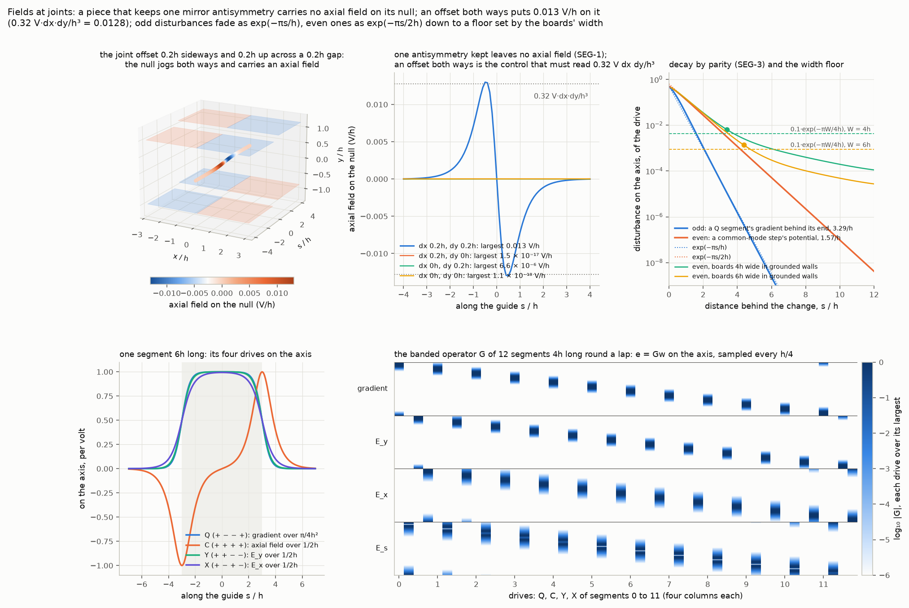

**Figure 5.** Fields at joints (section 4), from finite-difference solves in three dimensions and the Fourier kernels
between two planes, h = 1. Top left: facing boards 6h wide in two segments across a 0.2h gap, the second offset 0.2h
sideways and 0.2h toward the top board, the null traced by Newton steps in each section and coloured by the axial field
on it. Top middle: that field along the guide: at most 0.0130 V/h for the offset both ways, the control that must read
0.32·V·dx·dy/h³ = 0.0128; 7 × 10⁻⁶ V/h for the upward offset alone, the tracker's floor on this grid, and under 2 ×
10⁻¹⁷ for the sideways one alone and for none: a piece that keeps one antisymmetry carries no axial field on its null
(SEG-1). Top right: decay by parity behind a change: a Q segment's gradient e-folds at 3.29/h behind its end, exp(−πs/h)
with its algebraic prefactor, and a common-mode step's potential at 1.57/h (π/2); on boards 4h and 6h wide inside
grounded walls 8h out, the even disturbance leaves the wide boards' exponential at 6.5 × 10⁻³ and 1.4 × 10⁻³ of the step
(dots), near 0.1·exp(−πW/4h) (dashed: 4.3 × 10⁻³ and 9.0 × 10⁻⁴), and then decays slowly. Bottom left: one segment 6h
long and its four drives on the axis, per volt: Q's gradient over π/4h², C's axial field over 1/2h (sech(πs/2h) at each
end), Y's E_y and X's E_x over 1/2h. Bottom right: the banded operator G of twelve segments 4h long round a lap, e = Gw
on the axis every h/4, each drive's column over its largest entry; 5 % of the entries exceed 10⁻³ of the largest.

### 4.6 What the compiler sees

| Drive | Pattern: top left, top right, bottom left, bottom right | On the axis, per volt | Reach |
| --- | --- | --- | --- |
| Q, confinement | +, −, −, + | gradient π/4h² | odd |
| C, axial | +, +, +, + | (1/2h)·sech(πs/2h) at each end | even, to the floor |
| Y, steers along x | +, +, −, − | E_y = 1/2h | odd |
| X, steers along y | +, −, +, − | E_x = 1/2h | even, to the floor |

T915-S's strips are continuous copper with two feeds, so its one live unknown is the second feed's weight; Q, C, Y and X
become per-segment drives once the strips are cut into DC-isolated, RF-continuous segments (T915-S6, section 6.4).
**Claim (steering; checked).** Y and X at DC push the electron off the RF null into micromotion, as ion traps compensate
stray fields: 12.0 mV per micrometre at q = 0.5 and 915 MHz. At RF, in phase with Q, they move the null itself, 86 mV
per micrometre at 50 V, which one channel supplies only through copper (alignment) or the dividing network. So DC
steering compensates stray fields (contact potentials, patches, charging, section 6.1), and the null's place is frozen
in copper. **Proposition (common-mode step).** A step Δc between segments puts E_s = −(Δc/2h)·sech(πs/2h) on the axis,
with transit factor sech(ωh/v): a gap when static, a bump at RF. **Hypothesis (the operator).** The knot's field is the
virtual antenna's `e = Gw` with electrodes for elements, and its specification (no transverse field, a target gradient,
no axial field) a linear system banded to the even floor; at RF the drives are the settings of the network dividing the
HackRF's one channel.

## 5. Driving the knot

### 5.1 The line

Four strips carry three quasi-TEM modes, and only the quadrupole has no field on the axis. A quadrant solve calibrated
on ELE-2, with Wheeler's rule for copper loss on the copper's thickness (calibrated on stripline to 1 %), gives Z₀,
n_eff and Q for two sections: A, rigid, 35 µm copper strips 1.5h wide either side of a split g = h routed as a slot; B,
flex, 18 µm copper 8h wide, split 0.3h, on 25 µm polyimide. S2-C3's own line, the slot guide, is in section 3.3. **Claim
(index by band; checked).** At 915 MHz (h = 0.915 mm) section B's polyimide holds 7.4 % of the field energy and n_eff =
1.031; at 2.45 GHz (h = 0.343 mm) 15.2 % and 1.065, on grids that resolve the copper's 18 µm and the polyimide's 25 µm.
A 307 mm ring drawn with the 2.45 GHz index resonates at 947 MHz; m = 1 at 915 MHz takes 318 mm on the polyimide alone
and about 312 mm with 25 µm of adhesive behind it (n_eff near 1.05), so the length is set from a coupon's measured
index. Its gap sensitivity d ln Z₀/d ln h is 0.40 to 0.51 (this solve and the buildability lens's), and its Z₀ is
41.7 Ω. **Hypothesis (straps).** The left-right mode runs within 0.1 % of the quadrupole on slotted boards; straps
joining diagonal strips at the joints short it, if their count does not divide 2m (E2-17).

### 5.2 The ring

**Proposition (uniform means travelling).** V = a·e^(−iβs) + b·e^(iβs) has constant |V| exactly when ab = 0, its ripple
the smaller amplitude over the larger, so the target V₀·e^(−i2πms/L) is linear. **Proposition (shunt resistance).** A
ring of m guided wavelengths carrying a travelling wave has R = Z₀Q/(2πm) and dissipates P = πfC′V²L/Q. **Proposition
(selection rules).** A perturbation of period L/N couples ±m only when N divides 2m (NFD-6), and K equal feeds reach −m
only when K divides 2m: a trefoil travels for m ≠ 3k, T(3,4) for odd m, each for the symmetry of what is built. A
two-fold curve couples ±m for every m, and m = 3k on a trefoil likewise; each travels when its perturbations are weak,
2Q|c₂ₘ| ≤ 1 (smooth joints, cancelling pairs), or on feeds compiled at its joints, which drive both standing waves,
while three strong joints at m = 3 stay the case that must fail. **Proposition (cancelling pairs).** Identical
perturbations a quarter guided wavelength apart cancel: two closing joints so placed keep 0.998 of a perfect ring's
depth per watt, against 0.66 side by side. **Claim (backscatter).** A net reflection S builds a backward wave
|S|·Q/(2πm) (Kippenberg et al.), and impedance varying round the ring splits ±m by Δf/f = 2|c₂ₘ| (Little, Laine and
Chu), c₂ₘ the lap harmonic 2m of ln Z. **Hypothesis (spacer tolerance).** N spacers of independent relative gap error σ
give |c₂ₘ| ≈ S·σ/√N in rms, S = d ln Z₀/d ln h, so 2Q|c₂ₘ| is about 0.9 linewidths in rms at Q 214, S 0.5, 24 spacers
and 2 % (37 µm); the ring model's 60 draws on T915-S give a median of 0.78 and 1.44 at the 90th percentile, the closing
joints' ±1 % alone 0.28 (checked). Splitting past a linewidth defeats a fixed hybrid and not re-solved feeds
(section 5.3), so the spacers are held to 2 % rms on the strength of the compiled drive rather than of 2Q|c₂ₘ| ≤ 1;
whether balls in their seats hold 37 µm rms on an assembled flex pair is a metrology check, a feeler or capacitance
gauge at each station (DR-14). **Hypothesis (curvature backscatter).** Curvature changes the impedance at order (hκ)²,
and k = −1 strips carry it at 2m on every torus knot; k = 0 removes it (E2-7), and the two sensitivities of Z₀ to κ_n
and κ_g come from bent-section solves in stage 0. **Proposition (loss ripple).** Fed at one place the depth falls by 1 −
e^(−2πm/Q) a lap, 2.9 % at 915 MHz with Q 214 (checked).

### 5.3 K feeds: the first compile problem

A ring model closes line matrices round the knot with toleranced joints and capacitive feeds, giving V(sᵢ) = Σ Gᵢₖwₖ
over 240 samples. The compile minimises ‖Gw − V₀·e^(−i2πms/L)‖² + μ‖w‖², relaxes the target's phase and repeats, scoring
the least ripple at efficiency ≥ 0.8. **Claim (two cheap modes).** On section A's ring at 915 MHz (slotted RO4003C, Q
251, 290 mm, R 2934 Ω, six joints of 3 mm at 1.4 Z₀, ±10 % in impedance, ±0.5 mm in position) with K = 6 the singular
values are 3632, 3632, 29.3, 10.0, 10.0 and 5.3 V/A: the ±m modes over a floor 124 times lower. **Claim (ripple against
K, section A).** Medians of 20 tolerance draws on that ring:

| Case | K = 1 | 2 | 6 | 12 | Feeds at the joints | Untuned hybrid |
| --- | --- | --- | --- | --- | --- | --- |
| 915 MHz, m = 1 | 0.99 | 0.037 | 0.010 | 0.007 | 0.006 | 0.40 |
| the same, feed susceptance compensated | | 0.009 | 0.007 | | 0.006 | 0.38 |
| 2450 MHz flex, m = 2 | | 0.100 | 0.054 | | 0.012 | |
| must fail: m = 3, three joints, 2450 MHz | 0.54 | 0.69 | 0.76 | | 0.97 | 0.66 |

Two compiled feeds remove the resonant backward wave in the median, one draw in ten keeping 0.2 to 0.4 (at 915 MHz with
two, three, six and eight feeds, at 2450 MHz with four); feeds at the joints have no such tail. An untuned network
starts at 0.19 with plain coupling capacitors, so the weights are compiled from the built ring's measured G. **Claim
(T915-S; checked).** Section B at 318 mm (n_eff 1.031, Q 214 on bare copper), 24 spacers at σ rms gap error, two closing
joints of 29.4 mm at −2 ± 1 % in impedance placed a quarter guided wave (79.4 mm) apart with ±0.5 mm, feeds a quarter
guided wave apart, the laminate ±10 %; the buildability lens's nodal-admittance ring with d ln Z₀/d ln h = 0.5; medians,
the 90th percentile in brackets:

| Case | Draws | Splitting, linewidths | Fixed hybrid: \|b/a\|; depth per watt | Re-solved feeds: \|b/a\|; depth per watt |
| --- | --- | --- | --- | --- |
| bare copper, σ = 1 % | 30 | 0.60 (0.86) | 0.10 (0.14); 0.80 | 0.008 (0.014); 0.97 |
| bare copper, σ = 2 % | 60 | 0.78 (1.44) | 0.13 (0.24); 0.74 | 0.013 (0.020); 0.94 |
| bare copper, σ = 3 % | 30 | 1.24 (1.95) | 0.20 (0.32); 0.60 | 0.011 (0.026); 0.92 |
| ENIG, Q 167, σ = 2 % | 30 | 0.54 (1.27) | 0.09 (0.21); 0.78 | 0.009 (0.019); 0.95 |
| ENIG, Q 45, σ = 2 % | 30 | 0.16 (0.35) | 0.04 (0.07); 0.89 | 0.014 (0.027); 0.95 |
| bare copper, σ = 2 %, split etched ±20 % | 30 | 0.97 (1.74) | 0.16 (0.28); 0.68 | 0.012 (0.021); 0.94 |

Depth per watt is the weakest point's, relative to a perfect ring; at σ = 2 % its 10th percentile is 0.93 with re-solved
feeds and 0.55 with the hybrid. The re-solved second feed reached the search's ±6 dB bounds in some draws, so it spans
at least ±6 dB and 360°. **Claim (re-solved weights).** On the 2.45 GHz strips at 2.9 % rms spacer error two re-solved
weights keep 0.95 of a perfect ring's depth per watt against a fixed hybrid's 0.81, the solve holding the direction of
travel.

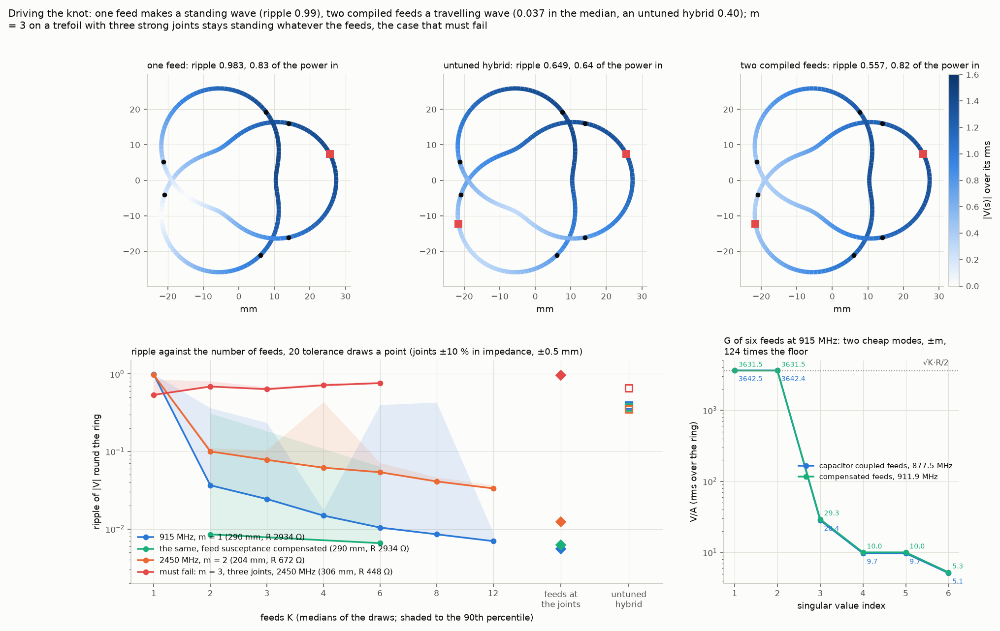

**Figure 6.** Driving the knot (section 5.3), from a ring of transmission line closed on itself with joints and
capacitively coupled Norton feeds, the drive lens's ring model typed. Top: one tolerance draw of section A's ring at 915
MHz (290 mm, n 1.13, Q 251, Z₀ 73.5 Ω, six 3 mm joints at 1.4 Z₀ drawn ±10 % and ±0.5 mm), |V(s)| over its rms on the
trefoil for one feed (ripple 0.98: a standing wave), the untuned 90° hybrid (0.65) and two compiled feeds (0.56); feeds
red, joints black. Bottom left: ripple against the number of feeds, medians of 20 draws shaded to the 90th percentile:
at 915 MHz and m = 1, 0.986 for one feed, 0.037 for two, 0.010 for six and 0.007 for twelve, 0.006 with the feeds at the
joints and 0.40 for the untuned hybrid; with the feeds' susceptance compensated, 0.009 for two and 0.007 for six (the
hybrid 0.38); at 2450 MHz and m = 2, 0.100 and 0.054 (0.012 at the joints); and m = 3 on a trefoil with three strong
joints, the case that must fail, 0.54 to 0.76 whatever the feeds and 0.97 with them at the joints. Bottom right: the
singular values of G for six feeds at the resonance: two cheap modes, ±m, at 3642 V/A with capacitor-coupled feeds and
3632 compensated (√K·R/2 = 3594), over a floor 124 to 128 times lower.

### 5.4 Q and volts per watt by laminate

For a 1 eV well near q = 0.5 (f·h = 0.839 MHz·m), bare copper faces, 18 µm thick on flex and 35 µm on rigid boards,
unless stated:

| Section, band, m | Laminate | Field energy in it | Q | R | Power for 1 eV |
| --- | --- | --- | --- | --- | --- |
| A, 915 MHz, 1 | FR-4 0.8 mm, solid; slotted | 0.59; 0.24 | 65; 121 | 611; 1336 Ω | 2.5; 1.1 W |
| A, 915 MHz, 1 | RO4003C 0.51 mm, slotted | 0.19 | 251 | 2934 Ω | 0.51 W |
| A, 915 MHz, 1 | polyimide 50 µm in air | 0.11 | 241 | 3066 Ω | 0.49 W |
| B, 915 MHz, 1, 318 mm | polyimide 25 µm; bare copper, ENIG | 0.074 | 214; 167 to 45 | 1.42; 1.11 to 0.30 kΩ | 0.89; 1.14 to 4.23 W |
| B, 2450 MHz, 2, 230 mm | polyimide 25 µm; rigid FR-4 | 0.15; 0.62 | 134; 52 | 418; 117 Ω | 3.0; 10.8 W |
| slot guide, 915 MHz, 1 | FR-4 0.8 mm; RO4003C 0.813 mm, 0.5 mm strips | 0.85; 0.81 | 43; 117 | 412; 1243 Ω | 0.21 to 0.30 eV at 40 V: 1.9; 0.64 W |

Solid laminate holds half or more of the field energy, a slot between facing boards or thin flex a fifth or less, and a
slot guide four-fifths, its quadrupole putting the laminate between opposite volts: a field mostly in the air gap is a
design result. The rigid fab's rules (slots ≥ 1.0 mm, copper 0.2 mm back) widen section A's split to about 1.5h at
915 MHz, for the solver to re-score. **Claim (the split as a lever; checked).** The copper's loss sits at the split's
edges, so at the same 1 eV well at q = 0.5 and 915 MHz, the well solved at each split, a wider split buys the power
back: from 0.3h to h the strips' Q rises from 210 to 290 and the null's gradient falls from 0.77 to 0.61 V/h², so the
gap closes to keep q (h from 0.90 to 0.72 mm) and the volts fall from 49.5 to 39.6 V, and the well takes 0.88 W at 0.3h,
0.51 W at 0.6h, 0.33 W at h and 0.26 W at 1.25h; at 1.5h it leaks through the split, its depth share falling from 0.248
to 0.189 of four rods', and takes 0.31 W. **Hypothesis (finish).** The fab's flex is ENIG only, whose nickel raises the
faces' surface resistance 1.3 to 5 times at 915 MHz by a layered skin-depth estimate (Coonrod measured ENIG's added
loss): the conductor Q falls from 228 to between 176 and 46, Q to between 167 and 45, and 1 eV on T915-S takes 1.14 to
4.23 W (checked). Two ring coupons settle it (DR-13), and the feed capacitors follow them, critical coupling moving from
0.47 to 1.05 pF in series across that range.

### 5.5 The frequency

At 915 MHz, m = 1 (318 mm) takes 0.89 W for 1 eV on bare copper and 1.14 to 4.23 W on the fab's ENIG, holds 6 to 10 eV
per eV of depth (the static in-plane limit discounted as four rods tracked, section 6.1, until E2-9 tracks facing
boards), tolerates 2 % (37 µm) of gap error with re-solved feeds and rises 34 K on radiation cooling (42 to 112 K on
ENIG); at 2450 MHz, m = 2 (230 mm) takes 3.0 W on bare copper, holds 12 to 19 eV per eV on the same terms, allows 5.5 %
(37 µm) by a 12-draw Monte Carlo and rises 200 K; at 5800 MHz, m = 5 takes about 13 W by the line solver with its copper
resolved, a figure that waits for DR-0's calibration at that size. **The first trefoil runs at 915 MHz, m = 1**, for the
least power, millimetre tolerances 1.0 to 2.7 times looser and a 0.27 mm split (2.45 GHz's 0.10 mm clears the fab's
0.089 mm flex rule by 0.011 mm, inside the ±20 % etch), at the cost of an in-plane radius of 5.1 half-widths and a 2W
rule met by 0.65 mm (checked). On ENIG the same choice takes the amplifier of section 5.6 to +37.0 dBm; a bare-copper
fab keeps it at +30.0 dBm.

**Proposition (impact bound).** In a uniform field E₀·cos(ωt + φ) an electron's speed changes by at most 2eE₀/(mω), so
impacts between facing strips carry at most (√W₀ + √(8D))². **Proposition (frequency drops out).** At fixed q, V =
35.7·q·(fd)² V and D = 1.42·q²·(fd)² eV (fd in GHz·mm, d = 2h): the multipactor chart point depends on D and q alone.
**Claim (level 1).** The line at q = 0.5 sits 5.2 dB below ECSS-E-ST-20-01C's copper boundary at 1 eV and crosses it at
3 eV; with dielectric in the split the standard asks for level 2 with measured yield at 7 to 8 dB. **Hypothesis (level
2).** In the strips' own field the secondary population decays at 1 eV and grows from 3 eV, so copper caps wells near
2 eV and deeper ones take a low-yield surface (Baglin et al.). The model behind it was fitted on the same five ECSS
points with one tuned parameter, and the 2-D tracker's 2 eV result changes sign with its laminate model, so it waits for
DR-0's held-out point; the buildable surface is gold over nickel as received, whose yield DR-8 measures. **Claim (the
split's band; checked).** First-order two-surface multipactor across a gap g spans (ωg)²/(|e/m|·√(π² + 4)) to
(ωg)²/(|e/m|·π): 42 to 50 V for g = h, at the edge of section A's 1 eV drive, and 3.8 to 4.5 V for section B's 0.3h, far
below its 50 V.

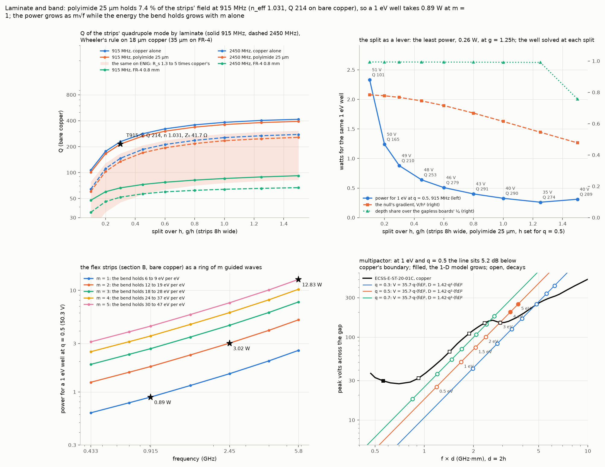

**Figure 7.** Laminate and band (sections 5.4 and 5.5), from finite-volume sections of the facing strips 8h wide with
the copper's thickness resolved, 18 µm on flex and 35 µm on FR-4, the copper's loss by Wheeler's rule. Top left: Q of
the quadrupole mode on bare copper against the split g/h, for the copper alone, behind 25 µm polyimide and behind 0.8 mm
FR-4, at 915 MHz (solid) and 2450 MHz (dashed), shaded for polyimide at 915 MHz with ENIG's surface resistance 1.3 to 5
times copper's; the star, section B at g = 0.3h: n_eff 1.031, polyimide share 0.074, Z₀ 41.7 Ω, Q_c 229 and Q 214
(section 5.1's solve: 1.031, 0.074, 41.7 Ω, 228 and 214). Top right: the power the same 1 eV well takes at q = 0.5 and
915 MHz against the split, the well solved at each split and h set for that q: 2.3 W at 0.1h, 0.88 W at 0.3h, 0.51 W at
0.6h, 0.33 W at h and 0.26 W at 1.25h, the well leaking through the split at 1.5h (0.31 W). Bottom left: the power a
1 eV well takes at q = 0.5 (50.3 V) on section B closed as a ring of m guided waves, against frequency: 0.89 W at
915 MHz and m = 1, 3.02 W at 2450 MHz and m = 2, 12.8 W at 5800 MHz and m = 5; the bend holds, by the static limit
discounted as four rods tracked, 6.0 to 9.4 eV per eV at m = 1 and 12.0 to 18.7 at m = 2, growing with m alone while the
power grows as m√f. Bottom right: ECSS-E-ST-20-01C's copper boundary with the operating lines V = 35.7·q·(fd)² at q =
0.3, 0.5 and 0.7 (D = 1.42·q²·(fd)²): at 1 eV and q = 0.5 the line sits 5.2 dB below the boundary, which it crosses near
3 eV. The markers are a one-dimensional two-surface Monte Carlo on copper's yield standing in for level 2's
two-dimensional tracker (filled: the population grows; open: it decays). On ECSS's boundary itself (squares) this model
decays between 0.9 and 2.9 GHz·mm, so there it is not conservative; along q = 0.5 its population decays from 0.5 to
2 eV, is marginal at 3 eV and grows from 4 eV.

### 5.6 The drive chain with the HackRF Pro alone

The HackRF Pro sends one CW tone; its maker publishes no transmit power (the HackRF One gives 5 to 15 dBm at 915 MHz),
so the first bench session measures it. An amplifier of 15 to 32 dB on its own supply reaches the +30.0 dBm that 1 eV on
bare copper takes after the coupling and the +31.0 to +37.0 dBm that ENIG takes (checked); hobby 915 MHz modules of a
few watts cost about $20 to $60 and lab amplifiers $300 and more (rough), and DR-5 measures the one chosen. A 90° hybrid
printed on the feed board serves two feeds, and a vector modulator on the second (an ADL5390-class part, about $20 to
$40) spans at least ±6 dB and 360°, errors ε and φ in its ratio leaving |b/a| = ε/2 and φ/2. Each feed is a balun and
two 0.93 pF capacitors (0.47 pF in series for 1.42 kΩ, checked), the ring drawn for the loaded line. Pickups feed
detector diodes on the controller's ADC, since the half-duplex HackRF cannot listen while it drives: three a sixth of a
guided wave apart (53 mm) give b/a, and from magnitudes alone four states per pickup (each feed alone, both in phase,
both in quadrature) fix the ratio of its two entries of G, the 4K − 4 count of `docs/VIRTUAL_ANTENNA.md` section 4.9 for
K = 2. **Hypothesis (radiation).** At m = 1 the knot is 0.97 of a free-space wavelength round (checked), so its common
mode radiates as a one-wavelength loop, and keeping that under 1 % of the loss takes about 36 dB of balun rejection
(E2-18).

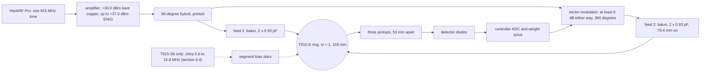

**Figure 8.** The drive chain with the HackRF Pro alone: one 915 MHz tone, an amplifier on its own supply, a printed 90°
hybrid and a vector modulator on the second feed, each feed a balun and two 0.93 pF capacitors into T915-S's strips;
three pickups 53 mm apart through detector diodes to the controller's ADC, which re-solves the second feed's weight;
dashed, T915-S6's chirp into the segments' bias stars.

## 6. Particles in the knot

### 6.1 Energy held against curvature

**Proposition (static maxima).** The force along four rods' weak diagonal, from U/D = u²/(1 + u⁴)², peaks at
0.6997·D/r₀, and in the plane of facing boards, from U = D·tanh²(πx/2h), at 1.209·D/h. **Claim (static bend limits).** A
particle sits where the restoring force equals 2Wκ, so four rods hold 0.350·D·R/r₀, 0.70 of `rf.bend_limit_ev`'s rule,
and facing boards bent in their plane 0.605·D·R/h (checked). **Claim (tracked).** Four rods at 1 GHz on the first run's
277 mm trefoil hold 3.5 eV and lose 3.75 eV at q = 0.3 when matched to the bend (3.0 and 3.25 eV on axis), 0.67 to 0.72
of the 5.2 eV rule against the derived 0.70 and 0.95 of the static limit; at q = 0.6, 9 eV, 0.43 of the rule and 0.61 of
the static limit, where a flat ring of the same length holds 32 eV, the knot's price. There the local q toward a rod
passes 0.908 at 0.543 r₀ (Hypothesis), so q near 0.3 gives the most energy per volt. At the same length T(3,4) holds
2.6 eV and T(2,5) about 2.9 eV at q = 0.3, matched: each knot needs its own threshold.

**Earth's field, a term (checked).** Rule 1 puts no coil or shield round the boards, and at 50 µT an electron's
gyroradius is 67 mm at 1 eV and 191 mm at 8 eV, so on T915-S's 15.3 mm bend the v × B force is 23 % and 8 % of the
centripetal 2Wκ. It is fixed in the lab while the bend turns along the knot, so it breaks C3, moves the equilibrium by
4.5 µm at 1 eV and 12.8 µm at 8 eV (against the bend's own 20 and 160 µm), and adds to the bend at some places and takes
from it at others, the other way for the other sense of travel: the held energy goes as W_max/(1 ± R/r_g), a difference
of up to 2R/r_g, 16 % near 8 eV, at the orientation that lines v × B up with the tightest bend. It is a tolerance draw
of orientation on the twin (section 8.3) and the test E2-15; planar windings on the boards themselves, a few
ampere-turns, cancel it within rule 1 where E2-15 shows it matters. **Contact potentials and patches, a term
(checked).** 0.1 V between the plates across 1.83 mm moves a 1 eV electron's equilibrium by 8.3 µm at q = 0.5, the size
of the bend shifts tracked; DC steering (section 4.6) compensates it at 12 mV per micrometre, and the twin draws it,
with the charge that exposed dielectric collects (S2-C3's slot walls 0.5 mm from the null, the polyimide in T915-S's
0.27 mm split).

**Hypothesis (facing boards are stiff toward the boards; derived here from ELE-2, checked).** On x = 0 ELE-2's field is
(V/2h)·tan(πy/2h), so the well toward a board, D·tan²(πy/2h), has no barrier and no force cap, where in the plane tanh²
caps it at 1.209·D/h; the local q, q₀·sec²(πy/2h), limits it instead, reaching 0.908 at y = 0.47h for q₀ = 0.5 with a
force of 5.15·D/h. A bend toward the boards then holds at least twice one in their plane, and the framing sets what a
strip knot holds: the k = 0 trefoil at 915 MHz keeps its in-plane radius at 18.6 mm or more, 12.3 eV per eV of depth by
the in-plane limit, against 10.1 eV were its 15.3 mm bend in the plane (checked). The tan² well is the gapless field on
the line that runs into the split, where the exposed polyimide sits and the gapless formula holds least, and the local q
passes 0.908 at 0.47h, where the pseudopotential picture ends; so until E2-9 tracks facing boards, T915-S is designed on
0.61 to 0.95 of the in-plane limit at its tightest bend, 6 to 10 eV per eV of depth, and the 12.3 is the hypothesis's
figure, not a design number.

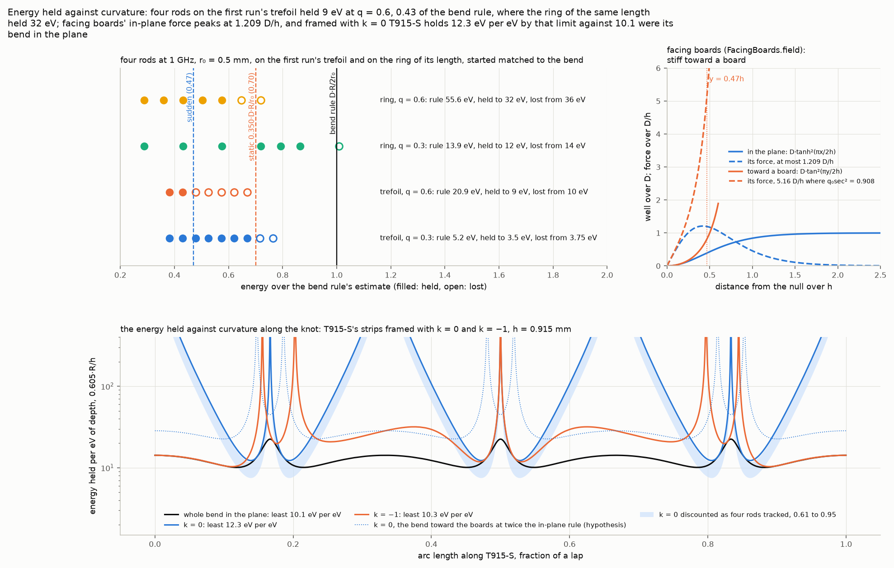

**Figure 9.** Energy held against curvature (section 6.1). Top left: electrons through four thin rods 0.5 mm from the
axis at 1 GHz (`QuadRods`, `integrate`, `GuideWatch`; 30 steps an RF period, 6 laps, started on the bend's static
equilibrium), on the first run's trefoil (276.5 mm, tightest bend 16.6 mm) and on the flat ring of its length, at q =
0.3 and 0.6, against energy over the bend rule D·R/2r₀ (filled held, open lost), with the static limit (0.70 of the
rule) and the sudden one (0.47): the trefoil holds 3.5 eV and loses 3.75 at q = 0.3, holds 9 eV and loses 10 at q = 0.6
(0.43 of the rule, 0.61 of the static limit), where the ring holds 12 and 32 eV. Top right: the facing boards' well from
`FacingBoards.field`, D·tanh²(πx/2h) in their plane with a force of at most 1.209 D/h (four rods' weak diagonal: 0.6997
D/r₀), and D·tan²(πy/2h) toward a board, which has no barrier: the local q₀·sec²(πy/2h) reaches 0.908 at y = 0.47h for
q₀ = 0.5, where the force is 5.16 D/h. Bottom: the energy held against curvature along T915-S (h = 0.915 mm), per eV of
depth, by the in-plane static limit 0.605·R/h: at least 10.1 were its whole bend in the boards' plane, 12.3 with the
strips framed k = 0 (shaded: discounted 0.61 to 0.95 as four rods tracked) and 10.3 with k = −1; dotted, k = 0's bend
toward the boards at twice the in-plane rule, the hypothesis E2-9 tests.

### 6.2 Joints as stopbands, and where to put them

A joint is felt through the distance per RF period v/f and the secular wavelength v/f_s: 0.65 and 3.5 mm at 1 eV on the
915 MHz strips at q = 0.5, where the tune ν = f_s·L/v is 92 on 318 mm, falling to 32 at 8 eV (checked). **Claim (six
families).** With g_k the lap harmonic k of ΔG/G₀ and β = 2f_s/f, a gradient dip is resonant at k·f_rev = 2f_s and f ∓
2f_s, a sideways null step at f_s and f ∓ f_s: the integer and half-integer stopbands (Courant and Snyder) with RF
sidebands that a short joint makes first order. Tracked centres agree to 0.3 % against the integrator's f_s; the exact
Mathieu f_s moves them up to 0.4 %, so predictions use it. **Proposition (placement).** J equally spaced joints drive
only lap harmonics nJ (NFD-5's lemma), joints on one orbit of a knot's symmetry nS, and by Parseval placement moves band
strength without removing it. **Proposition (exchange).** Each resonance is a wave cos(Kz ∓ ωt), so H − (ω/K)·p_z is
conserved: particles slow on 2f_s, f_s and f + 2f_s and speed up on f − 2f_s and f − f_s.

**Claim (tracked).** On the unrolled first-run guide (q = 0.6, 241 energies from 3.9 to 4.5 eV, 40 laps) none is lost
without joints, 87 to 88 with six 1 mm joints of 15 % dip, 112 to 165 with the same placed irregularly, 42 to 46 with
three, none with 4 or 8 mm joints. **Rules.** Smooth over 3v/(f(1 − β)) a joint removes the sideband families, 3.1 to
8.8 mm from 1 to 8 eV at 915 MHz, and over three secular wavelengths the f_s null-step family, 10.4 to 29.4 mm
(checked). So T915-S's closing joints are scarfed over 29.4 mm or more for its 8 eV registration, the sticks' and
lattice's twisted straights take 10.4 mm for 1 eV and 29.4 mm for 8 eV, and a 6 mm straight meets 3v/(f(1 − β)) only up
to 3.7 eV (checked). **Claim (tolerance).** Board offsets of 50 µm rms per axis (0.1h at h = 0.5 mm, q = 0.6) with 8 mm
transitions lost no electron of 61 at 1 eV in 100 laps; with 1 mm transitions all were lost.

**Hypotheses.** *Bounded bands:* the exchange walks a particle out of an isolated band, so loss needs overlapping ones
(Chirikov); section 6.5 states what follows for the charge. *Feed-down:* on a bend a gradient dip steps the equilibrium
too, so 4 mm joints on the trefoil's symmetry orbit lost energies at tunes 57, 54 and 51 where the unrolled guide lost
none. *The holonomy doublet:* a pure null step gives two bands on the trefoil and one on a flat ring, about 0.55 apart
in tune against the holonomy's 0.372, so the bend's anisotropy enters before the tune reads the writhe (CUR-1). *The
kink:* a joint turning by α over h to 2h hands over 0.4 to 0.75 of W·sin²α.

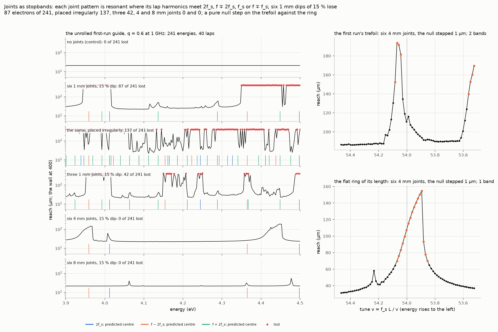

**Figure 10.** Joints as stopbands (section 6.2), tracked with `integrate` at 30 steps an RF period. Left: the first
run's guide unrolled, an ideal quadrupole channel 277 mm long at q = 0.6 and 1 GHz, 241 energies from 3.9 to 4.5 eV
started 10 µm off the axis and tracked 40 laps, each joint a cos² dip of the gradient; reach against energy (lost in
red) with the centres first-order theory predicts from each pattern's lap harmonics and the integrator's own secular
frequency, 231.60 MHz (2f_s blue, f − 2f_s orange, f + 2f_s green): none lost without joints, 87 with six 1 mm joints of
15 %, 137 with the same placed irregularly, 42 with three, none with 4 or 8 mm joints. Right: the fine scan round tune
54 with six 4 mm joints that step the null 1 µm aside, on the first run's trefoil (`QuadRods`) and on the flat ring of
its length, 71 energies from 3.93 to 4.07 eV over 20 laps, reach against tune (raised points orange): two bands on the
trefoil, at tunes 54.06 and 53.54, 0.52 apart, and one on the ring, from 53.85 to 54.07.

### 6.3 Ripple

**Claim.** E_⊥/f_s is adiabatic, so a 15 % gradient rise reflects forward energies under 0.15·E_⊥; RF common mode across
a joint makes 1.3 meV per (kV/m)² at 915 MHz and a DC offset a step of its own size, so the boards share one DC
reference. **Hypothesis (drive ripple).** A drive ripple ρ moves depth by ±2ρ adiabatically, but its maxima mirror
electrons whose forward energy is under about 2ρ·E_⊥: holding and lapping are different criteria (E2-16).

### 6.4 Acceleration

**Claim (the joints are the gaps, on the first run's guide).** On the first run's four-rod guide (277 mm, q = 0.6, six
equal segments) alternate segments at common-mode volts ±V_a put 2V_a across each joint, synchronous at (J/2 +
nJ)·f_rev: one chirp from 6.42 to 18.17 MHz takes electrons from 1 to 8 eV in 117 laps at 10 mV, capturing 50 ± 4 % in a
kick-drift map. At q = 0.3 that guide loses 3.75 eV, so the 8 eV ramp runs at q = 0.6, where the local-q hypothesis of
section 6.1 applies.

**Design (T915-S6; checked).** T915-S's strips are continuous copper with two closing joints a quarter guided wave
apart, which carry no ±V_a. Its segmented variant cuts every strip at six equally spaced stations, 53.0 mm apart, the
plates closing at two of them. Equal spacing gives the π mode, and for m = 1 six does not divide 2m, so identical cuts
cancel in backscatter as quarter-wave pairs do (the selection rule of section 5.2 in its general form); the six sit on
one orbit of the trefoil's D3 and drive lap harmonics 6n. Each cut is bridged at 915 MHz by about 100 pF a strip (1.7 Ω,
|Γ| ≈ 0.02 a cut), which at the chirp's 5.6 to 15.8 MHz is 25 to 71 Ω a joint; so the segments' common mode is driven
from a low-impedance source through a star of four chip inductors per segment (about 100 nH, self-resonant above
1.5 GHz, Q about 60) whose centre is the quadrupole's RF ground: 3.5 to 10 Ω across the chirp, and about 0.22 W of added
RF loss for the 24 strips, 24 % of the ring's 0.89 W, the price of acceleration. DC references and DC steering alone
take 1 MΩ resistors instead, 7.5 mW. Each cut is a joint for the particles as well, scarfed like the closing joints. At
60 meV a lap (V_a = 10 mV) the chirp runs 3f_rev from 5.60 to 15.84 MHz over 117 laps, 32.7 µs on 318 mm, while the tune
falls from 92 to 32 and crosses the cuts' bands at ν = 6n and 3n.

**Sources within rule 8.** The HackRF Pro holds the 915 MHz tone, and a 20 MHz baseband round 915 MHz makes sidebands at
915 ± f_a, not a voltage at f_a, so the chirp takes one of three routes:

1. *A DDS on the controller:* an AD9850-class module (125 MHz clock, about $10) whose tuning word the RP2040 rewrites
   every 0.25 µs through its PIO, phase-continuous, attenuated to the 10 mV the gaps take. Its 130 words sit in the
   controller's RAM; the 256-word, 10 µs sequencer gives one trigger word and holds the confinement state for the ramp's
   four slots.
2. *Two tones from the one radio:* the HackRF sends the carrier and a sideband 5.60 to 15.84 MHz above it, both inside
   its 20 MHz with the tuning 7.9 MHz above 915 MHz; the ring's 4.3 MHz linewidth keeps the sideband out of the ring,
   and a zero-bias Schottky detector on the feed board, fed through a coupler, recovers the beat as the gaps'
   common-mode volts. No second source; the chirp is computed in the HackRF's baseband, and the sequencer works as in 1.
3. *A synthesiser for the confinement tone:* an ADF4351-class module (about $15 to $30) locked to the HackRF's 10 MHz
   makes the 915 MHz tone, and the HackRF sends the chirp itself (the HackRF One tunes down to 1 MHz) or listens to the
   pickups between ramps.

A DDS or a locked synthesiser on the board drives electrodes, which rule 8's second clause allows; a second radio does
not. V1's beacon, a synthesiser of the same kind, is open for the owner (`docs/PROGRESS.md` section 6). **Pressure.**
117 laps of 318 mm are 37 m of path: a mean free path that long takes 1.1 × 10⁻⁵ mbar and ten times it 1.1 × 10⁻⁶ mbar,
against 6.3 × 10⁻⁵ mbar for DR-7's 20 laps (checked; section 8.2 prices the pumps).

**Claim (crossings).** The first run's ramp crosses 12 null-step and 24 gradient bands; a gradient band is a squeeze,
cosh Λ = e^G with G = π²·ν·ε_k²·W/(2ΔW_lap) and ε_k = 2g_k, about 0.16 a crossing for a 15 % dip over 1 mm at 60 meV a
lap, compounding, so ε_k near 0.1 % or a faster ramp keeps the sum under 1. RF rings (Church; Schätz, Schramm and Habs)
and resonance crossing in a Paul trap (Takeuchi et al.) are precedents.

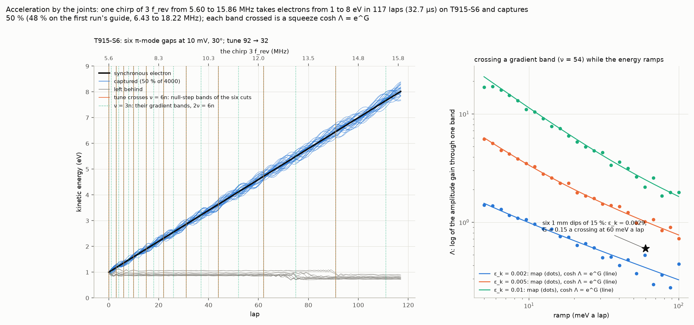

**Figure 11.** Acceleration by the joints (section 6.4), from kick-drift and lap maps. Left: T915-S6, six π-mode gaps
round 318 mm at ±10 mV and a synchronous phase of 30°, 60 meV a lap: of 4000 electrons spread over an RF period and by
0.02 eV, 50 % are captured (blue; 48 % on the first run's guide, whose chirp runs 6.43 to 18.22 MHz) and taken from 1 to
8 eV in 117 laps (32.7 µs) on one chirp of 3f_rev from 5.60 to 15.86 MHz (top axis); the exact Mathieu tune falls from
91.6 to 32.4, crossing the cuts' null-step bands at ν = 6n (orange) and their gradient bands at ν = 3n (green, dotted).
Right: Λ, the log of the amplitude gain through one gradient band (ν = 54) crossed while the energy ramps, for ε_k =
0.002, 0.005 and 0.01: a lap map of six thin lenses (dots) against cosh Λ = e^G with G = π²·ν·ε_k²·W/(2ΔW) (lines); the
star, six 1 mm dips of 15 % (ε_k = 0.0029) at 60 meV a lap, G = 0.15 a crossing.

### 6.5 Space charge and pickups

At the space-charge limit f_p = q·f/2 (RFG-4), 2.4 × 10⁶ electrons round the first run's 277 mm in a 50 µm beam at q =
0.6, and 1.8 × 10⁶ round T915-S at q = 0.5 (7.3 × 10¹⁴ m⁻³ with the exact Mathieu f_s, checked). **Hypotheses (what
binds first).** The beam lowers the tune by n/(2n_max) of itself. If an isolated band is lossy, keeping half a gap from
one allows 3.4 × 10⁴ electrons (11.6 nA) at 1 eV on the first run's guide; if the bounded-bands hypothesis of section
6.2 holds, an isolated band only bounds the amplitude, and loss waits until the beam's spread spans two bands, 1.35 ×
10⁵ electrons for six equal joints (bands 3 apart in tune at ν = 108), and then the space-charge limit. A many-particle
run separates the two (E2-26). Bunched at 1 eV, 3.4 × 10⁴, 1.35 × 10⁵ and 2.4 × 10⁶ electrons put about −119, −107 and
−82 dBm on a 50 Ω pickup coupling 30 %, and the −95 dBm of the particle lens is 2.7 × 10⁵ electrons at 4 eV in a 100 µm
beam at q = 0.6. **Loading and lifetime (checked; the mean free path an estimate).** A held number is a loading rate
times a lifetime: at 6.3 × 10⁻⁵ mbar a 1 eV electron lives 11 µs between collisions, so 3.4 × 10⁴ takes 3.2 × 10⁹
captured a second (0.5 nA); at 10⁻⁶ mbar it lives 0.67 ms and takes 5 × 10⁷ a second (8 pA). The electrodes are the
pickups (`docs/VIRTUAL_ANTENNA.md` section 7.4), through which the particles' own fields can correct the drive.

### 6.6 The particles' own fields against the geometry

**Proposition (beam harmonics by symmetry).** On T(p, q), s → s + L/q is a turn by 2πp/q, so a bunch circulating at
harmonic k of f_rev carries azimuthal order l only where l·p ≡ k (mod q): on the trefoil 2l ≡ k (mod 3), its electric
dipole axial at k = 3, 6, … and in the plane otherwise. Pickups on one orbit of C3, a third of a lap apart, see harmonic
k with relative phases e^(2πik/3), so their sum passes k ≡ 0 (mod 3), which on the trefoil is the axial family, and
their differences the in-plane rest: the knot's symmetry sorts the beam's harmonics, and the fields they make, among the
pickups. **Claim (multipoles; checked).** Per unit charge on T915-S's trefoil a bunch's dipole is 4.75, 15.5, 4.60,
0.28, 1.65 and 0.68 mm at k = 1 to 6, axial at 3 and 6; its magnetic dipole oscillates too (½∮r × T·e^(−2πiks/L) ds of
1046, 488 and 775 mm² at k = 1 to 3). On a ring of the same length a bunch is an in-plane dipole of 35.8 mm at k = 1
alone, with a steady magnetic moment. The trefoil's strongest dipole harmonic is 2f_rev, since it winds twice round its
axis, and 3f_rev its axial one. **Claim (steady fields; checked).** A steady beam's vector area is 2971 mm² along the
trefoil's axis against a ring's 8037 mm², so 11.6 nA makes a magnetic moment of 3.4 × 10⁻¹¹ A·m², 0.37 of the ring's;
the trefoil's writhe, −3.43, sets the frame's turn (CUR-1), not the moment. **Proposition (images).** Between grounded
planes at ±h a line charge λ meets its images as a gradient λπ/(16ε₀h²) when the whole beam is displaced and λπ/(48ε₀h²)
inside a centred beam, defocusing toward the boards and focusing across them (Laslett's π²/16 and π²/48). **Claim (image
tune shift; checked).** On T915-S at 1 eV and q = 0.5 that is 0.0032 coherent and 0.0011 incoherent at 3.4 × 10⁴
electrons, and 0.17 and 0.056 at the 1.8 × 10⁶ limit, splitting the tunes toward and across the boards. **Claim (beam
loading; checked).** Unbunched at 915 MHz, the beam loads the ring through its micromotion, a current in quadrature with
the drive: 18 nA at 3.4 × 10⁴ electrons, detuning the ring by about 1 Hz (3 × 10⁻⁷ of its linewidth) and by 59 Hz at the
limit, so the beam is heard at its own lines, k·f_rev and f_s ± k·f_rev, on the pickups. **Linked rings.** Two R1 rings
interlocked as a Hopf link carry beams whose magnetic fields link, their mutual helicity twice the linking number times
the two fluxes, a field topology one ring cannot make. A many-particle run in the solved field, the boards as its
boundaries, measures these (E2-26), with the tool of section 8.1.

### 6.7 Loading and seeing held electrons

A closed guide has no ends, so electrons are made inside it or let in through an entrance that switches within a lap
(`docs/PRIOR_ART.md`), and under rule 1 both happen on the boards. **Source.** A UV LED on the board lights the guide's
own ENIG gold: photoemission from gold at 405 nm is reported (`docs/PRIOR_ART.md`), and a UV-C LED of 255 to 280 nm (4.4
to 4.9 eV, a few dollars) clears an air-exposed gold work function of about 4.3 to 4.8 eV. The lit pad sits at the start
of a short branch guide that joins the ring through a switched segment: electrons leaving the pad at a fraction of an
electronvolt are drawn into the branch by a few volts and guided on its axis with little transverse energy, and the
junction's segments switch from branch to ring within a lap, 0.54 µs at 1 eV on 318 mm. Electrons made by the same
photocurrent ionising the residual gas inside the guide are a second, slower route, at its best at the rotary rung's
pressure. **Detection.** (1) *Dump and count:* switching the drive off sends the held electrons to a collector pad read
by a charge amplifier on the board, 3.4 × 10⁴ electrons being 5.4 fC, 5.4 mV on 1 pF, through the controller's ADC. (2)
*Hear them:* bunched they put −120 dBm on a pickup at 1 eV, below the detector diodes' reach, so the HackRF hears them
while a board synthesiser holds the tone (route 3 of section 6.4), or the board carries a narrowband receiver at
k·f_rev. (3) *Count the loss:* the current lost to a collector at the switched segment, N/τ, is about 0.5 nA at 6 ×
10⁻⁵ mbar, read through a transimpedance stage. TwinDetector models all three (section 8.3), and DR-13 registers a
holding measurement with them.

## 7. What the guide teaches the field compiler

The knot is the smallest complete compile problem the project has (`docs/VIRTUAL_ANTENNA.md` section 9), and it changes
the generic process of that document's section 3.4, step by step:

- *Step 0, new, topology and geometry:* the arrangement (section 3.2), the curve, its framing and closure, the section
  (W/h, g/h, set-back), the band and m, and the stations of joints, spacers, cuts and feeds. These are variables of the
  compile, not inputs.
- *Step 1, region:* the null line and a tube round it of the well's radius, sampled at the stations and between them at
  h/4.
- *Step 2, operators, three on one copper:* a banded electrostatic operator from the section kernels and the
  boundary-element windows (DC references and steering), the chirp's common-mode operator at 5.6 to 15.8 MHz, and the
  ring's G at 915 MHz from the ring model. This is step 9's band in a new form: one geometry, three operators at once,
  each with its own price list.
- *Step 3, spectrum:* the ring's G has two cheap modes, ±m, over a floor about 125 times lower (section 5.3); the
  electrostatic operator prices steering at 12.0 mV per micrometre at DC and 86 mV per micrometre at RF (section 4.6); a
  gradient correction costs its fraction of a segment's drive at RF, which one channel buys only in copper.
- *Step 4, targets:* linear where structure allows (zero transverse and axial field, a target gradient, uniform
  amplitude as a travelling wave), and in particle terms otherwise (held energy, band clearance, crossing gain), which
  are non-linear in the field: `docs/VIRTUAL_ANTENNA.md` section 4.7's non-linear targets, solved by alternation (the
  ring's phase relaxation of section 5.3) or by search on the tracker.
- *Step 5, bounded solves:* volts within the rail or twice it against floors of 0.23 to 0.45 G₀; q from 0.3 to 0.6 per
  section type; the path within 50 µm; rounding to −1, 0 and +1.
- *Step 6, 'map to the board' becomes 'write copper':* the plan's output is artwork (KiCad s-expressions, section 8.1)
  and a schedule, not a `protocol.Sequence` alone.
- *Step 7, verify* on the twin by DR-0 to DR-14, in the direction of use.
- *Step 8, update* G from the pickups' magnitudes: with K = 2 feeds four states per pickup fix the ratio of its two
  entries, the 4K − 4 count of `docs/VIRTUAL_ANTENNA.md` section 4.9, since a uniform travelling wave is an intensity
  target that needs G only up to one phase per position.
- *Time:* during a 1 → 8 eV ramp the tune falls from 92 to 32 and the kick, the bend margin and the bands crossed change
  with it, so the compile is a schedule, volts and chirp against lap, that fits the controller's 256 words: one trigger
  word and the confinement state for the ramp's four 10 µs slots, the chirp's 130 tuning words in the controller's RAM.


**Types** (`docs/VIRTUAL_ANTENNA.md` section 9.2). Its elements are dipole moments with a transfer matrix; the guide
adds `ElectrodeElements` (segments and strips, their outlines and their section), an `Operator` built from electrostatic
kernels or a ring model (`operator.electrostatic`, `operator.ring`), an `Alphabet` of frozen −1/0/+1 rail assignments
per segment, particle targets (`targets.Held`, `targets.BandClearance`) beside the field targets, and a `Plan` whose
output is artwork and a schedule (`plan.artwork` to a `.kicad_pcb`, `plan.schedule` to a `protocol.Sequence`). **Methods
for the geometry.** Discrete choices (arrangement, k, m, cut count) by enumeration under the symmetry rules; continuous
ones (r/R, the closure's start angle, W/h, g/h, the stations) by search on the cheap models, the 2-D section in 1 to 20
s, the ring model in about a second a draw and the frames in seconds, then by adjoint shape derivatives of the
boundary-element solve, one adjoint solve per objective at the cost of a forward window (about 10 s), with Palace last.

It asks for:

1. **Three kinds of element:** live drives (on T915-S the second feed's weight; on T915-S6 four per segment at DC and
   the chirp); frozen copper as artwork (sign patterns, rail assignment, tapers, flat outlines, each plate its own);
   geometry under constraints (r/R, framing and closure, W/h, g/h, the stations of joints, spacers, cuts and feeds,
   which load the line).
2. **One coherent channel:** the RF unknowns are the dividing network's settings; the chirp and DC come from board
   sources (section 6.4).
3. **Three operators on one copper**, as in step 2, with the ring's G measured from magnitudes.
4. **Linear targets where structure allows**, and particle targets by the non-linear methods.
5. **Bounded solves that output patterns:** volts within the rail or twice it, against floors of 0.23 to 0.45 G₀; q from
   0.3 to 0.6 on every section type; the path within 50 µm; rounding to −1, 0 and +1.
6. **Symmetry as a constraint:** N ∤ 2m; perturbation counts not dividing 2m; quarter-wave pairs; joints on one symmetry
   orbit; the symmetry of what is built, closure included; Earth's field and contact potentials break it and are
   compensated or toleranced.
7. **Continuity:** nothing changes faster than 3v/(f(1 − β)), or three secular wavelengths; one broken symmetry per
   joint, and 4h between pieces of different symmetry.
8. **Curvature by direction:** κ ≤ 0.605·D/(W·h) in the plane of facing boards, more toward them by hypothesis, the
   framing moving curvature between the two.
9. **Caps beyond power:** volts per gap, duty, band, and tolerances of 2 % rms in the gap with re-solved feeds and 0.2h
   (2 eV) to 0.07h (8 eV) in alignment.
10. **A closed loop on the measured operator,** holding efficiency ≥ 0.8 and the direction of travel.
11. **Tolerance inside the compile:** "buildable" is the fraction of fabrication draws holding the registered energies,
    stated at 95 % on 59 draws or more.
12. **Must-fail cases among its tests:** m = 3 on a trefoil with three strong joints, the sharp six-stick trefoil, the
    straight cut-out, straight strips on r/R = 0.30, one board's rails at 1 eV and 915 MHz, each with what makes it work
    (section 8.2).

## 8. Modelling the hardware before it is built

### 8.1 What is modelled, and with which tools

"Possible to build" is four answers before an order: the fab can make it; what it makes gives the compiled field within
tolerance; the field survives multipactor, gas, heat and vacuum; the control system runs it. A design is a curve, a
framing, a cross-section and a band, and one source drives every model, all open tools:

- **Boards:** a generator writes `.kicad_pcb` s-expressions as `hw/kicadgen.py` writes schematics, with the fab's rules
  as `.kicad_dru`; `kicad-cli pcb drc --exit-code-violations` checks it headless, `pcb export gerbers`, `drill` and
  `step --include-tracks --include-pads --include-zones` write the outputs, and PyGerber reads them back to within
  10 µm.
- **Mechanics:** CadQuery assembles boards, spacers and clamps, checks interference, and writes STEP for gmsh;
  CalculiX's shell elements give the twisted strip's flatness between spacers and each plate's outline.
- **Fields, decomposed:** the section, the boundary-element windows, the transmission-line ring; openEMS (in use,
  `experiments/vivaldi_openems.py`) for joints and feeds, with gerber2ems for the feed board; Palace for a full lap,
  with curved elements, lossy eigenmodes and adaptive refinement, since a staircase grid would put ±Δ/2 into the gap,
  15 % of h at 2.45 GHz with 0.1 mm cells, and read it as splitting.
- **Circuits and volts:** scikit-rf with part tolerances and Qucs-S for the feed and amplifier; a multipactor model
  calibrated on ECSS with a held-out point, then Furman and Pivi's emission model; pump-down breakdown from LoKI-B's
  open C++ release, checked against MacDonald, Gaskell and Gitterman.
- **Heat:** Elmer's finite elements for conduction through spacers and clips and radiation from the strips (DR-9).
- **Many particles:** WarpX's electrostatic particle-in-cell with embedded boundaries for the beam's own field in the
  boards' geometry, and a 2.5-D section model (each section's Poisson solve with its images, coupled to `integrate`) for
  the faster runs.
- **Gas:** electron cross-sections from LXCat's open databases for the twin's collisions, beside LoKI-B.

**Hypothesis (the decomposed model).** It gives the resonance within 0.5 % and Q within 15 % of Palace at 2.45 GHz
(h/R_b = 0.03), looser at 915 MHz, where W/R_b = 0.5 (E2-6).

**Where the instruments live.** The study's tools ran as scripts beside this document; they become modules with tests,
and ledger rows, before E2 registers:

| Instrument | Module | Held to |
| --- | --- | --- |
| 2-D sections by finite volumes (facing strips, slot guide, rails): Z₀, n_eff, share, Q, gradient, escape | `array16/guide/sections.py` | ELE-1 to ELE-3; section B's 1.031 and 1.065; the slot line of section 3.3 |
| boundary-element windows, null tracker, mirrored and unsymmetrised meshes | `array16/guide/bem.py` | the accuracies of section 4.5; E2-1 |
| axisymmetric bend reference by quadrature | `array16/guide/axisym.py` | 0.1405 and 0.318 to 0.1 % |
| ring model (line matrices and nodal admittance), feed compile, tolerance draws | `array16/guide/ring.py` | RNG-1 to RNG-6; the tables of section 5.3 |
| compiled ramp | `array16/guide/ramp.py` | KNT-9 |
| framings, plates, planforms, layouts, sticks and lattice | `array16/guide/geometry.py`, on `ClosedCurve` | KNT-6 to KNT-8, KNT-10 to KNT-12 |
| multipactor: impact bound, level-1 chart, trackers | `array16/guide/multipactor.py` | MPC-1 to MPC-3 |
| a solved section swept along a curve with a frame, as a `Fields` for `integrate` (`QuadRods.along` does this for rods) | `array16/particles/sections.py`, `SectionField` | the thresholds of section 6.1 |
| bench drivers | `array16/twin/`: `TwinGuide`, `TwinDetector`, `TwinVacuum` | section 8.3 |

`experiments/knotted_guide_study.py` draws this document's figures with typed ports of the study's tools (the sections,
the Laplace solves, the ring model, the trackers), and will draw them from these modules once they hold them.

### 8.2 The design review

Each check is a shot of an `array16.lab` experiment whose prediction is the registered criterion; fabrication outputs
leave only from a commit whose review passed and whose must-fail designs failed. A 95 % statement takes 59 draws without
a failure, or 93 with one (checked).

| Check | Passes when |
| --- | --- |
| DR-0 Instruments | ELE-1 to ELE-3 to 0.5 %; laminate share equal to d ln C′/d ln ε_r within 2 %; 2\|c₂ₘ\| to 1 %; ECSS to 10 % on a held-out point; INT-1 to INT-3, and f_s to 0.1 % at ≥ 120 steps per RF period; the axisymmetric bend reference to 0.1 % and the boundary-element bias against it recorded; Palace on Matthiesen et al.'s board resonator to 2 % in f, 30 % in Q; read-back to 10 µm |
| DR-1 Geometry | curvature radius ≥ 2W; half-width ≤ half the regression or in-plane limit; strain ≤ 1 %, and the twisted strip flat by DR-14; pieces fit 234 × 490 mm, each plate from its own centre line; counts not dividing 2m |
| DR-2 Fab rules | DRC exit 0; split ≥ 0.089 mm on 18 µm flex and ≥ 0.3h at −20 % etch; rigid slots ≥ 1.0 mm, copper ≥ 0.2 mm from edges |
| DR-3 Field | by section type: facing boards share ≥ 0.95 × ¼ and depth ≥ 0.8 × nominal at every joint; the slot guide ≥ 0.95 × its solved level (0.10 to 0.14 D₀ set back) and its ramps ≥ 0.5 × the level's depth at the compiled volts; rails and ribbon ≥ 0.95 × 0.0091; q within 5 %; null within 0.05h |
| DR-4 Resonator | f_m in band with 2 linewidths' margin for 95 % of draws; refinement moving f < 0.1 %, Q < 5 %; radiated ≤ 5 %; the re-solved feeds' \|b/a\| ≤ 0.03 and depth per watt ≥ 0.9 for 95 % of draws, 2Q\|c₂ₘ\| recorded |
| DR-5 Feed | \|S11\| ≤ −15 dB; hybrid ±0.5 dB, 90 ± 5°; modulator covering 95 % of draws, at least ±6 dB and 360° |
| DR-6 Depth | min/max ≥ 0.8 for 95 % of draws; 0.3 ≤ q ≤ 0.6 on every section type, the compiled ramp included (at rail volts its floor sits at q = 0.30) |
| DR-7 Particles | registered energies held 20 laps in both senses of travel with Earth's field drawn; must-fail energy lost |
| DR-8 Volts | level-2 growth < 0 at 1.41 × V for every draw on the measured yield of the surface as built (ENIG as received, or bare copper where a fab supplies it), beside the ECSS margin for parts with dielectric; drive gated outside the breakdown band |
| DR-9 Heat | by Elmer: ≤ 60 °C at printed parts (PETG; PLA softens near 55 °C); ≤ 105 °C for adhesive flex |
| DR-10 Vacuum | ASTM E595 screen (mass loss ≤ 1.0 %, condensables ≤ 0.10 %; RO4003C 0.06 % and 0.00 %); a mean free path at least the registered path: 6.3 × 10⁻⁵ mbar for 20 laps of T915-S, 1.1 × 10⁻⁵ mbar for its 1 to 8 eV ramp |
| DR-11 Mechanics | no interference; gap error within DR-4's draws; alignment over both boards ≤ 0.2h both ways for a 2 eV registration and ≤ 0.07h for 8 eV (section 4.3) |
| DR-12 Control | through `array16/fwsim.py`: ≤ 256 words, slots ≥ 10 µs, a ramp's chirp started by one word; tracking and the weight solve converge |
| DR-13 First build | f_m, Q (ENIG coupons), splitting, volts per watt, multipactor onset and a holding measurement (the dump to a collector, the loss current) registered with spreads |
| DR-14 Build | the twisted strip flat to 37 µm rms between spacers by the shell model; each plate cut from its own outline; the band threaded and closed in a jig that holds DR-11's alignment; spacers of sapphire balls and clips of PEEK or RO4003C screened as DR-10, with a gauge reading at each station; feedthroughs for two balanced feeds and the pickups; the split's ±20 % etch in DR-4's draws; the ramp compiled with the copper set-back |

**Designs that must fail, and what makes each work:** one board's rails at 1 eV and 915 MHz (q = 1.89), which work at
0.093 eV at 50 V with the null 0.575 mm up or at 1 eV with 543 V and the null 1.89 mm up; straight strips on r/R = 0.30,
which the twist-free or k = 0 framing makes; a 5 eV copper strip guide, which a low-yield surface or a shallower well
makes; rigid FR-4 strips at 2.45 GHz on printed mounts (about 11 W), which flex makes at 3.0 W; the sharp six-stick
trefoil, which rounding to 8 mm with twisted straights makes; m = 3 on a trefoil with three strong joints, which weak
joints (2Q|c₆| ≤ 1) or feeds compiled at the joints make. **First findings:** T915-S's index at 915 MHz is 1.031, so m =
1 takes 318 mm; the slot guide holds 85 % of its field in the laminate (Q 43 on FR-4, 117 on RO4003C) and the copper
set-back halves its depth; k = 0 keeps the trefoil's symmetry, but its twist makes the strip non-developable (edges
+3.2 × 10⁻⁴) and its plates 329.5 and 306.1 mm long; the 915 MHz strips meet DR-1's 2W rule by 0.65 mm; the 2.45 GHz
strips miss DR-11 with fab-drilled pins (up to 0.44h between boards); the 1 eV design keeps 5.2 dB at level 1 and about
3 dB at level 2, so DR-8 rests on measured yield.

**Costs at the choices (rough).**

- *Vacuum:* a two-stage rotary-vane pump reaches 10⁻² to 10⁻³ mbar for about $150 to $500, where an electron's mean free
  path is 0.04 to 0.4 m, 0.1 to 1.3 laps: the first rung, measuring one-lap transmission and the loss against pressure.
  Holding 20 laps takes 6.3 × 10⁻⁵ mbar and acceleration 1.1 × 10⁻⁵ mbar, a small turbo pump on a backing pump: used,
  with its controller, about $500 to $2000, and with a KF chamber, gauges and feedthroughs about $1000 to $3000. A
  sealed metal cell pumped once and kept by a non-evaporable getter is the third route. The turbo pump is laboratory
  equipment at the edge of rule 8, a choice for the owner.
- *Drive:* an amplifier of $20 to $60 (hobby module) or $300 and more (laboratory); the hybrid printed; a vector
  modulator of $20 to $40; baluns and capacitors a few dollars; a DDS module about $10 or a synthesiser module $15 to
  $30.
- *Boards:* a slotted FR-4 pair $40 to $80, a RO4003C pair $100 to $250 from a fab that stocks it; flex $60 to $120 in
  ENIG, bare copper or OSP from another fab; rigid-flex a few times flex; sapphire balls about $1 each.
- *Compute:* Palace on a full lap of T915-S, a few million unknowns, takes hours and tens of gigabytes (an estimate);
  whether Palace builds on the owner's machine is the first check, and a cloud instance by the hour, a few dollars an
  hour, the alternative.

### 8.3 The twin bench

```toml
name = "twin-trefoil-915"
workers = 8
[device.array]          # the HackRF Pro alone, the controller emulated by fwsim
driver = "array16.sim:SimBackend"
radio = "hackrf"
[device.guide]          # field, resonance and heat of one tolerance realisation
driver = "array16.twin:TwinGuide"
design = "designs/trefoil_915.toml"
realisation = 17
[device.detector]
driver = "array16.twin:TwinDetector"
[device.vacuum]
driver = "array16.twin:TwinVacuum"
```

`Bench.session` checks each device against an experiment's `needs`, and `Bench.describe` stamps each record with every
device's `identity()`. `TwinGuide` will read solver results cached by content hash and answer `tune`, `drive`, `pickup`,
`temperature` and `field()`, a `Fields` for `integrate`; each realisation carries tolerance draws the predictions do not
know, found blind by the calibration as in V1's simulated array: spacer gaps, joint impedances and positions, the
split's etch, the laminate, Earth's field and its orientation, contact potentials and patches up to 0.1 V, charge on
exposed dielectric (S2-C3's slot walls, T915-S's split) up to 1 V of surface potential, and the surface's secondary
yield. `TwinDetector` models the pickups and their detectors, the collector pad with its charge amplifier, and the dump;
`TwinVacuum` the pressure and LXCat's cross-sections. Frames pass through `array16/fwsim.py`, so the control loop runs
on the twin first, and hardware is a change of bench file.

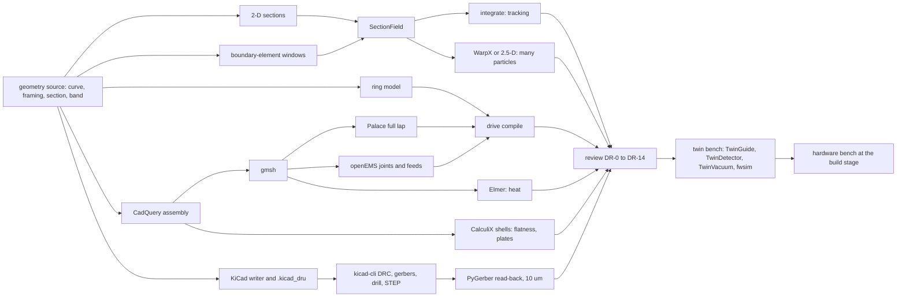

**Figure 12.** Modelling the hardware before it is built: one geometry source drives the KiCad writer and its rules,
DRC, gerbers and STEP read back to 10 µm, the CadQuery assembly with gmsh and the shell model, the two-dimensional
sections, boundary-element windows and ring model, Palace and openEMS, tracking and many-particle runs and the heat
model, all scored by the review DR-0 to DR-14; the twin bench's TwinGuide, TwinDetector and TwinVacuum then run the
control loop through `fwsim`, and the hardware bench takes their place at the build stage.

## 9. Lead designs to simulate next

1. **T915-S: facing flex strips on the r/R = 0.45 trefoil, 915 MHz, m = 1.** 318 mm (n_eff 1.031 by the section solve,
   the length set from a coupon) on 25 µm polyimide, gap 1.83 mm, width 8h (6h in the sweep), split 0.27 mm, closed with
   k = 0 at +0.48°/mm (in-plane radius ≥ 18.6 mm), plates of 329.5 and 306.1 mm each cut from its own planform, two
   compensated feeds and two closing joints each a quarter guided wave (79.4 mm) apart, the joints scarfed over 29.4 mm,
   sapphire spacers at 24 stations to 2 % rms: 0.89 W for 1 eV on bare copper (1.14 to 4.23 W on ENIG), 6 to 10 eV per
   eV of depth (by the discounted static limit until E2-9), the re-solved feeds' backward wave 0.013 in the median. The
   fewest joints, the full facing well, and a travelling wave its symmetry protects.
2. **T915-S6: T915-S cut into six segments** 53.0 mm long, each cut 100 pF a strip and scarfed, the common mode driven
   through inductor stars (0.22 W more), the chirp 5.60 to 15.84 MHz over 32.7 µs from a DDS, two tones or a board
   synthesiser: the acceleration design, at q = 0.5.
3. **S2-C3: two slotted RO4003C 0.813 mm boards 1.0 mm apart with the six-ramp trefoil, m = 2:** about 420 mm (R₀ =
   33.2 mm), 0.5 mm strips set back 0.2 mm; 40 V, a 0.21 to 0.30 eV level at q = 0.44, takes 1.29 W; bends in the plane,
   C3 by construction and the compiler's first frozen-pattern solve, at the price of shallow levels and ramps that may
   limit it near 3 eV unless their rails reach twice the rail. On FR-4 it is the cheapest board and a 3.9 W drive at m =
   2 (384 mm), or 1.9 W at m = 1 (192 mm).
4. **L26: the rounded lattice trefoil, 24 steps of 26.2 mm,** on slotted RO4003C at 915 MHz, m = 2 (582 mm): 1.03 W for
   1 eV, corners of 7.9 mm, 10.4 mm straights, no symmetry, compiled feeds.
5. **R1: the single-board line:** the rail ring (0.093 eV at 50 V, the null 0.575 mm up, about 200 mm at m = 1) as the
   twin's first calibration rung; the channel ring (210 mm on RO4003C, 0.64 W for 40 V) with its island on a carrier;
   the flat facing-board ring of 318 mm, the control for the knot's price; and the (1, 3) helix at r/R = 0.2, the
   control for leaving the plane.
6. **T915-R: one flex ribbon carrying rails** along T915-S's trefoil: one piece, no gap to hold, a 0.093 eV well at 50 V
   and about 1.2 eV by the bend rule round 15.3 mm; the one-piece route to a knot, and a test of how far one surface
   reaches.
7. **T2450-S: the strips at 2.45 GHz, m = 2,** for 12 to 19 eV per eV of depth, against 3.0 W, 200 K of heating and
   fab-pin alignment.

The sharp six-stick trefoil runs beside them as the case that must fail.

## 10. Experiment 2 in simulation

**Purpose.** Does a knot of boards hold and accelerate electrons, and can it be built? One `array16.lab` experiment on
the twin bench, its `PROTOCOL.md`, predictions and criteria committed before any run, with three-dimensional views of
boards, fields and orbits. **Order of work:**

| Stage | Runs | Draws and seeds | Compute (estimate) |
| --- | --- | --- | --- |
| 0 Instruments | the modules of section 8.1 with their tests; DR-0; the impedance sensitivities to κ_n and κ_g; the banded operator against the boundary-element solve | one realisation | about a day |
| 1 Calibration rung | R1's rail ring (E2-21), the flat ring and the (1, 3) helix (E2-22), the straight slot guide in 3-D against its 2-D section | one realisation each | hours |
| 2 T915-S | frames, plates and flat lay-up (E2-23); resonance and drive (E2-6 to E2-8); joints and kick (E2-1, E2-2, E2-14, E2-20); bend thresholds and stopbands (E2-9 to E2-11); Earth's field (E2-15); ripple (E2-16); straps and radiation (E2-17, E2-18); crossings (E2-19); multipactor (E2-13); DR-1 to DR-12 | 59 draws, 93 where one failure is allowed | one to three days |
| 3 S2-C3 | the set-back ramp (E2-4), ramp energy (E2-5), levels and crossings (E2-3, E2-19), modes by layout (E2-24), four layers (E2-27) | 59 draws | about a day |
| 4 T915-S6 | cuts and bias, acceleration with solved gaps (E2-12), many particles (E2-26), separation, feed-down and kink (E2-25) | 59 draws; 10³ to 10⁶ particles | days |
| 5 L26, T915-R, T2450-S | the same checks for each | 59 draws | days |

Each run takes one master seed, recorded with its record, from which every draw's seed follows; the harness stamps
commit, predictions and bench. Tracking runs at 120 steps or more per RF period. **What finalises a design.** A design
goes to fabrication output (DR-13) when every prediction it rests on passes, its must-fail designs fail, and DR-1 to
DR-12 and DR-14 pass on 59 draws without a failure or 93 with one: T915-S rests on E2-1, E2-2, E2-6 to E2-11, E2-13 to
E2-20 and E2-23; S2-C3 on E2-1, E2-3 to E2-6, E2-13, E2-19 and E2-24; T915-S6 on T915-S's and E2-12, E2-25 and E2-26; R1
on E2-21 and E2-22. **Stop rule.** A design is set aside when a prediction it rests on fails and no change inside its
topology restores it; the failure is recorded with what would restore it, and the next design in section 9 moves up.

| # | Prediction | Instrument | Fails outside |
| --- | --- | --- | --- |
| E2-1 | a piece keeping one mirror antisymmetry carries no axial field on its null: on a mesh without the mirror, an offset-sideways joint's axial field on the null stays under three times the floor the same mesh reads on a straight section | boundary elements, unsymmetrised | 3 × floor |
| E2-2 | bend shifts × R/h² at R = 40h: 0.1405 in the plane, 0.318 out of it | axisymmetric quadrature | 2 % |
| E2-3 | S2-C3's level set back 0.2 mm keeps ≥ 0.8 of its straight depth (0.10 to 0.14 D₀) on its 30 mm bend and at its crossings, where the lower board's slot replaces copper under it | boundary elements | 0.8 |
| E2-4 | the compiled ramp with the 0.2 mm set-back and laminate on a 25 µm grid keeps its path and a floor ≥ 0.15 G₀ at rail volts (0.30 G₀ at twice the rail), also rounded to −1, 0, +1 | ramp compile, boundary elements | 50 µm; 10 % |
| E2-5 | electrons through S2-C3's compiled ramps at 40 V and 915 MHz are held to 0.4 to 1.0 of the ramp estimate, 2.9 eV on the outer lobes and 4.1 eV on the inner, below the levels' 7 to 10 eV | tracker in the solved field | the band |
| E2-6 | T915-S resonates at m = 1 within 1 % of c/(n_eff·L) with n_eff = 1.031, inside 902 to 928 MHz, with R/Q within 10 % of Z₀/(2πm) | Palace eigenmode against the decomposed model | 1 %; 10 % |
| E2-7 | with k = 0 its ±1 pair splits from curvature by under 0.1 linewidth, C3 leaving no 2m harmonic; the k = −1 figure is registered from stage 0's sensitivities | Palace | 0.1 linewidth |
| E2-8 | at 2 % rms spacer error two re-solved feeds leave \|b/a\| ≤ 0.03 and ≥ 0.9 of a perfect ring's depth per watt in 95 % of draws, the fixed hybrid ≥ 0.1 in the median; the splitting is 2\|c₂ₘ\| of each drawn profile | ring model; Palace on 10 draws | the bands; 30 % |
| E2-9 | matched at q ≤ 0.3, facing boards hold 0.55 to 0.61·D·R/h bent in their plane and at least twice that toward them | tracker on `SectionField`, a ring and then T915-S | the band; a ratio of 2 |
| E2-10 | on facing boards the six families sit at the exact-f_s centres | tracker, ≥ 120 steps per RF period | 0.5 % |
| E2-11 | a pure null step gives two bands on the trefoil, one on the flat ring | tracker | two against one |
| E2-12 | T915-S6's six π-mode segments with solved gap fields capture at 3f_rev, 5.60 to 15.84 MHz | tracker in the solved field | 30 % captured |
| E2-13 | level-2 multipactor on facing strips at q = 0.5, the gap scaled as √D at 915 MHz, sets in between wells of 1.5 and 3 eV on copper's yield, counted where both laminate models of the 2-D tracker agree; ENIG's figure is registered from DR-8's measured yield | 2-D tracker, Furman and Pivi | the band |
| E2-14 | the kick: a 2 eV electron crossing a solved joint offset 0.2h both ways in a 1 eV well at q = 0.5 changes energy by at most 69 meV over the RF phase, an 8 eV one by at most 0.55 eV | tracker in the boundary-element field | a factor 2 |
| E2-15 | with 50 µT across T915-S the energy held differs between the two senses of travel by 2R/r_g at the worst orientation, about 16 % near 8 eV, and not without the field | tracker with a uniform B | half to twice |
| E2-16 | under a drive ripple of 5 %, electrons whose forward energy is under 2ρ·E_⊥ mirror and the rest lap | tracker | 30 % in the fraction |
| E2-17 | straps joining diagonal strips at three stations a lap move the left-right mode out of the quadrupole's linewidth; at two stations, which divide 2m = 2, they do not | ring model with both modes | 10 linewidths |
| E2-18 | at m = 1 the common mode radiates under 1 % of the loss with 36 dB of balun rejection, and in proportion to the rejection's power below it | openEMS on ring and feeds | a factor 2 |
| E2-19 | at S2-C3's 20.5° crossings the lower guide puts under 1 % of the upper gradient times h on the upper null; T915-S's strands, 18.5 mm apart at their centres, couple under −40 dB | boundary elements; openEMS | the bands |
| E2-20 | a perpendicular facing-board butt joint with a 0.1h gap keeps the null and at least 0.5 G₀ | boundary elements | 0.5 G₀ |
| E2-21 | R1's rail ring at 915 MHz (null 0.575 mm, 50 V, q 0.5) holds its 0.093 eV well and electrons to 0.58 to 0.86 of the bend rule's 2.6 eV round its 32 mm radius | tracker on the ELE-1 field swept round the ring | the band |
| E2-22 | at the same section, volts and q, the flat facing-board ring of 318 mm holds 2.7 to 3.3 times what T915-S holds, and the (1, 3) helix at r/R = 0.2 1.4 to 1.6 times | tracker | the bands |
| E2-23 | the shell model seats the k = 0 strip between its spacers flat to 37 µm rms | CalculiX shells | 37 µm |
| E2-24 | six identical ramps split m = 3 and leave m = 1 and 2 under 0.1 linewidth | ring model with the ramps' solved impedance | 0.1 linewidth |
| E2-25 | pieces of different symmetry 4h apart keep under 10⁻³ of their co-located axial field; 4 mm dips on the trefoil's symmetry orbit lose energies at tunes 57, 54 and 51 where the unrolled guide loses none; a joint turning by α over h to 2h hands over 0.4 to 0.75 of W·sin²α | boundary elements; tracker | the bands |
| E2-26 | at 3.4 × 10⁴ electrons on six equal joints none is lost if isolated bands only bound the amplitude, and losses begin near 1.35 × 10⁵, where the spread spans two bands | WarpX or the 2.5-D model | which of the two |
| E2-27 | a four-layer board's three-level ramp keeps the two-board ramp's floor within 30 % | ramp compile, boundary elements | 30 % |

**Replication criteria**, kept apart because the lens runs and this revision computed them: the joint losses of section
6.2, the tracked bend thresholds, the ring model's two tables, 50 ± 4 % capture, the straight slot guide's 2-D depths
reproduced in 3-D, T915-S's frames, plates and strains (section 3.5), the slot line's constants (section 3.3), and the
radiation-balance heating (34 K at 0.89 W on 318 mm; 200 ± 40 K for the 2.45 GHz strips) against Elmer's conduction and
radiation. **Controls:** without joints no excursion above the smooth trend of reach against energy (71 to 107 µm over
3.4 to 4.6 eV on the trefoil); the null tracker reading 0.32·V·dx·dy/h³ on an offset joint; m = 3 on a trefoil with
three strong joints reaching no ripple under 0.5; E2-15 without the field. **The case that must fail:** the sharp
six-stick trefoil of facing-board guides (128.8° joints) holds no electron above the well depth D, where the same
hexagon rounded to 8 mm with 10.4 mm twisted straights holds about 5 D by the static rule; if the sharp one holds more,
the sudden-joint model and the tolerances built on it are wrong. **Failures mean:** E2-9's second half failing drops the
toward-board term from the framing; E2-6 failing sets the length from the measured index and sends loss and finish to
coupons; E2-3 or E2-4 failing reopens S2-C3; E2-14 failing resets DR-11; E2-15 above its band adds board windings or a
registered orientation; E2-23 failing sends the strips to clips at every station or to k = −1's smaller twist; E2-26
deciding for lossy bands keeps the charge at 3.4 × 10⁴.

## 11. Laws for the ledger

Proposed rows, ids following `docs/LAWS.md`: KNT knotted geometry, SEG segmented fields, RNG the ring drive, JNT joints
and bends, MPC multipactor. A Proposition gets Lean declarations and a test against the float code; where it rests on a
physical premise, its domain says so, as `docs/LAWS.md` does ("ℝ: algebra from …"), and the physical statement built on
it is a Claim of its own.

| Id | Statement | Label | Falsifier | Lean |
| --- | --- | --- | --- | --- |
| KNT-1 | ≥ 2b ramps on parallel levels (Schubert, cited); two levels reach 2b by a bridge presentation | Claim | a two-ramp trefoil with a knotted null; a layout built from a bridge presentation that SnapPy does not identify as its knot | — |
| KNT-2 | T(p, q)'s braid layout: p-fold, p(q − 1) crossings, 2p ramps | Proposition | a flattened `torus_knot` with other counts | the braid word |
| KNT-3 | L > 4πR_min for a knot of curvature ≤ 1/R_min (ℝ: algebra from ∮κ ds > 4π, CUR-3 a premise) | Proposition | a knot shorter than 4π·`bend_radius` | ∫κ ≤ L/R_min |
| KNT-4 | a sudden turn by θ leaves W·sin²θ transverse below 90° and W beyond; n sticks turn over 720°/n somewhere (ℝ: trigonometry; Milnor's bound a premise) | Proposition | none: mathematics | trigonometry |
| KNT-4c | a sharp joint keeps a particle only if W·sin²θ < D below 90° and W < D beyond | Claim | a sharp 90° joint holding 1.5 D | — |
| KNT-5 | a quadrupole turned 90° reverses sign; facing boards keep u² and u⁶, reverse u⁴ | Proposition | E2-20: a perpendicular joint under 0.5 G₀ | power series over ℂ |
| KNT-6 | the rectifying strip is regular to half-width 1/\|(τ/κ)′\| | Proposition | a surface folding elsewhere | Frenet algebra |
| KNT-7 | odd k closes one band of 2L; q-fold symmetry needs a multiple of π per 1/q lap | Proposition | a band mismatched for its parity | frame algebra |
| KNT-8 | a torus knot is flat on its inner equator iff r/R = p²/(p² + q²) | Proposition | `torus_knot` at 4/13 with a curvature floor | polynomial algebra |
| KNT-9 | slot guide depths, the slot line's constants, ramp floors, the cut-out's half-steps | Claim | E2-3, E2-4 | — |
| KNT-10 | the plates at ±h along the board normal differ in length by 2h·∮κ_n ds to first order (ℝ: algebra on the offset curve) | Proposition | a plate pair off by more than the second-order term | Frenet algebra |
| KNT-11 | the twist-free strip is developable, and a closing twist ω gives \|det(T, u, u′)\| = \|ω\| | Proposition | none: mathematics | frame algebra |
| KNT-12 | a twisted strip with free edges strains +(ωb)²/3 at its edges and −(ωb)²/6 at its centre | Claim | the shell model of E2-23 off by 30 % | — |
| KNT-13 | a bunch on T(p, q) carries azimuthal order l at harmonic k only where l·p ≡ k (mod q); pickups on one orbit of C_q sum to the harmonics k ≡ 0 (mod q) | Proposition | a computed harmonic off its order | roots of unity |
| SEG-1 | one mirror antisymmetry gives an exact null without axial field | Proposition | E2-1: an unsymmetrised solve above three times its floor | odd functions on the fixed plane |
| SEG-2 | E_s = −dφ/ds on the transverse-null curve | Proposition | a mismatch beyond the tilt squared | chain rule |
| SEG-3 | parity decay rates; kernels k/sinh(kh), 1/cosh(kh) | Proposition | slower wide-board decay | parity of sine modes |
| SEG-4 | the common-mode step's sech field | Proposition | a solved step 2 % off | boundary values of Re atan |
| SEG-5 | ωh/v = (4γ/(q√share))·√(D/2W) | Proposition | `rf.electrode_drive_at_q` disagreeing | algebra |
| SEG-6 | bend shifts, width law, split cost, width floor, joint table | Claim | E2-2; converged solves off band | — |
| SEG-7 | image gradients λπ/(16ε₀h²) for a displaced beam and λπ/(48ε₀h²) inside a centred one between planes at ±h (ℝ: the image sums, Σ over odd n of 1/n² = π²/8) | Proposition | a solved image field off | series |
| SEG-8 | steering costs mω_s²·2h/e per metre at DC and (π/2h)·V per metre at RF (ℝ: algebra on the pseudopotential and ELE-2) | Proposition | none: mathematics | algebra |
| RNG-1 | uniform \|V\| exactly for a travelling wave | Proposition | none: mathematics | algebra over ℂ |
| RNG-2 | R = Z₀Q/(2πm), P = πfC′V²L/Q (ℝ: algebra from P = V²/(2R) and a uniform line's stored energy; the line model a premise) | Proposition | E2-6: eigenmode R/Q 10 % off | algebra |
| RNG-3 | K feeds reach −m only if K \| 2m; quarter-wave pairs cancel; equal spacing L/J with J ∤ 2m cancels | Proposition | a model ring breaking either | NFD-5's lemma |
| RNG-4 | one-feed loss ripple 1 − e^(−2πm/Q) | Proposition | pickups off the measured Q | algebra |
| RNG-5 | backward wave \|S\|Q/(2πm); splitting 2\|c₂ₘ\|; two cheap modes; ripple against K; T915-S's re-solved feeds | Claim | E2-8; ripple unchanged from Q 60 to 190 | — |
| RNG-6 | with K = 2 feeds, four states per pickup fix the ratio of its two entries of G from magnitudes | Proposition | none: mathematics | algebra over ℂ |
| JNT-1 | joints drive only nJ, on a knot's orbit nS; band strength placement-free | Proposition | a band at another harmonic | roots of unity; Parseval |
| JNT-2 | the static force maxima 0.6997·D/r₀ and 1.209·D/h (ℝ: one-variable calculus on u²/(1 + u⁴)² and tanh²) | Proposition | none: mathematics | one-variable calculus |
| JNT-2c | particles hold to the static balance: 0.350·D·R/r₀ on four rods, 0.605·D·R/h on facing boards | Claim | E2-9; a tracked threshold off the band | — |
| JNT-3 | which bands slow the particle and which speed it | Proposition | an isolated band moving the other way | H − (ω/K)p_z conserved |
| JNT-4 | six families, joint rules, offset tolerance, crossings, acceleration, thresholds | Claim | tracked values off band | — |
| JNT-5 | Earth's field moves the held energy to W_max/(1 ± R/r_g) between the senses of travel | Claim | E2-15 | — |
| MPC-1 | impacts carry at most (√W₀ + √(8D))² | Proposition | a speed change above 2eE₀/(mω) | inequality |
| MPC-2 | V = 35.7·q·(fd)², D = 1.42·q²·(fd)² | Proposition | an algebra error | algebra |
| MPC-3 | level-1 margins against ECSS copper | Claim | the table read otherwise | — |

**Hypotheses, each with its falsifier:**

| Id | Hypothesis | Falsifier |
| --- | --- | --- |
| KNT-H1 | ramp energy | E2-5 |
| KNT-H2 | modes by layout | E2-24 |
| KNT-H3 | crossings | E2-19, E2-3 |
| KNT-H4 | the four-layer board | E2-27 |
| KNT-H5 | flat lay-up of the twisted strip | E2-23 |
| SEG-H1 | the kick | E2-14 |
| SEG-H2 | separation | E2-25 |
| SEG-H3 | the banded operator | stage 0: the banded operator against the boundary-element field, within the even floor |
| RNG-H1 | straps | E2-17 |
| RNG-H2 | radiation | E2-18 |
| RNG-H3 | curvature backscatter | E2-7 |
| RNG-H4 | drive ripple | E2-16 |
| RNG-H5 | spacer tolerance: 2 % rms held with re-solved feeds, and 37 µm rms held by balls in seats | E2-8; DR-14's gauge readings |
| JNT-H1 | bounded bands | E2-26 |
| JNT-H2 | feed-down | E2-25 |
| JNT-H3 | the holonomy doublet | E2-11 |
| JNT-H4 | the band-limited charge | E2-26 |
| JNT-H5 | stiffness toward the boards | E2-9 |
| JNT-H6 | the kink | E2-25 |
| MPC-H1 | level 2 | E2-13 |
| — | the decomposed model | E2-6 |
| — | ENIG's loss | DR-13's ring coupons |

**To prove first in Lean:** the algebraic statements KNT-3, KNT-4, KNT-5, KNT-8, KNT-10, KNT-11, KNT-13, SEG-5, SEG-7,
SEG-8, RNG-1 to RNG-4, RNG-6, JNT-1 to JNT-3 and MPC-1 and MPC-2, each with its physical premise in its domain and
sharing NFD-5's lemma where they can; then KNT-6, KNT-7, SEG-1, SEG-2 and SEG-4 beside `formal/Array16/Electrode.lean`.
KNT-1's converse is tested, not proved: its layouts are built and identified.

## 12. Sources

1. H. Schubert, "Über eine numerische Knoteninvariante," Math. Z. 61, 245-288 (1954), doi:10.1007/BF01181346.
2. J. W. Milnor, "On the total curvature of knots," Ann. Math. 52, 248-257 (1950), doi:10.2307/1969467.
3. T. Ashton et al., "Knot tightening by constrained gradient descent," Exp. Math. 20, 57-90 (2011), arXiv:1002.1723.
4. E. Denne, Y. Diao, J. M. Sullivan, "Quadrisecants give new lower bounds for the ropelength of a knot," Geom. Topol.
   10, 1-26 (2006), doi:10.2140/gt.2006.10.1.
5. R. Randell, "An elementary invariant of knots," J. Knot Theory Ramifications 3, 279-286 (1994).
6. T. D. Eddy, C. Shonkwiler, "New stick number bounds from random sampling of confined polygons," arXiv:1909.00917.
7. Y. Huh, S. Oh, "Knots with small lattice stick numbers," arXiv:1512.03582.
8. R. Scharein et al., "Bounds for the minimum step number of knots in the simple cubic lattice," J. Phys. A 42, 475006
   (2009), doi:10.1088/1751-8113/42/47/475006.
9. Z. Luo et al., "Monolithic printed-circuit board RF-trap for electrons," arXiv:2607.18401 (2026).
10. D. R. Wilton et al., "Potential integrals for uniform and linear source distributions on polygonal and polyhedral
    domains," IEEE Trans. Antennas Propag. 32, 276-281 (1984), doi:10.1109/TAP.1984.1143304.
11. T. Betcke, M. W. Scroggs, "Bempp-cl," J. Open Source Softw. 6, 2879 (2021), doi:10.21105/joss.02879.
12. H. A. Wheeler, "Formulas for the skin effect," Proc. IRE 30, 412-424 (1942), doi:10.1109/JRPROC.1942.232015.
13. T. J. Kippenberg, S. M. Spillane, K. J. Vahala, "Modal coupling in traveling-wave resonators," Opt. Lett. 27,
    1669-1671 (2002), doi:10.1364/OL.27.001669.
14. B. E. Little, J.-P. Laine, S. T. Chu, "Surface-roughness-induced contradirectional coupling in ring and disk
    resonators," Opt. Lett. 22, 4-6 (1997), doi:10.1364/OL.22.000004.
15. C. Matthiesen et al., "Trapping electrons in a room-temperature microwave Paul trap," Phys. Rev. X 11, 011019
    (2021), doi:10.1103/PhysRevX.11.011019.
16. D. A. Church, "Storage-ring ion trap derived from the linear quadrupole radio-frequency mass filter," J. Appl. Phys.
    40, 3127-3134 (1969), doi:10.1063/1.1658153.
17. T. Schätz, U. Schramm, D. Habs, "Crystalline ion beams," Nature 412, 717-720 (2001), doi:10.1038/35089045.
18. E. D. Courant, H. S. Snyder, "Theory of the alternating-gradient synchrotron," Ann. Phys. 3, 1-48 (1958),
    doi:10.1016/0003-4916(58)90012-5.
19. B. V. Chirikov, "A universal instability of many-dimensional oscillator systems," Phys. Rep. 52, 263-379 (1979),
    doi:10.1016/0370-1573(79)90023-1.
20. H. Takeuchi et al., "Experimental study of resonance crossing with a Paul trap," Phys. Rev. ST Accel. Beams 15,
    074201 (2012), doi:10.1103/PhysRevSTAB.15.074201.
21. ECSS-E-ST-20-01C, "Space engineering: multipactor design and test," ESA-ESTEC (2020).
22. M. A. Furman, M. T. F. Pivi, "Probabilistic model for the simulation of secondary electron emission," Phys. Rev. ST
    Accel. Beams 5, 124404 (2002), doi:10.1103/PhysRevSTAB.5.124404.
23. V. Baglin et al., "The secondary electron yield of technical materials and its variation with surface treatments,"
    Proc. EPAC 2000, 217.
24. A. D. MacDonald, D. U. Gaskell, H. N. Gitterman, "Microwave breakdown in air, oxygen, and nitrogen," Phys. Rev. 130,
    1841-1850 (1963), doi:10.1103/PhysRev.130.1841.
25. A. Tejero-del-Caz et al., "The LisbOn KInetics Boltzmann solver," Plasma Sources Sci. Technol. 28, 043001 (2019),
    doi:10.1088/1361-6595/ab0537.
26. A. P. Povilus et al., "Vacuum compatibility of 3D-printed materials," J. Vac. Sci. Technol. A 32, 033001 (2014),
    doi:10.1116/1.4873556.
27. Rogers Corporation, RO4000 series laminates data sheet, and Publication 92-304 (2024) on outgassing.
28. J. Coonrod, "Finish makes a difference in broadband PCB loss," Microwave Journal (2015).
29. T. Liebig et al., "openEMS - a free and open source equivalent-circuit (EC) FDTD simulation platform," Int. J.
    Numer. Model. 26, 680-696 (2013), doi:10.1002/jnm.1875.
30. C. Geuzaine, J.-F. Remacle, "Gmsh," Int. J. Numer. Methods Eng. 79, 1309-1331 (2009), doi:10.1002/nme.2579.
31. A. Arsenovic et al., "scikit-rf," IEEE Microw. Mag. 23, 98-105 (2022), doi:10.1109/MMM.2021.3117139.
32. Documentation read 2026-11-21: Palace v0.16.0; KiCad 10.0's command-line reference and PCB Python bindings page;
    CadQuery; PyGerber; gerber2ems; Qucs-S; JLCPCB's flex and rigid capability pages; NASA GSFC's outgassing database;
    Great Scott Gadgets' HackRF Pro and HackRF One pages.
33. L. J. Laslett, "On intensity limitations imposed by transverse space-charge effects in circular particle
    accelerators," Proc. 1963 Summer Study on Storage Rings, Accelerators and Experimentation at Super-High Energies,
    BNL-7534, 324-367 (1963).
34. J.-L. Vay et al., "Modeling of a chain of three plasma accelerator stages with the WarpX electromagnetic PIC code on
    GPUs," Phys. Plasmas 28, 023105 (2021).
35. S. Pancheshnyi et al., "The LXCat project: Electron scattering cross sections and swarm parameters for low
    temperature plasma modeling," Chem. Phys. 398, 148-153 (2012).
36. M. Culler, N. M. Dunfield, M. Goerner, J. R. Weeks, "SnapPy, a computer program for studying the geometry and
    topology of 3-manifolds," snappy.computop.org.
37. Documentation for the tools added in this revision: Elmer FEM (CSC); CalculiX; WarpX; Analog Devices' AD9850 and
    ADF4351 data sheets.
