<!-- 2026-11-20. The theory of the virtual antenna and of a generic process that synthesises fields with array16,
from five theory memos (the mathematics of synthesis, equivalence, one radio, near fields and charges, prior art) and
their adversarial verification. Confirmed and corrected claims are stated as results, in corrected form; claims the
verifiers left uncertain are hypotheses. Every number comes from a verified claim, from the ledger (docs/LAWS.md), or
from a check made for this document with the Hertzian model of experiments/local_fields.py (section 6.3, rev B's delay
staircases; section 7.1, the tile's dark drives under the rev B delays; section 7.3, the delay-state foci at the
HackRF's EIRP; section 8.1, rev B's Frank lines; section 10, the first experiment, its spectrum, probe and phase
budget). The HackRF Pro's figures are its maker's documentation (hackrf.readthedocs.io), the TCXO's 0.5 ppm a
retailer's listing. Model numbers are those of Hertzian current elements with ground images; the field compiler of
section 9 will put a measured operator in their place wherever a bench supplies one. The figures are drawn by
experiments/virtual_antenna_study.py from the same model, ported typed; their captions, and the text where it quotes the
study, carry its run.log's numbers. -->

# The virtual antenna

## 1. The question

The owner, on 2026-11-20:

> the point of all this theory and experiments is can you build a generic process for creating arbitrary fields that
> can allow this to act like an antenna, a virtual antenna? studying that and understanding the theory aspect and
> consequences of such as system

Three earlier questions belong with it: whether the particle accelerator's geometry could serve as a generic antenna,
whether antennas pointed inward could make containment fields, and what applications fall out of complex, exotic
fields. The radio is the HackRF Pro alone (owner decision of 2026-11-20): one coherent channel that transmits or
receives, never both at once; 8-bit IQ at up to 20 Msps (16-bit samples at low rates, ENOB 9 to 11); 100 kHz to 6 GHz;
a built-in TCXO (0.5 ppm in a retailer's listing, no figure from its maker); and two configurable SMA ports, by default
the 10 MHz clock in and out, either of which can carry the hardware trigger, a 3.3 V rising edge that starts a capture
to within one sample. Its maker publishes no transmit power for the Pro. The numbers here that rest on one (sections
5.2, 7.3 and 8.1) take the HackRF One's, 13 to 15 dBm at 2.17 to 2.74 GHz and −10 to 0 dBm at 4 to 6 GHz, through
`REDESIGN.md` section 7; V1's transmit sessions (section 10.1) will measure the Pro's own.

## 2. Short answers

- **Yes: one operator and one loop.** Every field array16 makes at one frequency is `E(r) = Σ wₙ gₙ(r)`, a weighted
  sum of its sixteen embedded element fields; sampled over a region T it is `e = Gw`. The process measures G, reads its
  spectrum, poses a target, solves for w in the metric of radiated power, maps w onto the board's states, checks it on
  held-out positions and updates G. A virtual antenna is any antenna whose field over T lies in the span of G; by
  reciprocity the same weights give its receive response.
- **"Arbitrary" has a size, known before anything is driven.** The reachable fields over T are a subspace of at most
  sixteen dimensions with a price list `1/σᵢ²`: about min(N, the source's count, the region's count 2L(L+2) with
  L ≈ ka) modes are cheap and the rest cost exponentially more. The rev B tile radiates through 14 drives at 5.8 GHz and
  3 at 2.3 GHz; sixteen elements round a volume set a general vector field to about −20 dB in a ball of ka = 1.
- **Arbitrary in space, one waveform in time.** Inside the HackRF's 20 MHz the operator and the delay states do not
  move, so the field is a sum of separable terms, one per comb line, each the HackRF's one waveform times a spatial
  pattern from the span of G. A field whose time course differs from place to place takes more band than 20 MHz across
  true-time delays, or a scattering room.
- **A virtual antenna carries pattern, polarisation, apparent position and receive response over its region;** port
  and body stay with the board, and having no body it can share a place with others. Between the tile's elements it is
  reproduced to 1e-5 of the target's power at 2.4 GHz and 0.5 to 2.4 % at 5.8 GHz (directions within 60° of
  broadside); behind the board inside the window of rays through the aperture (−27 to −34 dB in 20 to 30° cones at
  5.8 GHz for a dipole 25 to 50 mm behind); beyond the edge with oversampling (0.3 λ at 2.4 GHz for 15 times the power).
- **With the HackRF Pro alone, any receive weight applies in software** after one capture through N switched states
  (16 states and the marker take 170 µs on rev A, 255 µs on rev B), to the floor of the state calibration (−24 dB at 3°
  and 0.26 dB) and for signals narrower than the comb spacing f_p when decoded by comb lines (slot means fall to
  −22.1 dB at 6 kHz with 8 µs slots). The price is signal-to-noise ratio: each software beam has 1/N of the static
  beam's over the same time, 12 dB for 16; and against a strong signal in the same capture the 8-bit samples, not the
  weights, bound a null.
- **On transmit, a periodic state sequence makes each element a frequency comb, and on comb line h the board is a
  continuous-weight array** whose phases are set by timing, in steps of 360°/L. The largest line-1 weight is the
  perimeter of the states' hull over 2π: 0.900 for rev A's four phases, 0.980 to 0.992 for rev B's delays from 2.3 to
  6 GHz. The wanted field exists only on its line, so what it carries must be narrower than f_p (5.88 kHz on rev A,
  3.92 kHz on rev B with the marker); a wider signal, up to 20 MHz, takes one static state. K simultaneous virtual
  antennas share the gain, at most 1/K each. Transmit numbers are read from receive by reciprocity, and stay
  predictions until V1's transmit sessions measure the transmit operator.
- **A field-only virtual antenna in empty space is a focus.** A true radiator or receiver at the spot takes matter
  there: a printed resonator, an electrode, a held cloud.
- **The accelerator's guide is an antenna with a dial.** N perturbations on a ring carrying the travelling mode m
  radiate only orbital orders l = m − pN; by the hypothesis of section 7.2, switched stubs move its radiation Q from
  about 3 × 10⁸ to 20, and a guide that radiates a fraction η of its drive keeps 1 − η of its well.
- **Antennas pointed inward gather at most 78 µeV per radiated watt for an electron, at any frequency, from fields
  that carry the power in from far away** (ledger RFG-2, the ceiling of fields without sources near the point);
  sixteen on a shell of radius λ/2 reach 0.97 of it lossless and 0.72 with 10 % loss. Stored field passes it: a
  surround dense enough to close, at its cavity resonances (256 elements at kb = 6.1, 939 times lossless and 12 times
  with 10 % loss), and a focus in an element's own near field (100 mm above the whips at 433 MHz, 382 µeV per watt with
  10 % loss, 4.9 times RFG-2's ceiling and 8.9 times the ceiling over the ground plane). Electrodes behind a resonator
  gain `(3π/2)(R/Z₀)·share/(kh)²` over the ceiling (RFG-3) while the null's Mathieu q stays under 0.908: four rods
  0.5 mm away at 1 GHz through 10 kΩ make 89 eV per watt up to 2.9 eV, and 1 eV at q = 0.5 takes 16 V and 13 mW at
  1.07 GHz. Containment runs through the board's own electrodes.
- **Charges are antennas whose port is the electrode.** A held electron column is a resonant dipole at its secular
  frequency and a series L-C on its electrodes, 142 H per electron across 2 mm, heard there 51 dB above its radiation.
- **Consequences.** A field camera, virtual whips and probes, quiet zones, simultaneous beams on one channel, a focus
  with 3.4 to 6.6 dB more field per watt of peak EIRP, an electrode microscope. It takes 16 complex numbers per
  frequency with a geometric model, a probe, a positioner and one 10 MHz reference, and it obeys the degree-of-freedom
  count, Chu's growth of Q with order, Parseval over the sidebands and over software beams, reciprocity and the ceiling.
- **The first experiment, V1:** four quarter-wave monopoles at 2.44 GHz switched by the controller, the HackRF
  receiving, a CW beacon on a 3-D printer; then the same bench with the HackRF transmitting and a detector probe on the
  printer. A virtual monopole fitted on 210 positions is checked against a real one on 120 others. Predicted: −32 dB at
  the centre of the square; −15 dB a quarter wavelength beyond the edge across the region and −31 dB the same distance
  away from it; −2.4 dB one wavelength across, the case that must fail; on transmit the same, to 3 dB.

## 3. Definitions

### 3.1 An antenna, as a set of properties

| | Property of an antenna A at frequency f | Where it lives |
| --- | --- | --- |
| (a) | pattern and polarisation over a region | its field E_A on the region |
| (b) | apparent position: where its wavefronts are centred | the curvature of E_A across the region |
| (c) | receive response: a source p at r induces a port voltage proportional to p·E_A(r) | E_A, by reciprocity |
| (d) | behaviour across a band | E_A(r, f) |
| (e) | its port: input impedance, efficiency, noise temperature, power handling | its structure |
| (f) | its body: what it scatters, its reactive field within about λ/2π | its structure |

### 3.2 The real hardware

Element n, driven at its port with the others present, makes the embedded field gₙ(r). The elements are the rev A
panel (16 patches at 26 mm, 5.8 GHz, `array16/board.py`), the rev B tile (the inner 4×4 of a 6×6 connected-Vivaldi grid
at 25 mm, 2.3 to 6 GHz) and rev B's 16 whip ports (two rings of 8 at 225 mm and 112 mm, 0.4 to 2.3 GHz). Through the
HackRF's one channel the board plays:

| Board | Per element | Shared | Sequencer |
| --- | --- | --- | --- |
| rev A panel | 2-bit delay line, 0/90/180/270° at 5.8 GHz (77.6° steps at 5.0 GHz, 93.1° at 6.0 GHz); LNA enable | | slots ≥ 10 µs on a 1 MHz clock (the 56-bit shift takes 7.2 µs); ≤ 256 words after one blank marker |
| rev B tile | 4-bit true-time delay, 38.5/52.5/117.5/139 ps (0 to 347.5 ps); LNA enable | 0/180° polarity per channel of four elements | slots ≥ 15 µs (the shift takes 13.4 µs); a host-defined marker |
| rev B whips | one port per group of four per slot | polarity per channel; X0 to X3 also transmit | as the tile |

On rev B a sign per element comes from a pair of delay states within 9° of 180° (`REDESIGN.md` section 3): the nearest
pairs are 179.2° apart at 2.44 GHz, 175.1° at 3.5 GHz and 179.4° at 5.8 GHz. The controller pulses the HackRF's trigger
input at the start of a sequence (on the Pro one of its two SMA ports, or header P28), which starts the capture to
within one sample, and the HackRF's 10 MHz clock out can time the slots.

### 3.3 The virtual antenna

**Definition.** Let T be a region holding no part of the array and no part of A, sampled at positions r_m at half a
wavelength or finer, and G the matrix of embedded element fields there (`G_mn = gₙ(r_m)`, components stacked). A
*virtual antenna of A over T at f* is a drive w from the board's reachable set with

    ε_T(w) = ‖G w − E_A‖_T / ‖E_A‖_T  ≤  ε,

stated with its cost: the radiated power `P(w) = wᴴRw` against A's own, and the sensitivity `S(w) = ‖w‖²/(wᴴRw)`
against one element's, R being the overlap of the elements' far fields. The same w reads three ways: on transmit, the
field over T; on receive, the response to sources in T; under a periodic state sequence, the field at f + h·f_p on
comb line h. It reproduces (a), (b) and (c) over T to ε, and (d) where one w or one delay table holds across the band.
Properties (e) and (f) belong to the real array.

**Claim (uniqueness).** Let T be bounded, source-free and filled with a lossless medium. Two fields that satisfy
Maxwell's equations in T and have the same tangential E on its boundary agree everywhere in T unless k is a resonance
of T as a cavity with conducting walls: for a ball of radius a the first are at ka = 2.744, 3.870 and 4.493, so the
balls of ka = 3.1 and 6.3 in section 4.3 already have resonances below their size. With tangential E and tangential H
both matched, or tangential E on two concentric spheres whose cavity resonances do not meet at k, they agree at every k
(the Stratton-Chu representation of the field inside by its boundary values; Colton and Kress). For an exterior T,
reaching to infinity, the radiation condition takes the place of the second datum (Rellich). The fit of section 3.4
scores points through the volume at λ/2 or finer, not its boundary alone, so every cavity field of T shows in its score.
A fit scored on one shell of a ball at ka = 2.744 leaves that cavity mode free, so its interior error must rise there:
the case that must fail.

**Proposition (receive transfer).** A source distribution p in T puts an error of at most `c‖p‖ ε ‖E_A‖` (L2 norms over
T) on the weighted output: averaged over sources spread like the scoring points the relative error is ε, and for one
source near a null of A it is larger. The receive G is the manifold of the receive path, through the LNAs; it equals the
transmit G for the passive part.

### 3.4 The generic process

1. **Region.** Choose T; sample it at λ/2 or finer, at least D = min(N, 2L(L+2)) positions, L = ⌈ka⌉ for radius a.
2. **Operator.** Measure G with switched states at each probe position (section 4.9) or compute it from a model.
   R, the overlap of the elements' far fields, comes by one of three routes: the model's R carried into the measured
   basis by one complex gain per element from `fit_gains`, `R̃ = Dᴴ(R + rI)D` (what V1 does, checked by its criterion
   V1-3); a scan of both tangential components over a closed surface round the array (a box or a hemisphere over its
   ground plane, at λ/2), taken to the far field by a spherical-wave fit; or the array's scattering matrix in power
   waves, `(I − SᴴS)/2` being the accepted power, radiated plus ohmic, measured port to port with the board's own source
   driving one port while the HackRF receives another. Add a loss, R + rI.
3. **Spectrum.** Solve `GᴴG v = σ² (R + rI) v`: the σᵢ are the capability for T, `1/σᵢ²` the price list.
4. **Target and budget:** a field (a virtual antenna, a quiet zone, values), a focus, an intensity pattern or a null
   curve; a power cap, a peak-EIRP cap, the weight-error variance.
5. **Solve:** linear targets in closed form, a focus as a Rayleigh quotient, intensities and curves by alternation or
   search.
6. **Map to the board** by the route table of section 6.1, set by the direction, by the signal's bandwidth against the
   comb spacing f_p and by whether the target needs phase. Receive: weights on the recorded element signals. Transmit:
   the nearest static state, a time-averaged schedule (line 0) or a staircase on comb line h.
7. **Verify** on held-out positions, by criteria registered before the run (`array16.lab`), in the direction of use: a
   transmit target on transmit, a receive target on receive.
8. **Update** G from each new sample by a Kaczmarz step, and go back to 3 while the held-out residual fails its
   criterion. Stop when it passes, or when an update moves no σᵢ by more than the calibration residual: the target is
   then out of reach at that budget, by the amount the price list gives.
9. **Band:** repeat 2 to 6 on a frequency grid and keep the table.

**Claim (one loop across fields).** Wave-field synthesis, ambisonics, time reversal, MRI parallel transmit, acoustic
levitation, holography and time-modulated arrays all run this loop: transfer, target and cost, constrained solve,
independent check, feedback. Sixteen coils shim one MRI slice to 600 MHz and the whole brain to 300 MHz (Mao et al.); two
256-emitter arrays move 25 particles independently (Marzo and Drinkwater); one channel refocuses microwaves in a
reverberant cavity (Lerosey et al.).

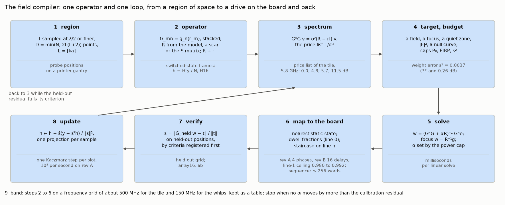

**Figure 1.** The field compiler of section 3.4. Each box holds its step's formula and, beneath the rule, what stands
for it on the board: switched-state frames decoded with H16 measure the operator; the price list says beforehand what is
cheap (for the tile at 5.8 GHz in a ball of radius 52 mm 150 mm out, 0, 4.8, 5.7 and 11.5 dB); rev A's four phases or
rev B's sixteen delays, played by a sequencer of at most 256 words, carry the drive (rev B's line-1 ceiling 0.980 to
0.992); a held-out grid judges it. The loop returns to step 3 while the held-out residual fails its registered
criterion, and step 9 repeats steps 2 to 6 on a frequency grid. `experiments/virtual_antenna_study.py` draws this figure
and every other one here from the Hertzian model of `experiments/local_fields.py`, ported typed; its `run.log` and
`results.json` hold their numbers.

### 3.5 What "arbitrary" means

**Proposition (reachable set).** At one frequency the fields the array makes over the sampled region are exactly
range(G), of dimension rank G ≤ N; a target is reachable to ε exactly when its out-of-span part `‖(I − GG⁺)E_A‖` is at
most `ε‖E_A‖`. M linear conditions leave drives of dimension at least N − M, so a null is the cheapest target there is.

Arbitrary fields are thus any fields in a subspace of at most sixteen dimensions, chosen afresh for each region, and the
spectrum says beforehand which targets are cheap. On transmit through the HackRF the drive set is the board's states and
their hulls (section 6); on receive it is all of ℂ¹⁶.

**Proposition (space-time form).** Let the HackRF send a waveform s(t) of spectrum S(f) about the carrier f₀ while the
board plays a sequence of period 1/f_p whose states' delays are short against a slot. Apart from transients of one
delay at each switch, `E(r, f) = Σ_h S(f − f₀ − h·f_p) Σₙ c_{n,h}(f − h·f_p) gₙ(r, f)`, with c_{n,h} the harmonic
weights of section 6.2 taken with each state's gain at the frequency entering it; a static state is the line h = 0
alone.

**Claim (separable inside 20 MHz).** Inside the HackRF's 20 MHz the operator moves by `1 − |corr|²` of 1e-4 on the tile
and 1.4e-3 on the whips, and rev B's longest delay turns 2.5° (section 4.8), so to that accuracy
`E(r, t) = Σ_h e^(2πi h f_p t) s(t) E_h(r)`: every comb line carries the one waveform with its own pattern E_h from the
span of G. "Arbitrary" in time therefore means one waveform per capture, shared by all points and shifted in frequency
line by line. A field whose time course differs from place to place, such as a pulse that comes to a focus in space and
time, takes band over which G or the delays change: more than about 500 MHz on the tile in free space (section 4.8), or
a scattering room, in which one channel compresses as √(Δf/δf) (section 8.1).

## 4. The mathematics of synthesis

### 4.1 Modes and the price list

**Proposition (minimum-power drive).** For G of full row rank (M ≤ N independent conditions) and positive definite R,
the unique drive of least radiated power with Gw = e is `w* = R⁻¹Gᴴ(GR⁻¹Gᴴ)⁻¹e`, of power `eᴴ(GR⁻¹Gᴴ)⁻¹e`. For a
consistent target with G rank deficient the same holds with the pseudo-inverse `(GR⁻¹Gᴴ)⁺` in place of the inverse.

**Proposition (regularised drive).** `w_α = (GᴴG + αR)⁻¹Gᴴe` is diagonal in `GᴴG vᵢ = σᵢ² R vᵢ` (`vᵢᴴRvⱼ = δᵢⱼ`,
`uᵢ = Gvᵢ/σᵢ`): mode i carries `σᵢ⟨uᵢ, e⟩/(σᵢ² + α)` and the power `Σ σᵢ²|⟨uᵢ, e⟩|²/(σᵢ² + α)²` tends to
`Σ |⟨uᵢ, e⟩|²/σᵢ²` as α → 0. Power falls and residual rises monotonically with α; under a cap `wᴴRw ≤ P₀` the
multiplier is the unique α at which the power equals P₀, found by bisection, and where the cap does not bind the answer
is the least-squares drive of least R-norm.

The vᵢ are the array's communication modes into T (Miller 2000, 2019): v₁ puts the most field energy into T per radiated
watt, v₂ the most among drives power-orthogonal to it, and a target's component along uᵢ costs `1/σᵢ²` watts per unit of
field energy. For the tile at 5.8 GHz into a ball of radius 52 mm 150 mm in front (10 % loss) the modes cost 0, 4.8,
5.7, 11.5, 14.9, 17.6, 22.2, 23.7, 27.1 and 32.4 dB relative to the first, down to 59 dB.

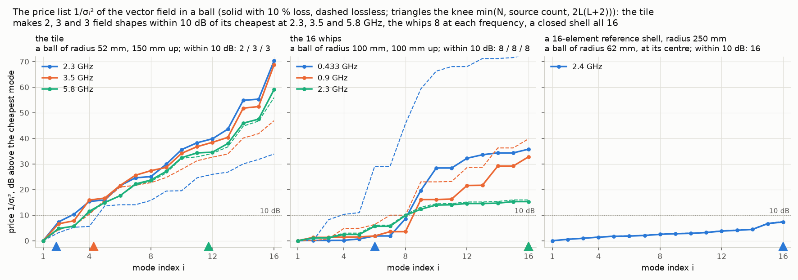

**Figure 2.** The price list 1/σᵢ², in dB above the cheapest mode, of the vector field in a ball: solid with 10 % loss,
dashed lossless; triangles mark the knee min(N, source count, 2L(L+2)), the source count being πA/λ² for the tile and
2(ka)² over the circumscribing sphere for the whips and the shell. In a ball of radius 52 mm 150 mm in front the tile
has 2, 3 and 3 modes within 10 dB at 2.3, 3.5 and 5.8 GHz (at 5.8 GHz 0, 4.8, 5.7, 11.5, 14.9, 17.6, 22.2, 23.7, 27.1
and 32.4 dB); at 5.8 GHz that is far below its knee of 11.8, the ball's distance limiting what the aperture reaches. In
a ball of radius 100 mm 100 mm above the plate the whips have 8 within 10 dB at 0.433, 0.9 and 2.3 GHz, past the
region's knee of 6 at 0.433 GHz, where the ball lies in the whips' stored field (kr of 1.4 to the nearest whip). The
16-element reference shell of radius 250 mm holds all 16 within 7.3 dB in a ball of radius λ/2 at its centre at 2.4 GHz.

### 4.2 How many drives radiate

In the Hertzian model (the tile as y-dipoles 13 mm over ground; the whips as monopoles with images, each cut to a
quarter wave at its own frequency):

| Array | f | Eigenvalues of R within 10 dB of the largest | Condition number | πA/λ², A = 0.01 m² |
| --- | --- | --- | --- | --- |
| tile, 25 mm | 2.3 / 3.5 / 5.8 GHz | 3 / 6 / 14 | 1.5 × 10⁷ / 5.4 × 10⁴ / 51 | 1.9 / 4.3 / 11.8 |
| 16 whips | 0.433 / 0.9 / 2.3 GHz | 5 / 11 / 16 | | |

At 2.3 GHz the tile radiates through 3 drives and carries 13 superdirective ones, the smallest 62 dB below the mean; the
counts run 1.2 to 1.6 times πA/λ². A drive of R-eigenvalue ρ radiates with efficiency ρ/(ρ + r) against an ohmic loss r
per element, which is how loss removes exactly the superdirective drives.

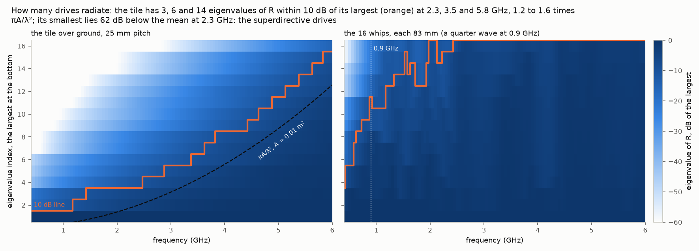

**Figure 3.** The eigenvalues of the radiation matrix R from 0.4 to 6 GHz, in dB of the largest, for the tile over
ground and for the 16 whips cut to 83 mm (a quarter wave at 0.9 GHz); the orange step counts those within 10 dB. The
tile has 3, 6 and 14 at 2.3, 3.5 and 5.8 GHz, 1.6, 1.4 and 1.2 times πA/λ² (dashed); its condition number is 1.5 × 10⁷
at 2.3 GHz, the smallest eigenvalue 62 dB below the mean, and 51 at 5.8 GHz. The whips have 5, 11 and 15 within 10 dB at
0.433, 0.9 and 2.3 GHz with this one cut, and 5, 11 and 16 when each is cut to a quarter wave at its frequency.

### 4.3 Degrees of freedom of a region

**Proposition (mode count).** The TE and TM vector spherical waves of degree 1 to L number `Σ 2(2l + 1) = 2L(L + 2)`:
6, 16, 30 and 48 for L = 1 to 4.

**Claim (degrees of freedom).** The order-one σᵢ number about min(N, the source-limited count, the region-limited count
2L(L+2) with L ≈ ka, Miller's source-to-region count), and past it they fall roughly geometrically. The source side is
the band limit of Bucci and Franceschetti (`2(ka)²` for sources in a sphere) and Gustafsson's 8π × (average shadow
area)/λ², which is `2(ka)²` for a sphere and 4πA/λ² for a plate of area A, πA/λ² per side and polarisation; the
source-to-region count is the number of singular modes of the coupling operator (Miller).

| Array (model) | Region | ka | 2L(L+2) | Modes within 10 / 20 dB |
| --- | --- | --- | --- | --- |
| 64-element reference shell, 5.8 GHz | ball of radius λ/2 | 3.1 | 30 (L = 3), 48 (L = 4) | 26 / 40 |
| 16-element reference shell, 2.4 GHz | ball of radius 62 mm | 3.1 | 48 | 16 / 16 |
| tile, 5.8 GHz | ball of radius 26 mm, 150 mm in front | 3.1 | 48 | 2 / 3 |
| tile, 5.8 GHz | ball of radius 52 mm, 150 mm in front | 6.3 | 126 | 3 / 6 |

Sixteen channels equal the electric and magnetic dipoles and quadrupoles (L = 2). Sixteen elements in general positions
and polarisations round a volume set a general vector field to a median −20 dB in a ball of ka = 1 (52 mm at 915 MHz,
20 mm at 2.44 GHz, 8 mm at 5.8 GHz) and −10 dB at ka = 2. Sixteen coplanar vertical whips reach −2.3 dB at ka = 2: full
vector control of a ball takes elements at several heights in two polarisations, such as whips on printed mounts on the
board's own ports.

### 4.4 The price of fine structure

**Claim (fine structure).** Holding M values of alternating sign at spacing δ below about 0.35 λ costs power growing as
about `(0.63 λ/δ)^(2(M−1))`, exponential in the number of sub-wavelength features and a power law in their spacing; at
λ/2 and above each point costs about 1 dB. On a 64-element reference shell at 5.8 GHz, relative to one point:

| δ | M = 2 | 3 | 4 | 5 | 6 |
| --- | --- | --- | --- | --- | --- |
| 1.0 λ | 3.1 dB | 5.5 dB | 6.8 dB | 8.0 dB | 9.0 dB |
| 0.5 λ | 2.2 | 3.6 | 4.8 | 5.9 | 6.8 |
| 0.35 λ | 4.1 | 8.2 | 12.9 | 17.7 | 21.8 |
| 0.25 λ | 6.5 | 14.0 | 22.2 | 30.2 | 37.8 |
| 0.15 λ | 10.6 | 23.1 | 36.1 | 48.7 | 61.1 |

Along a line 150 mm in front of the tile at 5.8 GHz, points 1.5 λ apart cost 3.4, 6.1 and 7.5 dB for M = 2 to 4 and the
fifth 25.8 dB more: four columns give four transverse degrees of freedom. The classical forms of the law are
Harrington's normal gain `(ka)² + 2ka` and the radiation Q, `1/(ka)³ + 1/(ka)` for the lowest mode (Chu; McLean) and
growing as about `((2l − 1)!!)²/(ka)^(2l+1)` for order l above ka.

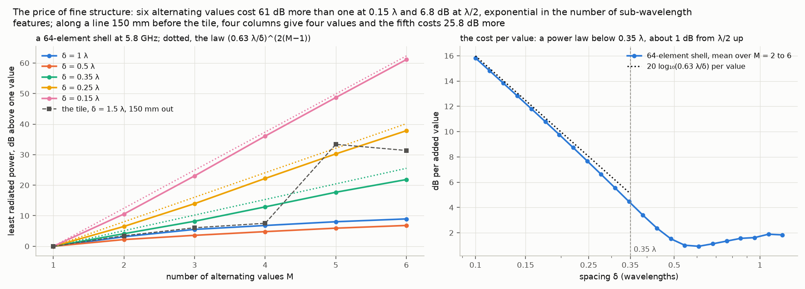

**Figure 4.** The least radiated power holding M values of alternating sign at spacing δ, in dB above one value. Left:
the table of section 4.4 for a 64-element shell at 5.8 GHz, with the law (0.63 λ/δ)^(2(M−1)) dotted for δ of 0.35 λ and
below, and the tile's line 150 mm in front with points 1.5 λ apart, 3.4, 6.1 and 7.5 dB for M = 2 to 4 and 25.8 dB more
for the fifth. Right: the mean cost per added value against δ, from 12.2 dB at 0.15 λ, 7.6 dB at 0.25 λ and 4.4 dB at
0.35 λ, following 20 log₁₀(0.63 λ/δ), to 1.4 dB at λ/2 and 1.8 dB at λ.

### 4.5 A focus, and the free-space ceiling

**Proposition (focus).** The squared component c·E at a point per radiated watt is the Rayleigh quotient
`|gᴴw|²/(wᴴRw)` (gᴴ = cᴴG(r_f)), largest at `w = R⁻¹g` where it equals `gᴴR⁻¹g`; for the whole vector it is the largest
eigenvalue of `G_f R⁻¹ G_fᴴ`, and with R = I it is the conjugate focus.

Over fields without sources near the point that carry the power in from far away, the quotient's ceiling is RFG-2,
`E² = 4Z₀k²P/(3π)` at the centre of a converging electric dipole wave (Bassett's theorem: at a point without sources
only the three electric dipole modes of a field are nonzero): 78.2 µeV per watt for an electron at any frequency,
20.4 V/m per milliwatt at 2.44 GHz. Over a ground plane the same fields' ceiling carries the image term of Im G (×1.137
for E_z at 100 mm and 0.9 GHz; ×0.55 for horizontal E at 100 mm and 433 MHz). An array meets those hypotheses only
where its elements return no wave to the point: a surround dense enough to enclose it, or a point in an element's own
stored field, holds energy there, and the quotient passes the ceiling by it.

**Claim (shells).** N short dipoles of random tangential polarisation on a shell of radius b reach `|E|²/P = NZ₀/(4πb²)`
at the centre, the fraction `3N/(16(kb)²)` of the ceiling, within 25 % while N stays below about 0.05 × 2(kb)²; nearer
filling the model exceeds it, by 2.2 times at N = 0.2 × 2(kb)². Sixteen elements on a shell of radius λ/2 (the study's
shell: tangential dipoles alternately along θ̂ and φ̂ on a Fibonacci lattice) reach 0.97 of the ceiling lossless and
0.72 with 10 % loss.

**Claim (what passes the ceiling, in the model).** A sparse surround stays near the ceiling: sixteen elements on a shell
reach at most 1.57 of it lossless and 1.04 with 10 % loss at kb ≥ 3 (at kb = 3), and the board's arrays pass it only at
foci within kr of about 3 of an element (the table below). A surround dense enough to close, N of order 2(kb)², passes
it at its cavity resonances by its stored energy, by its Q, which loss sets: 256 elements at kb = 6.1, beside the
resonance at 6.117, reach 939 times the ceiling lossless and 12.4 times with 10 % loss; with that loss they reach 57,
12.5, 5.4, 2.7 and 1.0 times it at kb = 2.744, 6.117, 9.317, 12.486 and 15.644, less as the shell thins against
2(kb)², and 0.22 between the resonances. A focus in an element's own stored field passes it the same way: 20 mm before
the tile at 2.44 GHz by 220 times the ceiling over the ground lossless and 20 times with 10 % loss.

| Array (model) | Focus | Share of RFG-2's ceiling | Share of the ceiling over the ground | Field at 1 W |
| --- | --- | --- | --- | --- |
| tile, 5.8 GHz, 10 % loss | 150 mm on axis, E_y | 0.048; 9.1 times one element | 0.046 | 336 V/m |
| tile, 5.8 GHz, lossless | 20 / 50 / 100 / 200 / 500 mm, E_y | 0.36 / 0.24 / 0.10 / 0.030 / 0.005 | 0.28 / 0.23 / 0.097 / 0.029 / 0.005 | |
| tile, 2.44 GHz, lossless | 20 / 50 / 100 / 200 mm, E_y | 147 / 0.66 / 0.29 / 0.094 | 220 / 0.53 / 0.26 / 0.10 | |
| whips, 915 MHz, lossless | 30 / 100 / 200 mm above the centre | 3.1 / 1.14 / 0.24 | 1.66 / 1.02 / 0.24 | |
| whips, 0.9 GHz, 10 % loss | 100 mm above the centre | 0.92 | 0.81 | 229 V/m |
| whips, 433 MHz, 10 % loss | 100 mm above the centre, horizontal field | 4.9 | 8.9 | 254 V/m: 382 µeV per watt |

Every share above 1 is stored field, set by Q and loss; RFG-3 takes that regime to an electrode behind a resonator
(section 7.3).

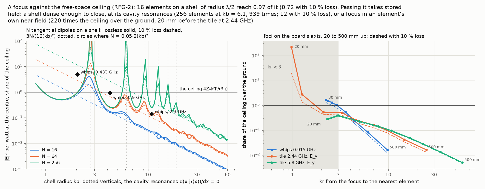

**Figure 5.** A focus against the free-space ceiling RFG-2. Left: the most |E|² per radiated watt at the centre of a
shell of N tangential dipoles (alternately along θ̂ and φ̂), as a share of the ceiling, lossless (solid) and with 10 %
loss (dashed), against the shell's radius kb; dotted, 3N/(16(kb)²), which the model meets once N is below 0.05·2(kb)²
(circles). Sixteen elements at kb = π reach 0.97 of the ceiling lossless and 0.72 with 10 % loss, and at most 1.57 and
1.04 at kb ≥ 3. The peaks fall on the cavity resonances of order one, where d(x j₁(x))/dx = 0 (kb = 2.744, 6.117,
9.317, …): a shell dense enough to close holds the dipole wave at its centre without radiating it, and the quotient
passes the ceiling by its stored energy, as a cavity's does by its Q, which loss sets: 256 elements at kb = 6.1 reach
939 times it lossless and 12 times with 10 % loss. Diamonds: the whip rings' foci 100 mm above the centre at the outer
ring's kb with 10 % loss, 4.88, 0.92 and 0.14 of RFG-2's ceiling (8.85, 0.81 and 0.14 of the ceiling over the ground)
at 0.433, 0.9 and 2.3 GHz. Right: foci on the board's axis 20 to 500 mm out against kr to the nearest element, as
shares of the ceiling over the ground; on the board's arrays the share passes 1 only within kr ≈ 3 (shaded), by 220
times 20 mm before the tile at 2.44 GHz.

### 4.6 Regularisation, and what each form means

- **Tikhonov in R:** a price per radiated watt; a hard power cap is the same problem with α its multiplier.
- **Tikhonov in the identity, R + rI:** an ohmic loss r per element, or a cap on white-noise gain; it removes the
  superdirective modes and nothing else.
- **Tikhonov in D = diag(GᴴG):** robustness. **Proposition (error field).** With independent zero-mean relative weight
  errors of variance s² the expected error energy over T is `s² wᴴDw`, so loading with s²D minimises target error plus
  expected error. Rev B's calibration residual of 3° and 0.26 dB is s² = 0.0037 (−24.4 dB): a drive whose `wᴴDw` exceeds
  about 270 times its delivered `‖Gw‖²` is lost in its own error field, and a null deeper than −24 dB below the
  unconstrained field takes finer calibration.

### 4.7 Targets that are not linear

- **Intensity.** `|E(r_p)|² = I_p` is quadratic in w: a quartic, non-convex problem, phase retrieval with signal and
  unknown exchanged, solved locally by Gerchberg-Saxton alternation (each step one linear solve) or lifted to a
  semidefinite programme (PhaseLift). An intensity target fixes M real numbers, not 2M; the free phases are a resource.
- **Finite alphabets.** Maximising a Hermitian form over m-th roots of unity is NP-hard in general, with a semidefinite
  relaxation of constant ratio (Zhang and Huang). Rev A has 4¹⁶ = 4.3 × 10⁹ phase states, rev B 16¹⁶ × 2⁴ = 3.0 × 10²⁰
  delay-and-polarity states. For the rev A focus at (30, 0, 150) mm an exhaustive search of the 4¹⁵ states (common phase
  removed) gives 102 350 (V/m)² per watt, the value coordinate ascent finds, −0.53 dB below the continuous optimum.
  **Hypothesis (local search on rev A).** Coordinate ascent from the rounded continuous drive finds rev A's best state
  for nulls and intensity targets as it does for this focus; the same exhaustive search of 4¹⁵ = 1.1 × 10⁹ states for
  each kind of target settles it.
- **Null curves.** **Claim.** A null of one component on a curve of length ℓ consumes about `2ℓ/λ + 1` drive modes,
  capped by the array's count. Modes consumed on a ring of radius ρ (within 40 dB, 10 % loss):

  | Array (model) | ρ = 0.25 λ | 0.5 λ | 1 λ | 2 λ |
  | --- | --- | --- | --- | --- |
  | estimate 2kρ + 1 | 4.1 | 7.3 | 13.6 | 26.1 |
  | tile, 5.8 GHz, ring 150 mm in front | 5 | 7 | 10 | 12 |
  | tile, 2.4 GHz, ring 150 mm in front | 5 | 7 | 11 | 11 |
  | whips, 0.9 GHz, ring 100 mm up | 16 | 16 | 16 | 16 |
  | 32-element reference shell, 5.8 GHz | 9 | 13 | 17 | 29 |

  The tile holds a null ring of radius 26 mm at 150 mm with 7 drives and keeps 9 for the field round it; on the board
  its depth is set by weight error, about −24 dB at 3° and 0.26 dB.
- **Knotted null lines.** **Hypothesis (knotted null lines).** Nulls of one complex component are topologically
  protected lines; the drive space CP^(N−1) splits into regions of fixed knot type separated by reconnection walls of
  real codimension one; a null of the whole vector field takes six real conditions. Milnor polynomials give knotted
  nulls in closed form, and Dennis et al. isolate optical vortex knots from them with one optimisation step. For the
  board: fit the linear conditions of a Milnor field on the curve, maximise the smallest |ψ| on a tube round it, and
  check the type with the tracer of `experiments/local_fields.py`. The search runs over CP^15, 30 real dimensions,
  since neither the scale nor the common phase of a drive moves its nulls. A trefoil traced in the knot type asked,
  from a drive found this way, settles it for that geometry.

**Hypothesis (cheap exotic fields).** Null rings and knotted lines sit in the cheap part of the spectrum and
sub-wavelength hot spots in its exponential part (a 26 mm ring at 5.8 GHz takes 7 of 16 drives; six features at 0.15 λ
take 61 dB). The least-power drive holding unit field half a wavelength off a nulled ring, with rev A's states, against a
focus making the same field, settles it. **Hypothesis (knots take a surround).** A trefoil null takes elements round the
volume; the compiler's null-curve solve on the panel, the whips and shells of 16 to 64 elements will give the smallest N
for a trefoil of a given size.

### 4.8 Across a band

**Claim (band).** Inside the HackRF's 20 MHz the operator does not move: `1 − |corr|²` between G(f) and G(f + 20 MHz) is
1e-4 for the tile and 1.4e-3 for whips cut for 0.9 GHz, and rev B's longest delay turns 2.5° across 20 MHz, so one
solution serves the instantaneous band. Across the tuned band it decorrelates (tile: 0.0023, 0.0093 and 0.057 at 100, 200
and 500 MHz; whips: 0.034, 0.125 and 0.55), so a band-wide target is a table on a grid of about 500 MHz for the tile
(about 8 entries over 2.3 to 6 GHz) and 150 MHz for the whips (about 13 over 0.4 to 2.3 GHz), with a finer grid where
element or matching resonances are narrower than the model's smooth patterns.

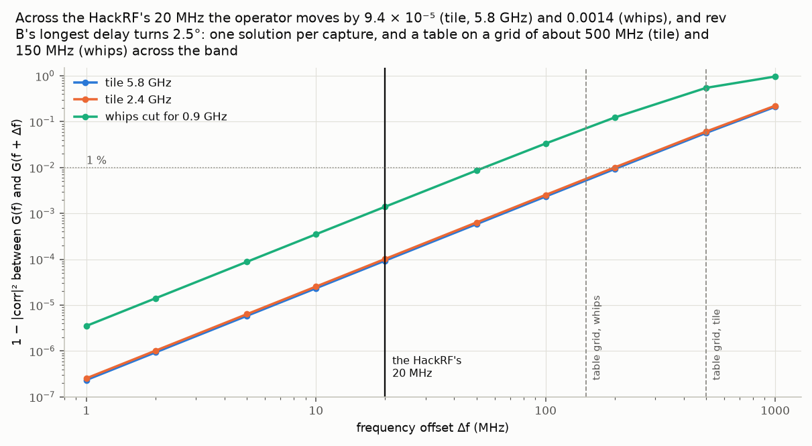

**Figure 6.** 1 − |corr|² between the operator G(f) over a ball and G(f + Δf), for the tile at 5.8 and 2.4 GHz (a ball
of radius 50 mm 150 mm out) and for the whips cut for 0.9 GHz (a ball of radius 100 mm 100 mm up). Across the HackRF's
20 MHz it is 9.4 × 10⁻⁵ and 1.0 × 10⁻⁴ for the tile and 1.4 × 10⁻³ for the whips, so one solution serves a capture; it
grows as Δf², to 0.057 for the tile at 500 MHz and 0.12 for the whips at 200 MHz; dashed, the table grids of 500 MHz
(tile) and 150 MHz (whips). Rev B's longest delay, 347.5 ps, turns 2.5° across 20 MHz.

### 4.9 Measuring the operator

- **Proposition (switched-state estimate).** With N states H, HᵀH = NI, and noise s² per sample, `ĥ = Hᵀy/N` is unbiased
  with covariance (s²/N)I, 12 dB below one element at a time for N = 16 and the best possible for entries bounded by 1
  (Hotelling). Rev A realises it at 5.8 GHz with its 0/180° states; elsewhere, and on rev B, the decode is a general
  16 × 16 solve with the measured states. Both take each element's gain to depend on its own state alone, the
  hypothesis of the product alphabet (section 6.2).
- **Claim (counts).** 16 complex numbers per frequency with a geometric model (one gain per element), at most N² = 256
  per field component without. With a power detector and no phase reference about 60 four-phase states per position are
  locally sufficient; the 4N − 4 theorem (Conca et al.) covers generic vectors, and ±1 states never separate h from its
  conjugate.
- **Proposition (phase-free targets).** `|(DGw)_m|² = |(Gw)_m|²` for diagonal unit-modulus D: intensity targets (focus,
  null, quiet zone, pseudo-potential) need G only up to one phase per position, so a free-running beacon calibrates
  them; wavefront and vortex targets take a phase reference per position, such as a cabled sample of the probe's carrier.
- **Offsets.** A free-running probe on its own 0.5 ppm TCXO, against the HackRF's, is up to 2.9 kHz off per oscillator
  at 5.8 GHz (5.8 kHz for two): 3.1 rad per 170 µs rev A cycle and 4.6 rad per 255 µs rev B cycle at 2.9 kHz. A cheap
  synthesiser module on its 25 MHz crystal, of 10 to 50 ppm, is 58 to 290 kHz off at 5.8 GHz and 24 to 120 kHz at
  2.44 GHz, far above any cycle rate. Either offset is estimated from the probe's tone over the whole capture and
  derotated before the slots are cut (200 samples per 10 µs slot at 20 Msps), or removed by giving the probe the
  HackRF's 10 MHz, which V1 does.
- **Proposition (update).** The Kaczmarz step `h ← h + s̄(y − sᵀh)/‖s‖²` is the orthogonal projection onto
  {h : sᵀh = y} and never increases `‖h − h₀‖` (Euclidean norm) for noise-free y; one step per slot is 1e5 per second on
  rev A and 6.7e4 on rev B.

## 5. Virtual antennas by equivalence

### 5.1 The board as an equivalent source

Love's equivalence puts `J_s = n × H_A` and `M_s = −n × E_A` on a surface so that they radiate E_A outside it and nothing
inside; Schelkunoff's backs the surface with a conductor and keeps M_s. **Claim (the board as a sampled sheet).** A
patch or a low dipole over ground is a magnetic-current element on a conductor, so the panel samples a Schelkunoff sheet
at its pitch, radiating to one side and taking two polarisations per cell for an arbitrary field; the aliasing rule
below and the window and edge rules of section 5.3 say how well. Acoustic wave-field synthesis is the same construction
with loudspeakers (Berkhout et al.; Spors et al.).

**Proposition (aliasing).** A sheet sampled at pitch d radiates no propagating copy of its drive spectrum for every drive
exactly when d < λ/2, and for drives limited to θ_max exactly when `d < λ/(1 + sin θ_max)`; a ring of N elements of radius
a makes order m with weight `J_m(ka cos el)` and mixes m with m ± N. The tile is λ/2 at 6.00 GHz (25 mm), the rev A panel
at 5.77 GHz (26 mm), the outer whip ring at 0.848 GHz (176.7 mm of arc) and the inner one at 1.704 GHz (88.0 mm).

### 5.2 What carries over, and what stays with the board

| Carries over to the virtual antenna, over T | Stays with the real array |
| --- | --- |
| pattern, to ε | impedance at the radio; element scan impedances move with w |
| polarisation where the array has it (two per cell for any) | efficiency, and the sensitivity S |
| apparent position: the wavefront curvature | the bandwidth of elements, filters and delays |
| receive response and receive position | noise temperature: S dB of signal-to-noise ratio on receive |
| several at once, by superposition | power: +1.5 dBm EIRP through the tile at 2.44 GHz and −17.8 dBm at 5.8 GHz for the HackRF One's output (section 1) |
| | scattering, shadowing, the reactive near field |

M virtual antennas at once share the drive, each getting 1/M of the power when orthogonal under R; on receive all come
from one set of captures, each at 1/N of the static state's signal-to-noise ratio (section 6.1).

### 5.3 Virtual sources behind the board

**Claim (closed-form drive and edge term).** The closed-form drive of a virtual point source is a delay ρ/c to each
element, an amplitude 1/ρ, an obliquity cos θ and a filter `(ik − 1/ρ)` common while kρ ≫ 1 (at 5.8 GHz and ρ of 25 to
59 mm, kρ is 3.0 to 7.2 and the filter's phase varies 10° across the elements). Inside the window of rays crossing the
aperture the field is right up to an edge term of relative size about 0.225/v, the lit side of a Fresnel edge wave,
`1/(π√2·v)`, with `v = t√(2/(λL))`, t the margin from the edge and `L = dr/(d + r)`: −10 dB takes v = 0.71 and −20 dB
v = 2.25, margins of 26 and 81 mm for a source 50 mm behind at 5.8 GHz.

**Claim (virtual sources behind the tile).** A co-polarised virtual dipole behind the tile is reproduced inside the
window. Residual (loading 1e-3 of the largest eigenvalue) over cones about boresight, shells at 0.3, 0.6 and 2 m:

| Source | 20° cone | 30° | 45° | 60° | Window atan(D/2d) |
| --- | --- | --- | --- | --- | --- |
| 25 mm behind, 5.8 GHz | −34 dB | −31 dB | −21 dB | −13 dB | 63° |
| 50 mm behind, 5.8 GHz | −31 | −27 | −16 | −9 | 45° |
| 100 mm behind, 5.8 GHz | −26 | −19 | −9 | −4 | 27° |
| 300 mm behind, 5.8 GHz | −14 | −6 | −1 | 0 | 9° |
| 50 mm behind, 2.4 GHz | −26 | −26 | −25 | −19 | 45° |

S is 0.1 to 1 dB at 5.8 GHz and 3 to 9 dB at 2.4 GHz for the 50 mm source, whose fit draws on superdirective weights.
Scored over the window itself at 5.8 GHz the residual is −10 to −18 dB over all rays through the aperture and −19 to
−26 dB over rays through its central half. The closed-form drive with one free scale reaches −7 to −15 dB in 20 to 30°
cones: with 16 elements the fit is the process and the formula its starting point.

**Claim (visibility).** A virtual source is reproduced only where its rays through the aperture land. A dipole at
(0.15, 0, −0.1) m, whose rays through the 0.1 m tile land at x = −0.45 to −0.15 m on the plane z = 0.2 m, scored on a
centred 200 mm square there, is reproduced to −22.7 dB at 2.44 GHz, −12.2 dB at 3.5 GHz and −2.8 dB at 5.8 GHz as the
aperture grows from 0.8 to 1.9 wavelengths. The case that must fail, a source 0.5 m to the side, gives −4.2, −0.7 and
−0.4 dB; reaching it takes an aperture that meets its rays.

Over squares on the plane 0.2 m in front, for a dipole 0.1 m behind:

| Square | f | Complex weights, loading 1e-6 | With 3° / 0.26 dB errors | rev B delay states (±1 dB) | Plain steered beam |
| --- | --- | --- | --- | --- | --- |
| 100 mm | 2.44 / 5.8 GHz | −49.2 / −45.2 dB | −36.1 / −33.7 dB | −27.5 / −19.5 dB | −22.6 / −15.3 dB |
| 200 mm | 2.44 / 5.8 GHz | −36.4 / −24.9 | −24.3 / −23.4 | −22.8 / −16.1 | −14.6 / −6.0 |

The ideal column depends on the loading (at 1e-3 the 2.44 GHz, 100 mm entry is −26.5 dB), so the loading is fixed with
the criteria. A target polarised across the single-polarised tile is missed entirely (0.0 dB) and one at 45° by half
(−3.0 dB); a dual-polarised tile of 32 ports reaches for any polarisation what one polarisation reaches for its own.

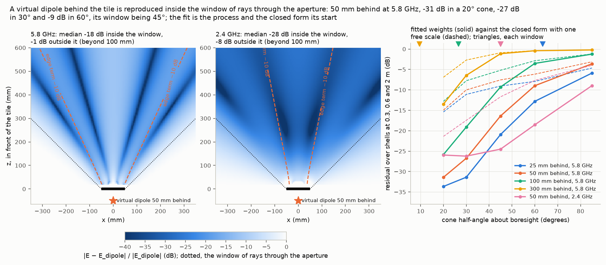

**Figure 7.** A co-polarised virtual dipole behind the tile. Left and middle: the error of the fitted field against the
dipole's over the x-z plane, the dipole 50 mm behind at 5.8 and 2.4 GHz, the weights fitted on shells at 0.3, 0.6 and 2
m within 45° (loading 10⁻³ of the largest eigenvalue); dotted, the window of rays from the source through the aperture's
edges; dashed orange, where the Fresnel edge term 0.225/v is −10 dB. Beyond 100 mm the median error is −18.5 dB inside
the window and −0.9 dB outside it at 5.8 GHz, −28.5 dB and −8.0 dB at 2.4 GHz. Right: the residual in cones about
boresight for sources 25 to 300 mm behind (the table of section 5.3), the fitted weights solid and the closed-form drive
with one free scale dashed; triangles mark each window atan(D/2d).

### 5.4 Focused sources and virtual probes in front

**Claim (a virtual antenna in empty space is a focus).** Fields of sources outside a region are smooth inside it, while
the outgoing Green function is singular at its source, so the best external match to a point radiator at r_v is the
standing wave Im G, regular there: a spot about λ/2 wide in intensity, a wave that converges, passes the focus and only
beyond it, inside the cone `atan(D/2z_f)`, equals the field of a source at the focus (Sherman). A focused virtual source
0.06 m in front of the tile, scored beyond it over a 200 mm square at 0.2 m, is reproduced to −35.0, −29.3 and −22.6 dB
at 2.44, 3.5 and 5.8 GHz. A true radiator or receiver at r_v takes matter there: an active sink (de Rosny and Fink reach
spots below λ/14), a printed resonator, a held cloud (section 7.4).

**Claim (on-axis maxima).** With conjugate weights the tile has an on-axis maximum at 5.8 GHz between 17 and 53 mm for
nominal foci of 20 to 300 mm, and none at 2.4 GHz. Foci asked at 30, 50, 100 and 200 mm at 5.8 GHz peak at 22, 32, 42 and
50 mm, with spots of 24 × 42, 32 × 43, 52 × 56 and 96 × 95 mm and gains over uniform drive of 7.0, 3.8, 1.2 and 0.3 dB. A
maximum at a chosen distance takes a Fresnel number `D²/(4λz)` near 1: N_F = 1 at 20 mm (2.4 GHz) and 48 mm (5.8 GHz)
for D = 100 mm, and a maximum at 100 mm and 2.4 GHz takes D = 224 mm, or null-forming weights (a null at 30 mm puts a
local maximum at 99 mm, 12 dB below uniform drive).

A virtual probe is the receive reading of a focus: weights focused at the centre of the whip plate give a spot of 143 mm
(0.43 λ) at 0.9 GHz and 527 mm (0.70 λ) at 0.4 GHz, a local lobe, since a source within a few centimetres of a whip is
heard more than 20 dB louder than one at the focus.

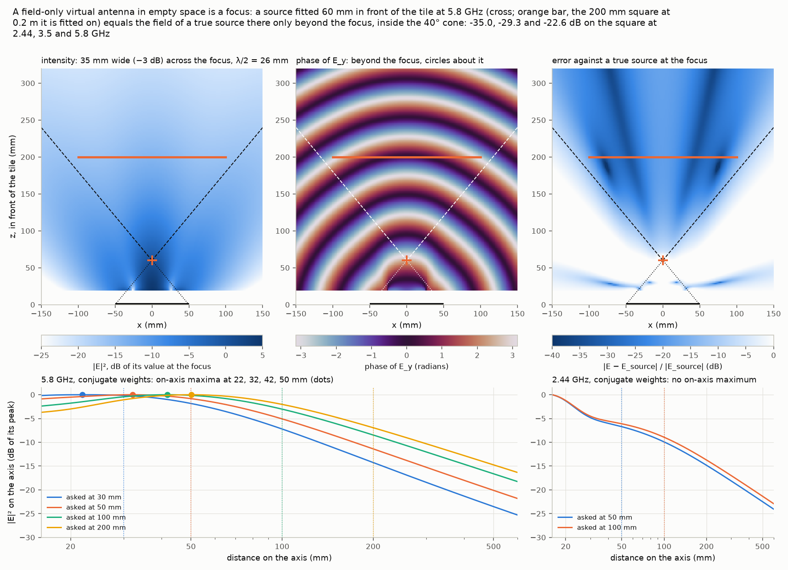

**Figure 8.** A virtual source focused 60 mm in front of the tile at 5.8 GHz, the weights fitted beyond it on a 200 mm
square 0.2 m out (orange bar). Intensity: the beam narrows to 35 mm across the focus at −3 dB, against λ/2 = 26 mm, and
the stored field near the elements is stronger still. Phase of E_y: beyond the focus the wavefronts are circles about
it. Error against a true source at the focus: a median of −21.9 dB inside the 40° cone beyond 100 mm, −1.5 dB outside it
and −0.7 dB before the focus, as a field regular at the focus must be; on the square the fit reaches −35.0, −29.3 and
−22.6 dB at 2.44, 3.5 and 5.8 GHz. Bottom: |E|² on the axis under conjugate weights; foci asked at 30, 50, 100 and 200
mm at 5.8 GHz peak at 22, 32, 42 and 50 mm, and at 2.44 GHz there is no on-axis maximum.

### 5.5 The whip rings: synthesis inside a ring

The whips surround the plate's centre, so the plate poses the interior problem: an expansion to order M about a point
reproduces a disc of radius about M/k and takes at least 2M + 1 elements on a ring. The ideal two-dimensional truncation
error is −20.5 dB at kr = 3 and −12.8 dB at kr = 4 for M = 3, and −40.2 dB at kr = 5 and −22.0 dB at kr = 7 for M = 7.

**Claim (rings as an order-3 interior array).** On each ring the orders m and m + 8 are one and only the difference in
radius separates them, so the 16 whips act as a ring of order about 3. A virtual whip at (0.6, 0.2) m is reproduced on
discs 30 mm above the plate to:

| Disc radius | 433 MHz | 915 MHz | 2.3 GHz |
| --- | --- | --- | --- |
| 50 mm | −51 dB (−37 with errors) | −40 (−34) | −29 (−25) |
| 100 mm | −21 (−21) | −22.5 (−22) | −11 (−11) |

At 2.3 GHz the array is 2 dB better than the ideal order-3 truncation (−8.8 dB at kr = 4.8); 0.15 m above the plane the
error rises by 5 to 14 dB. A disc of 150 mm, enclosing the inner whips, still reaches −3 to −14 dB; the case that must
fail is a disc of 200 mm (−2 to −9 dB), which holds sources. Four whips at ±1 through the HackRF's transmit path reach
−13.8, −10.6 and −4.5 dB on the 100 mm disc, a transmit prediction read from receive (section 8.2).

**Claim (virtual whips and phase patterns).** Over all azimuths, elevations of 0 to 45° and ranges of 1 to 6 m, the 16
whips at 0.9 GHz reproduce a quarter-wave whip to −24.3 dB or better anywhere within 150 mm of the centre and to
−19.6 dB within 200 mm, at S ≤ 0.3 dB, and the patterns exp(imφ) at −25.5 dB or better for m ≤ 2, −16 dB for m = 3
(S = 6 dB) and −13 dB for m = 4 (S = 15 dB).
The outer ring alone gives m = 1 at −0.4 dB over that band, because `J₁(ka cos el)` changes sign at 25.5° (ka = 4.24),
and −15 dB over 0 to 15°; the inner ring alone gives −39 dB, which is what the second ring is for. A vertically polarised
plane wave is reproduced inside the rings to −20 dB over a disc of radius 90 mm. Order 6 takes at least 13 elements on a
ring (2M + 1) with ka near 7.5, a ring of about 400 mm radius at 0.9 GHz. The 225 mm outer ring reaches that ka at
1.6 GHz, but its 8 ports alias order 6 to order −2 (section 5.1), so on rings of that size order 6 takes 13 ports or
more.

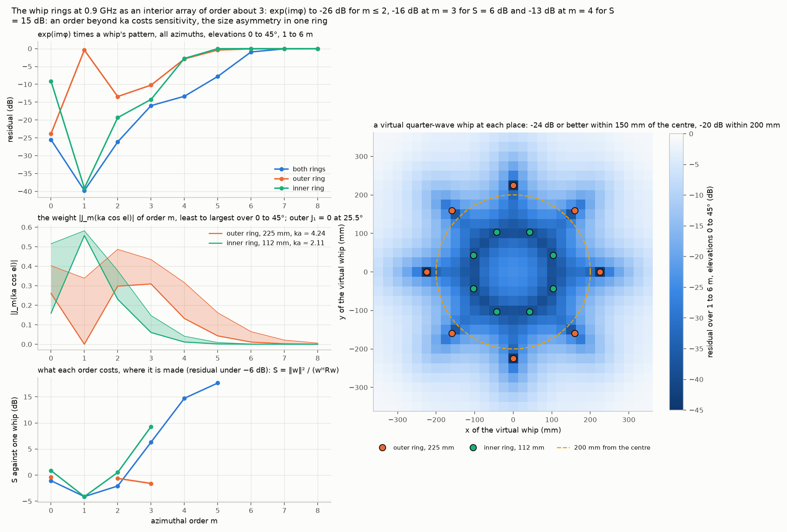

**Figure 9.** The whip rings at 0.9 GHz as an interior array. Top left: the residual of exp(imφ) times a whip's pattern
over all azimuths, elevations 0 to 45° and ranges 1 to 6 m, for both rings, the outer ring and the inner ring: −25.5 dB
or better for m ≤ 2 with both rings, −16 dB at m = 3 and −13 dB at m = 4; the outer ring alone misses m = 1 (−0.4 dB),
which the inner ring alone makes to −39 dB. Middle: the weight |J_m(ka cos el)| each ring gives order m, from its least
to its largest over 0 to 45°; the outer ring's J₁ passes through zero at 25.5°. Bottom: the sensitivity S against one
whip where the pattern is made (residual under −6 dB), 6 dB at m = 3, 15 dB at m = 4 and 18 dB at m = 5: orders beyond
ka cost sensitivity. Right: the residual of a virtual quarter-wave whip against its place over the plate on a 25 mm
grid, −24.3 dB or better within 150 mm of the centre and −19.6 dB or better within 200 mm.

### 5.6 Size, bandwidth and the 2.5-D law

**Claim (size).** A larger virtual aperture takes superdirective weights, available only where the pitch is well under
λ/2: emulating the hemisphere pattern of a uniform aperture s times the tile's side at 2.4 GHz, s = 1.5 reaches −24 dB
at S = 8 dB, s = 2 −13 dB at S = 15 to 17 dB, s = 3 −3.3 dB; at 5.8 GHz the best weights give −3.5 dB at s = 1.5, which
takes a 150 mm board. A smaller virtual antenna keeps the tile's bandwidth: at 5.8 GHz in a 20 to 30° cone it costs S
under 1 dB at −27 to −34 dB, and at 2.4 GHz S of 3 to 5 dB (3 to 11 dB for a point dipole). A dipole of ka = 0.1 has a
Chu Q of 1010; its virtual copy has the board's bandwidth.

**Claim (one delay table).** One rev B delay table keeps the wavefront curvature across 2.3 to 6 GHz at closed-form
quality, −17 dB at 2.4 GHz falling to −8 dB at 5.8 GHz for the 50 mm virtual dipole in a 30° cone; the −15 dB (static
states) and −26 dB (complex weights) residuals take a re-solve per frequency. The delays span 0 to 347.5 ps with gaps of
at most 38.5 ps (rms error 8.6 ps over that span: 7.4° at 2.4 GHz, 17.9° at 5.8 GHz); a 60° steer across 75 mm takes
217 ps and a 30 mm focus 104 ps. Inside 20 MHz phase and delay control are the same: frozen phases for a focus at 50 mm
leave −55 dB at 10 MHz offset and reach −20 dB at 570 MHz.

**Claim (2.5-D law).** A line of point sources emulating a point source d behind it gives on the axis at distance y the
amplitude ratio `√(y_ref (y + d)/(y (y_ref + d)))`, exact only at y = y_ref (an 801-element line gives +2.96 dB at
0.25 m against +3.01 dB predicted), while its first Fresnel zone lies well inside the aperture; a 4-element row of the
tile departs from it by up to 1.35 dB at 0.1 m. A ring of vertical whips obeys it in elevation pattern and range.

## 6. One radio: time-modulated synthesis

### 6.1 Four routes to a general weight

With the HackRF alone the drive is one carrier split sixteen ways, each element in a state of its alphabet.

1. **The nearest static state.** **Proposition (quantisation).** Rounding each phase to the nearest of four states keeps
   at least cos(π/4) of the focal amplitude at fixed element amplitudes. For the rev A focus at (30, 0, 150) mm the loss
   is 0.53 dB, so a focus needs no more. For the virtual dipole 50 mm behind the tile in a 30° cone at 5.8 GHz one state
   gives −15 to −16 dB with rev B's delays and −12 dB with rev A's phases, against −26.7 dB with complex weights and
   −19 dB with continuous phases. **Claim (what sets the floor).** At 2.44 GHz the 16 delays cost 10 to 13 dB against
   continuous phase; at 5.8 GHz on 200 mm targets unit amplitude costs 6 to 7 dB and the delays 3 to 4 dB; on 400 mm
   targets the array's span sets it. Finer delays pay most at 2.44 GHz, per-element amplitude at 5.8 GHz.
2. **The time average, line 0.** **Proposition (time-averaged weights).** Dwell fractions give the carrier the
   dwell-weighted mean state; the reachable carrier weights are the product of the per-element hulls (for rev A at
   5.8 GHz the square `|Re z| + |Im z| ≤ 1`, which contains the disc of radius 1/√2), and any needs at most 2N + 1 = 33
   states, the time-modulated array of Kummer et al. Rev A plays equal slots of at least 10 µs and at most 256 words,
   so dwell fractions are multiples of 1/256 at the finest. With 64 words, multiples of 1/64, focus weights come out
   with −28 to −35 dB of relative error in a 650 µs cycle (sidebands 1.54 kHz apart), the carrier holding 0.37 (optimum
   weights) or 0.51 (conjugate) of the radiated power and the blank marker scaling it by K/(K + 1). Rev B's hull moves
   with frequency because its states are delays.
3. **A comb line, h ≠ 0** (sections 6.2 and 6.3): continuous weights from discrete states.
4. **On receive, in software:** a signal recorded through N independent states gives h, and any weight applies after
   the capture, `y(w) = wᵀh`, to the floor the state calibration sets (−24 dB at 3° and 0.26 dB, section 4.6) and, for
   slot means, for bandwidths well under the cycle rate (section 6.4). It is paid for in noise. **Proposition (the price
   of software beams).** With noise of one variance per sample under every unit-modulus state, a unit-modulus weight
   applied to h estimated from N orthogonal states (HᴴH = NI) over a time T has 1/N of the signal-to-noise ratio of the
   static state with that weight over the same T, 12 dB for 16: each of the N estimated entries of h carries the noise
   of a whole capture, and a weight sums N of them. It is the conservation of beams (section 6.3) with K = N, since one
   capture serves every weight at once, and no switched design serves every weight with more. **Hypothesis
   (converter-limited software nulls).** A software null removes what is linear in the samples. Against a signal near
   full scale in the same capture its depth is set by the converter, of order the 8-bit samples' 50 dB
   (6.02 × 8 + 1.76 dB) and not deepened by averaging, so a deeper null of a strong signal is made before the
   converter, by the board's states, or with the 16-bit samples at low rates (ENOB 9 to 11). A strong beacon nulled in
   software, against the same null made by states, settles it.

**Which route.** The route follows from the direction, the signal's bandwidth B against the comb spacing f_p (5.88 kHz on
rev A with its marker at 10 µs slots, 3.92 kHz on rev B with a marker at 15 µs, 4.17 kHz without) and whether the
target needs phase:

| Direction | Signal | Target | Route | What it costs |
| --- | --- | --- | --- | --- |
| receive | B < f_p | any field | comb-line decode in software (section 6.4) | 1/N of the static state's signal-to-noise ratio per weight; the state-calibration floor |
| receive | steady over a cycle, or a repeatable signal the experiment sends | any field | slot means, or one triggered capture per state | as above; slot means lose to bandwidth (−22.1 dB at 6 kHz with 8 µs slots) |
| receive | B > f_p, up to 20 MHz, not repeatable | any field | one static state for the capture | the static-state residual: −15 to −16 dB for the 50 mm virtual dipole at 5.8 GHz on rev B |
| receive | a strong signal beside a weak one | a null on the strong one | a static state or a line null, before the converter | the states' null depth; a software null stops near the 8-bit samples' 50 dB |
| transmit | B < f_p | a complex field: a wavefront, a vortex, a virtual source | a staircase on comb line h (section 6.2) | the line-1 ceiling, 0.900 on rev A and 0.980 to 0.992 on rev B in amplitude; the rest goes to other lines |
| transmit | B < f_p, or CW | intensity only: a focus, a null, a quiet zone, a pseudo-potential | a static state, line 0, or painting (section 6.6) | the static or hull residual; painting reaches the cone of section 6.6 |
| transmit | B > f_p, up to 20 MHz | any | one static state | the static-state residual; a line-0 schedule would lay its other lines' copies over the signal |

### 6.2 The harmonic weight law

**Proposition (harmonic weights).** If element n's gain is g_{n,l} in slot l of L slots of length τ, periodic with
f_p = 1/(Lτ), then

    c_{n,h} = sinc(h/L) · e^(−iπh/L) · (1/L) Σ_l g_{n,l} e^(−2πi h l/L),     sinc(x) = sin(πx)/(πx),

and `y(t) = Σ_h e^(2πi h f_p t) s(t) Σₙ c_{n,h} aₙ`: on comb line h the board is a phased array with weights c_{n,h}, and
on transmit the field at f + h·f_p is the field of those weights, carrying s(t) cleanly only while s is narrower than
f_p, since the lines of a wider signal overlap.

**Hypothesis (product alphabet).** Element n's gain in a slot depends on its own state alone, `g_{n,l} = aₙ(s_{n,l})`.
Coupling between elements, and a shared splitter whose match moves with the states, would make it a function of the
whole state vector; the harmonic weights, the hulls and ceilings of sections 6.1 and 6.2 and the Hadamard decode of
section 4.9 would then take the joint table. One element's 16 states measured on rev B's calibration arm with its
neighbours held in each of their states, apart by more than the calibration residual (3°, 0.26 dB), refute it.

**Proposition (phase from timing).** Delaying element n's sequence by sₙ slots multiplies c_{n,h} by `e^(−2πi h sₙ/L)`.
A 2-bit element holding each state for L/4 slots has a line-1 weight of magnitude sinc(1/4) = 0.900 for any L divisible
by 4, with phase in steps of 360°/L: 22.5° at L = 16, 4-bit resolution from 2-bit hardware. On the rev A panel at
5.8 GHz a line-1 beam over 400 directions within 45° costs −1.13, −0.97, −0.93 and −0.92 dB against 16 ideal elements for
L = 8 to 64, against −0.91 dB for the static 2-bit beam; the static beam puts the lost power into lobes at the carrier,
the staircase onto other lines.

**Proposition (staircase spectrum).** An M-step staircase through M equally spaced phases has lines only at h = 1 + kM,
of amplitude sinc(h/M), with sinc²(1/M) of the power on line 1.

| Alphabet | Line 1 | Other lines, dB relative to the unmodulated carrier |
| --- | --- | --- |
| on/off, 50 % | 0.101 (−9.94 dB) | 0: −6.0; −1: −9.9; ±3: −19.5; ±5: −23.9 |
| polarity 0/180° | 0.405 (−3.92 dB) | −1: −3.9, an equal image; ±3: −13.5; ±5: −17.9 |
| 2-bit | 0.811 (−0.91 dB) | −3: −10.5; +5: −14.9; −7: −17.8; +9: −20.0 |
| 3-bit | 0.950 (−0.22 dB) | −7: −17.1; +9: −19.3 |
| 4-bit | 0.987 (−0.06 dB) | −15: −23.6; +17: −24.7 |

A single sideband takes two bits, which rev A has; polarity alone gives a beam and its mirror. The staircase is the
serrodyne translator (Cumming) with a quantised sawtooth, as run on 2-bit phase shifters by Gao et al.

**Claim (the line-1 ceiling).** Over all waveforms valued in an alphabet A the largest line-1 weight is
`Perimeter(conv A)/(2π)`; in the limit of fine slots the reachable line-1 weights fill the disc of that radius and the
line-0 weights fill conv A. The bound is the mean of A's support function round the circle (Cauchy's perimeter formula),
reached by taking at each instant the state furthest along the turning direction; time shifts rotate it and Lyapunov's
convexity theorem (Halmos) fills the disc. A search over all 4⁸ four-phase sequences of length 8 returns 0.9003.

| Alphabet | Largest phase gap | Line-1 ceiling | Line-0 inradius |
| --- | --- | --- | --- |
| on/off; polarity | | 1/π = 0.318; 2/π = 0.637 | |
| rev A at 5.8 / 5.0 / 6.0 GHz | 90° / 127° / 93.1° | 0.900 / 0.883 / 0.899 | 0.707 / 0.444 / |
| rev B delays at 2.3 / 2.44 / 3.5 / 5.8 GHz | 72.3° / 54.8° / 36.8° / 55.3° | 0.981 / 0.987 / 0.991 / 0.981 | 0.808 / 0.888 / 0.949 / 0.886 |
| rev B delays, 2.3 to 6 GHz | | 0.980 to 0.992, least 0.9803 at 5.88 GHz | 0.81 to 0.96 |
| rev B delays with polarity, per channel | | 0.991 to 0.998 | 0.956 to 0.992 |
| a 4-bit phase grid | 22.5° | 0.9936 | 0.981 |

Rev B's delays are within 0.17 dB of a perfect phase shifter on line 1 from 2.3 to 6 GHz; delays off a regular grid cost
nothing there, because the staircase visits the phases in order and dwells on each in proportion to its gaps. Extra bits
buy image rejection, not gain.

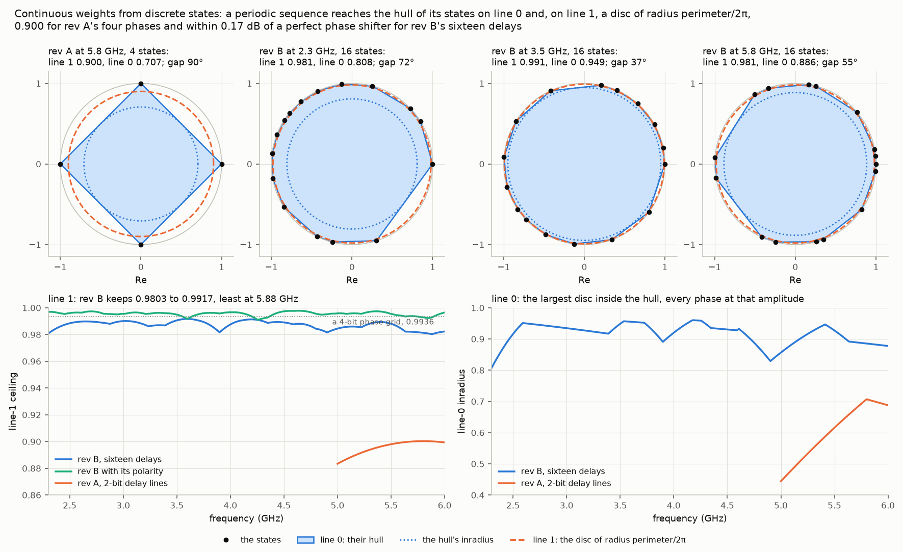

**Figure 10.** The weights an alphabet reaches. Top: the states as unit phasors, their hull (the line-0 weights of a
periodic sequence), its inradius, and the disc of radius perimeter/2π that line 1 fills: rev A at 5.8 GHz, 0.900 on line
1 and 0.707 on line 0; rev B's sixteen delays at 2.3, 3.5 and 5.8 GHz, 0.981, 0.991 and 0.981 on line 1 and 0.808, 0.949
and 0.886 on line 0. Bottom: both across the band. Rev B's line-1 ceiling stays between 0.9803 (at 5.88 GHz) and 0.9917,
within 0.17 dB of a perfect phase shifter, and 0.991 to 0.998 with its polarity; rev A's falls to 0.883 and its inradius
to 0.444 at 5.0 GHz.

### 6.3 Conservation of beams, perfect sequences and the rotating ring

**Proposition (conservation of beams).** For |g| ≤ 1 and a source with |aₙ| = 1, `Σ_h |b_h|² ≤ N²`: K equal simultaneous
beams each have at most 1/K of the single-beam gain, and on receive, where the LNA noise stays white under unit-modulus
modulation, that is 10 log K dB of signal-to-noise ratio. Brégains et al. give the sideband power in closed form and Poli
et al. use the lines as simultaneous beams. Phase-only sequences found by iterative projection give the weakest of K
beams −4.9, −7.7 and −10.9 dB with 2-bit states and L = 64 for K = 2, 4 and 8, and −4.0, −6.9 and −9.9 dB with 4-bit
states, against −3.0, −6.0 and −9.0 dB for the bound.

**Proposition (perfect sequences).** If every element plays one flat-spectrum sequence delayed by its index, the state
matrix is √L times a unitary circulant and the L lines carry the L DFT beams over the elements with equal power. The
Frank sequence of length 16, `g_l = i^((l div 4)(l mod 4))`, does it with exactly rev A's four phases (Frank and
Zadoff): the 16 lines carry −12.0 dB (line 0) to −16.0 dB (line −8) of the full-array gain each, 0.773 in all, and the
mixing matrix has singular values from 2/π to 1. With rev A's blank marker each line mixes neighbouring beams and the
decode solves with the 17-line matrix (condition number 1.48); rev B's host-defined marker allows a marker-free period.

**Proposition (the commutated ring).** Selecting a ring's N ports one at a time in order gives port n the line-h weight
`(1/N) sinc(h/N) e^(−iπh/N) e^(−2πi h n/N)`: line h carries the ring's phase mode of order h (and h + mN), the electronic
form of one antenna carried round the circle, `e^(ikR sin θ cos(Ωt − φ)) = Σ_h i^h J_h(kR sin θ) e^(ih(Ωt − φ))`, which
locks azimuthal order to frequency offset. For 8 whips the line-1 weight is 0.122 (−18.3 dB) per whip in steps of −45°;
on rev B the ring turns at up to 8.33 kHz (7.41 kHz with a marker), and eight ports keep the modes apart while
2kR + 1 ≤ 8, to 0.74 GHz on the 225 mm ring and 1.49 GHz on the 112 mm ring.

**Claim (rev B's staircases).** Rev B's delays are not a phase grid: at 2.3 and 2.44 GHz its 16 states span 288° and
305°, and at 3.5 and 5.8 GHz they wrap with uneven gaps. A 16-slot staircase that takes in each slot l the state
nearest the element's ramp `φₙ + 2πl/P`, P the period in slots, steering by the offsets φₙ, puts 0.950, 0.966, 0.971
and 0.952 of an element's radiated power on line 1 at 2.3, 2.44, 3.5 and 5.8 GHz in a marker-free period
(f_p = 4.17 kHz), means over the offset and at least 0.948 for any, against sinc²(1/16) = 0.987 for an ideal 4-bit grid;
with a marker slot (f_p = 3.92 kHz) 0.90 to 0.91 (0.89 to 0.92 over offsets), against 0.918 for the grid. Visiting each
state once in phase order gives 0.79 to 0.96, so the nearest-state rule is the one to use. A marker-free 4-step ramp on
rev A puts 0.81 on line 1, 0.62 with its blank marker, 0.77 with 16 slots behind the marker and 0.80 with 64.

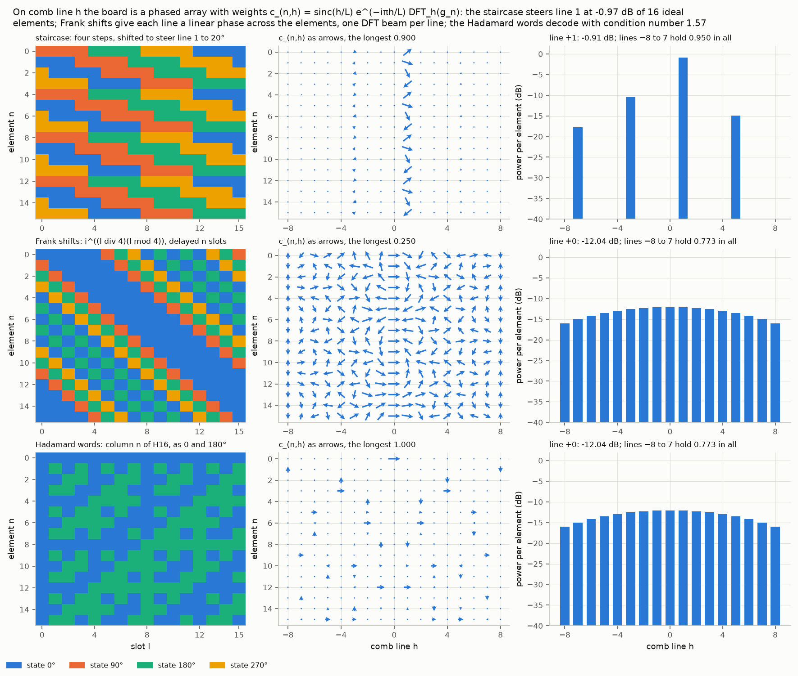

**Figure 11.** Three schedules of 16 slots on 16 elements (L = 16, no marker): the state rasters (elements down, slots
across), the line weights c_(n,h) of the harmonic weight law as arrows (length |c|, direction arg c), and the power per
element on each comb line. The staircase, shifted per element to steer line 1 to 20° on rev A's panel, puts −0.91 dB on
line 1 and −10.5, −14.9 and −17.8 dB on lines −3, +5 and −7, nothing on the others; its line-1 beam is −0.97 dB of 16
ideal elements. Frank shifts give every element the same magnitude on every line with a phase that advances linearly
across the elements, one DFT beam per line, lines −8 to 7 holding 0.773 in all (−12.0 to −16.0 dB each). The Hadamard
words spread the same power over the lines in a sparse pattern and decode with condition number 1.57 (π/2).

### 6.4 Which signals fit, on receive and on transmit

**Claim (line decode).** If the signal's two-sided bandwidth B is below f_p = 1/(Lτ), the comb lines do not overlap,
a band-pass filter gives `z_h(t) = Σₙ c_{n,h} aₙ s(t)` on each line, and N lines whose matrix C has rank N give every
element's signal aₙs(t). One-channel beamforming needs B < 1/(Lτ), not a steady tone; the switched snapshot is the case
decoded by slot means.

| Slots L | rev A, 10 µs (today's floor) | rev A, 8 µs | rev B, 15 µs | 1 µs, control from RP2040 pins |
| --- | --- | --- | --- | --- |
| 4 | 25.0 kHz | 31.3 kHz | 16.7 kHz | 250 kHz |
| 8 | 12.5 | 15.6 | 8.3 | 125 |
| 16 | 6.25 | 7.8 | 4.2 | 62.5 |
| 16 + marker | 5.88 | 7.35 | 3.92 | 58.8 |

Today's firmware plays slots of at least 10 µs on rev A and 15 µs on rev B, and at most 256 words after the marker
(`MAX_SEQ` in `array16/protocol.py`, protocol version 2); the 8 µs column takes a firmware change to the slot floor,
and the 1 µs column direct drive from the RP2040's pins. The budget is L·B ≤ 1/τ: 100 kHz on rev A as it stands,
67 kHz on rev B, 1 MHz with direct drive. Sixteen lines 7.8 kHz apart occupy 125 kHz of the HackRF's 20 MHz, and
with the slots on the HackRF's 10 MHz each line falls on one FFT bin.

**Claim (lines against slot means).** Sixteen elements, the Hadamard words and the marker, 8 µs slots (f_p = 7.35 kHz),
40 dB SNR; error of the recovered array vector, the median of three seeded captures of 1024 periods in the study's run:

| Signal bandwidth | a tone | 100 Hz | 1 kHz | 3 kHz | 6 kHz | 7 kHz |
| --- | --- | --- | --- | --- | --- | --- |
| slot means | −79.7 dB | −57.1 | −44.2 | −35.0 | −22.1 | −21.5 |
| lines | −80.3 dB | −79.4 | −79.1 | −79.6 | −78.8 | −78.4 |

The words of `array16/control.py`, decoded by lines, hold the noise floor; at today's 10 µs floor the condition is
B < 5.88 kHz. **Proposition (time as a degree of freedom).** With one waveform of energy E and unit-norm static weights,
the peak field at a target is at most `λ_max(M)·E`, `M_nn' = ∫ hₙ* hₙ'`, reached by the principal eigenvector and time
reversal: between 1 and N times the average element (12 dB for 16), and rev B's delays reach 12.5 of the continuous 12.8
in Rayleigh channels at 2.44 GHz.

**On transmit** the budget holds the other way round: a line carries a modulated signal cleanly only while B < f_p,
5.88 kHz on rev A at its 10 µs floor with the marker and 3.92 kHz on rev B with a marker (4.17 kHz without). A wider
signal, up to the HackRF's 20 MHz, takes one static state, as the route table of section 6.1 sets out.

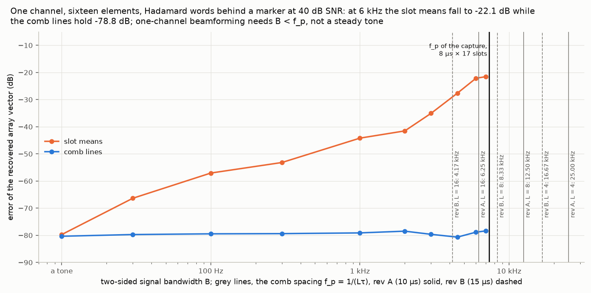

**Figure 12.** The error of the recovered array vector against the signal's bandwidth: sixteen elements under the
Hadamard words behind a blank marker, 8 µs slots (17 slots, f_p = 7.35 kHz), 40 dB SNR, the median of three captures of
1024 periods. Slot means hold −80 dB for a tone and fall to −44 dB at 1 kHz and −22 dB at 6 kHz; comb lines hold −78 to
−81 dB up to 7 kHz. Grey lines mark f_p = 1/(Lτ) for L = 4, 8 and 16 on rev A at its 10 µs floor (solid) and on rev B at
15 µs (dashed): one-channel beamforming needs B < f_p.

### 6.5 What limits a line

- **The marker.** **Claim (the marker).** One blank slot in L + 1 puts comb lines 1/((L + 1)τ) from the wanted one at
  about −24 dB (L = 16). With R periods behind one marker they stay near −24 dB and move in to 1/((16R + 1)τ), while the
  wanted weights' error falls from −43 dB (R = 1) to −54 dB (R = 4, 64 words); the 256-word store holds up to R = 16.
  Putting the marker into C removes its effect on the weights.
- **Transitions.** A dropout t_r per slot scales the wanted line by (1 − t_r/τ) and puts lines at multiples of the slot
  rate, which measure t_r.
- **Timing.** Jitter σ_t is a phase error 2π h f_p σ_t on line h; the time origin is needed to a fraction of a slot
  (0.4 µs is 9° on line 8 at 7.8 kHz), from the marker or the trigger.
- **State errors.** **Hypothesis (null floor).** Line-1 nulls from 2-bit states deepen with L and with the synthesis:
  in the study's seeded run, medians over 40 beam-and-null pairs, error feedback reaches −39.6 and −53.8 dB for L = 16
  and 64, a search with restarts −47.5 and −58.3 dB (the beam keeps −2.0 dB of 16 ideal elements), where static 2-bit
  states give −27.8 dB. The firmware plays up to 256 words after the marker (protocol version 2), so L = 255 and
  L = 256 are playable: at L = 256, −65.4 dB by error feedback and −68.3 dB by search. On hardware the floor is of
  order σ²/N for a state phase error σ (−47 dB at 1°, −38 dB at 3°, −26 dB at 11.4°), so with L ≥ 16 the measured
  state table sets the null, and L = 64 already reaches below the 3° floor.
- **Neighbouring signals.** A signal m·f_p away lands on the wanted line through the line −m response: for the 2-bit
  staircase the h = −3 image, 4 f_p away, 9.6 dB below the wanted line; for 4-bit states h = −15, 16 f_p away, 23.5 dB
  below. Clean reception takes a band clear at those offsets, or more phase states.

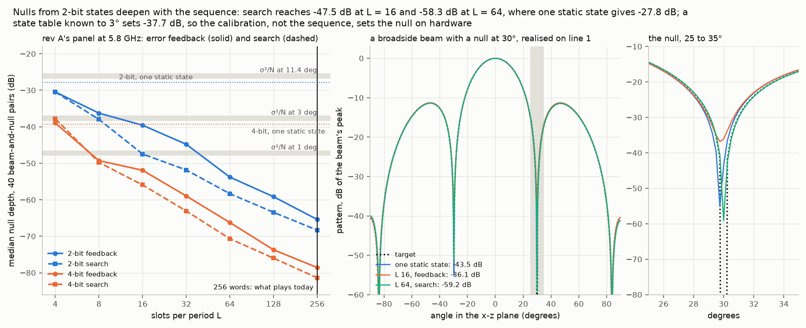

**Figure 13.** Line-1 nulls from discrete states on rev A's panel at 5.8 GHz, as the array factor of its 16 element
places at 26 mm. Left: the median null depth over 40 beam-and-null pairs against slots per period L, for 2-bit and 4-bit
states, by error feedback (solid) and by search with restarts (dashed); dotted, one static state per element; grey
bands, the calibration floor σ²/N at 1°, 3° and 11.4° of state error. 2-bit search reaches −47.5 dB at L = 16 and −58.3
dB at L = 64, error feedback −39.6 and −53.8 dB, against −27.8 dB for one static state; 4-bit search −55.9 and −70.7 dB;
from L = 16 on the beam keeps −2.0 dB (2-bit) and −1.1 dB (4-bit) of 16 ideal elements. Middle and right: a broadside
beam with a null at 30°, the realised line-1 patterns against the target, with −43.5 dB at 30° for one static state,
−36.1 dB for L = 16 by feedback and −59.2 dB for L = 64 by search.

### 6.6 Measuring by lines, painting, and pairs

**Hypothesis (line division).** Frank shifts or the Hadamard words measure T(r, n) for all elements at a probe position
in one capture, with inter-element phases free of the receiver's oscillator, given the time origin to a fraction of a
slot and the receiver's offset under f_p/2 or fixed by a cabled carrier on line 0. A 10 ms capture holds 78 periods at
7.8 kHz, and filtering 20 MHz of noise to a 100 Hz line gives 53 dB. Comparison with one-at-a-time measurement settles it.

**Proposition (painting).** Patterns wₖ held for fractions pₖ give the time-averaged intensity `I(r) = g(r)ᵀ W g(r)*`,
`W = Σ pₖ wₖ wₖᴴ ⪰ 0`: a convex cone of dimension at most N² = 256, against 2N − 1 = 31 parameters for one coherent
drive. Over a 12 cm box in front of the tile its algebraic rank is 250 to 256.

**Hypothesis (who sees what).** An observer narrower than f_p tuned to f + h·f_p sees the coherent line field; a
wide-band one sees `Σ_h |E_h|²`. A particle follows the painted ponderomotive potential when its secular frequency is far
below f_p, under about 25 kHz with 1 µs slots and L = 4, as painted optical potentials do (Henderson et al.). An
electron near 100 MHz secular sees each slot as a static well: a painted potential for electrons takes wells about 4000
times lower in secular frequency than the 100 MHz guides, or slots under about 1 ns, and faster transport is the ring's
travelling wave (section 7.3).

**Claim (three virtual elements).** Switching synthesises weights on the physical positions, motion puts support on the
swept path, and pairing transmit and receive positions gives the sum co-array, as wide as both apertures together
(Hoctor and Kassam): a CW source stepped to 2 × 2 positions at 104 mm pitch, the HackRF receiving through the sequenced
rev A panel (78 mm across), gives an 8 × 8 virtual grid 182 mm across for two-way imaging of a far-field scene. The
HackRF is half-duplex, so the source is a transmitter beside it, a synthesiser on its 10 MHz or on rev B the board's own
LMX2572 through RADAR OUT; a second source is the owner's choice under the decision that the radio is the HackRF alone.

## 7. Near fields and charges

### 7.1 The near field as design space

**Proposition (multipole ladder).** An electrode structure carrying I = ωQ (Q on one rod) radiates through
`R_dip = 20 (kd)² Ω` as a dipole of separation d and `R_quad = 12 (ka)⁴ Ω` as a planar four-pole of half-diagonal a
(Jackson's multipole formulas): at d = 2a the power ratio is `(3/20)(ka)²`, each step up the ladder costing (ka)².
Unequal charge on the two rods of a pair, a fraction ε, adds a dipole that matches the four-pole's radiation at
`ε = √(3/20) ka`, 0.4 % at 1 GHz and 0.5 mm.

**Claim (radiation Q).** A source filling a sphere of radius a has `Q₁ = 1/(ka)³ + 1/(ka)` and
`Q₂ = 18/(ka)⁵ + 6/(ka)³ + 3/(ka)` at least (Chu; Collin and Rothschild):

| f | a | ka | Q₁, dipole | Q₂, quadrupole |
| --- | --- | --- | --- | --- |
| 0.4 / 1.0 / 5.8 GHz | 0.5 mm | 0.0042 / 0.0105 / 0.061 | 1.4 × 10⁷ / 8.7 × 10⁵ / 4.5 × 10³ | 1.4 × 10¹³ / 1.4 × 10¹¹ / 2.2 × 10⁷ |
| 2.4 / 5.8 GHz | 5 mm | 0.25 / 0.61 | 67 / 6.1 | 1.8 × 10⁴ / 249 |
| 5.8 GHz | 25 mm | 3.0 | 0.37 | 1.27 |

Against a board resonator's ohmic Q of 100 to 300 a balanced sub-millimetre electrode confines and a centimetre
electrode at 5.8 GHz radiates; 1 pF is about 20 mm of guide (ka = 0.21 at 1 GHz, Q₁ = 110).

**Claim (the tile's reactive drives).** The radiation matrix splits the tile's drives into radiating and reactive ones,
and one channel selects between them with sign patterns. For 16 in-plane Hertzian dipoles in free space the best all-on
sign pattern radiates 87, 55, 35, 21 and 7 dB less than uniform drive at 0.4, 1.0, 2.4, 3.5 and 5.8 GHz, while above an
element the checkerboard's field equals uniform drive's within 5 mm (ratio 1.03 at 5 mm, 0.18 at 20 mm) and decays as
e^(−κh), `κ = √(2π²/p² − k²)` = 170 per metre at 2.4 GHz: a carpet of field 5.9 mm deep, free in shape in the plane.
Checked for this document with the tile model of `experiments/local_fields.py` (y-dipoles 13 mm over ground) and rev B's
own delay states (unit amplitude, coordinate descent from the best sign pattern), radiated power against uniform drive:

| Model | f | Eigenvalues above 10 % / below 1 % | Best sign pattern | rev B delay states | Continuous phases |
| --- | --- | --- | --- | --- | --- |
| free space | 2.44 / 3.5 / 5.8 GHz | 5/8, 8/4, 15/0 | −34.4 / −21.2 / −6.8 dB | −33.8 / −20.3 / −6.8 dB | −35.1 / −22.5 / −6.8 dB |
| over ground | 2.44 / 3.5 / 5.8 GHz | 3/10, 6/6, 14/0 | −38.4 / −23.0 / −12.1 | −37.1 / −23.1 / −12.1 | −38.4 / −27.0 / −12.1 |

The delay alphabet reaches the darkest sign pattern to within 1.3 dB. At half-wave pitch every drive radiates, and a
reactive design space there takes structure finer than the pitch: electrodes. A dark drive gives more field per watt
where the elements are matched to it, as a distributed resonator whose Q is set by copper and substrate.

**Claim (no finite array is dark).** The radiation matrix of Hertzian dipoles at distinct points is positive definite,
by Rellich's lemma and unique continuation: a drive with no far field would have no field anywhere off the elements,
which each driven dipole's own singularity forbids (Colton and Kress). The tile's smallest eigenvalue is 4.3 × 10⁻⁶ at
2.4 GHz and 0.11 at 5.8 GHz in free space; exactly non-radiating sources take a continuum, `J = (∇×∇× − k²)F` with F of
compact support (Devaney and Wolf).

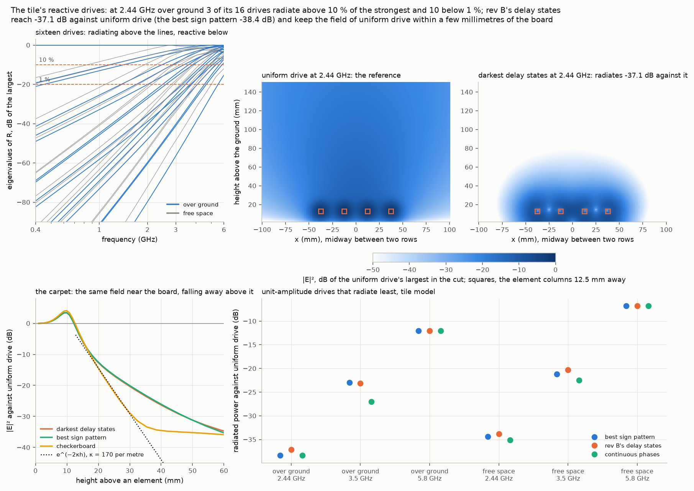

**Figure 14.** The tile's drive space. Top left: the 16 eigenvalues of R from 0.4 to 6 GHz, in dB of the largest, over
ground (blue) and in free space (grey), with the 10 % and 1 % lines. Top middle and right: |E|² in the plane midway
between two rows of elements at 2.44 GHz on one scale, for uniform drive and for the darkest drive rev B's delay states
reach, which radiates 37.1 dB less and keeps its field close to the board. Bottom left: |E|² 1 to 60 mm above an element
against uniform drive: the darkest delay states, the best sign pattern and the checkerboard stay within 1 dB of it up to
5 mm, rise 3 to 4 dB at 10 mm and fall away above, the checkerboard as e^(−2κh) with κ = √(2π²/p² − k²) = 170 per metre
(dotted). Bottom right: the radiated power of the darkest unit-amplitude drives against uniform drive; over ground the
best sign pattern gives −38.4, −23.0 and −12.1 dB at 2.44, 3.5 and 5.8 GHz, rev B's delay states −37.1, −23.1 and −12.1
dB, continuous phases −38.4, −27.0 and −12.1 dB.

### 7.2 The guide as an antenna with a dial

**Proposition (ring selection rule).** A ring of radius R carrying the travelling mode e^(imφ), with N identical
perturbations at φₙ = 2πn/N each taking a vertical dipole moment p₀e^(imφₙ), radiates only orbital orders l = m − pN,
with power `P = P₁(p₀) N² Σ_p F_|m−pN|(kR)`, `F_l(x) = (3/4)∫₀^π sin³θ J_l(x sin θ)² dθ` and `Σ_l F_l = 1`; the core is
the finite sum `Σₙ e^(2πi(m−l)n/N) = N` when N divides m − l, else 0. Order l radiates freely once kR exceeds about |l|
and is cut off as (kR/2)^(2|l|) below. Ring resonators with angular gratings (Cai et al.) are the optical precedent.

**Proposition (Bragg splitting).** The same perturbations couple +m and −m only when N divides 2m, where the pair splits
into standing waves. On a trefoil guide (N = 3) the circulating wave survives for m not divisible by 3: m = 1 radiates
l = 1 and −2, m = 2 radiates 2 and −1, and m = 3k contains l = 0.

**Proposition (radiate or hold).** With the feed matched at each setting, a resonant guide radiating the fraction
`η = Q_ohm/(Q_ohm + Q_rad)` keeps 1 − η of its stored energy and of its well, U(η) = U₀(1 − η); with a fixed coupling set
for the dark guide the stored energy carries a further factor `4β/(1 + β)²`.

**Hypothesis (the dial).** For the 277 mm ring (R = 44.1 mm) at 13 V with C' = 50 pF/m, W = 1.17 nJ and ωW = 8.0 VA at
1.082 GHz, its m = 1 resonance in air (n_eff = 1; on laminate the resonances fall as 1/n_eff), so 53 mW holds 13 V at
Q_ohm = 150. Q_rad is about 3 × 10⁸ as an ideal four-rod quadrupole and 6.4 × 10³ as a two-wire ring of 1 mm spacing at
m = 1. Ten-millimetre stubs of 0.5 pF, switched by PIN diodes from the shift-register chain, set it at the ring's own
resonances: 3 stubs at m = 2 (2.16 GHz in air) 1.1 × 10³, radiating 12 % at Q_ohm = 150; 8 stubs there 660 (18 %); 3
stubs at m = 5 (5.41 GHz in air) 94 (61 %); 8 stubs there 20 (88 %). The tone picks m (f_m = mc/(n_eff L)), the stub
pattern picks l, and two quadrature feeds a quarter guided wavelength apart make the travelling wave from one channel.
Eight stubs move the resonances by about 12 % and a 10 mm stub at 5.4 GHz is near a quarter wave, so an openEMS model
with the real conductors fixes the numbers to better than this model's factor of four.

So the accelerator's geometry is a generic antenna in an exact sense: one structure and one channel, an orbital order
chosen by the tone and the stub count, a radiation Q that board switches set, by this hypothesis, from about 3 × 10⁸ to
20, and what it radiates is what it no longer holds.

**Claim (whip rings radiate orbital orders).** Eight whips on a ring driven with phase step 2πm/8 obey l = m − 8p and
give a pure order while kR < 8 − |m|: to order 2 on the 225 mm ring at 433 MHz (kR = 2.04, purity 1.00), to order 3 at
900 MHz (0.91 at m = 3) and on the 112 mm ring at 1.5 GHz; at 2.3 GHz on the 225 mm ring the purity is 0.18 to 0.36.

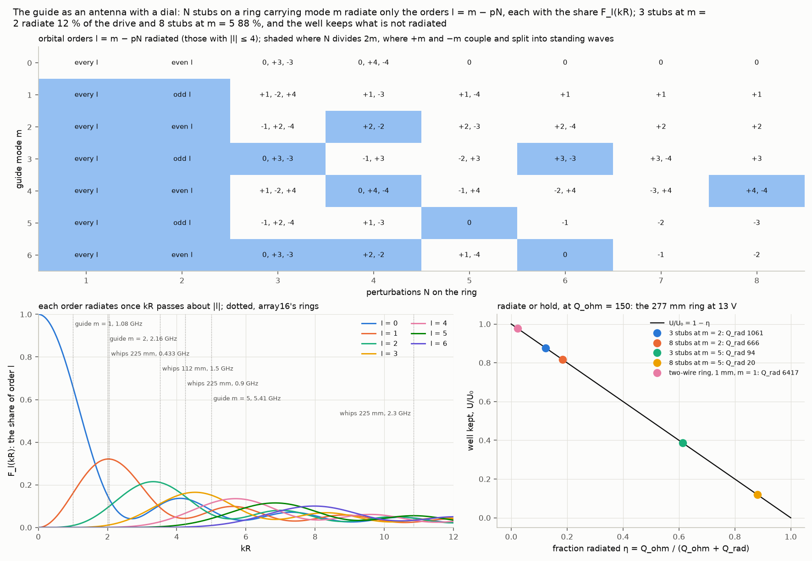

**Figure 15.** The guide as an antenna with a dial. Top: the orbital orders l = m − pN that N perturbations on a ring
carrying mode m radiate (those with |l| ≤ 4 listed), shaded where N divides 2m and the pair ±m splits into standing
waves. Bottom left: F_l(kR), the share of order l, for l = 0 to 6, with array16's rings marked: the 277 mm guide
(R = 44.1 mm) at its resonances m = 1, 2 and 5 (1.08, 2.16 and 5.41 GHz in air), and the whip rings at 0.433, 0.9 and
2.3 GHz (225 mm) and 1.5 GHz (112 mm). Bottom right: the well kept, U/U₀ = 1 − η, against the fraction radiated at
Q_ohm = 150 for the 277 mm ring at 13 V: Q_rad of 1061 and 666 for 3 and 8 stubs at m = 2 (12 % and 18 % radiated), 94
and 20 at m = 5 (61 % and 88 %), and 6.4 × 10³ for a two-wire ring of 1 mm spacing at m = 1 (2.3 %).

### 7.3 Antennas pointed inward: what containment takes

Pointing antennas inward gathers at most the ceiling of RFG-2, 78.2 µeV per radiated watt for an electron (section 4.5),
from fields that carry the power in from far away: sixteen elements on a λ/2 shell reach 0.97 of it lossless and 0.72
with 10 % loss, and in the model the board's arrays pass it only at foci within kr of about 3 of an element. Stored
field passes it (section 4.5): a surround dense enough to close, at its cavity resonances (256 elements at kb = 6.1, 939
times lossless and 12 times with 10 % loss), and a focus in an element's own near field, lossless 220 times the ceiling
over the ground 20 mm in front of the tile at 2.44 GHz (147 times RFG-2's) and 1.66 times it 30 mm above the whips at
915 MHz (3.1 times RFG-2's). 100 mm above the whips at 433 MHz the focus with 10 % loss gives 382 µeV per watt,
4.9 times RFG-2's ceiling (8.9 times the ceiling over the ground plane, which is 0.55 of RFG-2's for a horizontal field
at that height), so a 25 meV well there takes 65 W radiated. One electron-volt takes 12 kV/m at 0.4 GHz, 73 kV/m at
2.45 GHz and 174 kV/m at 5.8 GHz. Free-space foci at the 15.249 level (0.75 mW peak EIRP) with complex weights give
8.3 V/m at 50 mm and 5.8 GHz (0.0023 µeV), 6.9 V/m at 50 mm and 2.44 GHz (0.0089 µeV) and 4.2 V/m 100 mm above the
whips at 915 MHz (0.024 µeV). Through the HackRF alone with rev B's delay states the 2.44 GHz focus at 50 mm is 5.3 V/m
at that level (0.0053 µeV); at 5.8 GHz, where the HackRF's −17.8 dBm EIRP (for the HackRF One's output, section 1)
lies 16.5 dB under it, it is about 1.0 V/m at 50 mm and 0.5 V/m at 100 mm (3 × 10⁻⁵ and 8 × 10⁻⁶ µeV), checked for
this document. At those levels a free-space virtual antenna is a radio instrument, and a well of electron-volts takes
electrodes within a millimetre of the path at tens of volts.

That route is RFG-3: power P through a resonator of shunt resistance R puts `V = √(2PR)` on electrodes a distance h from
the null and gains `(3π/2)(R/Z₀)·share/(kh)²` over the ceiling, 1.14 × 10⁶ at 1 GHz, h = 0.5 mm and 10 kΩ: 89.1 eV per
watt on four rods and 22.3 eV per watt on two facing boards (ELE-2, a quarter of four rods), while one board with two
rails keeps at most 0.0091 of a four-rod well (ELE-3). The depth is the pseudo-potential's, `share·V·q/(8γ)` with q the
null's Mathieu q and γ its gradient over V/h² (1 for four rods, π/4 for two facing boards, 0.309 for one board at its
best), so a watt buys it only while q stays under 0.908, and the depth holds as stated for q below about 0.5. At 1 GHz,
0.5 mm and 10 kΩ the slope runs up to 2.9 eV at 32 mW on four rods, 1.2 eV at 53 mW on two facing boards and 0.28 eV at
0.34 W on one board; 1 eV takes 15 V and 11 mW at q = 0.53 on four rods, 30 V at q = 0.84 on facing boards, and on one
board 157 V at q = 1.73, past the edge. What a depth takes is set at a stated q (`rf.electrode_drive_at_q`): at q = 0.5
through 10 kΩ, 1 eV takes 16 V and 13 mW on four rods at f·h = 0.53 MHz·m (1.07 GHz at 0.5 mm), 50 V and 126 mW on two
facing boards at 1.68 GHz, and 542 V and 14.7 W on one board at 3.46 GHz.

**Claim (shunt resistance).** An electron Paul trap built from printed boards with a half-wave coplanar resonator at
1.60 GHz (Matthiesen et al.), the nearest prior art, reaches about 100 V with 5 W, an effective shunt resistance of
V²/2P = 1 kΩ at a resonator Q near 35; a resonator of Q 100 to 300 on low-loss laminate reaches 3 to 10 kΩ. Budgets
start from 1 to 10 kΩ until a pickup and a detector measure volts against watts on the project's board: 1 eV at 1 GHz on
four rods 0.5 mm away takes 15 V at q = 0.53, 11 mW through 10 kΩ and 110 mW through 1 kΩ. The planar guide of Hoffrogge
et al. (970 MHz, 33 V, the null 500 µm above the electrodes, 133 MHz transverse, 41 meV along a 37 mm arc) is at the
scale of a 1 GHz ring. Driving electrodes to confine and accelerate charged particles is an ISM use (47 CFR Part 18), so
the guide drive belongs on 915, 2450 or 5800 MHz.

Acceleration comes from the travelling-wave ring: a closed guide longer than a quarter wavelength runs as a ring
resonator whose degenerate modes cos mφ and sin mφ, driven 90° apart at feeds a quarter guided wavelength apart, sum to
`e^(i(mφ − ωt))` with one amplitude all the way round. A knotted guide needs no twist and costs bending: its largest
curvature exceeds 4π/L (CUR-3).

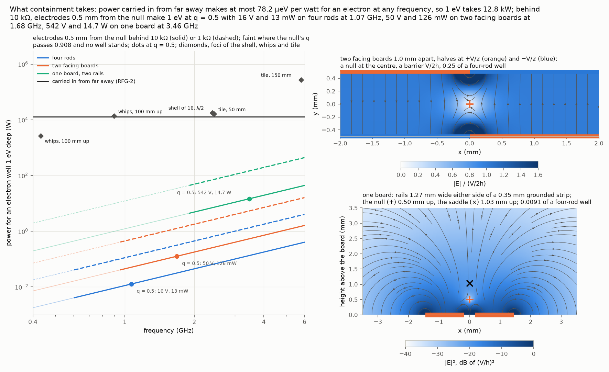

**Figure 16.** What containment takes. Left: the power an electron well 1 eV deep takes against frequency. Carried in
from far away, at least 12.8 kW at any frequency (RFG-2, 78.2 µeV per watt); the arrays' foci with 10 % loss take more
except where stored field passes the ceiling: the whips 100 mm up take 2.6 kW at 0.433 GHz, where it does, and 14 kW at
0.9 GHz, the 16-element shell 18 kW, the tile 16 kW 50 mm out at 2.44 GHz and 270 kW 150 mm out at 5.8 GHz. Behind a
resonator of 10 kΩ (1 kΩ dashed), electrodes 0.5 mm from the null take a power that grows as f² (RFG-3), and each line
is faint below the frequency at which 1 eV puts the null's Mathieu q past 0.908, where no well stands: 0.59 GHz for four
rods, 0.92 GHz for two facing boards and 1.90 GHz for one board. The dots mark q = 0.5: 16 V and 13 mW on four rods at
1.07 GHz, 50 V and 126 mW on two facing boards at 1.68 GHz, 542 V and 14.7 W on one board at 3.46 GHz; at 1 GHz four
rods take 11 mW, at q = 0.53. Right, drawn from `array16.particles.electrodes`: two facing boards 1 mm apart, each split
into halves at ±V/2, |E| in units of the barrier V/2h with the field lines, a null at the centre and a quarter of a
four-rod well (ELE-2); one board at its best, rails 1.27 mm wide either side of a 0.35 mm grounded strip (rail/gap
3.68), the null 0.50 mm up and the saddle 1.03 mm up, 0.0091 of a four-rod well (ELE-1, ELE-3).

### 7.4 Charges as antennas

**Proposition (space-charge limit).** At the limit of a pseudo-potential guide `f_p = √2 f_sec = q·f/2` (RFG-4), and a
column filling the guide holds `N'_max = 4πε₀D/e²` = 6.9 × 10⁸ electrons per metre per eV of depth D, whatever the
frequency and radius (Dubin and O'Neil treat such single-species equilibria). At 1 GHz and q = 0.3: f_sec = 106 MHz,
f_p = 150 MHz, n = 2.8 × 10¹⁴ m⁻³, D = 0.32 eV, N'_max = 2.2 × 10⁸ per metre. The exact Mathieu exponent raises ω_sec by
1.9 % at q = 0.3 and 9 % at q = 0.6 (231 MHz, not 212 MHz, for 1 GHz at q = 0.6).

**Proposition (the column's dipole mode).** At that limit the cold column's dipole resonance `ω_p/√2` equals ω_sec, and by
the generalised Kohn theorem (Brey et al.) the centre-of-mass mode stays at ω_sec at any density. The column is never
overdense at its drive (f_p < 0.46 f).

**Proposition (the centre of mass).** In a force field linear in position, time dependence included, the centre of mass
of N interacting charges obeys the single-particle equation exactly. **Claim (the column as a circuit).** Seen from an
electrode pair of effective gap d, N electrons are a series L-C with `l_N = md²/(Ne²)` and `c_N = 1/(ω_sec² l_N)`, damped
into R at `γ = R/l_N` (Wineland and Dehmelt): at d = 2 mm one electron is 142 H. The 1 GHz, q = 0.3 column taken here
holds the limiting density in a radius of r₀/2 = 0.25 mm, a quarter of N'_max: 5.5 × 10⁷ per metre, 1.5 × 10⁷ on 277 mm.
It is 9.4 µH and 0.24 pF, resonant at 106 MHz and damped into 50 Ω at 5.3 × 10⁶ per second (Q = 125).
Its frequency is set by the trap volts and its inductance counts the electrons.

**Claim (electrodes beat radiation).** The column's electrons oscillating together 0.1 mm at 106 MHz radiate −89 dBm and
drive 81 µA, −38 dBm, into 50 Ω through a 2 mm pair: 51 dB above their radiation. One electron is −181 dBm into 50 Ω and
−148 dBm into a 100 kΩ resonant pickup, 25 dB above k_BT in 1 Hz. The charges' antenna is the electrode and its
weighting field the pattern: a charge q moving at v past an electrode that makes E_w per volt induces q v·E_w (Shockley;
Ramo), charge rotating round a ring makes fields whose azimuthal order is locked to their frequency, and reading the beam
to correct the drive is the principle of stochastic cooling.

**Claim (a column as a wire).** The kinetic inductance `L_k = m/(e²N')` is 0.65 H/m for that column at 1 GHz and q = 0.3
(5.5 × 10⁷ per metre); a wire's 1 µH/m takes N' = 3.5 × 10¹³ per metre: a 51 keV well for pure electrons, or a
neutralised discharge, which a 12 mm bore reaches at 3.1 × 10¹⁷ m⁻³ (the plasma antennas of Borg et al.).

**Hypothesis (density waves).** Below f_p the column carries Trivelpiece-Gould waves at `v = ω_p a √(ln(b/a)/2)`
(1.4 × 10⁵ m/s at 1 GHz and q = 0.3, 1.6 × 10⁶ m/s at 5.8 GHz and q = 0.6): lines 0.50 and 5.8 MHz per azimuthal order
apart round a 277 mm ring, standing out of Landau damping below about 80 K for the 1 GHz column and up to about 0.9 eV for
the 5.8 GHz one.

**Hypothesis (a matter-anchored virtual antenna).** A held column is a microwave sink at f_sec when its non-radiative
damping matches its coupling to the drive structure, seen as an impedance dip on the electrodes that moves with the
drive volts; its radiation Q is 2.0 × 10⁶ (6.1 × 10⁷ electrons on 277 mm, the same column of radius r₀/2 at the 1 GHz,
q = 0.6 limit), so the anharmonic spread sets the width. A Shockley-Ramo estimate of the coupling, then an impedance
sweep through f_sec with at least 10⁶ held electrons, settles it.

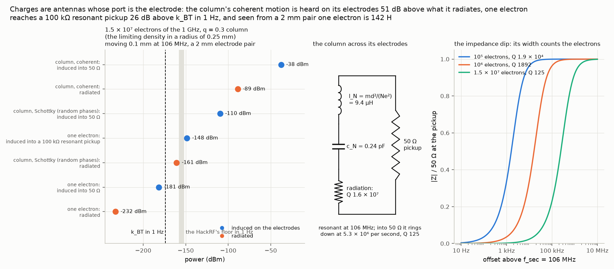

**Figure 17.** Charges as antennas. Left: the signals of the 1.5 × 10⁷ electrons of the 1 GHz, q = 0.3 column on the
277 mm guide, the limiting density in a radius of r₀/2 = 0.25 mm (a quarter of N'_max), moving 0.1 mm at 106 MHz,
induced on a 2 mm electrode pair (blue) and radiated (orange), with k_BT in 1 Hz (−174 dBm) and the HackRF's floor in
1 Hz (−158 to −152 dBm for its noise figure of 16 to 22 dB with the amplifier off): coherent motion drives −38 dBm into
50 Ω and radiates −89 dBm, 51 dB less; the Schottky signal of the same electrons in random phases drives −110 dBm; one
electron reaches −148 dBm in a 100 kΩ resonant pickup and radiates −232 dBm. Middle: the column across its electrodes as
a series L-C, l_N = md²/(Ne²) = 9.4 µH with 0.24 pF, resonant at 106 MHz and damped into 50 Ω at 5.3 × 10⁶ per second
(Q 125). Right: the dip in |Z| at the pickup above 106 MHz for 10⁵, 10⁶ and 1.5 × 10⁷ electrons; its width, 50 Ω over
l_N, counts the electrons.

### 7.5 Probes on the receive side

**Claim (perturbation probe).** A grain of polarisability α at r changes a port's reflection by `δΓ = −iωαE(r)²/(4P)` and
a resonant electrode's frequency by `δf/f = −α/(2Ch²)` (capacitance C, grain at distance h; Slater), so every synthesised
transmit field is a receive probe whose point-spread function is its square. A focus at the ceiling gives
|δΓ| = (4/3)(kb)³ for a sphere of radius b, −52 dB at 5.8 GHz for b = 1 mm; a 1 pF resonant electrode moves by
8.7 × 10⁻⁴ for a 250 µm sphere at 1 mm (0.87 MHz at 1 GHz, against 6.7 MHz of linewidth at Q = 150), and a resolved
10⁻⁷ is a 12 µm sphere. With the HackRF half-duplex the shift is read on the board, by a detector on a coupler, or with
the electrode as an oscillator's tank whose tone the HackRF receives while the controller alternates it with a reference
electrode (resonant near-field microscopes: Anlage et al.). The microscope and the charge pickup are one instrument.

### 7.6 What each takes

| Effect | At array16's scale | What it takes |
| --- | --- | --- |
| reactive tile drives | 6 to 10 of 16 drives radiating under 1 % at 2.44 to 3.5 GHz over ground; −37 dB at 2.44 GHz with rev B's delays | elements matched for the dark drive; a target within 5 to 10 mm |
| confinement without radiation | Q₂ of 2.2 × 10⁷ (5.8 GHz) to 1.4 × 10¹³ (0.4 GHz) for balanced 0.5 mm electrodes | balance better than 0.39 ka |
| the guide as an antenna | Q_rad 20 to 1100 with 3 or 8 stubs at 2.2 to 5.4 GHz (hypothesis); the well falls as 1 − η | PIN-switched stubs on the shift-register chain; N not dividing 2m |
| orbital orders from the whips | pure to order 2 at 433 MHz, 3 at 900 MHz and 1.5 GHz | kR < 8 − \|m\| |
| a confining well | 78 µeV per watt carried in from far away, passed only by stored field; through electrodes 0.5 mm from the null behind 10 kΩ, 1 eV at q = 0.5 for 16 V and 13 mW on four rods (1.07 GHz) or 50 V and 126 mW on two facing boards (1.68 GHz) | printed electrodes behind a resonator, on an ISM band, with the null's q under 0.908 |
| the column as a resonator | 9.4 µH, 0.24 pF, 106 MHz, Q 125 into 50 Ω for 1.5 × 10⁷ electrons (the limiting density in a radius r₀/2) | electrons held longer than 1/γ = 190 ns; a pickup pair |
| the column as a wire | Budker parameter 1.5 × 10⁻⁷ for that column | a 51 keV well, or a discharge of 12 mm bore at 3 × 10¹⁷ m⁻³ |
| density-wave lines | 0.5 to 5.8 MHz per azimuthal order | the column below about 80 K (1 GHz guide), or the 5.8 GHz guide |
| single-electron detection | −148 dBm into a 100 kΩ resonant pickup | a 1 Hz effective bandwidth: a secular line stable to 10⁻⁸ |
| the electrode microscope | 8.7 × 10⁻⁴ for a 250 µm grain at 1 mm | a detector or an oscillator on the board, reference switching |

## 8. Consequences

### 8.1 What it enables

- **A field camera:** array, probe and gantry, which is also an antenna near-field scanner (section 10).
- **Virtual whips and probes:** through the rings the board listens as a whip at (0.6, 0.2) m would, to −21 dB over a
  disc of radius 100 mm at 433 and 915 MHz.
- **Sixteen beams on one ADC.** **Claim (Frank lines on both boards).** With exact quarter turns (rev A at 5.8 GHz)
  Frank shifts put the sixteen DFT beams on lines 5.88 kHz apart behind rev A's blank marker, decoded with the 17-line
  matrix (condition number 1.48), each −12.0 to −16.0 dB of the full-array gain, for sources narrower than the
  spacing. Rev B's nearest delay states miss the quarter turns by 4.8 to 7.4° (best common offset, 2.3 to 5.8 GHz), so
  in a marker-free period its lines, 4.17 kHz apart, carry −11.2 to −16.9 dB (0.77 in all, as with exact phases) and
  the decode matrix's condition number is 1.56 to 1.93, against π/2 for exact phases; with each element's measured
  states the decode is a general 16 × 16 solve. Checked for this document.
- **A single-port imager.** **Hypothesis (single-port imager).** With the board's states as masks one port images a
  scene of incoherent emitters: the power behind state s is `sᵀC s̄`, C the 16 × 16 coherence matrix of the element
  signals, so N² = 256 states in general position fix C, and with it the power any receive virtual antenna would
  collect from the scene (the receive form of painting, section 6.6). 20 MHz across a 0.3 m scene is 0.02 cycles, so
  the diversity is spatial. Two incoherent beacons of known place and power, their C measured through 256 states
  against the C their fields predict, settle it.
- **A location-keyed link.** **Hypothesis (location-keyed link).** State vectors drawn per symbol from many that each
  give one QPSK point at a chosen place (equal magnitude, phases 90° apart) make a link that is right only there, at up
  to one symbol per slot, 66.7 kBd on rev B; elsewhere each symbol lands where its drawn vector puts it. It is
  directional modulation (Daly and Bernhard) with a focus in place of a direction. A state search on the tile model
  settles it: the error-vector magnitude at the place and 0.1 m from it, over the vectors the sequencer holds (256 words
  in today's protocol).
- **Quiet zones, null rings and lines,** knotted null lines from a surround, and painted intensities.
- **The price of software antennas.** Every weight applied after one capture through N states has 1/N of the static
  state's signal-to-noise ratio (12 dB for 16), and a strong signal in the same capture is nulled before the converter,
  by the board's states, since 8-bit samples bound a software null by the hypothesis of section 6.1. Receive virtual
  antennas are cheap to make and dear in noise; transmit ones on a comb line are dear in bandwidth, B < f_p.
- **Claim (EIRP-aware focus).** 47 CFR 15.249 limits peak EIRP (50 mV/m at 3 m, −1.25 dBm, in 902 to 928, 2400 to 2483.5
  and 5725 to 5875 MHz), so the design that counts maximises field per watt of peak EIRP, a second-order cone programme
  that flattens the far field through the null space. With complex weights it gains 8.5 and 7.7 dB at 50 and 100 mm at
  2.44 GHz and 5.7 dB at 5.8 GHz. Through the HackRF with rev B's states it gains 6.6 and 5.3 dB at 2.44 GHz (5.3 V/m at
  50 mm at the 15.249 level) and 3.9 and 3.4 dB at 5.8 GHz, where the HackRF's −17.8 dBm EIRP (for the HackRF One's
  output) sets about 1.0 V/m at 50 mm and 0.5 V/m at 100 mm and the 15.249 level takes 16.5 dB more drive, a driver
  amplifier on the board. These are transmit predictions read from receive (section 8.2).
- **Claim (shaping in a room).** Feedback shaping raises a probe's power by `(π/4)(N − 1) + 1` (Vellekoop and Mosk): 12.8
  for 16 elements with continuous phase, 10.5 with four levels, 12.5 (11.0 dB) with rev B's delays at 2.44 GHz.
  One-channel time reversal compresses as √(Δf/δf): with 20 MHz a furnished room (decay near 40 ns) gives Δf/δf ≈ 0.8, a
  metal box of Q 3000 at 2.45 GHz 3.9 and a peak-to-noise ratio near 2, Lerosey's chamber (3.6 µs) 8.5.
- **The electrode microscope and the electrode readout of a held cloud** (sections 7.4 and 7.5).

### 8.2 What it demands

- **Calibration:** per frequency the 16 state tables from rev B's conducted calibration arm, the channel polarities and
  the transmit-to-receive factors, and the radiated manifold for patterns and coupling. Rev B's residual of 3° and
  0.26 dB sets floors of −24 to −36 dB with complex weights and −16 to −28 dB through the delays. **Hypothesis
  (reciprocity with an active factor).** Where transmit and receive share element and delay network and differ by a
  per-element active path, `tₙ(s) = cₙ rₙ(s)` with cₙ independent of the state and of the field point; with neighbours
  terminated differently on transmit and receive c becomes a matrix. It is the link by which every transmit number here
  is read from receive, so those numbers stay predictions until it is tested: on a passive path by V1's sessions T
  (criterion V1-9), on rev B's active one by measuring cₙ for all 16 states on the arm.
- **A probe and a positioner:** a 3-D printer (about 0.1 mm repeatability, 200 to 250 mm of travel, G-code from Python)
  with the probe on a printed arm away from the head's metal and its moving lead held to a fixed bend. At λ/2 a 0.2 m
  cube is 729 positions at 5.8 GHz and 125 at 2.44 GHz; at a second per position the gantry sets the time.
- **A detector for transmit:** with the HackRF half-duplex, transmitted fields are read by a log detector on the probe
  with a switched cabled reference (V1's sessions T), or on rev B by its AD8317 monitor.
- **One reference** for slot clock, HackRF and probe, the trigger and the marker aligning captures to frames.
- **Compute:** milliseconds for linear solves, about a second for the cone programme, 0.1 to 1 s for a state search.

### 8.3 What governs it

- **Linearity:** the reachable fields are the span of G, and a null is the cheapest target.
- **The degree-of-freedom count** sets the cheap modes; past the knee the price grows exponentially in the number of
  features. **Chu and Harrington:** gain beyond the normal gain costs Q, which loss turns into heat.
- **Parseval:** simultaneous virtual antennas share the gain, a one-radio sequence spends power on its other lines, and
  software beams from one capture share its signal-to-noise ratio, 1/N each.
- **One waveform:** inside 20 MHz every point carries the HackRF's one waveform, line by line (section 3.5).
- **Reciprocity** makes the receive virtual antenna the transmit one for the passive part.
- **The ceiling, RFG-2:** at most 78 µeV per watt carried in from far away; what passes it is stored field, set by Q and
  loss: a surround dense enough to close, an element's own near field, an electrode behind a resonator (whose well
  holds while the null's q stays under 0.908).
- **Regularity:** a field-only virtual antenna in empty space is a focus. **Sampling:** pitch under λ/2 for every drive.
- **The rules, where they bear on a choice:** 15.249's peak EIRP for radiated experiments (the EIRP-aware focus, V1's
  beacon level); 15.247 for digitally modulated signals at least 500 kHz wide (up to 36 dBm EIRP in 902 to 928, 2400 to
  2483.5 and 5725 to 5850 MHz); Part 18 for electrode drive on the ISM bands.

## 9. The generic process as code: a field compiler

### 9.1 Where it lives and what it reuses

A new package, `array16/synthesis/`, will be the field core beside the particle core `array16/particles/`: frozen
dataclasses of numpy arrays and pure functions, with state only in devices, under `mypy --strict` and `ruff`, added to
the lists in `pyproject.toml` and to `[tool.setuptools] packages`. It will reuse:

| From | What | Becomes |
| --- | --- | --- |
| `experiments/local_fields.py` | `Arr.G` (the exact dipole field with every near-field term), `Arr.R` (far-field quadrature), `panel`, `whips`, `surround`, `selftest` | `elements.field`, `elements.radiation`, `elements.panel`, `elements.whips` (length an argument, not cut per frequency), `elements.shell`, the element tests |
| `experiments/local_fields.py` | `eigh`, `focus_w`; `ttd_phases`, `revb_project`, `revb_decode` | `spectrum.spectrum`, `solve.focus`; `states.rev_b`, `states.nearest` |
| `experiments/local_fields.py` | `vortex_faces`, `trace_lines`, `linking_number`, `verify`, `CurveProblem` | `curves.trace`, `curves.linking`, `solve.null_curve` |
| `array16/evolve.py` | `climb`, `evolve`, `reselect` | the discrete-state search and the non-convex targets; `reselect` re-scores finalists on fresh weight-error draws |
| `array16/control.py`, `array16/dsp.py` | `H16`, `find_marker`, `cut_slots`, `estimate_tone`, `slot_means` | `measure.hadamard`, `measure.decode_slots`, `measure.offset` |
| `array16/particles/fields.py` | the `Fields` protocol | `export.as_fields`: a synthesised field as E(x, t) for `array16.particles.tracking.integrate` |

`experiments/local_fields.py` stays the study; the compiler's regression tests will hold its numbers and this
document's to stated tolerances.

### 9.2 Types and functions

The modules will have these types and functions:

```
elements.Elements(positions (S,3), moments (S,3), transfer (S,N), feeds (N,3), ground: bool, name)
    field(el, f, points) -> (M,3,N);  radiation(el, f, order=48) -> (N,N);  panel / whips / monopoles / shell(...)
region.Region(points (M,3), components, weights (M,), name);  slab / ball / cone / shell / curve(...);  interleave(r) -> (fit, held)
operator.Operator(G (M·C,N), R (N,N), f, region, provenance);  model(el, f, region);  measured(h, region, R)
    radiation_from_scan(scan, surface);  radiation_from_s(S)      # the second and third routes to R of section 3.4
spectrum.Spectrum(sigma2, V, U).count(within_db);  spectrum(op, loss=0.1) -> Spectrum
targets.Target = FieldValues | VirtualAntenna | Focus | Quiet | Intensity | NullCurve | Pattern
targets.Budget(power_cap, loss, weight_error=0.0037, eirp_cap=None, loading=None)
solve.Solution(w, residual_db, power, sensitivity_db, alpha)
    linear(op, target, budget);  focus(op, point);  intensity(op, levels, starts, seed);  null_curve(op, curve, tube)
    eirp(op, target, directions, cap)      # second-order cone programme, an open-source solver as an optional extra
states.Alphabet(gains (N,S), f, shared);  rev_a(f);  rev_b(f, tables=None);  ceiling(a);  nearest(op, w, a, objective, starts, seed)
sequences.Schedule(states (L,N), slot_s, marker);  line_weights(s, a, lines) -> (H,N)
    compile_line(w, a, L, line=1);  compile_average(w, a, L);  to_protocol(s, board) -> protocol.Sequence
measure.Design(states (K,N));  hadamard(N);  frank(M);  commutation(N)
    decode_slots(y, d, a);  decode_lines(capture, s, a);  offset(capture, slot);  kaczmarz(h, s, y);  fit_gains(model, h)
    detector_solve(levels, curve, reference_states) -> h     # transmit operator from detector readings (sessions T)
verify.Score(fit_db, held_db, power_ratio, sensitivity_db);  score(op_fit, op_held, w, target)
compile.Problem(elements | operator, region, freqs, target, budget, alphabet, mode);  compile(problem) -> Plan
    route(direction, bandwidth_hz, target, board) -> mode     # the route table of section 6.1
```

`line_weights` will be the harmonic weight law with the marker included, the oracle every sequence is checked against;
`compile_line` will shift per-element staircases to arg wₙ, set |wₙ| by error feedback over the slots, then search on
the true line weights; `to_protocol` will write rev A control words or rev B's `LOAD_SEQ2` and refuse slots below a
board's floor or more words than its controller stores (256 on each board); `fit_gains` will find one complex gain per
element between a model and a measured G, so the model's R carries into the measured basis as `Dᴴ(R + rI)D`, which
leaves the generalised spectrum of section 4.1 as it was; `detector_solve` will turn a log detector's slot readings
under a reference at 0°, at 90° and off into complex entries of h; `route` will pick the mode by the table of section
6.1; and `compile` will be steps 1 to 9 of section 3.4 as one pure pipeline.

### 9.3 Devices, benches and the harness

An experiment names device roles and what each must do (`Experiment.needs`), and a bench file gives a driver per role, so
one experiment runs on simulated or real hardware by a change of bench. The roles will be protocols in
`array16/synthesis/devices.py`:

| Role | Must be able to | Simulated driver | Hardware driver |
| --- | --- | --- | --- |
| `array` | `tune(f)`, `play(schedule)`, `capture(n)` or `transmit(s)`, `identity()` | `simbench:SimArray`, an `Elements` model with its own departures (segments, per-throw gains, coupling, noise) | the HackRF Pro through open-source libhackrf bindings; the controller over `array16.protocol` |
| `probe` | `emit(f, dbm)` and `off()`, or `read()` for a detector | `simbench:SimBeacon` | a synthesiser module set over the controller's SPI, or a log detector on its ADC |
| `positioner` | `move_to(p)`, `where()`, `home()` | `simbench:SimGantry`, with a repeatability error | a 3-D printer over G-code and pyserial |

Simulated devices will share one scene through a process-local registry keyed by the bench's `scene` option, since the
harness opens devices one by one and uses them in order in one process. The bench files will be `benches/v1_sim.toml`
and `benches/v1_rung1.toml`.

### 9.4 Tests and proofs

pytest with Hypothesis will attack each Proposition on random instances: rank-nullity, the minimum-power drive against
feasible perturbations, the modal sum against the direct solve, the focus bound, the error field against Monte Carlo,
the hull, the quantisation bound, the switched-state covariance and the price of software beams, the Kaczmarz step, the
harmonic law and the space-time form against direct integration, the ceiling against brute force over 4⁸ sequences,
Parseval over lines, the Frank sequence and the ring selection rule. The element model will keep local_fields'
self-test (one dipole's radiated power to 1e-6 of `Z₀k²|Il|²/12π`). The finite-dimensional Propositions will go to Lean
over `EuclideanSpace ℂ (Fin n)`, because Mathlib's norm on `Fin n → ℂ` is the sup norm, in which the Kaczmarz step fails
(s = e = (1, 1, 1) doubles the error).

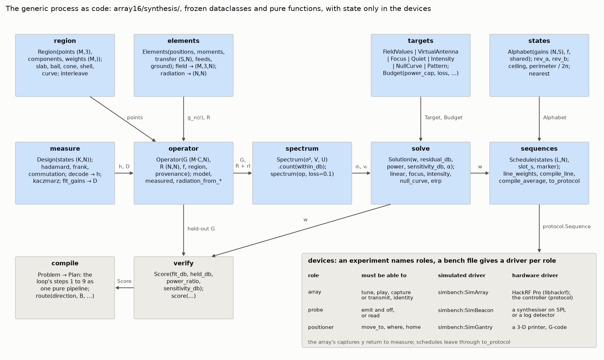

**Figure 18.** The field compiler as code (section 9): the modules of `array16/synthesis/` with their types and the data
passed between them, the solve and the held-out score kept apart, and the three device roles with their simulated and
hardware drivers; schedules leave through `to_protocol` and captures return to `measure`.

## 10. Experiments

### 10.1 V1: a virtual monopole from four switched monopoles, against a real one

**Purpose.** Calibrate the instrument every virtual antenna is computed from, make one virtual antenna, check it against
the real antenna it stands for on positions the fit never saw, in both directions, and keep a case that must fail. It
will run on `benches/v1_sim.toml`, then on `benches/v1_rung1.toml`, the cheapest hardware round the HackRF Pro.

**Hardware (rung 1).** Four quarter-wave monopoles (30.7 mm at 2.44 GHz) on SMA bulkhead jacks at the corners of a
30.7 mm square (λ/4 apart), on an aluminium or copper-clad plate under the whole scanned region, with further jacks at the
target positions. An absorptive four-way switch with an all-off state (or a five-way one with a terminated throw) between
the jacks and the HackRF, driven by one 74HC595 on the controller's shift lane so that the repository's firmware and
protocol play it: per cycle the blank marker (all off), then elements 1 to 4, five slots of 10 µs, a 20 kHz cycle. The
HackRF receives at 2.44 GHz, gives the controller and the probe its 10 MHz from its clock-out port, and starts its
capture on the controller's pulse at its trigger input at the start of a sequence. The probe is a synthesiser module (a
35 MHz to 4.4 GHz part) with a reference input, locked to that 10 MHz, at −20 dBm into a two-way splitter; module and
splitter ride on a 3-D printer's head. One arm feeds the probe antenna on a printed arm; the other runs through an
attenuator and a thin cable into a combiner at the HackRF's input, the cabled reference. The beacon radiates at most
−20 dBm EIRP, 18.75 dB under the 15.249 level. Plate, rods, switch and printer are a calibration rung beside the board
rather than the board itself, and the beacon is a second RF source beside the HackRF: both are the owner's choice under
rule 1 and the decision that the radio is the HackRF alone, and sessions T below run the same bench with the HackRF as
the only source.

**Probe.** A vertical dipole scanned down to 30 mm above the plate must be shorter than 60 mm overall, and a half-wave
sleeve dipole at 2.44 GHz is 61 mm. The probe is a dipole 40 mm overall, fed from above by semi-rigid coax along its
axis, its upper arm a tube over the coax with ferrite beads above it as the choke; its lower tip clears the plate by
10 mm at the lowest height. Array and targets are measured with the same probe, so their comparison stands whatever the
probe's response, and the predictions and V1-3 use that response, E_z weighted along the 40 mm by a triangular current;
against a point probe it moves the held-out residuals by at most 0.2 dB and the spectrum by 0.1 dB.

**Cables.** Flexing thin coax at 2.44 GHz moves its phase by a degree or more, and V1-1's −30 dB allows 1.8° rms per
position in all (checked for this document: 1.0° rms of phase per position gives −35 dB, 1.8° gives −30 dB). With
module and splitter on the head, everything before the splitter is common to both arms and cancels in the ratio below;
the one lead that moves is the reference's, from the head down to the combiner, and it runs in a printed drag loop of
fixed bend radius to a clamp, so that its bend repeats at every position. One reference position is re-measured after
every layer of the traverse (V1-0).

**Measurement.** The marker slot gives the reference r and slot n gives r + hₙ; `ĥₙ = (yₙ − y₀)/y₀` removes the beacon's
power and phase and the HackRF's oscillator, since both paths come from one beacon through one receiver. Beacon and
HackRF share the 10 MHz and 2.44 GHz is a whole multiple of it, so no offset turns the phase between slots. A module
left on its own 25 MHz crystal, of 10 to 50 ppm, would be 24 to 120 kHz off at 2.44 GHz, above the 20 kHz cycle rate;
its tone, present in every slot through the reference, would then be estimated over the whole capture and derotated
before the slots are cut. A position takes 1000 cycles (50 ms) and a move of about a second.

**Transmit (sessions T, the HackRF the only source).** The HackRF transmits CW at 2.44 GHz into the switch's common
port, at a level that keeps the whips under −20 dBm EIRP, and the head carries a detector probe in the beacon's place:
the same 40 mm dipole into one input of a two-way combiner, whose other input is a reference taken from the HackRF's
output by a 10 to 20 dB coupler and brought up the drag loop through a switch that gives it 0°, 90° (a quarter-wave
line) or off. The combiner feeds a log detector (an AD8317 or AD8318 part) whose output, filtered to about 1 MHz, the
controller's ADC samples in step with the slots, five samples per 10 µs slot; spare outputs of the same 74HC595 drive
the reference switch. A cycle plays the marker and the four throws under each reference setting, 13 slots. With the
detector's curve calibrated against the HackRF's own output steps, the slots give |r|², |tₙ|², |r + tₙ|² and
|ir + tₙ|², hence tₙ/r in amplitude and phase: the transmit operator, measured with no second source. The
reference-off slots alone are the intensities that phase-free targets need (section 4.9). For the comb lines the switch
plays its plain five-slot cycle with the reference held at 0° through one capture and at 90° through the next: with the
reference much stronger than the probe's signal, the detector's component at h·f_p is `r̄E_h + rĒ₋ₕ`, and the two
reference phases give E_h for h and −h apart. Sessions T repeat A, A′, E1 and the targets in this direction, the target
whip driven through throw 1. Predicted: the receive table, since switch, cables and whips are passive and reciprocal,
with the detector's noise and curve error added, which the simulated bench calibrates.

**Region.** A slab beside the array, 100 to 220 mm from its centre along +y, x within ±90 mm, 30 to 180 mm above the
plate; the probe measures E_z. Fit grid: 210 positions (5 × 7 × 6 at 30 mm); held-out grid: 120 (4 × 6 × 5, offset 15 mm
in each axis).

**Sessions (shots).** A: the four array whips. A′: the same, unscrewed and refitted. E1, the control: one whip at element
1's place, the other three removed. Targets, each with the array whips removed and one whip in its jack cabled to throw
1: the centre of the square; across the region (+x) λ/8, λ/4, λ/2 and λ beyond the edge; away from it (−y) λ/4 and λ/2;
toward it (+y) λ/4. Each will be a shot of `array16.lab`, run with `--only` once its whip is set, about 6 minutes each.
T: each of these again with the HackRF transmitting.

**Fit.** `w = argmin ‖G_fit w − t_fit‖² + α wᴴR̃w` under the cap wᴴR̃w ≤ 10 P₁ (P₁ one whip's radiated power),
`R̃ = Dᴴ(R + rI)D` from the model's R, r a tenth of R's mean diagonal and D the per-throw gains of `fit_gains`; the
score is `‖G_held w − t_held‖/‖t_held‖`.

**Predictions,** computed for this document with the Hertzian model (monopoles of 8 segments with images, read through
the 40 mm probe); the registered file will be written by `predict` from the same model:

| Target whip | Position (x, y) | Held-out residual | With −40 dB measurement noise | Power ratio |
| --- | --- | --- | --- | --- |
| centre | (0, 0) mm | −31.9 dB | −31.0 dB | 0.61 |
| across, λ/8 beyond the edge | (30.7, 0) | −22.7 | −22.5 | 0.68 |
| across, λ/4 | (46.1, 0) | −15.0 | −14.9 | 1.3 |
| across, λ/2 | (76.8, 0) | −7.6 | −7.6 | 6.6 |
| across, λ: the case that must fail | (138.2, 0) | −2.4 | −2.4 | 7.9 |
| away, λ/4 | (0, −46.1) | −30.7 | −29.2 | 2.4 |
| away, λ/2 | (0, −76.8) | −24.8 | −24.1 | 4.0 |
| toward, λ/4 | (0, 46.1) | −23.0 | −22.6 | 6.1 |

The generalised spectrum of G over the fit grid in the fit's metric R + rI (section 3.4, step 3) is 0, −5.9, −22.3 and
−28.6 dB. It stays where it is when per-throw gains D enter G, provided R enters as `Dᴴ(R + rI)D`, which is why V1-3 is
stated in it; the plain singular values of G, 0, −11.2, −22.2 and −33.7 dB, move with the gains' magnitudes (by 0.1 dB
for gains within ±1 dB). Held-out residuals lie 0.4 to 2.6 dB below the fit residuals, the held-out grid being inside
the fit grid; with −30 dB of measurement noise the centre rises to −27 dB and the targets away from the region by 4 to
7 dB. The pattern is the one equivalence predicts: a source behind the array is easiest, a lateral one is limited by
the aperture, and one between array and region is a focused source and costs power. By symmetry the best fit to the
centre whip is the scaled sum of the four, and what remains is a term of order (ka)² whose power grows 12 dB when the
side doubles (−32 dB at λ/4, −19 dB at λ/2): hence the λ/4 square.

**Criteria,** registered with the predictions:

| | Criterion | What a failure would mean |
| --- | --- | --- |
| V1-0 | one reference position, re-measured after every layer of the traverse, repeats to −35 dB or better (1°) | the moving lead sets the phase, and its route is fixed before anything is judged |
| V1-1 | sessions A and A′ agree to −30 dB or better | the instrument does not repeat, and nothing after it is judged |
| V1-2 | the control E1 is reproduced to −27 dB or better | coupling leaves the span of the embedded fields, and the price list must come from measurement |
| V1-3 | the measured generalised spectrum, with the per-throw gains of `fit_gains` carried into R̃, gives σ₂²/σ₁², σ₃²/σ₁², σ₄²/σ₁² within 3 dB of −5.9, −22.3 and −28.6 dB | the Hertzian operator does not describe real whips here (SYN-H1) |
| V1-4 | the centre target reaches −24 dB or better | the virtual antenna inside the aperture departs from the theory |
| V1-5 | each displaced target is within 3 dB of its prediction where that lies above −24 dB, and at −21 dB or better where it lies below | the displacement law is wrong |
| V1-6 | λ/2 beyond the edge the target away from the region beats the one across it by 10 dB or more (model: 17 dB) | the equivalence picture of section 5.3 fails at this scale |
| V1-7 | every held-out residual is within 3 dB of its fit residual, or below it | the fit is learning the noise |
| V1-8 | the target a wavelength across gives −6 dB or worse | the case that must fail does not, and the scoring is wrong |
| V1-9 | the transmit operator of sessions T equals the receive one up to one factor per throw, `tₙ(r) = cₙrₙ(r)`, to −27 dB or better over the fit grid | transmit and receive differ by more than a factor per element on a passive path, and no transmit number may be read from receive (SYN-H3) |
| V1-10 | each transmit target's held-out residual lies within 3 dB of its receive value, and the commutation's lines −2 to 2 match the harmonic law applied to the measured transmit operator to −24 dB or better | transmit virtual antennas, or the comb lines, depart from the theory |

**Claim (span under coupling).** For minimum-scattering elements, such as thin wires near resonance, each embedded field
is a combination of the isolated ones, so G_embedded = G_isolated·C with C invertible and range(G) is unchanged: coupling
changes the price list, not the reachable set. V1-2 tests it.

On the simulated bench SimArray will carry departures the prediction does not (16 segments, per-throw gains within
±1 dB and random phases, a coupling matrix, −40 dB noise, 0.1 mm gantry error, a moving lead's phase), so its run
calibrates the pipeline against the registered criteria before the hardware run. The parts beside the HackRF and the
printer are a microcontroller board, one RF switch, four brass rods, a synthesiser module with a reference input, a
splitter, a combiner, attenuators, cables, a printed drag loop and a plate; sessions T add a directional coupler, a
second combiner, a small switch with a quarter-wave line and a log-detector module.

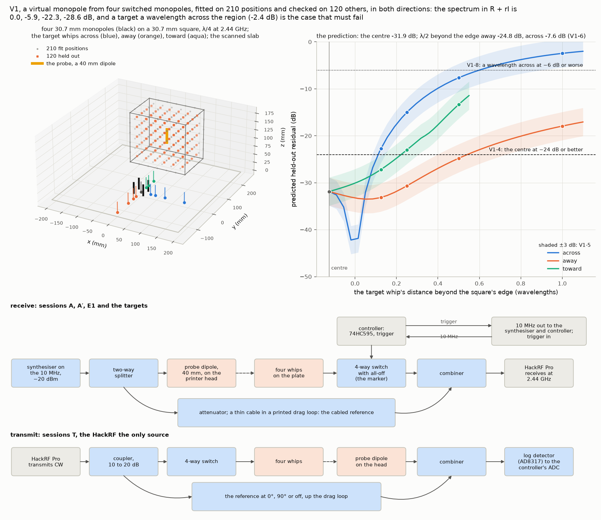

**Figure 19.** V1. Top left: the bench in 3-D, four 30.7 mm monopoles on a 30.7 mm square (λ/4 at 2.44 GHz), the target
whips across (+x), away (−y) and toward (+y) the region, and the scanned slab with its 210 fit positions, its 120
held-out positions and the 40 mm probe dipole. Top right: the predicted held-out residual against the target whip's
distance beyond the square's edge, with ±3 dB bands (V1-5) and the levels of V1-4 and V1-8: the centre −31.9 dB; λ/2
beyond the edge −24.8 dB away and −7.6 dB across, 17 dB apart (V1-6); a wavelength across −2.4 dB, the case that must
fail. Bottom: the receive chain (the beacon locked to the HackRF's 10 MHz, its cabled reference up a drag loop, the
switch with its all-off marker) and the transmit chain of sessions T (the HackRF transmitting through a coupler, the
reference switched to 0°, 90° or off, a log detector read by the controller).

### 10.2 After V1

- **V2, comb lines on receive and on transmit.** Rung 2: four to eight 2-bit elements (two switched-line stages each) on
  a printed Wilkinson tree between the jacks and the HackRF, measured with V1's two chains: on receive the locked beacon
  with its cabled reference, the lines read from the HackRF's capture by FFT; on transmit the detector probe with its
  switched reference, the lines read from the detector's output. The beacon stays CW while the board plays staircases,
  so by reciprocity each line carries the receive pattern of its virtual antenna, and the transmit sessions measure the
  transmit one. Predictions: line +1 at −0.91 dB of the unmodulated level and lines −3, +5, −7, +9 at −10.5, −14.9,
  −17.8 and −20.0 dB (each within 1 dB), even lines and line −1 below −25 dB; one slot of delay moves line 1 by −22.5°
  and line −3 by +67.5° at L = 16, within 2°; Frank shifts give 16 lines equal within the sinc droop; the state table of
  each element with its neighbours in each of their states tests the product alphabet (section 6.2).
- **V3, the rev B tile and whips** under the same protocol, with the board's own LMX2572 on its 10 MHz as the beacon
  (through RADAR OUT and a cable up the drag loop to the probe), its calibration arms for the per-state tables, its
  in-place calibration radiators (the centre monopole and two probe flares, at most −60 dBm EIRP) as fixed probes that
  track drift between passes, and its AD8317 monitor and V1's detector chain for transmit: the virtual dipole 50 mm
  behind the tile at −24 to −26 dB in a 30° cone at 5.8 GHz with receive weights and −15 to −16 dB with one delay state;
  on transmit, the EIRP-aware focus at +3 to +4 dB (5.8 GHz) and +5 to +7 dB (2.44 GHz) with delay states, and the
  Pro's own transmit power at both bands.
- **V4, the ring guide as an antenna:** a 277 mm printed ring with switched stubs, with radiated orders only at
  l = m − pN, the m = 3 doublet split on a threefold ring with m = 1, 2, 4 and 5 unsplit, and the loaded Q falling from
  150 to about 120 with eight stubs in at m = 2. The orders come from V1's receive chain: the locked beacon on a circle
  of probe positions with its cabled reference and the ring's feed into the HackRF, by reciprocity, a DFT round the
  circle giving each l. The loaded Q comes from a reflection sweep with the HackRF alone: it transmits a stepped tone
  into the feed through a 20 dB coupler whose coupled port drives V1's log detector, read by the controller, and the
  width of the return-loss dip gives Q.

## 11. Laws for the ledger

Proposed rows; ids follow `docs/LAWS.md` (SYN synthesis, TMA time modulation, EQV equivalence, NFD near fields, CHG
charges). A Proposition gets Lean declarations and a test against the float code; a Claim or a Hypothesis gets none.

| Id | Statement | Label | Falsifier | Lean |
| --- | --- | --- | --- | --- |
| SYN-1 | reachable fields are range(G); M conditions leave ≥ N − M dimensions | Proposition | random-matrix test; a field unlike the weighted sum of element fields | rank-nullity on `mulVecLin` |
| SYN-2 | for G of full row rank, the minimum-power drive `R⁻¹Gᴴ(GR⁻¹Gᴴ)⁻¹e` and its power; with the pseudo-inverse for any consistent target | Proposition | feasible perturbations never cheaper | `(star e ⬝ᵥ K⁻¹ e).re ≤ (star w ⬝ᵥ R w).re`, equality at `R⁻¹GᴴK⁻¹e`, for `K = GR⁻¹Gᴴ`, invertible when G has full row rank |
| SYN-3 | the Tikhonov drive is unique and modal; power falls and residual rises with α; the cap's α is unique | Proposition | modal sum against direct solve | `GᴴG + α•R` positive definite; monotone for 0 < α ≤ β |
| SYN-4 | focus quotient ≤ gᴴR⁻¹g, reached at R⁻¹g | Proposition | a drive beating R⁻¹g on measured G and R | Cauchy-Schwarz in the R inner product |
| SYN-5 | Σ 2(2l + 1) = 2L(L + 2) | Proposition | arithmetic | induction on `Finset.range` |
| SYN-6 | expected error energy s² wᴴdiag(GᴴG)w | Proposition | Monte Carlo | finite sum over sign patterns |
| SYN-7 | switched-state estimate unbiased with covariance (s²/N)I | Proposition | bench variance not 12 dB below one-at-a-time | `(1/N)•Hᵀ(Hh) = h` for `HᵀH = N•1` |
| SYN-8 | the Kaczmarz step never increases the error | Proposition | algebraic | projection in `EuclideanSpace ℂ (Fin n)` |
| SYN-9 | four-phase rounding keeps cos(π/4) of focal amplitude | Proposition | a focus losing over 3 dB to its best 2-bit state | `‖Σ aᵢ exp(I δᵢ)‖ ≥ cos(π/4) Σ aᵢ` for \|δᵢ\| ≤ π/4 |
| SYN-10 | reciprocity as a transpose, and the receive error bound | Proposition | transmit and receive residuals apart beyond calibration | bilinear identity, Cauchy-Schwarz |
| SYN-11 | cheap modes ≈ min(N, source, 2L(L+2), Miller) | Claim | more than 2L(L+2) modes within 20 dB at L = ⌈ka⌉ + 2, or more than N | — |
| SYN-12 | fine structure costs (0.63λ/δ)² per point below 0.35λ | Claim | six values at 0.15λ for under 40 dB above one | — |
| SYN-13 | a null curve consumes 2ℓ/λ + 1 modes | Claim | a λ/2 ring at −40 dB with fewer modes; a 2λ ring with under 10 | — |
| SYN-14 | one solution per 20 MHz, where the field is separable line by line; tables on 500 MHz (tile) and 150 MHz (whips) | Claim | a fixed state's pattern moving over 1 % in 20 MHz | — |
| SYN-15 | coupling of minimum-scattering elements leaves range(G) | Claim | V1-2 | — |
| SYN-16 | intensity targets need G only up to one phase per probe position | Proposition | an intensity design from a phase-scrambled operator doing measurably worse | `‖(D.mulVec (G.mulVec w)) m‖ = ‖(G.mulVec w) m‖` for unit-modulus diagonal D |
| SYN-17 | a unit-modulus weight on h from N orthogonal unit-modulus states has 1/N of the static state's signal-to-noise ratio over the same time | Proposition | a bench software beam more than 2 dB off 12 dB below its static state's signal-to-noise ratio over the same capture time | the quadratic form `star w ⬝ᵥ (Hᴴ * H).mulVec w = N * ‖w‖²` for `HᴴH = N•1`, the variance as that form |
| SYN-H1 | the Hertzian operator gives real spectra to 3 dB over the cheap modes | Hypothesis | V1-3; an openEMS operator 6 dB off within 8 modes at 5.8 GHz | — |
| SYN-H2 | null structures are the cheap exotic fields | Hypothesis | a null curve under 3λ costing over 20 dB above a focus for the same surrounding field | — |
| SYN-H3 | reciprocity with an active factor: `tₙ(s) = cₙ rₙ(s)`, cₙ independent of state and field point | Hypothesis | V1-9 on the passive path; cₙ for rev B's 16 states on the arm apart beyond calibration | — |
| SYN-H4 | knotted null lines: regions of fixed knot type in CP^15, reached from Milnor fits; a trefoil takes elements round the volume | Hypothesis | a trefoil traced from a Milnor-fitted drive in another knot type; a planar array holding a trefoil the size a surround holds | — |
| SYN-H5 | coordinate ascent finds rev A's best state for nulls and intensity targets | Hypothesis | an exhaustive search of the 4¹⁵ states beating it for a null or an intensity target | — |
| TMA-1 | the harmonic weight law | Proposition | line amplitudes off DFT × sinc beyond calibration | finite DFT of a piecewise-constant function; the slot integral in closed form |
| TMA-2 | a time shift is a phase; staircase lines only at h ≡ 1 mod M | Proposition | V2's line phases and line set | geometric sums of roots of unity |
| TMA-3 | time-averaged weights fill the product of hulls; the disc of radius 1/√2; 2N + 1 states | Proposition | a carrier pattern unlike the dwell-weighted mean | `convexHull_pi`, `eq_pos_convex_span_of_mem_convexHull` |
| TMA-4 | line-1 ceiling Perimeter(conv A)/2π and its disc | Claim | a sequence above it (brute force over 4⁸ in the tests) | — (Cauchy's formula, Lyapunov's theorem cited) |
| TMA-5 | conservation of beams, Σ\|b_h\|² ≤ N² | Proposition | K measured beams summing above the static gain | finite Parseval |
| TMA-6 | shifted flat-spectrum sequences give L equal DFT beams; Frank-16 is perfect | Proposition | the finite check | `decide` on the 16 × 16 Gram matrix |
| TMA-7 | B < 1/(Lτ) and rank C = N recover every element signal | Claim | a band-limited signal not recovered to the noise floor | — |
| TMA-8 | painted intensities form the PSD cone of dimension ≤ N² | Proposition | a time-averaged map outside the cone | Hermitian forms of PSD sums |
| TMA-9 | one waveform and static weights give at most λ_max(M)·E at a target, reached by the principal eigenvector and time reversal | Proposition | a searched state vector beating the quantised principal eigenvector beyond its quantisation loss | Cauchy-Schwarz and the Rayleigh quotient |
| TMA-10 | a commutated ring carries phase mode h (and h + mN) on line h | Proposition | measured line phases off −360·h·n/N degrees | finite DFT of one-hot sequences |
| TMA-11 | marker neighbours near −24 dB; the wanted weights' error falls from −43 to −54 dB over R = 1 to 4 periods | Claim | leakage more than 2 dB off −24 dB with the marker outside C | — |
| TMA-12 | the space-time form `E(r, f) = Σ_h S(f − f₀ − h·f_p) Σₙ c_{n,h} gₙ(r, f)` | Proposition | a line's field unlike the waveform times that line's pattern, beyond the transients | the slot integral of TMA-1 with a waveform factor; finite sums |
| TMA-13 | rev B's nearest-state staircases put 0.95 to 0.97 of an element's power on line 1 (0.90 to 0.91 with a marker); its Frank lines span −11.2 to −16.9 dB with decode condition 1.56 to 1.93 | Claim | a model or bench line-1 share more than 0.02 off | — |
| TMA-H1 | the null floor is the measured state table, of order σ²/N | Hypothesis | a board calibrated to 3° with an L = 64 null shallower than −30 dB | — |
| TMA-H2 | line division measures T(r, n) in one capture | Hypothesis | phases off one-at-a-time measurement beyond calibration | — |
| TMA-H3 | slow particles see the painted potential, electrons a conveyor | Hypothesis | a wide-band probe map unlike the mean of slot maps | — |
| TMA-H4 | the product alphabet: an element's gain depends on its own state alone | Hypothesis | one element's 16 states with its neighbours in each of their states apart beyond 3° and 0.26 dB | — |
| TMA-H5 | a software null against a full-scale signal stops near the 8-bit samples' 50 dB | Hypothesis | a software null deeper than 55 dB against a full-scale tone in one 8-bit capture | — |
| TMA-H6 | one port and 256 states measure a scene's 16 × 16 coherence matrix | Hypothesis | two known incoherent beacons whose measured C departs from their predicted one beyond calibration | — |
| TMA-H7 | states drawn per symbol key a link to a place | Hypothesis | an error-vector magnitude under 50 % 0.1 m from the place, over the vectors the sequencer holds | — |
| EQV-1 | no propagating copy for d < λ/2 (λ/(1 + sin θ_max)); rings mix m and m ± N | Proposition | a grating lobe below the stated frequency | real inequalities; finite DFT aliasing |
| EQV-2 | the 2.5-D amplitude law | Claim | a line array 0.2 dB off it at y > λ with its Fresnel zone inside | — |
| EQV-3 | a field-only virtual antenna in empty space is a focus | Claim | external sources matching an outgoing point source inside the focus | — (elliptic regularity cited) |
| EQV-4 | the board as a sampled Schelkunoff sheet; the closed-form drive; visibility and window rules, edge term 0.225/v | Claim | the off-axis source better than −15 dB at 5.8 GHz on the centred square | — |
| EQV-5 | the size asymmetry | Claim | a 1.5 times aperture better than −10 dB at 5.8 GHz | — |
| EQV-6 | tangential E on its boundary fixes a source-free field in a bounded region off the cavity resonances; tangential E and H, or two spheres, at every k; the radiation condition for an exterior region | Claim | a fit scored on one shell of a ball at ka = 2.744 whose interior error does not rise above its level off resonance | — (Stratton-Chu and Rellich cited) |
| EQV-H1 | a measured manifold lands within 6 dB of the model residuals | Hypothesis | V3's virtual dipole worse than −20 dB in a 30° cone at 5.8 GHz | — |
| EQV-H2 | EIRP-aware gains survive coupling to 2 dB | Hypothesis | an openEMS or measured gain under 2 dB | — |
| NFD-1 | the multipole ladder and the imbalance threshold √(3/20) ka | Proposition | an openEMS four-rod ratio 20 % off (3/20)(ka)² at ka < 0.1 | algebra from Jackson's formulas |
| NFD-2 | Q₁ and Q₂ of the lowest modes | Claim | an electrode below Q₂(ka) with copper loss removed | — |
| NFD-3 | the tile's reactive drives and their darkness under rev B's delays | Claim | an openEMS tile within 15 dB of uniform for the best 2.44 GHz pattern | — |
| NFD-4 | R positive definite for distinct points | Claim | a nonzero drive with zero far field | — (Rellich's lemma and unique continuation cited) |
| NFD-5 | ring selection rule l = m − pN, Σ F_l = 1 | Proposition | an order outside m − pN above the floor on a probe circle | `Σ n, exp(2πi(m − l)n/N) = N·[N ∣ m − l]` |
| NFD-6 | Bragg splitting only when N divides 2m | Proposition | a split at m = 1 or 2 on a threefold ring beyond the linewidth | characters of the cyclic group |
| NFD-7 | radiate or hold, U = U₀(1 − η) | Proposition | Q with stubs in and out against the formula | algebra over ℝ |
| NFD-8 | the whip rings' orbital purity | Claim | an NEC-2 (nec2c or necpp) or openEMS ring with m = 1 purity under 0.9 at 433 MHz | — |
| NFD-H1 | the stub dial's Q_rad | Hypothesis | an openEMS ring a factor 4 off | — |
| CHG-1 | N'_max = 4πε₀D/e² | Proposition | a tracker column denser than the limit staying confined | extends `Confine.lean`'s space-charge algebra |
| CHG-2 | the column's dipole resonance equals f_sec at the limit | Proposition | a dense cloud's centre-of-mass line away from f_sec | from RFG-4 |
| CHG-3 | the centre of mass obeys the single-particle equation in a linear field | Proposition | an N-body run departing beyond integrator error | finite sums, antisymmetric pair forces |
| CHG-4 | the column as a series L-C, l_N = md²/(Ne²) | Claim | a pickup line whose inductance does not scale as 1/N | — |
| CHG-5 | electrodes read coherent motion 51 dB above radiation | Claim | a simulated pickup off Neωx/d beyond the electrode's geometry factor | — |
| CHG-6 | kinetic inductance and the wire threshold | Claim | a column under 10¹² per metre carrying antenna current like copper at 433 MHz | — |
| CHG-7 | the perturbation shift α/(2Ch²) | Claim | a steel ball's shift a factor 2 off after the electrode's real E/V | — |
| CHG-H1 | density-wave lines at m·v/L above four thermal speeds | Hypothesis | no line within a factor 2 of m·v/L in a particle simulation | — |
| CHG-H2 | a held column is a sink at f_sec | Hypothesis | no electrode resonance at f_sec with 10⁶ held electrons, or one that ignores the volts | — |

To prove first: SYN-1 to SYN-10, SYN-16 and SYN-17, TMA-1 to TMA-3, TMA-5, TMA-6, TMA-8 to TMA-10 and TMA-12, EQV-1,
NFD-5 to NFD-7 and CHG-1 to CHG-3. They are finite linear algebra, finite sums of roots of unity, convexity already in
Mathlib and algebra over ℝ, each a day's work or less. The radiation matrix is best formalised as the Gram matrix of the
far-field patterns, positive semidefinite by construction.

## 12. Sources

1. O. M. Bucci, G. Franceschetti, "On the degrees of freedom of scattered fields," IEEE Trans. Antennas Propag. 37(7),
   918-926 (1989), doi:10.1109/8.29386.
2. D. A. B. Miller, "Communicating with waves between volumes: evaluating orthogonal spatial channels and limits on
   coupling strengths," Applied Optics 39(11), 1681-1699 (2000), doi:10.1364/AO.39.001681.
3. D. A. B. Miller, "Waves, modes, communications, and optics: a tutorial," Advances in Optics and Photonics 11,
   679-825 (2019), doi:10.1364/AOP.11.000679.
4. M. Gustafsson, "Degrees of freedom for radiating systems," IEEE Trans. Antennas Propag. 73(2), 1028-1038 (2025),
   doi:10.1109/TAP.2024.3524437.
5. L. J. Chu, "Physical limitations of omni-directional antennas," Journal of Applied Physics 19(12), 1163-1175 (1948),
   doi:10.1063/1.1715038.
6. R. F. Harrington, "Effect of antenna size on gain, bandwidth, and efficiency," Journal of Research of the National
   Bureau of Standards 64D(1), 1-12 (1960).
7. J. S. McLean, "A re-examination of the fundamental limits on the radiation Q of electrically small antennas," IEEE
   Trans. Antennas Propag. 44(5), 672-676 (1996), doi:10.1109/8.496253.
8. R. E. Collin, S. Rothschild, "Evaluation of antenna Q," IEEE Trans. Antennas Propag. 12, 23 (1964),
   doi:10.1109/TAP.1964.1138151.
9. J. D. Jackson, Classical Electrodynamics, 3rd ed. (Wiley, 1999), sections 9.2-9.3.
10. H. Hotelling, "Some improvements in weighing and other experimental techniques," Annals of Mathematical Statistics
    15(3), 297-306 (1944).
11. S. Zhang, Y. Huang, "Complex quadratic optimization and semidefinite programming," SIAM Journal on Optimization
    16(3), 871-890 (2006).
12. A. Conca, D. Edidin, M. Hering, C. Vinzant, "An algebraic characterization of injectivity in phase retrieval,"
    Applied and Computational Harmonic Analysis 38, 346-356 (2015), doi:10.1016/j.acha.2014.06.005.
13. E. J. Candès, T. Strohmer, V. Voroninski, "PhaseLift: exact and stable signal recovery from magnitude measurements
    via convex programming," arXiv:1109.4499.
14. M. R. Dennis, R. P. King, B. Jack, K. O'Holleran, M. J. Padgett, "Isolated optical vortex knots," Nature Physics 6,
    118-121 (2010), doi:10.1038/nphys1504.
15. A. E. H. Love, "The integration of the equations of propagation of electric waves," Philosophical Transactions of
    the Royal Society A 197 (1901), doi:10.1098/rsta.1901.0013.
16. S. A. Schelkunoff, "Some equivalence theorems of electromagnetics and their application to radiation problems,"
    Bell System Technical Journal 15(1), 92-112 (1936), doi:10.1002/j.1538-7305.1936.tb00720.x.
17. A. J. Berkhout, D. de Vries, P. Vogel, "Acoustic control by wave field synthesis," Journal of the Acoustical Society
    of America 93(5), 2764-2778 (1993), doi:10.1121/1.405852.
18. S. Spors, R. Rabenstein, J. Ahrens, "The theory of wave field synthesis revisited," AES 124th Convention, paper 7358
    (2008).
19. J. W. Sherman III, "Properties of focused apertures in the Fresnel region," IRE Trans. Antennas Propag. 10(4),
    399-408 (1962), doi:10.1109/TAP.1962.1137900.
20. J. de Rosny, M. Fink, "Overcoming the diffraction limit in wave physics using a time-reversal mirror and a novel
    acoustic sink," Physical Review Letters 89, 124301 (2002), doi:10.1103/PhysRevLett.89.124301.
21. W. H. Kummer, A. T. Villeneuve, T. S. Fong, F. G. Terrio, "Ultra-low sidelobes from time-modulated arrays," IEEE
    Trans. Antennas Propag. 11(6), 633-639 (1963), doi:10.1109/TAP.1963.1138102.
22. J. C. Brégains, J. Fondevila-Gómez, G. Franceschetti, F. Ares, "Signal radiation and power losses of time-modulated
    arrays," IEEE Trans. Antennas Propag. 56(6), 1799-1804 (2008).
23. L. Poli, P. Rocca, G. Oliveri, A. Massa, "Harmonic beamforming in time-modulated linear arrays," IEEE Trans.
    Antennas Propag. 59(7) (2011).
24. R. C. Cumming, "The serrodyne frequency translator," Proceedings of the IRE 45(2), 175-186 (1957),
    doi:10.1109/JRPROC.1957.278387.
25. Gao et al., "Single-sideband time-modulated phased array with 2-bit phased shifters," arXiv:2010.06504.
26. R. L. Frank, S. A. Zadoff, "Phase shift pulse codes with good periodic correlation properties," IRE Trans.
    Information Theory 8(6), 381-382 (1962), doi:10.1109/TIT.1962.1057786.
27. P. R. Halmos, "The range of a vector measure," Bulletin of the American Mathematical Society 54(4), 416-421 (1948),
    doi:10.1090/S0002-9904-1948-09020-6.
28. R. T. Hoctor, S. A. Kassam, "The unifying role of the coarray in aperture synthesis for coherent and incoherent
    imaging," Proceedings of the IEEE 78(4), 735-752 (1990).
29. K. Henderson, C. Ryu, C. MacCormick, M. G. Boshier, "Experimental demonstration of painting arbitrary and dynamic
    potentials for Bose-Einstein condensates," New Journal of Physics 11, 043030 (2009),
    doi:10.1088/1367-2630/11/4/043030.
30. A. J. Devaney, E. Wolf, "Radiating and nonradiating classical current distributions and the fields they generate,"
    Physical Review D 8, 1044 (1973), doi:10.1103/PhysRevD.8.1044.
31. X. Cai et al., "Integrated compact optical vortex beam emitters," Science 338, 363 (2012),
    doi:10.1126/science.1226528.
32. D. H. E. Dubin, T. M. O'Neil, "Trapped nonneutral plasmas, liquids, and crystals (the thermal equilibrium states),"
    Reviews of Modern Physics 71, 87 (1999), doi:10.1103/RevModPhys.71.87.
33. L. Brey, N. F. Johnson, B. I. Halperin, "Optical and magneto-optical absorption in parabolic quantum wells,"
    Physical Review B 40, 10647 (1989).
34. D. J. Wineland, H. G. Dehmelt, "Principles of the stored ion calorimeter," Journal of Applied Physics 46, 919
    (1975), doi:10.1063/1.321602.
35. W. Shockley, "Currents to conductors induced by a moving point charge," Journal of Applied Physics 9, 635 (1938),
    doi:10.1063/1.1710367.
36. S. Ramo, "Currents induced by electron motion," Proceedings of the IRE 27, 584 (1939),
    doi:10.1109/JRPROC.1939.228757.
37. G. G. Borg et al., "Plasmas as antennas: theory, experiment and applications," Physics of Plasmas 7(5), 2198-2202
    (2000), doi:10.1063/1.874041.
38. A. W. Trivelpiece, R. W. Gould, "Space charge waves in cylindrical plasma columns," Journal of Applied Physics 30,
    1784 (1959), doi:10.1063/1.1735056.
39. S. M. Anlage, D. E. Steinhauer, B. J. Feenstra, C. P. Vlahacos, F. C. Wellstood, "Near-field microwave microscopy of
    materials properties," arXiv:cond-mat/0001075 (2000).
40. C. Matthiesen, Q. Yu, J. Guo, A. M. Alonso, H. Häffner, "Trapping electrons in a room-temperature microwave Paul
    trap," Physical Review X 11, 011019 (2021), doi:10.1103/PhysRevX.11.011019.
41. J. Hoffrogge, R. Fröhlich, M. A. Kasevich, P. Hommelhoff, "Microwave guiding of electrons on a chip," Physical
    Review Letters 106, 193001 (2011), doi:10.1103/PhysRevLett.106.193001.
42. G. Lerosey, J. de Rosny, A. Tourin, A. Derode, G. Montaldo, M. Fink, "Time reversal of electromagnetic waves,"
    Physical Review Letters 92, 193904 (2004), doi:10.1103/PhysRevLett.92.193904.
43. I. M. Vellekoop, A. P. Mosk, "Focusing coherent light through opaque strongly scattering media," Optics Letters 32,
    2309 (2007), doi:10.1364/OL.32.002309.
44. W. Mao, M. B. Smith, C. M. Collins, "Exploring the limits of RF shimming for high-field MRI of the human head,"
    Magnetic Resonance in Medicine 56, 918 (2006), doi:10.1002/mrm.21013.
45. A. Marzo, B. W. Drinkwater, "Holographic acoustic tweezers," Proceedings of the National Academy of Sciences 116,
    84 (2019), doi:10.1073/pnas.1813047115.
46. 47 CFR §§15.247, 15.249, 18.107, 18.305.
47. M. P. Daly, J. T. Bernhard, "Directional modulation technique for phased arrays," IEEE Trans. Antennas Propag.
    57(9), 2633-2640 (2009), doi:10.1109/TAP.2009.2027047.
48. D. Colton, R. Kress, Inverse Acoustic and Electromagnetic Scattering Theory, 4th ed. (Springer, 2019), chapter 6:
    the Stratton-Chu formulas, Rellich's lemma and uniqueness for Maxwell's equations.
49. Great Scott Gadgets, HackRF documentation, hackrf.readthedocs.io: the HackRF Pro's features, external clock
    interface and hardware triggering, and the HackRF One's typical maximum transmit power.
