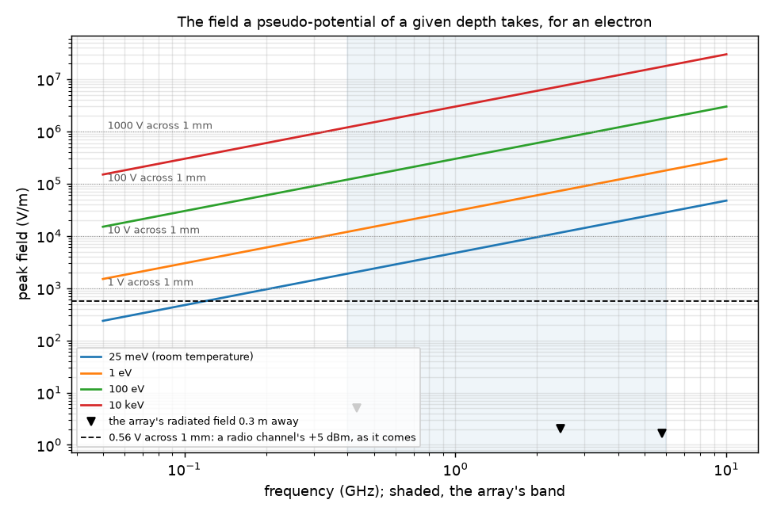
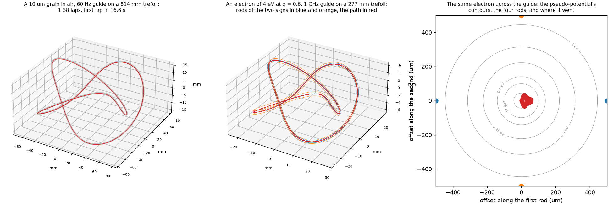
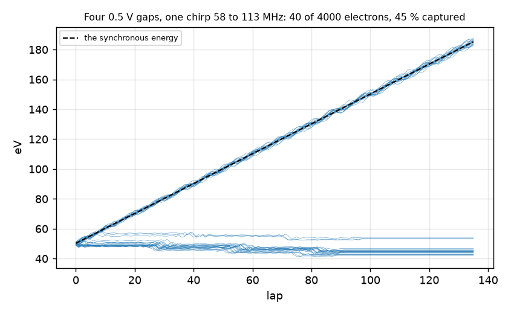

<!-- 2026-11-18. The first particle run (2026-11-16), redone on array16.particles. Code:
experiments/accelerator_study.py; outputs in experiments/accelerator/. Its fast parts are held to their numbers by
tests/test_accelerator_study.py. A study, not a registered experiment: experiment 2 takes its questions further
with predictions committed first. Not reviewed by anyone but its author. -->

# The first run: what radio-frequency fields take to hold a charge and speed it up

The owner's idea: a field that acts as a small particle accelerator, its shape holding the particle's path, with
the particles' own fields refining it. This study puts numbers on the radio-frequency parts of that idea. It runs
in 73 seconds (`uv run python experiments/accelerator_study.py`).

## 1. Short answers

- **Volts set the depth of the well.** A quadrupole well D electron-volts deep takes a drive of 8D/q volts, where
  q is Mathieu's stability parameter: 27 V for 1 eV at a comfortable q = 0.3, whatever the frequency and the
  size (ledger RFG-1).
- **Frequency times electrode distance follows from the volts.** For electrons that 1 eV well sits at
  f × r₀ = 0.89 GHz·mm: 0.89 GHz with the electrodes 1 mm from the path, 1.8 GHz at 0.5 mm, 0.3 GHz at 3 mm. A
  well ten times deeper takes ten times the volts and √10 times f × r₀. The array's 0.4-6 GHz band is where
  millimetre-scale electrodes confine electrons.
- **A radio channel as it comes makes a well of room-temperature depth.** Its +5 dBm on 50 Ω is 0.56 V: a 21 meV
  well at q = 0.3, on electrodes 0.3 mm from the path at 433 MHz. A resonator or an amplifier multiplies the
  volts, and the depth with them.
- **A 1 GHz quadrupole on a trefoil knot guides electrons.** With 25 V between rods 0.5 mm from the axis, a well
  1.26 eV deep held electrons of 0.5 to 8 eV for every lap tracked, 5 to 20 of them, within 0.17 mm of the axis.
- **The same shape at 60 Hz carries charged dust in air.** With ±500 V on rods 6 mm from the axis, 10 µm glass
  grains follow the knot, and a travelling wave of 34 V per 30 mm carries them round at 5 cm/s: a lap in 16.6 s.
- **Four phase-stepped gaps on one chirp accelerate.** Four 0.5 V gaps, 90° apart in phase, on a chirp from 58.5
  to 112.6 MHz, take a 50 eV beam to 185 eV in 135 laps and capture 45 % of it.
- **The beam's own field sets how many the guide holds, and announces them.** The 1 GHz guide holds up to
  1.1 × 10¹⁵ electrons per cubic metre; a million circulating electrons put about −78 dBm on a pickup.

## 2. The pseudo-potential

A charge in a field E(x)·cos ωt that changes little over its quiver motion is pushed toward where the field is
weak, as if by a potential

    U = e²E² / (4mω²)

The lines are wells of equal depth for an electron. Halving the frequency deepens a well fourfold at the same
field, so the low end of the band is the cheap end. The dashed line is a radio channel's own 0.56 V across a
millimetre; the triangles are the array's radiated field 0.3 m away at full drive (5.1, 2.1 and 1.7 V/m at 0.433,
2.44 and 5.8 GHz). One channel's 0.56 V across a millimetre is a hundred times the field the whole array
radiates to 0.3 m, and ten thousand times the depth: the elements belong beside the path.

Along a line where the field vanishes, a quadrupole E = g·cos ωt·(−x, +y) holds the charge. Its motion is
Mathieu's equation with q = 2(e/m)g/ω²: stable below q = 0.908, and for small q a slow oscillation at
ω_sec = qω/(2√2) in a well of depth q·g·r₀²/8 at distance r₀. Writing g = V₀/r₀² gives the two rules above:

| Depth | Drive V₀ at q = 0.3 | f × r₀ for electrons | f at r₀ = 1 mm | f × r₀ for protons |
| --- | --- | --- | --- | --- |
| 25 meV | 0.67 V | 0.14 GHz·mm | 0.14 GHz | 3.3 MHz·mm |
| 1 eV | 27 V | 0.89 GHz·mm | 0.89 GHz | 21 MHz·mm |
| 10 eV | 267 V | 2.8 GHz·mm | 2.8 GHz | 66 MHz·mm |
| 100 eV | 2.7 kV | 8.9 GHz·mm | 8.9 GHz | 208 MHz·mm |

A resonant gap turns power into volts: with a shunt resistance of 0.25 to 1 MΩ (an estimate), 3.2 mW makes 40 to
80 V and 1 W makes 0.7 to 1.4 kV.

## 3. A guide on a knot

**Electrons at 1 GHz.** Four rods 0.5 mm from the axis of a trefoil 277 mm long, tightest bend 16.6 mm.

| Mathieu q | Volts between rods | Secular frequency | Depth | Held | Lost |
| --- | --- | --- | --- | --- | --- |
| 0.3 | 13 V | 106 MHz | 0.32 eV | 0.5, 1, 2 eV | 4, 8 eV |
| 0.6 | 25 V | 212 MHz | 1.26 eV | 0.5, 1, 2, 4, 8 eV | 16, 32 eV |

- A bend pushes a moving charge outward with force 2W/R; the well pushes back. The estimate
  W = depth × R / (2r₀) gives 5.2 and 20.9 eV as the most each well holds round this knot's tightest bend.
  Tracking held 2 and 8 eV and lost 4 and 16: between 38 and 77 % of the estimate.
- So the energy a guide holds grows with the well's depth and with the bend's radius over the electrode
  distance. Gentle bends and close electrodes carry fast particles.
- The rods of a bent guide leave a small field on their centre line: the null a particle follows lies r₀²/(4R)
  inside it (ledger ROD-2), 4 µm here.

**Grains at 60 Hz.** The same shape, 814 mm long, rods 6 mm from the axis at ±500 V, in air. Drag makes the
motion overdamped, and gravity pulls the grains down by 0.13 to 0.83 mm against the well. Grains with half,
one and two times the nominal charge all stay within 1.3 mm of the axis. A calibration against the damped
pseudo-potential precedes this run: at 1 kV the tracked sag is 0.27 mm where the formula gives 0.20 mm.

## 4. Acceleration along the path

Four gaps a quarter of a lap apart, each 0.5 V, driven by one chirp with a fixed 90° from gap to gap: what four
coherent radio channels supply. A particle that crosses each gap at the same phase gains the same energy at each
and stays in step as the chirp rises; particles near it in phase oscillate about it and are carried along. From a
continuous 50 eV beam, 45 % is captured and reaches 185 eV in 21 µs with an rms spread of 1.6 eV. The rest
stays near its starting energy. This is a model of the motion along the path alone.

## 5. The particles' own fields

- **How many a guide holds.** A beam's own field pushes outward; where it equals the well's inward push the
  guide is full: n = 2ε₀mω_sec²/e². For the 1 GHz guide that is 2.8 × 10¹⁴ m⁻³ at q = 0.3 and 1.1 × 10¹⁵ m⁻³ at
  q = 0.6: in a beam 50 µm in radius, 9 million electrons per metre and 2.4 µA at 8 eV.
- **What a beam announces.** 10⁵, 10⁶ and 10⁷ electrons circulating at 185 eV are 0.14, 1.4 and 14 µA, about
  −98, −78 and −58 dBm on a 50 Ω pickup coupling 30 % (an estimate): within a receiver's reach, at harmonics of
  the revolution frequency.
- **A line of charges orders itself.** Grains closer than 0.65 mm along the 60 Hz guide buckle from a line into a
  zigzag: the knot has room for more than 1200 in single file.

## 6. Against the run of 2026-11-16

The same cases on the core give the same results. The frame that carries the rods round the curve is now turned
by rotation where the first run projected it, which moves the rods by micrometres.

| Quantity | 2026-11-16 | On the core |
| --- | --- | --- |
| Dust: laps, first lap, reach at nominal charge | 1.38, 16.6 s, 0.60 mm | 1.38, 16.6 s, 0.60 mm |
| Electrons, q = 0.3: held / lost | 0.5-2 eV / 4, 8 eV | the same |
| Electrons, q = 0.6: held / lost | 0.5-8 eV / 16, 32 eV | the same |
| Electrons, q = 0.6: reach at 0.5, 1, 2, 4, 8 eV | 63, 60, 59, 61, 153 µm | 66, 66, 66, 67, 167 µm |
| Ring: harmonic, chirp, final energy, captured | 13, 58.5-112.6 MHz, 185 eV, 45 % | the same |
| Run time of the two tracked guides | 113 s | 70 s |

Two things changed on purpose. The array's field is derived from `REDESIGN.md` section 7 (the first run assumed
17 V/m at 0.3 m). And the magnetic guide left this script: experiment 1 (`guide_study.md`) redid it with
predictions committed first. Cyclotron resonance, which adds a static field, is the optional section
`resonance`.

## 7. The model

Point charges and thin rods carrying line charges, in vacuum for electrons and in still air for grains. One
particle at a time, except where section 5 computes what many do.

## 8. Next

Experiment 2 puts the electrodes on the board and registers its predictions first (`docs/PROGRESS.md`).

## Sources

1. J. Hoffrogge, R. Fröhlich, M. A. Kasevich, P. Hommelhoff, "Microwave Guiding of Electrons on a Chip,"
   Physical Review Letters 106, 193001 (2011), doi:10.1103/PhysRevLett.106.193001. The 1 GHz guide's scale
   follows theirs.
2. E. A. Vinitsky, E. D. Black, K. G. Libbrecht, "Particle dynamics in damped nonlinear quadrupole ion traps,"
   American Journal of Physics 83, 313-319 (2015), doi:10.1119/1.4902185. The grain's mass, charge and drag.
