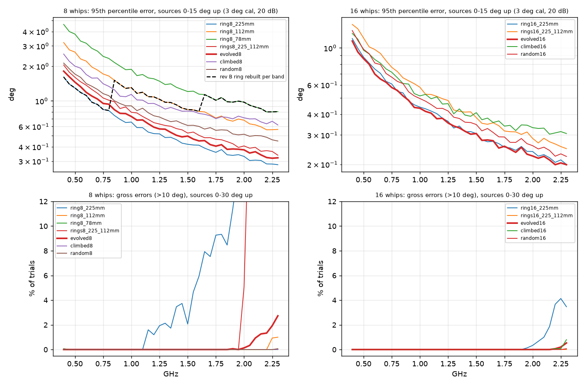
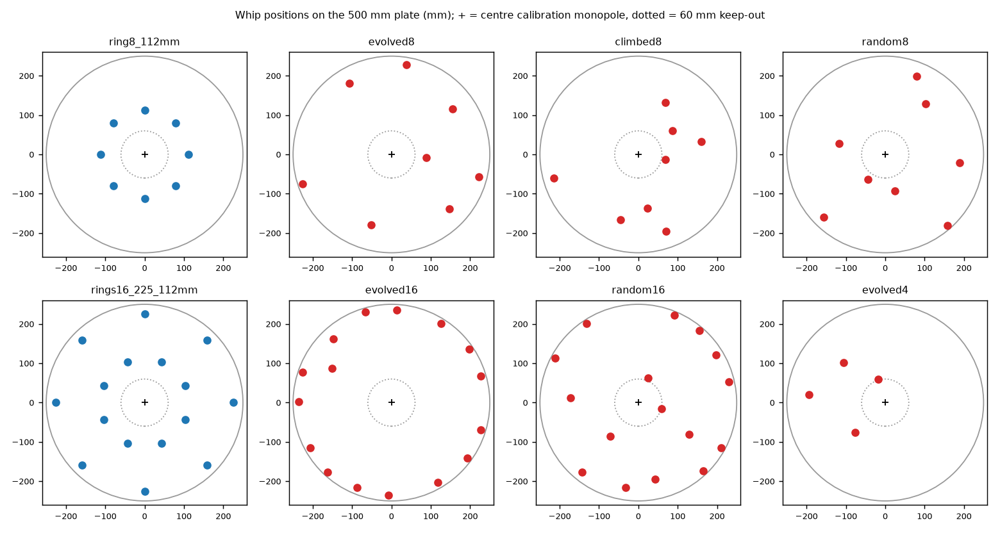

<!-- 2026-11-15. The owner's idea ("genetic algorithm iterative testing") turned into a tool, and its first use:
one fixed layout of external whips for 0.4-2.3 GHz. Code: array16/evolve.py (tests/test_evolve.py),
experiments/evolve_layout.py; results in experiments/evolve/. A second use, the Vivaldi element in openEMS, is
in experiments/vivaldi_study.md once that run finishes. -->

# Evolutionary search: change a design a little, keep what works

The owner's idea: "once we find a design we like, we optimize by making small changes and keeping what works and
disregarding what doesn't and iterating over many rounds." It works, and it is standard practice: an antenna
evolved this way flew on NASA's Space Technology 5 mission in 2006 and beat the contractor's hand design [1], and
genetic algorithms have been used to choose element positions in sparse arrays since the 1990s [2]. This study
built the tool, used it on one real question, and recorded what goes wrong as well as what works.

## 1. The tool

`array16/evolve.py` has four pieces, all minimising a score that a simulation computes:

| Function | What it does |
| --- | --- |
| `climb` | Exactly the owner's loop: start from a design you like, try a few small random changes per step, keep the best change only if it beats the current design on the same random numbers. The step grows after a success and shrinks after a failure. |
| `evolve` | A genetic algorithm: a population of designs, parents chosen by tournament, children by blending two parents and mutating, the best two kept unchanged. |
| `random_search` | The baseline both must beat: random designs, keeping a pool of the best that is re-scored with every new batch. |
| `reselect` | Re-scores finalists on fresh random numbers and ranks them by the mean (see lesson 2). |

The score takes a whole batch of designs and a generation number, so every design in a generation is judged on the
same noise, and the noise changes between generations. Eleven tests check it on problems with known answers
(`tests/test_evolve.py`).

## 2. First use: one whip layout for the whole external band

Rev B mounts its external whips as rings sized for one band at a time (8 whips: r = 225/112/78 mm for
0.4-0.8/0.8-1.6/1.15-2.3 GHz), so the ring is rebuilt for each band. Can one fixed set of holes on the same 500 mm
plate serve all of 0.4-2.3 GHz?

**Rules of the plate.** Whips within 240 mm of the centre, none within 60 mm of it (the centre monopole is the
calibration source), none closer than 75 mm to each other (0.1 wavelength at 0.4 GHz).

**Two models.** The search uses a fast one: azimuth-only direction finding, one source, a 3-4° calibration residual
per whip, 64 samples, Bartlett beamscan, 16 frequencies and 96 directions redrawn every generation. Every finished
design is then judged by a separate, slower one: the design panel's own ring Monte Carlo, rewritten for any layout,
with fresh random numbers. That check reproduces the design panel's published ring results:

| Ring (3° residual, 20 dB, 64 samples) | Design panel: median / 95th / gross | This check |
| --- | --- | --- |
| 4 whips, r = 0.25 λ | 0.93° / 2.65° / 0.0 % | 0.93° / 2.62° / 0.0 % |
| 4 whips, r = 0.354 λ | 0.75° / 170.7° / 10.2 % | 0.75° / 170.7° / 10.6 % |
| 8 whips, r = 0.5 λ | 0.32° / 0.93° / 0.0 % | 0.33° / 0.93° / 0.0 % |
| 8 whips, r = 0.65 λ | 0.25° / 0.73° / 0.0 % | 0.25° / 0.73° / 0.0 % |

"Gross" means an error above 10°: the array picked the wrong direction altogether.

**Three conditions.** Nominal: 3° residual, 20 dB, sources 0-15° above the horizon. Elevated: the same with sources
0-30° up (a drone, a rooftop). Stress: 5° residual, 0 dB per whip, sources 0-30° up.

### Results (worst over 0.4-2.3 GHz: 95th percentile error / gross-error rate)

| Layout | Nominal | Elevated | Stress |
| --- | --- | --- | --- |
| Rev B rings, rebuilt for each band (8 whips) | 1.6° / 0 % | 1.8° / 0.0 % | 4.4° / 0.0 % |
| One ring of 8, r 225 mm | 1.6° / 0 % | 172° / **30 %** | 172° / 30 % |
| One ring of 8, r 112 mm | 3.2° / 0 % | 3.5° / 1.0 % | 8.4° / 2.9 % |
| 8 whips, random search (`random8`) | 2.1° / 0 % | 2.6° / 0.1 % | 5.3° / 0.2 % |
| 8 whips, climb from the 112 mm ring | 2.6° / 0 % | 3.3° / 0.0 % | 6.8° / 0.4 % |
| 8 whips, genetic algorithm | 1.8° / 0 % | 1.9° / 2.7 % | 4.4° / 3.1 % |
| One ring of 16, r 225 mm | 1.1° / 0 % | 1.3° / 4.1 % | 2.8° / 4.2 % |
| Two rings of 8, r 225 and 112 mm (hand design) | 1.4° / 0 % | 1.5° / **0.0 %** | 3.6° / 0.1 % |
| 16 whips, random search | 1.3° / 0 % | 1.3° / 0.1 % | 3.2° / 0.1 % |
| 16 whips, genetic algorithm | 1.1° / 0 % | 1.2° / 0.5 % | 2.7° / 1.5 % |
| Best 4-whip layouts (any method) | 5.5-6.4° / 0-0.4 % | 5.9-7.2° / 0.5-3.2 % | 14-17° / **18-23 %** |

**What it found.**
- **16 whips:** two concentric rings of 8 (225 and 112 mm, inner ring turned 22.5°) cover the whole band with no
  gross errors, even for elevated sources: 95th percentile 1.4° at 0.4 GHz, 0.6° at 1 GHz, 0.25° at 2.3 GHz. The
  searched layouts are 10-20 % more accurate and slightly less robust. Use the two rings: they are easy to drill and
  to reason about.
- **8 whips:** one fixed irregular layout (`random8`, coordinates in `evolve/results.json`) covers the band with
  no rebuilding. Rebuilding rev B's rings for each band remains the most robust choice (no gross errors in any
  condition); the fixed layout is 30 % worse at 0.4 GHz (2.1° against 1.6°), better above 0.8 GHz (0.9° against
  1.3° at 1 GHz, 0.45° against 0.8° at 2.3 GHz), and has at most 0.2 % gross errors. It trades a little low-band
  accuracy for never touching the whips.
- **4 whips:** no layout survives a 5.75:1 band under stress (18-23 % gross errors). Keep rev B's ring per band for
  the 4-whip simultaneous mode.

These are now in `REDESIGN.md`, section 4.

### Which method did best? (each run five times with new seeds)

| Whips | Method | Score on fresh draws, median (range) | Runs with ≤1 % gross errors, elevated / stress |
| --- | --- | --- | --- |
| 8 | random search | 1.79 (1.73-1.84) | 5/5 / 5/5 |
| 8 | climb | 2.66 (2.33-3.99) | 2/5 / 1/5 |
| 8 | genetic algorithm | 3.49 (1.78-4.15) | 0/5 / 0/5 |
| 16 | random search | 0.97 (0.96-1.01) | 5/5 / 5/5 |
| 16 | climb | 1.47 (1.08-4.42) | 4/5 / 4/5 |
| 16 | genetic algorithm | 1.27 (1.16-1.62) | 5/5 / 5/5 |

Here, random search with a re-scored pool was the best and steadiest method. The genetic algorithm always found the
most accurate layouts (95th percentile 1.8° nominal at 8 whips, against 2.2-2.3°) and never a robust one at 8
whips. The likely reason: the failures it misses are rare events, gross errors in a few percent of directions at a
few frequencies. A design that is scored once per generation can hide them; the random search's pool is re-scored
with every batch, so its survivors are checked hundreds of times. Resampling elites and averaging their scores is
the textbook remedy [3]; it was not tried here.

## 3. Lessons for using it on this project

1. **The score is the specification.** The first search scored sources on the horizon only and would have chosen the
   225 mm ring, which fails for sources 20-30° up. Widen the scenario until the winner stops changing.
2. **Noisy scores crown lucky designs.** The genetic algorithm's first answers were partly luck: the best design of
   the last generation is also the one that drew the kindest noise. Re-scoring finalists on fresh draws removed that
   (`run_noreselect.log` against `run.log`).
3. **Always run the baselines, and more than once.** A hand design (two rings) matched the searches; random search
   beat the genetic algorithm at 8 whips; one run per method could not rank them (the spread between seeds was as
   large as the gaps between methods).
4. **Check winners with a different model, then measure.** Every layout above was judged by a separate Monte Carlo,
   not by the score it was found with. Neither model includes mutual coupling, the whips' patterns or multipath; the
   rings are calibrated in place, but a measurement outdoors is the final check.

## 4. Where else it fits

| Problem | Design variables | Score from | Cost per score | Fit |
| --- | --- | --- | --- | --- |
| External whip layout | 2 × whips | DF Monte Carlo | 5-30 ms | done (section 2) |
| True-time-delay bit lengths | 4 delays | toggle, RMS error, resonance margins | <1 ms | done by the rev B check: 38.5/52.5/117.5/139 ps |
| Vivaldi flare shape | 5-8 dimensions | openEMS active reflection | about a minute | running; few hundred scores, so climb from a good start |
| Filters, matching networks | component values | circuit simulation | ms | good fit |
| Calibration tables and beam weights on the built board | phase states | measured by the board itself | ms | good fit, and literally "iterative testing": no fabrication in the loop |
| PCB layout and architecture | | no fast, trustworthy score | weeks per test | no: these are decided by analysis and judgement |

When each score costs minutes (openEMS), a population of thousands is out of reach. Climb from a good start, or use a
surrogate model that learns the score from the evaluations so far.

## 5. Running it

    python -m pytest tests/test_evolve.py
    python experiments/evolve_layout.py                  # the study, about 10 minutes
    python experiments/evolve_layout.py --replicates 5   # each method five times with new seeds, about an hour
    python experiments/evolve_layout.py --plot-only      # redraw the figures from evolve/results.json

## Sources

1. G. S. Hornby, J. D. Lohn, D. S. Linden, "Computer-Automated Evolution of an X-Band Antenna for NASA's Space
   Technology 5 Mission," Evolutionary Computation 19(1), 1-23 (2011), doi:10.1162/EVCO_a_00005.
   https://gpbib.cs.ucl.ac.uk/gp-html/Hornby_2011_EC.html
2. R. L. Haupt, "Thinned arrays using genetic algorithms," IEEE Trans. Antennas Propag. 42(7), 993-999 (1994),
   doi:10.1109/8.299602.
3. Y. Jin, J. Branke, "Evolutionary Optimization in Uncertain Environments—A Survey," IEEE Trans. Evol. Comput. 9(3),
   303-317 (2005), doi:10.1109/TEVC.2005.846356. https://www.cs.le.ac.uk/people/sy11/ECiDUE/JinBranke-TEVC05.pdf
