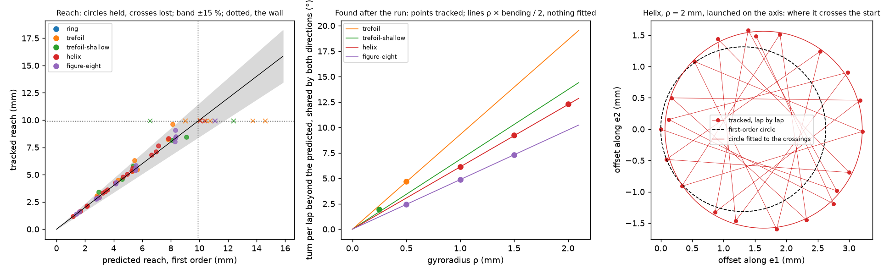

<!-- 2026-11-18. Experiment 1 of the particle work. Registered in commit 6c058df (protocol, predictions, criteria),
run once at that commit, output recorded in 85a3ff6. Code: experiments/guide_study.py on array16.lab and
array16.particles. Sections 1 to 4 report the registered test. Section 5 was worked out after the run and is
marked so. Not reviewed by anyone but its author. -->

# Experiment 1: is it the knot, or the twist?

The owner's idea is a field whose knotted shape holds a particle's path. The first run seemed to show it: a
solenoid wound on a trefoil knot held electrons and one wound on a ring lost them. That comparison was confounded
(`guide/PROTOCOL.md`, section 1). This experiment asks the question again with a theory that predicts the answer
first, five guides instead of two, and criteria fixed before the tracking.

## 1. Short answers

- **It is the twist, not the knot.** What holds an electron is that the guide's axis leaves the plane, so that a
  frame carried round it comes back turned. A knot does that. So do a helix wound on a torus and a figure-eight
  with its strands lifted apart, neither of them knotted, and both held more than the trefoil did.
- **A flat ring holds nothing.** All ten electrons sent round it were lost, each within 0.03 lap of the lap
  the theory named.
- **The unknotted helix was the best guide tried.** Launched on the axis it held gyroradii up to 2 mm, where the
  trefoil held 0.5 mm and lost 1 mm: four times the gyroradius, sixteen times the energy. Launched on its closed
  orbit it held 3 mm, the largest tried (317 eV at 20 mT in a bore of 9.9 mm).
- **The first-order theory is a good design tool and an imperfect law.** It called held or lost correctly in 92
  cases of 93 and the reach within 15 % in 54 of 55, usually within 5 %. It failed its registered test on the
  turn per lap: 7 fits of 22 were off by more than the 8° allowed, by up to 16.5°.
- **What it missed looks like one term.** Read after the run, the part of the error that both directions of
  travel share is ρ × (the curve's bending) / 2 to within 2 % on seven of eight pairs, with nothing fitted. That
  is now a hypothesis (GDE-H2), not a result.
- **Bending is where a knot pays.** A knotted curve's total curvature exceeds 4π (Fáry and Milnor [4]), so its
  bending exceeds 16π² over its length, four times a circle's (proved from that in Lean: ledger CUR-2). An
  unknot has no such floor.

## 2. The verdicts

132 electrons were tracked, all at the registered commit; 10 more had nowhere to start, their closed orbit lying
outside the wall. Every comparison is in `guide/results.md`.

| | Criterion | Passed | Verdict |
| --- | --- | --- | --- |
| C1 | Reach within 15 % + 0.1 mm, for shots predicted well inside | 54 of 55 | fails by one shot |
| C2 | Held or lost as predicted | 92 of 93 | fails by one shot, the same one |
| C3 | Fitted closed orbit within 15 % + 0.1 mm of the predicted | 21 of 22 | fails by one shot |
| C4 | Fitted turn per lap within 8° of the predicted | 15 of 22 | **fails** |
| C5 | A launch on the predicted closed orbit stays within 25 % + 0.1 mm of it | 26 of 34 | **fails** |
| C6 | The ring loses every electron, at the predicted lap | 10 of 10 | passes |
| C7 | C1 to C5 on the two unknotted guides | 123 of 131 | fails on C4, C5 and one fit of C3; passes C1 and C2 whole |
| C8 | The same gyroradius at twice the field gives the same orbit | 16 of 16 | passes |
| C9 | C1 to C5 on the shots sent against the field | 82 of 83 | fails by one fit (8.1° against 8°) |
| C10 | The instrument made finer changes nothing | 6 of 6 | passes |
| C11 | The first run's table, reproduced by this tracker and by the theory | 24 of 24, 23 of 23 | not a test |

The protocol said what each failure would mean. This is the case it describes as "the first order is right and its
range is shorter than assumed", with one addition: the turn per lap is wrong even at the smallest gyroradii, by
a few degrees that do not shrink with it.

## 3. What held

- **The ring.** Lost at laps 3.2 to 0.5 for gyroradii 0.5 to 3 mm, within 0.03 lap of the prediction, both ways
  round. With no turn every lap adds the same drift (GDE-6), and nothing was found to contradict it.
- **Every guide that leaves the plane held electrons**, and what each held scaled with the gyroradius as the
  theory says. Tracked reach per millimetre of gyroradius, launched on the closed orbit and sent along the field,
  at 1 mm and above: 2.8 mm on the helix and the figure-eight, 6.3 mm on the trefoil. So in the same bore the two unknots hold 2.3 times the gyroradius the
  trefoil does, five times the energy.
- **The closed orbit is where the theory puts it, and on the other side for the other direction.** For
  example on the trefoil at 0.5 mm: predicted 1.48 mm one side, fitted 1.67 mm; sent backwards, predicted
  2.67 mm the other side, fitted 2.61 mm.
- **Only the gyroradius matters.** At 40 mT and four times the energy every orbit repeated its 20 mT twin within
  3 % in reach and 2° in turn. Halving the time step, doubling the points on the curve and doubling the
  filaments per turn each changed the reach by less than 1 %, and sixty laps gave the reach of twenty to a
  micrometre.
- **The first run is explained.** The new tracker reproduces all 24 cases of its table, and the theory, with
  the single-wire winding's net current included, gets the 23 it judges.

## 4. What failed

- **The turn per lap (C4).** The fitted turn differs from the curve's holonomy by +11° on the trefoil at 0.5 mm,
  and by +11.5°, +14.1° and +16.5° on the helix at 1, 1.5 and 2 mm, sent along the field. Sent against it the
  differences are smaller, −2° to +8°. The 40 mT repeats give the same numbers to a tenth of a degree, so this is
  the physics and not the instrument.
- **Launches on the closed orbit (C5).** Eight strayed further than allowed, by 0.4 to 1.2 mm; six of the eight
  are one shot and its repeats, the trefoil at 1 mm. These are C3's
  errors seen twice as large: an orbit launched a distance d from the true closed orbit circles it and reaches
  2d from where it started. The registered tolerances were inconsistent here, C5 being twice as strict as C3.
- **One electron lost that should have been held (C1, C2).** The shallow trefoil turns the plane by only 52° a
  lap, which puts its closed orbit far out: 5.9 mm predicted at 0.5 mm. The true one is further still, and the
  electron launched on the predicted one reached the wall on its sixth lap.
- **One closed orbit out by 25 % (C3)**, the helix at 2 mm. The helix's net drift is a small difference of
  larger parts, which is why it holds so much, and also why a few percent of error in the parts shows as a
  quarter in the difference. The fitted closed orbit is further out than predicted for electrons sent along the
  field (by 13 to 28 %) and nearer for those sent against it (by up to 13 %) on both the trefoil and the helix.

## 5. Read after the run

**Everything in this section was found by looking at the results. None of it is a test.**
`experiments/guide_posthoc.py` writes `guide/posthoc.md` and the figure.

For each gyroradius at which both on-axis shots were held, split the two shifts of the turn into the part they
share and the part that changes sign with the direction of travel.

| Guide | ρ (mm) | Along the field | Against it | Shared | ρ × bending / 2 | Ratio | Reversing |
| --- | --- | --- | --- | --- | --- | --- | --- |
| figure-eight | 0.50 | +2.05° | +2.82° | +2.43° | +2.44° | 1.00 | −0.38° |
| figure-eight | 1.00 | +4.47° | +5.27° | +4.87° | +4.88° | 1.00 | −0.40° |
| figure-eight | 1.50 | +6.93° | +7.65° | +7.29° | +7.31° | 1.00 | −0.36° |
| helix | 1.00 | +11.52° | +0.75° | +6.14° | +6.13° | 1.00 | +5.38° |
| helix | 1.50 | +14.09° | +4.38° | +9.23° | +9.19° | 1.00 | +4.86° |
| helix | 2.00 | +16.55° | +8.07° | +12.31° | +12.25° | 1.00 | +4.24° |
| trefoil | 0.50 | +11.33° | −1.97° | +4.68° | +4.65° | 1.01 | +6.65° |
| trefoil-shallow | 0.25 | +3.07° | +0.83° | +1.95° | +1.72° | 1.13 | +1.12° |

- **The shared part is ρ × bending / 2**, where the bending is the squared curvature summed round the curve,
  `∮κ² ds`. It comes from the curve alone. The argument: the field of a bent guide weakens outward as
  `1/(1 + κx)`, so an electron further out on a bend has a larger gyroradius and a longer way round, and its
  drift per unit length of axis grows as `1 + κx`. That is a shear of the offsets, and half of a shear is a
  rotation: `ρκ²/2` per unit length, right-handed about the field whichever way the electron goes. An
  accelerator physicist would call it the guide's chromaticity: the turn per lap depends on the momentum.
- **The reversing part belongs to the coil.** It is near zero on the figure-eight and about +5° on the helix.
  Following the helix coil's own field lines for one lap, with no electron, they turn 5.8° more than the axis's
  holonomy, and the figure-eight's 0.3° less: the same numbers. So the field lines of a real winding do not
  turn by exactly the holonomy of its axis. On the two trefoils the same check did not come out clean (lines
  0.3 mm apart did not map linearly), and their +6.7° and +1.1° are unexplained.
- **The closed orbit's error is not yet accounted for.** The change of turn alone would move it the wrong way
  on the helix. The drift per lap must change at second order too.

## 6. What this means for a guide one could build

- **Choose the axis for its numbers, not its topology.** Three numbers from the curve decide: the turn per
  lap, which must be well away from zero; the net drift per lap, which sets where the closed orbit sits; and the
  bending, which sets how fast the turn moves with momentum. A knot is one way to get the first and it raises
  the third. In `array16.particles` all three are properties of a `ClosedCurve` and its `GuideOptics`, so any
  curve can be scored in milliseconds before a coil is wound or a run is made.
- **Rule of thumb from these runs.** An electron launched on the closed orbit stays within 2.8 gyroradii of
  the axis on the helix or the figure-eight, and within 6.3 on the trefoil. A bore of radius `a` therefore holds
  `Bρ` up to about `B·a/2.8`: 71 µT·m here, 440 eV, on the helix at 20 mT. Energy held goes as `(B·a)²`.
- **Mind the direction and the energy.** The closed orbit sits on opposite sides for the two directions of
  travel and moves outward in proportion to momentum. A beam that is accelerated walks outward as it gains
  energy unless the field rises with it.
- **Mind the resonances.** The turn moves by several degrees per millimetre of gyroradius. On the helix,
  electrons sent against the field pass through a turn of 120°, a third of a circle, near 1.3 mm. Nothing
  happened there in 20 laps. It was not looked for, and 20 laps is not long.

## 7. Limits

One electron at a time: no space charge, no collisions, no radiation. Filament windings without thickness, leads
or winding errors. A wall that is a distance, not a pipe. Twenty laps, sixty in two cases. The run kept to the
protocol. The one departure from doing things in order is stated in the protocol itself: one of these shots was
tracked for two laps in a timing test before the registration was committed.

## 8. Next

1. **Experiment 1b.** Put the second-order terms into the lap map: the turn as the field line's own plus
   ρ × bending / 2, and the drift to the same order. Register it. Test it on curves it has not seen, chosen to
   pull the terms apart, and for hundreds of laps across the 120° resonance.
2. **Search the curves.** With the theory scoring a curve in milliseconds, `array16.evolve` can look for the
   closed curve that holds the most in a given bore and length.
3. **Then the rest of the first run** on the same harness: the electric guides, cyclotron resonance and the
   ring of accelerating gaps, each with its predictions registered first.

## Sources

1. L. Spitzer Jr., "The Stellarator Concept," The Physics of Fluids 1(4), 253-264 (1958),
   doi:10.1063/1.1705883.
2. F. B. Fuller, "The Writhing Number of a Space Curve," Proceedings of the National Academy of Sciences 68(4),
   815-819 (1971), doi:10.1073/pnas.68.4.815.
3. S. R. Hudson, E. Startsev, E. Feibush, "A new class of magnetic confinement device in the shape of a knot,"
   Physics of Plasmas 21, 010705 (2014), doi:10.1063/1.4863844.
4. J. W. Milnor, "On the Total Curvature of Knots," Annals of Mathematics 52(2), 248 (1950),
   doi:10.2307/1969467.
