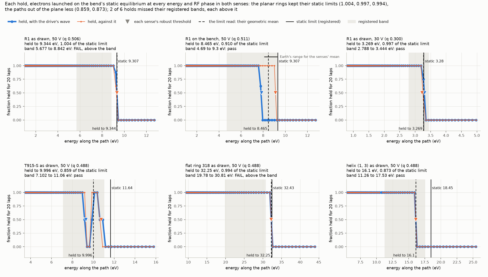
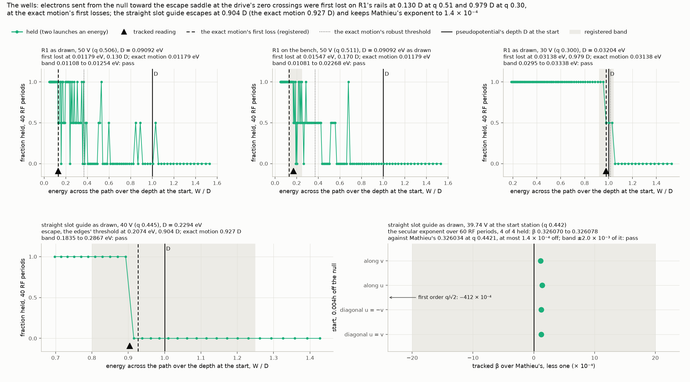
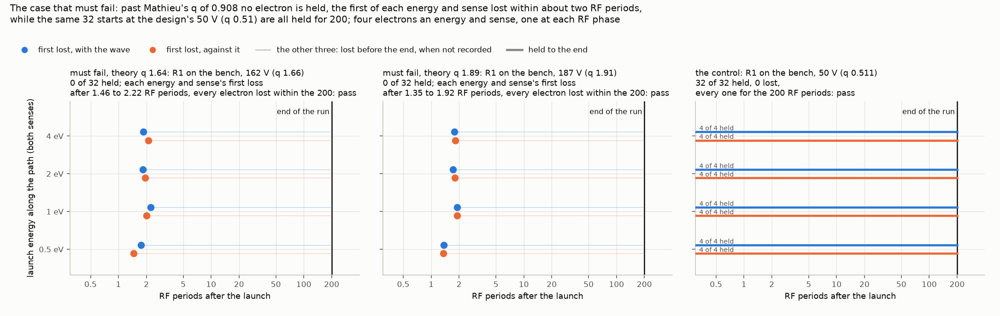
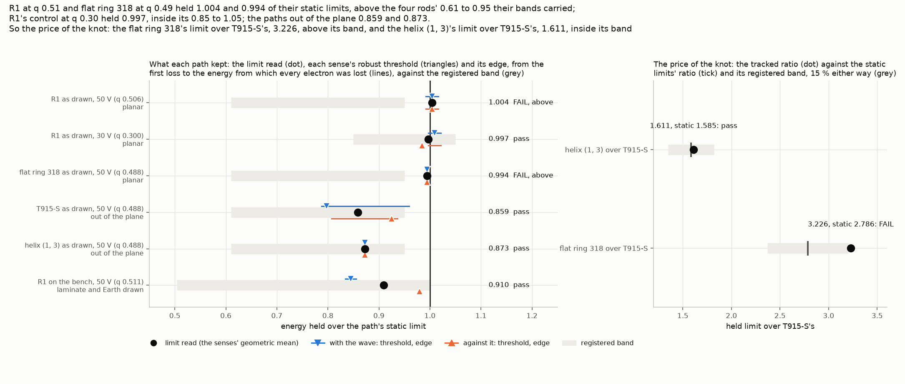
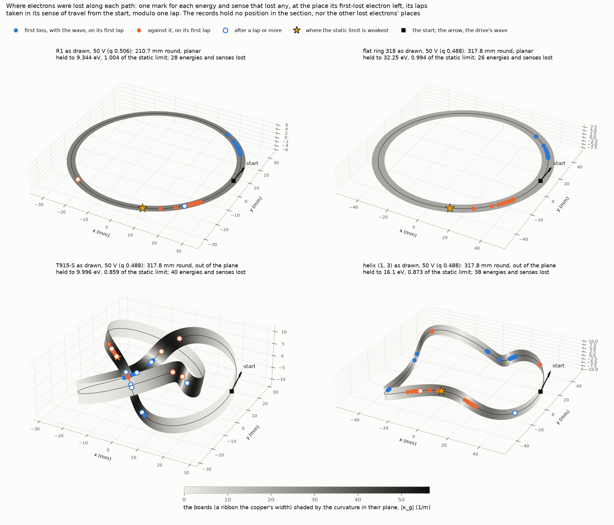
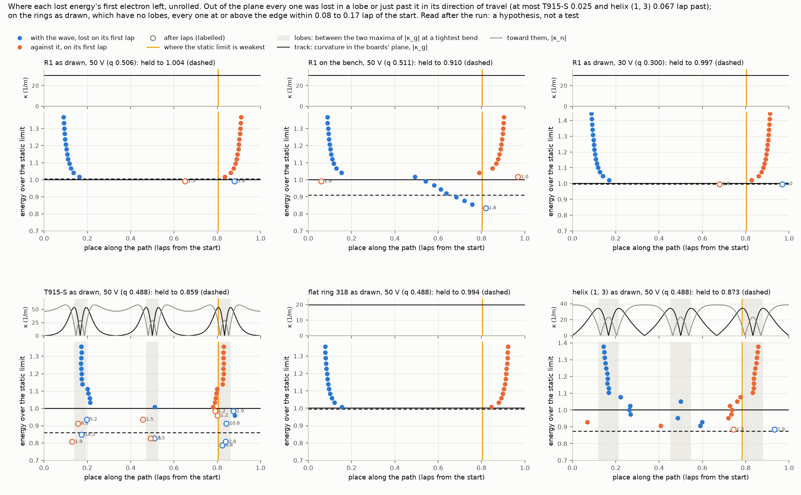

<!-- 2026-11-22. Experiment 2, stage 1. Registered in commit 3e2149f (PROTOCOL.md, predictions.json, predictions.md,
slot_straight.toml and experiments/twin_rung1.py with its criteria), run once at that commit on the bench twin-r1, its
records (runs.jsonl, results.json, results.md) committed in f17352b. The figures are drawn from those records alone by
experiments/twin_rung1_figures.py. Sections 1 to 5 report the registered test. Section 6 was read from the results
after the run, with theory computed afterwards to read them: Hypotheses, each with the stage-2 shot that tests it, not
results. -->

# Experiment 2, stage 1: the calibration rung on the twin bench. The report

Stage 1 is the first run that tracks electrons through the computed field of a design rather than an ideal one: each
design's cross-section solved by finite volumes, swept along its path and driven by its realised ring, on the twin bench
of `benches/twin_r1.toml`. Before stage 2's knots rest on that instrument, it was calibrated on cases the theory answers
(`PROTOCOL.md` section 1): R1's rails swept round a ring (E2-21), the flat ring and the (1, 3) helix against T915-S
(E2-22), the straight slot guide against its 2-D section, and a case that must fail.

## 1. Short answers

- **The instrument is calibrated where the theory is exact.** Electrons sent from R1's null toward its escape saddle
  were first lost at 0.01179 eV, the exact motion's own first loss on the solved axis (0.130 of the pseudopotential's
  depth, 0.0909 eV), and at q 0.30 at 0.03138 eV, again the exact motion's (0.979 of the depth). The straight slot
  guide, tracked in three dimensions, gave back Mathieu's secular exponent to a fraction 1.4 × 10⁻⁴ and escaped at 0.904
  of its section's depth (the exact motion: 0.927). Past Mathieu's q of 0.908 none of 64 electrons was held, while the
  same launch at the design's 50 V held 32 of 32.
- **The three planar rings held 0.994 to 1.004 of their static limits.** R1 as drawn held 9.344 eV against its static
  limit of 9.307 eV (1.004), the control at q 0.30 3.269 eV against 3.280 (0.997), and the flat ring of 318 mm 32.25 eV
  against 32.43 (0.994): the static balance computed on the solved section (JNT-2c), to within the scan's 2.5 % step. R1
  at q 0.51 and the flat ring, whose bands carried over the 0.61 to 0.95 of it that four rods kept, miss above those
  bands for that; the control lies inside its own, 0.85 to 1.05.
- **T915-S and the helix held 0.859 and 0.873 of theirs.** T915-S held 9.996 eV of its 11.64 and the (1, 3) helix
  16.10 eV of its 18.45, both inside their bands. With them the knot's price, the flat ring's limit over T915-S's, came
  to 3.226, where its static price is 2.786 and its band ends at 3.204: the third miss. The helix over T915-S, 1.611
  against 1.585, passes.
- **On the bench**, with FR-4's permittivity and Earth's field drawn, R1 held 8.465 eV, 7.860 with the drive's wave and
  9.116 against it, inside its band of 4.69 to 9.30 eV, the senses' split of 0.216 √eV inside the 0.670 allowed; its
  well first lost an electron at 0.01547 eV, inside the laminate's 0.01081 to 0.02268.
- **16 of 19 checks pass.** Two of the three misses read as `PROTOCOL.md` section 5 registered, so stage 2 registers
  E2-9 on the tracked fractions and designs T915-S on the tracked price, 10.2 eV per eV of its weakest depth, with the
  flat ring's 33 eV per eV as its ceiling. The third, R1's hold, met its static balance, where the reading registered
  for a high result had the static balance understate the hold (section 5).
- **Read after the run, kept as Hypotheses** with the stage-2 shots that would test them (section 6): leaving the plane
  costs about 14 % of the static limit, knotted or not (H1); under T915-S's 0.86 lie a band of energies lost late, from
  0.79 of its limit, and an edge at 0.94 to 0.96, and its senses differ only where the protocol's window reads that band
  with two electrons an energy (H2); out of the plane the first-lost electron of each energy and sense left in or just
  past a lobe where the bend in the boards' plane is tightest (H3); and the bench departs from R1 as drawn by the
  laminate's shift of its band and by Earth's field as drawn alone, 30.0 µT along R1's axis and 40.0 µT in its plane,
  the static balance with that field, computed afterwards and scaled to the bench's band, coming within 0.1 % of the
  senses' mean and within a sixth of their split (H4).

## 2. What was registered, and when

Stage 1 was registered on 2026-11-22 in commit 3e2149f: `PROTOCOL.md`, `predictions.json`, `predictions.md` and
`slot_straight.toml` here, with `experiments/twin_rung1.py`. The protocol was written before any shot was tracked and
revised the same day on reviews of its physics and of its gates, still before any was tracked (its section 6 lists what
was run or known). `array16.lab` refuses to measure until those files are committed and stores with every measurement
the commit it was registered at; `twin_rung1.py run` refuses while `predictions.md` is not what the code predicts. The
numbers that decide the verdicts are constants at the head of the script, in the same commit: the tracked fraction of a
static limit `DISCOUNT` = 0.61 to 0.95, the controls' `CONTROL_BAND` = 0.85 to 1.05, the ratios' `RATIO_TOL` = 15 %, the
slot depth's `WELL_BAND` = 0.80 to 1.25, the wells' `WELL_STEPS` = 2 scan steps, `BETA_TOL` = 2 × 10⁻³,
`SENSE_STEPS` = 2, `LAMINATE_SDS` = 3 and a threshold's `WINDOW` of 5 energies.

The rung stands on stage 0's instruments (commit 60e6235, its CI fixed in 3b878fa): the finite-volume sections, the ring
model with its compiled feeds and the multipactor instrument (`array16/guide/`), the section swept along a path
(`array16/particles/sections.py`), the twin bench (`array16/twin/`), the design files (`designs/`) and the bench file.
Stage 0's full-wave run (`experiments/twin_openems_line.py`) modelled R1's section on a backed board, a ground plane
under the laminate and via walls holding the strip at ground, its ring 197.4 mm round on that board's even-mode index;
closed into a ring there, R1's two rails resonated apart, at 899 and 962 MHz. Hypothesis (`docs/KNOTTED_GUIDE.md`
section 3.6): the one-board ring takes bridges across its strip, or compiled feeds, to hold its rails in phase. E2-21
was therefore registered as a statement about R1's section swept round a ring with an ideal in-phase drive, the
single-mode ring's, not about R1 as built (`PROTOCOL.md` section 7). The unbacked board as R1 draws it, 210.7 mm round,
is the next full-wave ring.

**A correction to the protocol's section 7**, which stays as it was registered. It argues that the rails part on the
unbacked board as drawn too because their coupling through the grounded strip is weak, quoting C₁₂/C₁₁ of −0.02 to
−0.055; those are the backed board's, with the laminate and in air. On the board as R1 draws it the rails couple more
strongly, C₁₂/C₁₁ −0.138 with the laminate and −0.118 in air (`experiments/twin_openems_line/results.json`). The
argument rests instead on `docs/KNOTTED_GUIDE.md` section 3.6's: on R1 as drawn the rails' centre lines differ in length
by ±2.8 %, more than its even and odd modes' indices differ (2.0 %) and than its linewidth (1/Q = 2.7 %), so the bend
mixes the two modes more strongly than the section separates them, and the rails part there too (a Hypothesis, which the
unbacked ring's full-wave run tests). E2-21, stated for the ideal in-phase drive, does not rest on it.

What was predicted, each from the solved sections and formulas with no electron tracked (`predictions.md`):

- **E2-21's wells**: the first loss of electrons sent from R1's null toward its escape saddle at the drive's zero
  crossings, at the energy where the exact motion on the solved axis first loses one in 40 RF periods (Claim, section
  2.1), as drawn, on the bench, and at q 0.30, the control.
- **E2-21's holds**: what R1 holds for 20 laps round its bend against its static limit (Claim JNT-2c, the static balance
  on the solved section, section 2.2): 0.61 to 0.95 of it at 50 V (a Hypothesis, four rods' discount carried to rails,
  with the zone under the null where the local q passes 0.908 named as a competing cause), 0.85 to 1.05 at q 0.30 (the
  control), and on the bench a band widened for Earth's field and the laminate; the two senses within two scan steps as
  drawn, and on the bench split by no more than Earth's most (section 2.3).
- **E2-22**: the flat ring, the helix and T915-S each within 0.61 to 0.95 of its static limit, and the ratios of their
  limits within 15 % of their static limits' (the Hypothesis of section 2.2, the price of the knot).
- **The slot guide**: Mathieu's exponent β = 0.326034 at its null's q at the start station, 0.4421 (Proposition, section
  2.4), and its escape within 0.80 to 1.25 of its section's depth.
- **The case that must fail**: past q = 0.908 no well (Proposition), so none held at 162.4 V (q 1.64) or 187.0 V
  (q 1.89), beside a control at 50 V that holds every electron (Claim).

## 3. What ran

One run, at commit 3e2149f with a clean tree (every record's `dirty` is false and its `registered` commit is the one it
ran at), on the bench `twin-r1`: the guide `array16.twin:TwinGuide` on `designs/r1_rail_ring.toml` at realisation 1, the
detector `TwinDetector` (pickups at 0 and 0.25 lap, a 1 pF collector), the vacuum `TwinVacuum` at 10⁻⁶ mbar, and the
radio's `SimBackend` unused; the shots marked as drawn opened their design at realisation 0 beside the bench's guide,
sharing its cache of solved sections. Ten workers, on Darwin arm64 with Python 3.14.10 and numpy 2.5.5.

The 14 shots ran one after another from 17:32:55 to 19:37:36 UTC on 2026-11-22, 2 h 4 min 41 s, their own times adding
to the same 7481 s: R1's three holds 2200, 2228 and 2149 s (1 h 50 min; the protocol estimated about 100 minutes), the
holds of T915-S, the flat ring and the helix 362, 221 and 291 s (a quarter of an hour, as estimated), the wells, the
secular frequency and the must-fail shots 30 s together. They launched 6172 electrons: 280, 280 and 172 in the wells,
1664, 1664 and 1200 in R1's holds, 248, 252 and 252 in E2-22's, 4 and 60 in the slot guide, and 32 in each must-fail
shot and in the control. The gas stopped 47 of the holds' 5280 electrons (0.4 to 2.0 % a hold), counted apart; every
other electron of a hold either made its 20 laps or was lost before them.

Integrity, as `results.md` states it: 14 of 14 shots on file; the predictions file is what the code predicts; no record
made before registration, from other predictions or from uncommitted code; one commit and one bench.

**Done differently from the protocol.** The holds ran the steps `run_steps` gives on the ring's unrounded length, which
differ by one or two from the counts printed in section 4's table: 795 484 against 795 486 on R1 as drawn, 889 378
against 889 380 at q 0.30, and 641 463, 389 357 and 511 712 against 641 462, 389 356 and 511 711 on T915-S, the flat
ring and the helix. The table was computed from the predictions' lengths, rounded to six figures; the difference is
3 × 10⁻⁶ of a run, inside its 2 % margin. The bench's hold ran 791 273 steps, the same 20.4 laps at 1 eV at its own
tuned band. Nothing else departs from the protocol.

**The model** is the protocol's (section 7): the section quasi-static and swept along the path, its null where the 2-D
solve puts it, the magnetic field the wave's T × E/v; R1's ring one line mode with both rails driven alike; one electron
at a time; copper with no charge of its own and no secondary emission, so that E2-21 tests holding at a drive at which
MPC-3 reads R1's bare copper to multipact (−5.22 dB at level 1), which stage 2's tracking with secondary emission
settles; the gas one cross-section at every energy.

## 4. The verdicts

Every check of `PROTOCOL.md` section 5, as `results.json` records it. Energies are along the path for a hold and across
it for a well; a hold's limit is its two senses' robust thresholds' geometric mean, its fraction that over its static
limit. The slot guide's q is at its mean 40 V, and its secular exponent is read at the start station's 39.74 V, where
its q is 0.4421.

| Criterion | Shot | Registered | Band | Found | Verdict |
| --- | --- | --- | --- | --- | --- |
| E2-21 well | R1 as drawn, 50 V (q 0.51) | first loss 0.01179 eV, the exact motion's (0.130 D) | 0.01108 to 0.01254 eV | 0.01179 eV | pass |
| E2-21 well | R1 on the bench, 50 V (q 0.51) | the same; 0.0115 to 0.0213 eV over the laminate's ±3 sds | 0.01081 to 0.02268 eV | 0.01547 eV | pass |
| E2-21 well control | R1 as drawn, q 0.30 (29.68 V) | first loss 0.03138 eV, the exact motion's (0.979 D) | 0.0295 to 0.03338 eV | 0.03138 eV | pass |
| slot depth | slot guide, 40 V (q 0.445) | its depth 0.2294 eV; the exact motion 0.927 D | 0.1835 to 0.2867 eV | 0.2074 eV, 0.904 D | pass |
| slot secular frequency | slot guide, 39.74 V at the start station | Mathieu's β 0.326034 at q 0.4421 | 0.325382 to 0.326686, all held | 0.326070 to 0.326078, 4 of 4 held | pass |
| E2-21 hold | R1 as drawn | 0.61 to 0.95 of the static limit 9.307 eV (Hypothesis) | 5.677 to 8.842 eV | 9.344 eV, 1.004 | **FAIL**, above |
| E2-21 senses | R1 as drawn | the senses within two scan steps | 2 steps | 0.0 steps | pass |
| E2-21 hold | R1 on the bench | 0.61 of Earth's least mean to 0.95 of its most, ±3 sds | 4.69 to 9.30 eV | 8.465 eV, 0.910 | pass |
| E2-21 senses | R1 on the bench | \|√W₋ − √W₊\| within Earth's most and two steps | 0.670 √eV | 0.216 √eV | pass |
| E2-21 hold control | R1 as drawn, q 0.30 | 0.85 to 1.05 of the static limit 3.280 eV | 2.788 to 3.444 eV | 3.269 eV, 0.997 | pass |
| E2-21 senses | R1 as drawn, q 0.30 | the senses within two scan steps | 2 steps | 1.0 step | pass |
| E2-22 static limit | T915-S | 0.61 to 0.95 of 11.64 eV | 7.102 to 11.06 eV | 9.996 eV, 0.859 | pass |
| E2-22 static limit | flat ring 318 | 0.61 to 0.95 of 32.43 eV | 19.78 to 30.81 eV | 32.25 eV, 0.994 | **FAIL**, above |
| E2-22 static limit | helix (1, 3) | 0.61 to 0.95 of 18.45 eV | 11.26 to 17.53 eV | 16.10 eV, 0.873 | pass |
| E2-22 price of the knot | flat ring over T915-S | the static limits' ratio 2.786, ±15 % | 2.368 to 3.204 | 3.226 | **FAIL**, above |
| E2-22 price of the knot | helix over T915-S | the static limits' ratio 1.585, ±15 % | 1.347 to 1.822 | 1.611 | pass |
| must fail control | R1 on the bench, 50 V (q 0.51) | every electron held for 200 RF periods | none lost | 32 of 32 held | pass |
| must fail | R1 on the bench, 162.4 V (q 1.66) | no well past q 0.908: none held | none held, beside the control | 0 of 32 held | pass |
| must fail | R1 on the bench, 187.0 V (q 1.91) | the same | none held, beside the control | 0 of 32 held | pass |

By test: E2-21 8 of 9, E2-22 3 of 5, the slot guide 2 of 2, the case that must fail 3 of 3.

**The holds** (`holds.png`). R1 as drawn held every electron, bar those the gas stopped, up to 9.004 eV in both senses,
7 of 8 with the wave and 5 of 8 against it at 9.229 eV, and none from 9.460 eV up: an edge between 0.992 and 1.016 of
its static limit, the same in both senses. At q 0.30 the edge lies between 3.269 eV (6 of 8 and 3 of 8 held) and
3.350 eV (none), 0.997 to 1.022 of its limit, and on the flat ring between 31.86 and 32.65 eV, 0.982 to 1.007. The helix
held every electron the gas left up to 15.90 eV and none from 16.30 eV, 0.862 to 0.883 of its limit, in both senses.
T915-S lost electrons from 9.169 eV with the wave and 9.398 eV against it, held every one again at 10.12 and 10.37 eV,
and lost every one from 11.17 eV with the wave and 10.90 eV against it; the protocol's window read 9.282 and 10.76 eV,
and 9.996 eV between them. On the bench the two senses parted: with the wave every electron was lost from 7.958 eV,
against it from 9.229 eV.

**The wells** (`wells.png`). On R1's rails at q 0.51 electrons were lost in islands of energy from 0.130 of the depth,
as the exact motion said, and the tracked robust threshold, which no criterion judged, is the exact motion's too:
0.03367 eV as drawn, 0.03256 eV at q 0.30. At q 0.30 the escape came at the depth, 0.979 of it. On the bench the first
loss moved to 0.01547 eV and the robust threshold to 0.01728 eV. The slot guide held every electron up to 0.2048 eV and
none from 0.2099 eV, and its four electrons' exponents lie a fraction 1.1 to 1.4 × 10⁻⁴ above Mathieu's (3.6 to
4.4 × 10⁻⁵ in β), where the first order's lies 4.1 % below.

**The case that must fail** (`must_fail.png`). On the bench's band, 0.53 % under the design's, the volts set for a 1 eV
well (q 1.64) and for q 1.89 put the null at 1.66 and 1.91. Every one of 32 electrons was lost in both shots. The record
keeps each energy and sense's first loss, after 1.46 to 2.22 RF periods at q 1.66 and 1.35 to 1.92 at q 1.91 (the "last
lost after 2.2 RF periods" of `results.md` is the latest of these first losses), and of the other 24 electrons of each
shot that each was lost within the 200 RF periods. The control's 32, launched alike at 50 V, were all held for the 200.

**What each path kept** (`fractions.png`): the three planar rings 0.994 to 1.004 of their static limits, the two paths
out of the plane 0.859 and 0.873, R1 on the bench 0.910 of its as-drawn limit.

## 5. What the misses mean

Two of the misses read as `PROTOCOL.md` section 5 registered before the run; the third, R1's hold, met the static
balance rather than exceeding it, so the reading registered for a high result holds there only in sign:

- **E2-21 hold, R1 as drawn, above its band.** Section 5 registered for it: "High: the static balance understates the
  hold." The hold met the static balance instead: its edge lies between 0.992 and 1.016 of the static limit, and its
  limit, 1.004 of it, within a sixth of a scan step. What the miss refutes is the Hypothesis carried from four rods,
  that the rails at q 0.5 keep 0.61 to 0.95 of their static limit, and with it the competing cause the protocol named:
  the zone 0.19h under the null where the local q passes 0.908 set no aperture below the fold for an electron launched
  on its equilibrium with its micromotion matched. The control is in (0.997 at q 0.30, inside 0.85 to 1.05), so the
  reading is not the tracker's or the static computation's fault: R1's rails on a planar ring kept their whole static
  limit at q 0.51 and at q 0.30, not four rods' 0.61 to 0.95 of it. What T915-R, rails following T915-S's trefoil out of
  the plane, keeps of its static limit waits on stage 2's shots for H1 (section 6), the paths out of the plane here
  having kept about 0.86 of theirs.
- **E2-22 static limit, the flat ring, above its band.** Section 5: "JNT-2c's discount does not hold for facing boards
  on that path; E2-9 is then registered on the tracked fraction." The flat ring kept 0.994 of its static limit, so E2-9,
  stage 2's tracking of facing boards, is registered on this rung's tracked fractions: 0.994 for the flat ring, 0.859
  for T915-S and 0.873 for the helix, not on 0.61 to 0.95.
- **E2-22 price of the knot, the flat ring over T915-S, above its band.** Section 5: "the knot costs more than its
  static price, the turning of its curvature through the frame, not only its tightest point, setting what it holds;
  stage 2 then designs T915-S on the tracked price and the flat ring's 33 eV per eV is its ceiling." The tracked price,
  3.226, is 1.16 times the static 2.786 and lies 0.7 % above the band's top. Stage 2 designs T915-S on it: 9.996 eV held
  on its weakest depth of 0.979 eV, 10.2 eV per eV, against the flat ring's 33.0 tracked and 33.1 static.

The passes mean, by the same section, that nothing else falls with the misses: the well control's pass says the tracker
feels the pseudopotential's depth at q 0.30 in the swept field; the 50 V wells', that it follows the exact motion where
it is resonant; the senses' as drawn, that nothing but Earth's field tells R1's senses apart; the slot guide's, that
stage 3's predictions on S2-C3 can rest on this instrument; and the must-fail shots beside their control, that no sign
error, field scaled wrong or grid that loses everything is at work.

## 6. Read after the run

**Everything in this section was found by looking at the results. None of it is a result: each item is a Hypothesis, and
each names the stage-2 shot that would test it, to be registered before it is run.** `along.png` and `paths.png` carry
it; their numbers come from the committed records through `experiments/twin_rung1_figures.py`, and
`tests/test_twin_rung1_figures.py` holds them there. H4's theory numbers were computed after the run with
`twin_rung1.theory` and `twin_rung1.ring_limit` on R1 as drawn, with no electron tracked.

**H1, the plane.** Hypothesis: a path in a plane holds its static limit, a path out of it about 0.86 of its own, knotted
or not, so leaving the plane costs about 14 % of the static limit, and the knot's price follows: its static price over
that fraction, 2.786/0.86 = 3.24 against the flat ring (tracked 3.226), while against another path out of the plane a
knot pays only its static price (the helix over T915-S: 1.585 static, 1.611 tracked). It rests on three planar holds on
two sections and three drives (R1 at q 0.51, 1.004; at q 0.30, 0.997; the flat ring at q 0.49, 0.994) and two holds out
of the plane on one section and drive (T915-S 0.859, the helix 0.873). In this rung every planar path is a circle and
every path out of the plane bends by a changing amount, so two rivals read the same numbers:

- H1a, the changing bend: an electron launched on its static equilibrium stays on it while the bend's force is constant,
  as round a circle; where the force turns or changes along the path, the equilibrium moves under it, and near the fold,
  where the well is shallow and its secular frequency low, the swing that follows takes it out. A planar path whose
  curvature changes would then lose like a knot.
- H1b, the stiff side: T915-S's 9.996 eV and the helix's 16.10 eV lie 2.0 % and 0.1 % above the bounds the protocol
  computed with every bend counted across the boards' plane (9.80 and 16.08 eV, section 2.2), as if the boards' stiff
  side, 5.42 D/h toward them at the local q's limit 0.495h from the null, gave a bend nothing once it is tracked.

The stage-2 shots that tell them apart, at section B and 50 V: a planar path in the boards' plane whose curvature
changes, an ellipse of 318 mm whose tightest radius is T915-S's in-plane 18.57 mm (H1 holds its static limit, H1a about
0.86 of it); the flat ring of 318 mm bent toward its boards, the strips two coaxial cylinders with the gap radial,
planar and of constant curvature with its bend wholly on the stiff side (H1 holds its static limit, about 4.5 times the
flat ring's 32 eV from the strengths 5.42 and 1.199 D/h; H1b about the flat ring's own 32 eV); and the (1, 3) helix at
r/R = 0.1 and 0.3 beside 0.2 (H1 keeps 0.86 at each; H1a moves with how fast the bend turns).

**H2, under T915-S's 0.86, and its senses.** From the record (`holds.png`, `fractions.png`): T915-S lost electrons in a
band of energies below its edge, from 9.169 eV with the wave (0.787 of its static limit) and 9.398 eV against it
(0.807); both senses lost every electron at 9.398 and 9.633 eV and held every one at 10.12 and 10.37 eV; and both lost
every electron from their edges, 11.17 eV with the wave (0.959) and 10.90 eV against it (0.936), a step apart. The
band's first losses came late, after 1.9 to 14.2 laps (the open marks of `along.png`), those at and above the edge
within two. The senses' robust thresholds, 9.282 and 10.76 eV, are six scan steps apart where R1's were 0 and 1 and the
flat ring's and the helix's 0: with two electrons an energy the window of five judges ten, and with the wave it falls
under half at 9.398 eV because one electron each at 9.169 and 9.873 eV was lost there that against it was held; against
it, it falls under half only at the edge. Hypothesis: the two senses do not differ on T915-S beyond that sampling, and
the band is a resonance of the electron's secular motion with the passing of the knot's three lobes (H3), which a hold
longer than 20 laps would show deeper. The shot: T915-S's hold at eight phases an energy, as R1's, at a scan ratio of
1.01 over 0.75 to 1.0 of its static limit, for 100 laps, both senses registered within two steps of each other and the
band at the same energies in both; and the same at q 0.30, where a resonance moves with the secular frequency to another
fraction of the static limit and an aperture does not.

**H3, where electrons leave.** The records hold no positions, but each energy and sense that lost electrons keeps the
laps of its first loss, and those laps, taken in its sense of travel from the start, place that electron along the path
(`paths.png`, `along.png`): 40 places on T915-S, which lost 75 electrons, and 38 on the helix, which lost 76. On T915-S
all 40 lie in one of the knot's three lobes, the stretches between the two maxima of the curvature in the boards' plane
that flank each tightest bend (0.1385 to 0.1948, 0.4720 to 0.5280 and 0.8052 to 0.8615 lap), or at most 0.025 lap past
one in the direction of travel; on the helix all 38 lie in its lobes or at most 0.067 lap past, 8 of them 0.050 to
0.067 lap past, at 16.30 to 18.90 eV, near its edge. Far above the edge it is the first lobe met, near and below the
edge later ones. The static limit's weakest place, 0.80 lap on T915-S and 0.78 on the helix, is at one of three lobes
the curve makes alike, the drive's 0.4 % ripple choosing among them. On the rings as drawn, which have no lobes, every
recorded first loss at or above the edge came 0.08 to 0.17 lap after the start, and the four below it after 1.3 to
4.0 laps. Hypothesis: out of the plane an electron near its limit is lost in or just past a lobe, downstream, where the
bend in the boards' plane is tightest. The shot: stage 2's twin records each lost electron's place along the path, its
position in the section as it leaves and its step (the twin's watch keeps the place and the step already), and a hold
out of the plane is registered to lose every electron below or near its edge within a lobe or less than 0.07 lap past it
in its direction of travel, none upstream. The band takes in both paths' places: the helix's first losses reach
0.067 lap past a lobe and T915-S's 0.025, so a band of 0.05 lap would already fail on the helix's; stage 2 judges it on
every lost electron, not only on each energy's first.

**H4, the bench: FR-4 and Earth on R1.** From the record: the bench's draw of FR-4's permittivity tuned R1 to
909.984 MHz, 0.53 % under the design's 914.827 MHz (0.62 of the laminate's sd of the band, 0.86 %), so at 50 V its
null's q was 0.511 for 0.506. Its well first lost an electron at 0.01547 eV for 0.01179 as drawn, inside the range the
exact motion gives over the laminate's ±3 sds, 0.0115 to 0.0213 eV. Its hold split, 7.860 eV with the wave and 9.116 eV
against it, and their geometric mean, 8.465 eV, lies inside Earth's registered range for the mean, 8.09 to 9.31 eV. The
realisation's draw follows from the design's seed and is read without tracking: Earth's field on the bench is (−29.37,
−27.10, −30.05) µT (`TwinGuide("designs/r1_rail_ring.toml", 1).drawn.earth`, z along the ring's axis), 30.0 µT along
R1's axis and 40.0 µT in its plane. By the Proposition of section 2.3 a field along the axis parts the senses' √W by
B_z·R·√(e/2m), 0.497 √eV for 50 µT, and leaves their geometric mean where it was: the drawn axial part alone would part
them by 0.299 √eV, and the split found, 0.216 √eV, is what 21.7 µT along the axis would give alone, so the part in the
plane enters the split too. Computed after the run from the theory alone, the static balance on R1 as drawn with the
drawn field (`ring_limit`) gives 7.65 eV with the wave and 9.15 eV against it; scaled to the bench's band as 1/f², the
pseudopotential's scaling at fixed volts (an estimate, taking the section's field as unchanged by the laminate's draw),
that is 7.73 and 9.25 eV, a geometric mean of 8.46 eV and a split of 0.26 √eV, where the tracking found 7.860, 9.116 and
8.465 eV and 0.216 √eV: the mean within 0.1 %, the split a sixth under. At the design's band the axial part alone gives
8.44 and 10.26 eV and the part in the plane alone 8.42 and 8.31 eV, against 9.307 eV with no field: the part in the
plane lowers both senses. With the wave, each energy's first loss from 7.958 to 9.460 eV came on the first lap, at 0.76
down to 0.49 lap, the place moving back toward the start as the energy rose. Hypothesis: the bench departs from R1 as
drawn by the laminate's shift of the band and by Earth's field as drawn alone, and its hold keeps the static balance
that band and field give, as the planar rings as drawn kept theirs: the part along the axis parts the senses, and the
part in the plane, which pushes the electron up from the board toward the rails' soft side (1.73 D/h) over half of each
lap, lowers both and narrows their split, an electron being lost where it first enters the arc in which that push leaves
no equilibrium; and the well's first loss is the exact motion's at the bench's own band. The shots: before any rerun,
the exact motion at the bench's band and the static balance on R1's section solved at the bench's own band (909.984 MHz,
its laminate as drawn), with realisation 1's drawn field, computed and registered as H4's predictions of the well's
first loss and of each sense's limit; then R1's hold and well on two variants of the bench's realisation, its Earth's
field set to zero (the laminate alone: the senses together, near 9.41 eV by the 1/f² estimate) and its laminate and
Earth's field as drawn (each sense as registered).

## 7. The records and the figures

`experiments/twin_rung1_figures.py` draws six figures from the committed records alone, with twin_rung1's own readings
of a scan, and the design files for the paths; it tracks nothing and solves nothing (`uv run python
experiments/twin_rung1_figures.py`, a few seconds):

- `holds.png`: each hold's fraction held against energy, both senses, the static limit, the band, each sense's robust
  threshold and the limit read.
- `wells.png`: each well's fraction held against energy over the depth, the exact motion's first loss and robust
  threshold and the band; the slot guide's four secular exponents against Mathieu's.
- `fractions.png`: what each path kept of its static limit, with each sense's threshold and edge, and the knot's price.
- `must_fail.png`: the must-fail shots' first losses against RF periods, beside the control.
- `paths.png`: R1, the flat ring, T915-S and the helix in three dimensions, the boards a ribbon of the copper's width
  shaded by the curvature in their plane, with the start, the static limit's weakest place, and where each lost energy's
  first electron left (H3).
- `along.png`: those places unrolled for every hold, against energy over the static limit, under the curvature in the
  boards' plane and toward them, with the lobes marked (H2, H3).

The records keep, for each shot, energy and sense, how many electrons were held, lost to the guide, stopped by the gas
or short of their laps, and the fewest laps (RF periods for a well or a must-fail shot) after which one was lost. So a
lost electron's place along the path is known for the first-lost electron of each energy and sense; where it left the
section, and the places and times of the others lost beside it, stage 2's records will hold (H3).

## 8. Next

Stage 2, on the same bench, with its predictions and criteria committed before any tracking (`docs/KNOTTED_GUIDE.md`
section 10):

1. E2-9 registered on this rung's tracked fractions, and T915-S designed on the tracked price (section 5).
2. The twin's records carrying each lost electron's place, section position and step (H3).
3. T915-S's hold at eight phases, a finer scan and 100 laps, and at q 0.30 (H2).
4. The ellipse, the flat ring bent toward its boards and the helix at r/R = 0.1 and 0.3 (H1), which also say what T915-R
   keeps out of the plane.
5. The exact motion and the static balance at the bench's own band with its drawn field, computed and registered, then
   R1 on the bench's two variants (H4).
6. Before any R1 prediction is used for hardware, the two-rail line matrices with the bridges' admittances in
   `array16.guide.ring` and `TwinGuide`, the unbacked R1 run in full wave, and the residual odd-mode field at the null
   registered as its own prediction (`PROTOCOL.md` section 7).

## Sources

1. `PROTOCOL.md`, `predictions.md`, `predictions.json`, `results.md`, `results.json` and `runs.jsonl` in this folder.
2. `docs/KNOTTED_GUIDE.md` sections 3.6, 6.1, 8 and 10: the one-board ring, the static balance (JNT-2c), the twin bench,
   and experiment 2; `experiments/twin_openems_line/`, the full-wave run of stage 0.
3. N. W. McLachlan, *Theory and Application of Mathieu Functions* (Oxford, Clarendon Press, 1947).
