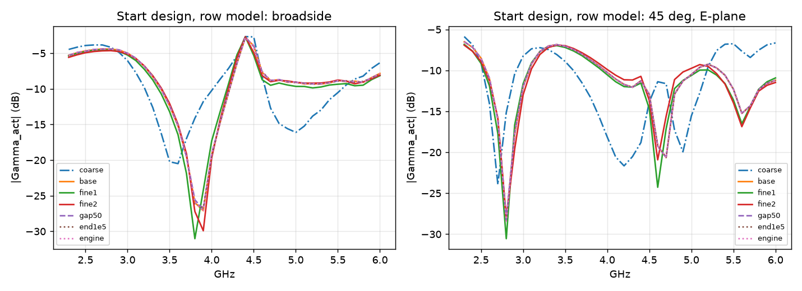
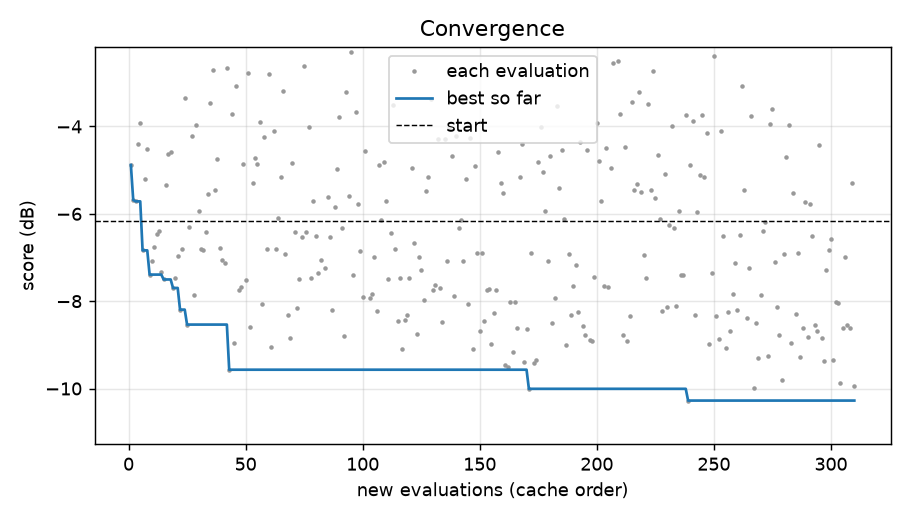
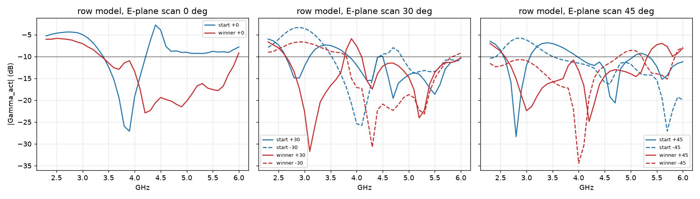
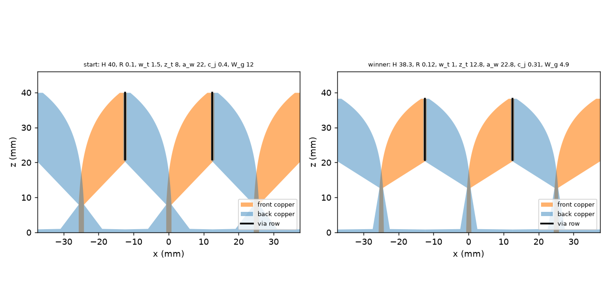
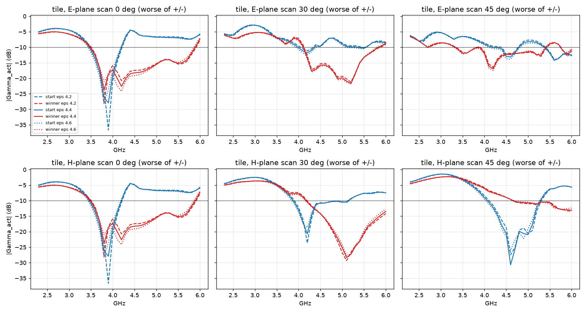
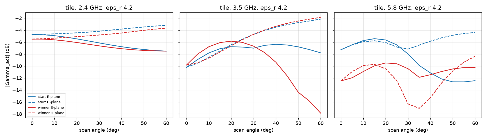
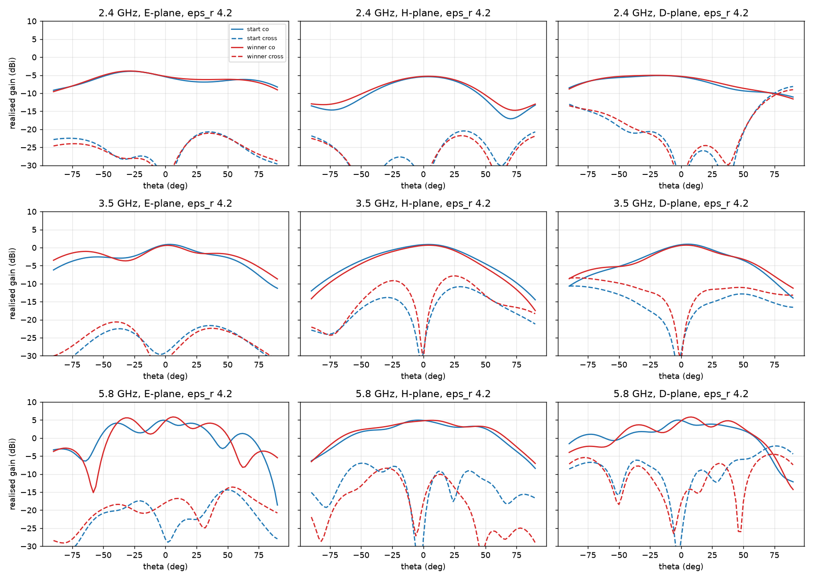

# Connected antipodal Vivaldi, openEMS: machine-written summary

Written by `experiments/vivaldi_openems.py report` on 2026-11-15 22:35 from the files in this folder. 334 evaluations in `evals.jsonl`.

Stages complete: validate yes, search yes, check yes.

Score = worst |Gamma_act| (dB) over 2.3-6 GHz and E-plane scan 0, +/-30, +/-45 deg + 0.3 x mean (dB) + manufacturing penalty. Lower is better. Reference: 50 ohm.

## Parameters

| Name | Meaning | Unit | Low | High | Start | Winner |
| --- | --- | --- | --- | --- | --- | --- |
| H | fin (card) height | mm | 35 | 45 | 40 | 38.3 |
| R | exponential opening rate of the flare | 1/mm | 0.02 | 0.3 | 0.1 | 0.12 |
| w_t | throat (parallel-strip) width | mm | 1 | 3 | 1.5 | 1 |
| z_t | height of the throat above the tile = length of the feed taper | mm | 3 | 15 | 8 | 12.8 |
| a_w | aperture width at the top | mm | 14 | 24 | 22 | 22.8 |
| c_j | start of the joined section, as a fraction of the flare length (z_j = z_t + c_j (H - z_t)) | - | 0.05 | 0.9 | 0.4 | 0.31 |
| W_g | width of the ground taper at the card foot | mm | 3 | 24.5 | 12 | 4.9 |

## Validation (starting design, row model, eps_r 4.4)

| Run | Mesh along card and z (mm) | Cells through laminate | Air to PML (mm) | Cells | Time steps | Wall (s) | Worst (dB) | Mean (dB) | Score |
| --- | --- | --- | --- | --- | --- | --- | --- | --- | --- |
| coarse | 0.500 | 2 | 30 | 784036 | None | 2.9 | -2.66 | -11.39 | -6.08 |
| base | 0.357 | 3 | 30 | 1718496 | 5394 | 8.3 | -2.79 | -11.27 | -6.18 |
| fine1 | 0.250 | 4 | 30 | 3607500 | 13840 | 22.3 | -2.71 | -11.60 | -6.19 |
| fine2 | 0.179 | 4 | 30 | 6731820 | 19850 | 55.1 | -2.67 | -11.39 | -6.08 |
| gap50 | 0.357 | 3 | 50 | 1881792 | 9570 | 9.9 | -2.77 | -11.26 | -6.15 |
| end1e5 (end 1e-5) | 0.357 | 3 | 30 | 1718496 | 19140 | 13.8 | -2.70 | -11.27 | -6.08 |
| engine (multithreaded) | 0.357 | 3 | 30 | 1718496 | 10585 | 66.0 | -2.79 | -11.27 | -6.17 |

| Check | Number | Limit | Result |
| --- | --- | --- | --- |
| Mesh: score, fine1 to fine2 | -0.11 dB | 1.0 dB | pass |
| Mesh: largest change of abs(Gamma_act), fine1 to fine2 | 0.042 | 0.08 | pass |
| Mesh: score, base to fine2 (the error of the search mesh) | -0.09 dB | reported | - |
| Mesh: largest change of abs(Gamma_act), base to fine2 | 0.073 | reported | - |
| Boundary: score, PML 30 to 50 mm away | -0.02 dB | 0.5 dB | pass |
| Boundary: largest change of abs(Gamma_act) | 0.004 | 0.05 | pass |
| End criterion 1e-4 to 1e-5: score | -0.10 dB | 0.5 dB | pass |
| End criterion: largest change of abs(Gamma_act) | 0.011 | 0.05 | pass |
| Passivity: largest abs(S) | 0.5821 | 1.005 | pass |
| Passivity: largest column power sum | 0.5679 | 1.005 | pass |
| Engine gpu against multithreaded: largest abs(dS) | 0.0013 | 0.02 | pass |
| Incident wave at the passive ports (should be 0) | 3.0e-03 | - | - |

**Model trustworthy by these gates: yes.**

Behaviour of the starting design on the fine1 mesh, for comparison with published arrays (sources and discussion in `../vivaldi_study.md`):

| Quantity | Model |
| --- | --- |
| Coupling to the adjacent cells, 2.3-6 GHz | -17.2 to -8.5 dB |
| Coupling to the cells two away | -20.6 to -11.0 dB |
| Passive S11 of the centre cell | -20.6 to -5.0 dB |
| Active VSWR at broadside: max, median, share of band below 2, below 3 | 6.46, 2.05, 34 %, 71 % |
| Active VSWR at 45 deg E-plane: max, median, share below 2, below 3 | 2.68, 1.75, 71 %, 100 % |
| Active VSWR at broadside at 2.3 and 6 GHz | 3.35, 2.29 |
| Share of the incident power radiated or lost in FR-4 (1 - column sum) | 0.44 to 0.88 |

## Search (row model, base mesh, eps_r 4.4)

310 distinct designs evaluated so far (planned: about 323 including finalists). Best score -10.28 against -6.18 for the start.

| Evaluations | Best score (dB) |
| --- | --- |
| 1 | -4.88 |
| 10 | -7.39 |
| 25 | -8.54 |
| 50 | -9.57 |
| 75 | -9.57 |
| 100 | -9.57 |
| 150 | -9.57 |
| 200 | -10.01 |
| 250 | -10.28 |
| 300 | -10.28 |
| 310 | -10.28 |

### Finalists, re-scored at both ends of the eps_r range (row model, base mesh)

| Design | H | R | w_t | z_t | a_w | c_j | W_g | Score eps 4.2 | 4.4 | 4.6 | Robust (worst of the three) |
| --- | --- | --- | --- | --- | --- | --- | --- | --- | --- | --- | --- |
| winner | 38.3 | 0.12 | 1 | 12.8 | 22.8 | 0.31 | 4.9 | -9.96 | -10.01 | -9.85 | -9.85 |
| finalist 2 | 41.1 | 0.09 | 1 | 12.8 | 20.1 | 0.17 | 4 | -9.81 | -9.98 | -10.24 | -9.81 |
| finalist 3 | 37.3 | 0.145 | 1 | 12.3 | 21.7 | 0.33 | 4 | -10.08 | -9.95 | -9.70 | -9.70 |
| finalist 4 | 38.8 | 0.115 | 1.05 | 14 | 21.6 | 0.28 | 4.4 | -10.42 | -10.28 | -9.47 | -9.47 |
| start | 40 | 0.1 | 1.5 | 8 | 22 | 0.4 | 12 | -6.38 | -6.18 | -5.97 | -5.97 |

Winner = best robust score. 

| Parameter | Start | Winner | Change |
| --- | --- | --- | --- |
| H (mm) | 40 | 38.3 | -1.7 |
| R (1/mm) | 0.1 | 0.12 | +0.02 |
| w_t (mm) | 1.5 | 1 | -0.5 |
| z_t (mm) | 8 | 12.8 | +4.8 |
| a_w (mm) | 22 | 22.8 | +0.8 |
| c_j (-) | 0.4 | 0.31 | -0.09 |
| W_g (mm) | 12 | 4.9 | -7.1 |

### Active reflection per frequency, row model (dB)

| GHz | start 0 | start +30 | start -30 | start +45 | start -45 | winner 0 | winner +30 | winner -30 | winner +45 | winner -45 |
| --- | --- | --- | --- | --- | --- | --- | --- | --- | --- | --- |
| 2.3 | -5.3 | -6.0 | -7.9 | -6.5 | -10.4 | -6.1 | -6.7 | -9.0 | -7.0 | -11.6 |
| 2.5 | -4.7 | -7.3 | -6.1 | -8.5 | -9.0 | -5.9 | -8.0 | -8.2 | -8.8 | -12.2 |
| 2.7 | -4.4 | -11.7 | -4.0 | -15.9 | -6.5 | -6.1 | -11.0 | -7.2 | -12.2 | -11.1 |
| 2.9 | -4.5 | -14.9 | -3.3 | -17.8 | -5.8 | -6.7 | -17.3 | -6.7 | -18.9 | -10.7 |
| 3.1 | -5.7 | -9.9 | -4.2 | -9.2 | -6.9 | -7.8 | -31.7 | -7.0 | -21.4 | -11.6 |
| 3.3 | -8.3 | -7.6 | -6.3 | -7.0 | -8.6 | -9.4 | -20.5 | -7.9 | -17.2 | -13.5 |
| 3.5 | -12.4 | -7.5 | -9.6 | -7.0 | -10.0 | -11.5 | -16.7 | -8.8 | -15.8 | -15.8 |
| 3.7 | -19.5 | -8.5 | -14.1 | -8.0 | -10.8 | -12.9 | -13.6 | -9.1 | -15.1 | -17.0 |
| 3.9 | -27.1 | -10.5 | -20.8 | -9.4 | -11.3 | -11.0 | -5.9 | -15.0 | -10.8 | -22.2 |
| 4.1 | -14.8 | -13.7 | -25.8 | -11.1 | -11.8 | -17.3 | -10.1 | -17.3 | -16.7 | -30.4 |
| 4.3 | -6.4 | -15.4 | -15.1 | -12.1 | -12.7 | -22.4 | -17.5 | -30.7 | -20.8 | -14.9 |
| 4.5 | -3.9 | -9.9 | -9.4 | -12.9 | -15.9 | -19.4 | -12.2 | -20.9 | -14.4 | -12.1 |
| 4.7 | -8.8 | -19.6 | -8.0 | -20.6 | -13.9 | -20.2 | -11.5 | -22.3 | -13.0 | -10.6 |
| 4.9 | -9.1 | -15.1 | -10.8 | -11.3 | -11.3 | -21.5 | -13.2 | -19.4 | -13.5 | -9.0 |
| 5.1 | -9.3 | -13.7 | -13.9 | -9.6 | -13.0 | -18.6 | -17.6 | -19.4 | -14.6 | -8.7 |
| 5.3 | -9.3 | -15.4 | -13.2 | -9.7 | -14.2 | -16.2 | -22.3 | -23.2 | -10.5 | -12.1 |
| 5.5 | -8.8 | -18.7 | -13.4 | -12.3 | -15.4 | -17.6 | -13.7 | -15.0 | -7.3 | -14.0 |
| 5.7 | -8.9 | -12.8 | -10.8 | -14.3 | -27.1 | -16.8 | -11.4 | -11.5 | -7.7 | -15.2 |
| 5.9 | -8.4 | -11.0 | -10.9 | -11.6 | -19.3 | -12.1 | -11.1 | -9.7 | -9.3 | -8.6 |

## Check

Tile model: finite 6 x 6, mesh 0.312 mm, element (card 2, cell 2) excited, inner 4 x 4 driven for the active reflection, scan 0, +/-30, +/-45 deg.

| Model | Design | eps_r | Worst E-plane (dB) | Mean E (dB) | Score E | Worst E+H (dB) | Score E+H | Worst at |
| --- | --- | --- | --- | --- | --- | --- | --- | --- |
| row, base mesh | start | 4.2 | -3.01 | -11.20 | -6.38 | - | - | 4.4 GHz, +0 deg |
| row, base mesh | winner | 4.2 | -5.70 | -14.20 | -9.96 | - | - | 3.9 GHz, +30 deg |
| row, base mesh | start | 4.4 | -2.79 | -11.27 | -6.18 | - | - | 4.4 GHz, +0 deg |
| row, base mesh | winner | 4.4 | -5.85 | -13.85 | -10.01 | - | - | 2.5 GHz, +0 deg |
| row, base mesh | start | 4.6 | -2.56 | -11.34 | -5.97 | - | - | 4.4 GHz, +0 deg |
| row, base mesh | winner | 4.6 | -5.80 | -13.50 | -9.85 | - | - | 2.5 GHz, +0 deg |
| row, fine1 mesh | start | 4.4 | -2.71 | -11.60 | -6.19 | - | - | 4.4 GHz, +0 deg |
| row, fine1 mesh | winner | 4.4 | -5.00 | -12.18 | -8.65 | - | - | 3.9 GHz, +30 deg |
| tile 6 x 6 | start | 4.2 | -2.89 | -10.19 | -5.95 | -1.44 | -4.37 | 3.0 GHz, -30 deg |
| tile 6 x 6 | winner | 4.2 | -5.07 | -13.64 | -9.16 | -2.25 | -5.95 | 2.7 GHz, +0 deg |
| tile 6 x 6 | start | 4.4 | -2.85 | -10.29 | -5.93 | -1.43 | -4.40 | 3.0 GHz, -30 deg |
| tile 6 x 6 | winner | 4.4 | -5.02 | -13.68 | -9.13 | -2.29 | -6.01 | 2.6 GHz, +0 deg |
| tile 6 x 6 | start | 4.6 | -2.78 | -10.42 | -5.91 | -1.42 | -4.40 | 2.9 GHz, -30 deg |
| tile 6 x 6 | winner | 4.6 | -4.97 | -13.71 | -9.09 | -2.32 | -6.05 | 2.6 GHz, +0 deg |

| Model | Planes | Start, worst score over eps_r | Winner, worst score over eps_r | Improvement (dB) | eps_r values |
| --- | --- | --- | --- | --- | --- |
| row, base mesh | E | -5.97 | -9.85 | +3.88 | 3 |
| row, fine1 mesh | E | -6.19 | -8.65 | +2.46 | 1 |
| tile 6 x 6 | E | -5.91 | -9.09 | +3.18 | 3 |
| tile 6 x 6 | E+H | -4.37 | -5.95 | +1.58 | 3 |

**The winner holds on the check model**: 3.18 dB better than the start on the tile (E-plane score, worst over eps_r), 1.58 dB with the H-plane included, 2.46 dB on the finer row mesh; the search-mesh error is 0.09 dB.

### Active reflection on the tile at the pattern frequencies (dB, worse of +/- scan)

| Design | eps_r | GHz | E 0 | E 30 | E 45 | H 30 | H 45 | passive S11 |
| --- | --- | --- | --- | --- | --- | --- | --- | --- |
| start | 4.2 | 2.4 | -4.7 | -6.1 | -7.0 | -4.2 | -3.6 | -8.3 |
| start | 4.2 | 3.5 | -10.2 | -7.0 | -6.5 | -4.7 | -3.1 | -7.5 |
| start | 4.2 | 5.8 | -7.3 | -8.0 | -12.2 | -7.2 | -5.3 | -16.0 |
| winner | 4.2 | 2.4 | -5.5 | -6.6 | -7.3 | -4.8 | -4.3 | -8.5 |
| winner | 4.2 | 3.5 | -9.8 | -6.7 | -11.6 | -4.7 | -2.9 | -18.1 |
| winner | 4.2 | 5.8 | -12.5 | -10.4 | -10.9 | -16.3 | -12.8 | -13.4 |
| start | 4.4 | 2.4 | -4.6 | -6.0 | -7.0 | -4.1 | -3.6 | -8.3 |
| start | 4.4 | 3.5 | -10.9 | -7.1 | -6.5 | -5.0 | -3.3 | -7.1 |
| start | 4.4 | 5.8 | -7.4 | -8.2 | -12.3 | -7.3 | -5.3 | -16.4 |
| winner | 4.4 | 2.4 | -5.4 | -6.5 | -7.2 | -4.7 | -4.2 | -8.5 |
| winner | 4.4 | 3.5 | -10.2 | -6.9 | -11.9 | -4.9 | -3.0 | -17.1 |
| winner | 4.4 | 5.8 | -12.0 | -10.2 | -11.1 | -15.6 | -13.0 | -13.2 |
| start | 4.6 | 2.4 | -4.5 | -6.0 | -6.9 | -4.0 | -3.5 | -8.2 |
| start | 4.6 | 3.5 | -11.6 | -7.3 | -6.5 | -5.3 | -3.6 | -6.8 |
| start | 4.6 | 5.8 | -7.4 | -8.4 | -12.3 | -7.4 | -5.3 | -16.5 |
| winner | 4.6 | 2.4 | -5.3 | -6.5 | -7.2 | -4.7 | -4.1 | -8.4 |
| winner | 4.6 | 3.5 | -10.5 | -7.1 | -12.3 | -5.2 | -3.2 | -16.3 |
| winner | 4.6 | 5.8 | -11.4 | -10.0 | -11.2 | -14.9 | -12.8 | -13.0 |

### Embedded element pattern (centre element excited, all others terminated)

Realised gain = 4 pi r^2 S / P_incident: mismatch, power coupled into the other 35 ports and FR-4 loss all count against it. Co-polar = x (Ludwig 3). Cross-polar levels are relative to the co-polar gain at the same angle; 'D' is the 45 deg cut. Efficiency = P_radiated / P_accepted.

| Design | eps_r | GHz | Realised gain, broadside (dBi) | Unit-cell limit 4 pi A / lambda^2 (dBi) | Peak (dBi) at theta, phi | Directivity (dBi), solver / integrated | Reflected | Coupled to other ports | FR-4 loss | Radiated / incident | Efficiency (rad/acc) | X-pol broadside (dB) | X-pol worst within 45 deg: E, H, D (dB) |
| --- | --- | --- | --- | --- | --- | --- | --- | --- | --- | --- | --- | --- | --- |
| start | 4.2 | 2.4 | -5.5 | -3.0 | -3.9 at 28, 170 | 4.8 / 4.8 | 15 % | 63 % | 9 % | 14 % | 16 % (-7.9 dB) | -29.2 | -13.8, -12.0, -15.0 |
| start | 4.2 | 3.5 | 0.8 | 0.3 | 1.0 at 6, 55 | 7.4 / 7.4 | 18 % | 49 % | 10 % | 23 % | 27 % (-5.6 dB) | -30.0 | -19.6, -8.9, -9.3 |
| start | 4.2 | 5.8 | 4.9 | 4.7 | 5.0 at 4, 255 | 6.7 / 6.7 | 2 % | 21 % | 10 % | 67 % | 69 % (-1.6 dB) | -32.9 | -12.4, -9.5, -7.8 |
| winner | 4.2 | 2.4 | -5.3 | -3.0 | -3.8 at 28, 170 | 4.9 / 4.9 | 14 % | 63 % | 10 % | 13 % | 16 % (-8.1 dB) | -28.7 | -14.9, -14.4, -13.4 |
| winner | 4.2 | 3.5 | 0.6 | 0.3 | 0.8 at 10, 80 | 6.6 / 6.6 | 2 % | 61 % | 11 % | 26 % | 27 % (-5.7 dB) | -32.0 | -17.2, -6.4, -5.3 |
| winner | 4.2 | 5.8 | 4.8 | 4.7 | 5.9 at 6, 20 | 7.6 / 7.6 | 5 % | 18 % | 10 % | 67 % | 71 % (-1.5 dB) | -22.7 | -19.0, -11.6, -10.8 |
| start | 4.4 | 2.4 | -5.5 | -3.0 | -3.9 at 28, 170 | 4.8 / 4.8 | 15 % | 62 % | 9 % | 14 % | 16 % (-7.9 dB) | -27.5 | -13.8, -11.7, -14.7 |
| start | 4.4 | 3.5 | 0.8 | 0.3 | 1.0 at 6, 55 | 7.4 / 7.4 | 19 % | 48 % | 10 % | 23 % | 28 % (-5.5 dB) | -29.8 | -19.4, -8.7, -9.2 |
| start | 4.4 | 5.8 | 5.0 | 4.7 | 5.1 at 4, 255 | 6.8 / 6.8 | 2 % | 21 % | 10 % | 67 % | 69 % (-1.6 dB) | -33.7 | -13.3, -9.3, -7.6 |
| winner | 4.4 | 2.4 | -5.4 | -3.0 | -3.8 at 30, 170 | 4.9 / 4.9 | 14 % | 63 % | 10 % | 13 % | 16 % (-8.1 dB) | -27.1 | -14.8, -14.4, -13.1 |
| winner | 4.4 | 3.5 | 0.6 | 0.3 | 0.8 at 10, 75 | 6.6 / 6.6 | 2 % | 60 % | 11 % | 26 % | 27 % (-5.7 dB) | -32.2 | -17.0, -6.2, -5.1 |
| winner | 4.4 | 5.8 | 4.8 | 4.7 | 6.1 at 8, 30 | 7.8 / 7.8 | 5 % | 18 % | 10 % | 67 % | 71 % (-1.5 dB) | -22.9 | -19.2, -11.6, -11.2 |
| start | 4.6 | 2.4 | -5.7 | -3.0 | -3.9 at 28, 170 | 4.8 / 4.8 | 15 % | 62 % | 10 % | 14 % | 16 % (-7.9 dB) | -26.1 | -13.8, -11.4, -14.4 |
| start | 4.6 | 3.5 | 0.8 | 0.3 | 1.0 at 8, 60 | 7.4 / 7.4 | 21 % | 46 % | 10 % | 23 % | 29 % (-5.4 dB) | -29.6 | -19.1, -8.5, -9.2 |
| start | 4.6 | 5.8 | 5.0 | 4.7 | 5.1 at 4, 260 | 6.9 / 6.9 | 2 % | 20 % | 10 % | 67 % | 69 % (-1.6 dB) | -34.4 | -14.1, -9.1, -7.4 |
| winner | 4.6 | 2.4 | -5.4 | -3.0 | -3.8 at 30, 170 | 4.9 / 4.9 | 14 % | 62 % | 10 % | 13 % | 16 % (-8.1 dB) | -26.1 | -14.7, -14.3, -12.8 |
| winner | 4.6 | 3.5 | 0.6 | 0.3 | 0.8 at 10, 75 | 6.6 / 6.6 | 2 % | 60 % | 11 % | 26 % | 27 % (-5.7 dB) | -32.5 | -17.0, -6.0, -4.9 |
| winner | 4.6 | 5.8 | 4.8 | 4.7 | 6.1 at 8, 25 | 7.8 / 7.8 | 5 % | 18 % | 9 % | 68 % | 71 % (-1.5 dB) | -23.1 | -19.5, -11.8, -11.4 |

## Compute

| Tag | Runs | Solver wall time (h) |
| --- | --- | --- |
| validate | 7 | 0.05 |
| search | 310 | 0.61 |
| finalist | 10 | 0.02 |
| check | 7 | 0.16 |
| all | 334 | 0.84 |

Failed runs: 0. Staircase aliases (different parameters, identical mesh geometry, not re-run): 0.

